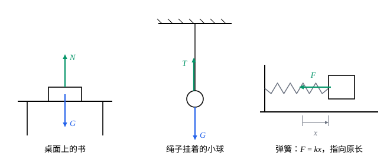

## 这一节要回答的问题

[牛顿运动定律](lesson:physics.newtonian-mechanics.newtons-laws)里说过，:term[力]{id="physics.newtonian-mechanics.force"}（force）只由施力的物体和它的状态决定。要用牛顿定律算运动，先得知道各种力有多大、指向哪里：桌上的书、挂着的灯、拉长的弹簧，各受到哪些力？

## 讲解

### 重力

::anchor{id="def-weight"}
地面附近，地球对:term[质量]{id="physics.newtonian-mechanics.mass"}（mass）为$m$的物体的:term[吸引力]{id="physics.newtonian-mechanics.force"}$\vb G=m\vb g$叫作:term[重力]{id="physics.newtonian-mechanics.weight"}（weight），方向竖直向下，$\vb g$是:term[重力加速度]{id="physics.newtonian-mechanics.gravitational-acceleration"}（gravitational acceleration）。

为什么这样定义：物体自由下落时只受地球的吸引，:term[加速度]{id="physics.newtonian-mechanics.acceleration"}（acceleration）是$\vb g$，由:term[牛顿第二定律]{id="physics.newtonian-mechanics.newtons-second-law"}（Newton's second law），这个力就是$m\vb g$；各种物体的$g$相同，所以重力和质量成正比。边界情况：$g$随地点略有不同，重力也跟着变；在月球上，同一个物体的重力约为地球上的$\frac16$，质量却不变。

### 弹力和胡克定律

::anchor{id="def-elastic"}
物体发生形变后，要恢复原状而对和它接触的物体施加的:term[力]{id="physics.newtonian-mechanics.force"}，叫作:term[弹力]{id="physics.newtonian-mechanics.elastic-force"}（elastic force）。

为什么这样定义：绳子、弹簧、桌面推拉别的物体，都是因为自己被拉伸或压缩了；形变越大，弹力越大，方向指向恢复原状的一侧。边界情况：桌面的形变小得看不出来，它的弹力却可以很大。

::anchor{id="def-hooke"}
:term[胡克定律]{id="physics.newtonian-mechanics.hookes-law"}（Hooke's law）：弹簧伸长或压缩$x$时，:term[弹力]{id="physics.newtonian-mechanics.elastic-force"}的大小是$F=kx$，方向沿着弹簧、指向恢复原长的一侧；比例系数$k$叫作:term[劲度系数]{id="physics.newtonian-mechanics.spring-constant"}（spring constant），单位是$\mathrm{N/m}$。

为什么这样定义：实验发现，形变不太大时弹力和形变成正比，$k$只由弹簧本身决定，越硬的弹簧$k$越大。边界情况：拉得太长、超过了弹性限度，弹簧就不再遵守这个规律，松手后也回不到原长。

### 支持力和拉力

::anchor{id="def-normal"}
物体压在支持面上时，支持面对它的:term[弹力]{id="physics.newtonian-mechanics.elastic-force"}叫作:term[支持力]{id="physics.newtonian-mechanics.normal-force"}（normal force），方向垂直于接触面、指向被支持的物体。

为什么这样定义：支持面只能推、不能拉，推的方向垂直于接触面，沿着接触面的作用是另一种:term[力]{id="physics.newtonian-mechanics.force"}（见[摩擦力](lesson:physics.newtonian-mechanics.friction)）。支持力的大小事先不知道，要由物体的运动和其他力用牛顿定律算出来，这类力在分析力学里叫:term[约束力]{id="physics.analytical-mechanics.constraint-force"}（constraint force）。边界情况：算出的支持力小于零，说明物体已经离开了支持面，这时支持力是零。

::anchor{id="def-tension"}
绳子被拉紧时，对两端物体的:term[弹力]{id="physics.newtonian-mechanics.elastic-force"}叫作:term[拉力]{id="physics.newtonian-mechanics.tension"}（tension），方向沿着绳子、指向绳子中间；:term[质量]{id="physics.newtonian-mechanics.mass"}可以不计的绳子叫作:term[轻绳]{id="physics.newtonian-mechanics.light-string"}（light string），它各处的拉力一样大。

为什么这样定义：绳子只能拉、不能推，拉的方向只能沿着绳子。轻绳的任何一段质量都是零，由:term[牛顿第二定律]{id="physics.newtonian-mechanics.newtons-second-law"}，作用在它两端的力必须大小相等，所以拉力处处相同。边界情况：绳子松弛时拉力为零；绳子的质量不能忽略时，各处的拉力不同（第 5 题）。

## 几何图像

左图：书静止在桌面上，:term[重力]{id="physics.newtonian-mechanics.weight"}$\vb G$和:term[支持力]{id="physics.newtonian-mechanics.normal-force"}$\vb N$大小相等、方向相反，:term[合力]{id="physics.newtonian-mechanics.net-force"}（net force）为零；这两个:term[力]{id="physics.newtonian-mechanics.force"}都作用在书上，不是一对作用力和反作用力。中图：小球挂在:term[轻绳]{id="physics.newtonian-mechanics.light-string"}下静止，:term[拉力]{id="physics.newtonian-mechanics.tension"}$\vb T$和重力平衡。右图：弹簧被拉长$x$，对木块的:term[弹力]{id="physics.newtonian-mechanics.elastic-force"}指向恢复原长的一侧，大小是$kx$。

## 例题

### 例 1　电梯里的体重秤

:term[质量]{id="physics.newtonian-mechanics.mass"}$60\,\mathrm{kg}$的人站在电梯里的体重秤上，$g$取$9.8\,\mathrm{m/s^2}$。电梯以$1.2\,\mathrm{m/s^2}$的:term[加速度]{id="physics.newtonian-mechanics.acceleration"}向上加速时，秤的示数（秤对人的:term[支持力]{id="physics.newtonian-mechanics.normal-force"}）是多少？

**为什么想到这么做**：人只受:term[重力]{id="physics.newtonian-mechanics.weight"}和秤的支持力，两者的:term[合力]{id="physics.newtonian-mechanics.net-force"}等于质量乘加速度；取向上为正，列:term[牛顿第二定律]{id="physics.newtonian-mechanics.newtons-second-law"}。

**推导**：$N-mg=ma$，$N=m(g+a)=60\times(9.8+1.2)=660\,\mathrm N$，比静止时的$588\,\mathrm N$大。电梯向上减速或向下加速时，加速度向下，示数比$mg$小；电梯自由下落时$a=g$，示数为零。

### 例 2　串联的两根弹簧

:term[劲度系数]{id="physics.newtonian-mechanics.spring-constant"}为$k_1$、$k_2$的两根轻弹簧首尾相接，上端固定，下端挂:term[质量]{id="physics.newtonian-mechanics.mass"}为$m$的物体。静止时一共伸长多少？把它们当作一根弹簧，劲度系数是多少？

**为什么想到这么做**：质量不计的弹簧和:term[轻绳]{id="physics.newtonian-mechanics.light-string"}一样，各处的:term[弹力]{id="physics.newtonian-mechanics.elastic-force"}相同，所以两根弹簧受的:term[拉力]{id="physics.newtonian-mechanics.tension"}都等于物体的:term[重力]{id="physics.newtonian-mechanics.weight"}。

**推导**：物体静止，弹簧对它的弹力等于$mg$；两根弹簧各伸长$\frac{mg}{k_1}$、$\frac{mg}{k_2}$，一共伸长$mg\bigl(\frac1{k_1}+\frac1{k_2}\bigr)$。当作一根弹簧，$k=\frac{k_1k_2}{k_1+k_2}$，比每一根都软。

## 常见误区

- 「:term[支持力]{id="physics.newtonian-mechanics.normal-force"}总等于:term[重力]{id="physics.newtonian-mechanics.weight"}。」电梯加速时（例 1）、在斜面上、有别的:term[力]{id="physics.newtonian-mechanics.force"}压着时，两者都不相等。
- 「书受的重力和支持力是一对作用力和反作用力。」它们都作用在书上；支持力的反作用力是书对桌面向下的:term[弹力]{id="physics.newtonian-mechanics.elastic-force"}，重力的反作用力是书对地球的吸引。
- 「弹簧拉得越长，:term[劲度系数]{id="physics.newtonian-mechanics.spring-constant"}越大。」$k$是弹簧自己的性质，拉长时变大的是弹力$kx$。
