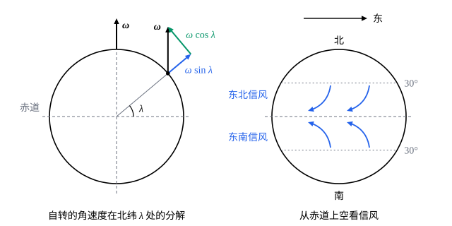

## 这一节要回答的问题

1851 年，傅科（Foucault）在巴黎挂起一个摆长$67\,\mathrm m$的大摆，它摆动的平面一点点地顺时针转动；北半球低纬度的海面上常年吹着东北风，台风总是逆时针旋转。怎样用随地球转动的:term[参考系]{id="physics.newtonian-mechanics.reference-frame"}（reference frame）里的:term[离心力]{id="physics.newtonian-mechanics.centrifugal-force"}（centrifugal force）和:term[科里奥利力]{id="physics.newtonian-mechanics.coriolis-force"}（Coriolis force）解释这些现象？

## 讲解

### 重力随纬度的变化

地球相对恒星自转一周约$86164\,\mathrm s$，它的:term[角速度矢量]{id="physics.newtonian-mechanics.angular-velocity-vector"}（angular velocity vector）$\boldsymbol\omega$沿地轴指向北极，大小$\omega\approx7.29\times10^{-5}\,\mathrm{rad/s}$。地面是一个:term[转动参考系]{id="physics.newtonian-mechanics.rotating-frame"}（rotating frame）。

::anchor{id="thm-effective-gravity"}
定理：把地球当作半径为$R$、:term[质量]{id="physics.newtonian-mechanics.mass"}（mass）球对称分布的球，地球对物体的吸引指向地心，大小$mg_0$。在纬度$\lambda$处相对地面静止的物体，我们量到的:term[重力]{id="physics.newtonian-mechanics.weight"}（weight）是这个吸引和:term[离心力]{id="physics.newtonian-mechanics.centrifugal-force"}$m\omega^2R\cos\lambda$的:term[合力]{id="physics.newtonian-mechanics.net-force"}（net force）：赤道上比$mg_0$小$m\omega^2R$，两极等于$mg_0$，其余纬度上，铅垂线（plumb line）和指向地心的方向成一个小角，约为$\frac{\omega^2R}{g_0}\sin\lambda\cos\lambda$。

证明思路：离心力在经线平面里背离地轴，和指向天顶的半径方向成$\lambda$角，分成沿半径向外的$m\omega^2R\cos^2\lambda$和沿地面指向赤道的$m\omega^2R\cos\lambda\sin\lambda$。前者抵消一小部分吸引；后者使合力偏离半径方向，$\omega^2R$只有$g_0$的千分之几，偏角约等于它和$mg_0$之比。

赤道上$\omega^2R\approx0.034\,\mathrm{m/s^2}$，约为$g$的$0.35\%$（见[圆周运动](lesson:physics.newtonian-mechanics.circular-motion)的例题）；地球又被自转「甩」成了扁球，两者合起来，赤道上的:term[重力加速度]{id="physics.newtonian-mechanics.gravitational-acceleration"}（gravitational acceleration）比两极小约$0.5\%$。[常见的力](lesson:physics.newtonian-mechanics.common-forces#def-weight)里说重力就是地面附近地球对物体的吸引，那是不计自转时的近似：地球的吸引和量到的重力，大小最多只差$0.35\%$，平常不必区分。

### 地球上的科里奥利力

在纬度$\lambda$处，把$\boldsymbol\omega$分成竖直向上的分量$\omega\sin\lambda$和沿水平方向指向正北的分量$\omega\cos\lambda$（南半球$\lambda<0$，竖直分量朝下）。

::anchor{id="thm-earth-coriolis"}
定理：在纬度$\lambda$处沿水平方向运动的物体，受的:term[科里奥利力]{id="physics.newtonian-mechanics.coriolis-force"}的水平分量大小是$2m\omega v'|\sin\lambda|$，北半球指向它前进方向的右边，南半球指向左边，赤道上为零；竖直下落的物体受的科里奥利力指向东，大小$2m\omega v'\cos\lambda$。

证明思路：水平运动时，$\boldsymbol\omega$的水平分量和$\vb v'$的叉积（cross product）沿竖直方向，不影响水平运动；竖直分量给出$-2m\omega\sin\lambda\,\uv u\times\vb v'$，$\uv u$是竖直向上的单位矢量。从上往下看，$\uv u\times\vb v'$是把$\vb v'$逆时针转$90^\circ$，加负号就指向右边，$\sin\lambda<0$时反过来。竖直下落时只有水平分量起作用，指向北的矢量叉乘向下的矢量，再加负号，指向东。

### 傅科摆和信风

::anchor{id="def-foucault-pendulum"}
摆线很长、摆球很重、能朝任何方向摆动的单摆，叫作傅科摆（Foucault pendulum）。

为什么这样定义：摆线长、摆球重，空气的影响相对小，能一连摆上几个小时，摆动平面的缓慢转动才看得出来。边界情况：普通的单摆也受:term[科里奥利力]{id="physics.newtonian-mechanics.coriolis-force"}，可摆不了多久就停了。

::anchor{id="thm-foucault"}
定理：在纬度$\lambda$处，傅科摆摆动的平面以:term[角速度]{id="physics.newtonian-mechanics.angular-velocity"}（angular velocity）$\omega|\sin\lambda|$绕竖直方向转动，北半球从上往下看是顺时针，南半球是逆时针，赤道上不转。

证明思路：摆球几乎在水平面里运动，由上面的定理，只有$\boldsymbol\omega$的竖直分量影响它的水平运动，:term[离心力]{id="physics.newtonian-mechanics.centrifugal-force"}已经算进了:term[重力]{id="physics.newtonian-mechanics.weight"}。所以在北半球，摆球就像在一个以$\omega\sin\lambda$逆时针转动的转盘上（$\omega^2$那么小的项不计）。在转盘外的:term[惯性系]{id="physics.newtonian-mechanics.inertial-frame"}（inertial frame）里看，摆不受侧向的:term[力]{id="physics.newtonian-mechanics.force"}（force），摆动平面不变；在转盘上看，平面就以同样的角速度顺时针转。

在北极，平面一天转一圈：从惯性系看，平面根本不动，是地球在它下面转。

大范围的风也这样偏转。赤道附近的空气受热上升，北半球向南流来补充的空气向右偏，从东北吹来；南半球向北流的空气向左偏，从东南吹来，这就是信风（trade winds）的方向。北半球流向低气压中心的空气向右偏，绕中心逆时针旋转，台风因此逆时针转。

## 几何图像

左图：:term[角速度矢量]{id="physics.newtonian-mechanics.angular-velocity-vector"}在北纬$\lambda$处分成竖直的$\omega\sin\lambda$（蓝）和水平的$\omega\cos\lambda$（绿），水平运动受的侧向:term[科里奥利力]{id="physics.newtonian-mechanics.coriolis-force"}只来自竖直分量。右图：流向赤道的空气都偏向西，成了东北信风和东南信风。

## 例题

### 例 1　落体偏东

在赤道上，从$100\,\mathrm m$高的塔顶由静止释放一个小球，不计空气，$g$取$9.8\,\mathrm{m/s^2}$。小球落在塔顶正下方的哪一侧，偏多远？

**为什么想到这么做**：下落时:term[科里奥利力]{id="physics.newtonian-mechanics.coriolis-force"}指向东，比:term[重力]{id="physics.newtonian-mechanics.weight"}小得多，可以先按自由落体取$v'=gt$，再算向东的:term[位移]{id="physics.newtonian-mechanics.displacement"}（displacement）。

**推导**：赤道上向东的:term[加速度]{id="physics.newtonian-mechanics.acceleration"}（acceleration）是$2\omega gt$，从静止开始求两次原函数（antiderivative），向东的:term[速度]{id="physics.newtonian-mechanics.velocity"}（velocity）是$\omega gt^2$，位移是$\frac13\omega gt^3$。下落时间$t=\sqrt{\frac{2h}g}\approx4.52\,\mathrm s$，偏东约$\frac13\times7.29\times10^{-5}\times9.8\times4.52^3\approx2.2\times10^{-2}\,\mathrm m$。在:term[惯性系]{id="physics.newtonian-mechanics.inertial-frame"}里看：塔顶离地轴比塔底远，向东的速度比塔底大，小球带着它下落，就落到了塔底的东边。

### 例 2　巴黎的傅科摆

巴黎在北纬$48.9^\circ$。那里的傅科摆，摆动平面转一圈要多少小时？地球自转一周取$86164\,\mathrm s$。

**为什么想到这么做**：平面转动的:term[角速度]{id="physics.newtonian-mechanics.angular-velocity"}是$\omega\sin\lambda$，转一圈的时间是自转一周的时间除以$\sin\lambda$。

**推导**：$\frac{86164}{\sin48.9^\circ}\approx1.14\times10^5\,\mathrm s$，约$31.8$小时，每小时转约$11.3^\circ$。

## 常见误区

- 「北半球洗手池里的水，总是逆时针流进下水口。」那里:term[科里奥利力]{id="physics.newtonian-mechanics.coriolis-force"}带来的:term[加速度]{id="physics.newtonian-mechanics.acceleration"}只有:term[重力加速度]{id="physics.newtonian-mechanics.gravitational-acceleration"}的百万分之一左右，远比池子的形状、水原来的旋转影响小，哪个方向都可能。
- 「赤道上的物体不受科里奥利力。」赤道上水平运动的物体不左右偏，可下落的物体偏东（例 1）。
- 「傅科摆的摆动平面转动，是有什么:term[力]{id="physics.newtonian-mechanics.force"}在推它。」在北极，从:term[惯性系]{id="physics.newtonian-mechanics.inertial-frame"}看平面根本不动，是地球在它下面转。
