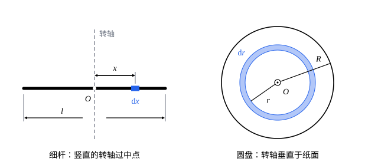

## 这一节要回答的问题

门绕门轴转，砂轮绕自己的轴转，上面每一点都在画圆，各点的:term[速度]{id="physics.newtonian-mechanics.velocity"}（velocity）却各不相同。描述这样的转动要几个量？同样:term[质量]{id="physics.newtonian-mechanics.mass"}（mass）的圆环和圆盘转得一样快，谁的:term[角动量]{id="physics.newtonian-mechanics.angular-momentum"}（angular momentum）大？

## 讲解

### 刚体与定轴转动

::anchor{id="def-rigid-body"}
各个质点之间的距离始终保持不变的:term[质点系]{id="physics.newtonian-mechanics.system-of-particles"}（system of particles），叫作:term[刚体]{id="physics.newtonian-mechanics.rigid-body"}（rigid body）。

为什么这样定义：石块、车轮、门在:term[力]{id="physics.newtonian-mechanics.force"}（force）的作用下形状几乎不变，当作刚体，整个物体的运动就只要几个量来描述，不用一个一个质点去追。边界情况：绳子、水、正在收拢手臂的溜冰者都不是刚体，各部分之间的距离会变。

::anchor{id="def-fixed-axis-rotation"}
刚体上有一条直线始终不动，其余各点都绕它做圆周运动，这样的运动叫作:term[定轴转动]{id="physics.newtonian-mechanics.fixed-axis-rotation"}（rotation about a fixed axis），这条直线叫作转轴。

为什么这样定义：门、砂轮、风扇的叶片都这样转。刚体的形状不变，刚体上一条垂直于转轴的直线转过的角$\theta$一确定，各点的位置就都确定了，所以各点的:term[角速度]{id="physics.newtonian-mechanics.angular-velocity"}（angular velocity）都是$\omega=\dv\theta t$，:term[角加速度]{id="physics.newtonian-mechanics.angular-acceleration"}（angular acceleration）都是$\alpha=\dv\omega t$，离转轴$d$处的点:term[速率]{id="physics.newtonian-mechanics.speed"}（speed）是$d|\omega|$。边界情况：在路上滚动的车轮没有一条始终不动的直线，不是定轴转动。

在转轴上取定正方向，记作$z$轴，按右手定则（right-hand rule）规定转向：右手四指顺着转动的方向弯曲，拇指指向$z$轴正方向时$\omega>0$，反过来$\omega<0$。这样定轴转动的角速度就可以看成沿转轴的量，大小是$|\omega|$，方向由右手定则确定，和[力矩与角动量](lesson:physics.newtonian-mechanics.angular-momentum#def-torque)里确定:term[力矩]{id="physics.newtonian-mechanics.torque"}（torque）方向的约定一致。

### 角动量与转动惯量

::anchor{id="thm-axial-angular-momentum"}
定理：:term[刚体]{id="physics.newtonian-mechanics.rigid-body"}绕$z$轴:term[定轴转动]{id="physics.newtonian-mechanics.fixed-axis-rotation"}，:term[角速度]{id="physics.newtonian-mechanics.angular-velocity"}为$\omega$时，它对转轴上任一点的:term[角动量]{id="physics.newtonian-mechanics.angular-momentum"}沿转轴的分量是$L_z=\Bigl(\sum_im_id_i^2\Bigr)\omega$，$d_i$是第$i$个质点到转轴的距离。

证明思路：第$i$个质点绕转轴做圆周运动，在垂直于转轴的平面里，它的位置是$(x_i,y_i)=d_i(\cos\theta_i,\sin\theta_i)$，:term[速度]{id="physics.newtonian-mechanics.velocity"}是$d_i\omega(-\sin\theta_i,\cos\theta_i)$（见[圆周运动](lesson:physics.newtonian-mechanics.circular-motion#thm-tangential)）。它的角动量的$z$分量是$m_i(x_iv_{iy}-y_iv_{ix})=m_id_i^2\omega$，和质点的$z$坐标无关，所以对转轴上哪一点算都一样。把各个质点加起来即得。

::anchor{id="def-moment-of-inertia"}
$I=\sum_im_id_i^2$叫作刚体对这条转轴的:term[转动惯量]{id="physics.newtonian-mechanics.moment-of-inertia"}（moment of inertia），单位是$\mathrm{kg\cdot m^2}$；这样$L_z=I\omega$。

为什么这样定义：$L_z=I\omega$和:term[动量]{id="physics.newtonian-mechanics.momentum"}（momentum）$p=mv$对照，$I$在转动里的地位就像:term[质量]{id="physics.newtonian-mechanics.mass"}。[质点系的角动量守恒](lesson:physics.newtonian-mechanics.angular-momentum-systems)例 2 里绕:term[质心]{id="physics.newtonian-mechanics.center-of-mass"}（center of mass）转动的角动量写成$\sum mr^2\omega$，就是$I\omega$。$I$不光看质量，还看质量离转轴多远。边界情况：同一个刚体对不同的转轴，$I$不同；刚体对转轴对称时（圆盘、飞轮绕自己的轴），各质点的角动量垂直于转轴的分量两两抵消，整个角动量沿着转轴，可斜着装在轴上的杆就不是这样（第 7 题）。

### 用微元法求转动惯量

连续分布的:term[刚体]{id="physics.newtonian-mechanics.rigid-body"}，用微元法（method of differential elements）把它分成许多小块，每一小块:term[质量]{id="physics.newtonian-mechanics.mass"}$\dd m$、离转轴$d$，$I=\int d^2\,\dd m$（见[微元法与平面图形的面积](lesson:math.calculus.area-between-curves#def-element-method)）。

::anchor{id="thm-rod-disc"}
定理：质量为$M$、长为$l$的均匀细杆，对过中点并垂直于杆的轴，:term[转动惯量]{id="physics.newtonian-mechanics.moment-of-inertia"}是$\frac1{12}Ml^2$，对过一端并垂直于杆的轴是$\frac13Ml^2$；质量为$M$、半径为$R$的均匀圆环和均匀圆盘，对过圆心并垂直于环面、盘面的轴，分别是$MR^2$和$\frac12MR^2$。

证明思路：细杆每单位长度的质量是$\frac Ml$，以中点为原点，$x$到$x+\dd x$那一小段的$\dd I=x^2\frac Ml\,\dd x$，从$-\frac l2$积到$\frac l2$得$\frac1{12}Ml^2$，从$0$积到$l$（原点放在一端）得$\frac13Ml^2$。圆环上的质量都离圆心$R$。圆盘每单位面积的质量是$\frac M{\pi R^2}$，把它分成许多细圆环，半径$r$到$r+\dd r$的那一圈面积约为$2\pi r\,\dd r$，$\dd I=r^2\cdot\frac M{\pi R^2}\cdot2\pi r\,\dd r$，从$0$积到$R$得$\frac12MR^2$。

圆盘的质量大多离圆心不到$R$，所以它的转动惯量只有同样质量的圆环的一半；同一根杆，对一端的转动惯量是对中点的$4$倍。

## 几何图像

左图：细杆上离转轴$x$处长$\dd x$的一小段，:term[质量]{id="physics.newtonian-mechanics.mass"}是$\frac Ml\dd x$，对:term[转动惯量]{id="physics.newtonian-mechanics.moment-of-inertia"}的贡献是$x^2\frac Ml\dd x$。右图：圆盘上半径$r$、宽$\dd r$的细圆环，面积约为周长乘宽度$2\pi r\,\dd r$，环上各处离转轴一样远，贡献是$r^2\dd m$。越靠外的部分离转轴越远，贡献越大。

## 例题

### 例 1　飞轮

飞轮可以看成:term[质量]{id="physics.newtonian-mechanics.mass"}$20\,\mathrm{kg}$、半径$0.30\,\mathrm m$的均匀圆盘，绕过圆心、垂直于盘面的轴每分钟转$600$圈。它的:term[转动惯量]{id="physics.newtonian-mechanics.moment-of-inertia"}和对转轴的:term[角动量]{id="physics.newtonian-mechanics.angular-momentum"}各是多少？同样多的材料全都做成边缘上的一圈，转得一样快时，角动量是多少？

**为什么想到这么做**：圆盘的$I=\frac12MR^2$，圆环的$I=MR^2$；:term[角速度]{id="physics.newtonian-mechanics.angular-velocity"}要换成$\mathrm{rad/s}$，再用$L_z=I\omega$。

**推导**：$I=\frac12\times20\times0.30^2=0.90\,\mathrm{kg\cdot m^2}$，$\omega=\frac{600\times2\pi}{60}\approx62.8\,\mathrm{rad/s}$，$L_z=I\omega\approx56.5\,\mathrm{kg\cdot m^2/s}$。做成圆环时$I=1.8\,\mathrm{kg\cdot m^2}$，角动量加倍，约$113\,\mathrm{kg\cdot m^2/s}$。所以飞轮常常把质量集中在边缘。

### 例 2　转台上的孩子

水平的转台是:term[质量]{id="physics.newtonian-mechanics.mass"}$100\,\mathrm{kg}$、半径$2.0\,\mathrm m$的均匀圆盘，可以绕竖直的中心轴自由转动，转轴光滑。$50\,\mathrm{kg}$的孩子站在转台边上，随转台以$0.50\,\mathrm{rad/s}$转动；后来他走到转台中心。这时转台的:term[角速度]{id="physics.newtonian-mechanics.angular-velocity"}是多少？

**为什么想到这么做**：孩子和转台之间的:term[力]{id="physics.newtonian-mechanics.force"}是:term[内力]{id="physics.newtonian-mechanics.internal-force"}（internal force）；:term[外力]{id="physics.newtonian-mechanics.external-force"}（external force）里，:term[重力]{id="physics.newtonian-mechanics.weight"}（weight）沿竖直方向，平行于转轴，转轴对转台的力通过转轴，它们的:term[力矩]{id="physics.newtonian-mechanics.torque"}都没有沿转轴的分量。对转轴上一点取[质点系的角动量守恒](lesson:physics.newtonian-mechanics.angular-momentum-systems#thm-system-angular-momentum)里的定理沿转轴的分量，$L_z$守恒；孩子当作质点。

**推导**：转台的$I=\frac12\times100\times2.0^2=200\,\mathrm{kg\cdot m^2}$。开始时孩子的$md^2=50\times2.0^2=200\,\mathrm{kg\cdot m^2}$，$L_z=(200+200)\times0.50=200\,\mathrm{kg\cdot m^2/s}$；走到中心后只剩转台的$200\,\mathrm{kg\cdot m^2}$，$\omega'=1.0\,\mathrm{rad/s}$，转得快了一倍。

## 常见误区

- 「:term[刚体]{id="physics.newtonian-mechanics.rigid-body"}上离转轴越远的点，:term[角速度]{id="physics.newtonian-mechanics.angular-velocity"}越大。」各点的角速度都一样，离转轴越远的点:term[速率]{id="physics.newtonian-mechanics.speed"}越大。
- 「刚体的:term[角动量]{id="physics.newtonian-mechanics.angular-momentum"}总是沿着转轴，大小是$I\omega$。」一定成立的只有$L_z=I\omega$；不对称的刚体，整个角动量可以偏离转轴。
