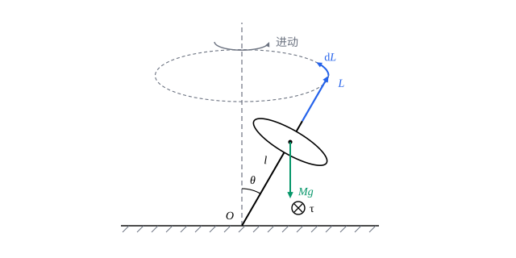

## 这一节要回答的问题

不转的陀螺一放手就倒下；转得很快的陀螺斜着立在桌上却不倒，它的轴绕着竖直线慢慢画出一个圆锥。:term[重力]{id="physics.newtonian-mechanics.weight"}（weight）明明在把它往下拉，它为什么不倒？轴转一圈要多久？

## 讲解

### 陀螺仪近似

陀螺对自己的对称轴（symmetry axis）是对称的，尖端$O$支在桌面上不动，:term[质心]{id="physics.newtonian-mechanics.center-of-mass"}（center of mass）在对称轴上、离$O$为$l$，对称轴和竖直方向成$\theta$角。陀螺绕对称轴快速自转，:term[角速度]{id="physics.newtonian-mechanics.angular-velocity"}（angular velocity）是$\omega_3$，对对称轴的:term[转动惯量]{id="physics.newtonian-mechanics.moment-of-inertia"}（moment of inertia）是$I_3$；$\vb e_3$是沿对称轴、从$O$指向质心的单位矢量，$\omega_3$的正负按右手定则（right-hand rule）对$\vb e_3$规定。

::anchor{id="def-gyroscopic-approximation"}
陀螺自转得很快时，把它的:term[角动量]{id="physics.newtonian-mechanics.angular-momentum"}（angular momentum）近似看成只有自转的那一部分，$\vb L=I_3\omega_3\vb e_3$，这叫作陀螺仪近似（gyroscopic approximation）；陀螺仪（gyroscope）就是装在框架里、绕对称轴高速转动的转子。

为什么这样定义：陀螺只绕对称轴转动时，由[刚体的定轴转动与转动惯量](lesson:physics.newtonian-mechanics.fixed-axis-rotation#def-moment-of-inertia)，对称的:term[刚体]{id="physics.newtonian-mechanics.rigid-body"}（rigid body）的角动量沿转轴，正是$I_3\omega_3\vb e_3$。对称轴本身也在慢慢转动，这会带来一点别的角动量，只要对称轴转得比自转慢得多，这一部分就可以不计。边界情况：陀螺转慢了，这个近似就不成立，它会剧烈地晃动，最后倒下。

### 进动

::anchor{id="def-precession"}
自转的:term[刚体]{id="physics.newtonian-mechanics.rigid-body"}受到:term[外力]{id="physics.newtonian-mechanics.external-force"}（external force）的:term[力矩]{id="physics.newtonian-mechanics.torque"}（torque）时，自转轴绕另一个方向转动，叫作:term[进动]{id="physics.newtonian-mechanics.precession"}（precession）；快速自转的陀螺的对称轴绕竖直线慢慢转动，就是进动。

为什么这样定义：这正是开头的现象，:term[重力]{id="physics.newtonian-mechanics.weight"}没有让陀螺倒下，而是让它的轴转圈，下面的定理说明这是力矩改变:term[角动量]{id="physics.newtonian-mechanics.angular-momentum"}的结果。边界情况：不自转的陀螺开始时角动量为零，重力矩使它获得的角动量沿着力矩的方向，陀螺就绕这个水平方向倒下去，不会进动。

::anchor{id="thm-precession"}
定理：陀螺仪近似下，陀螺的对称轴绕竖直线匀速转动，:term[角速度]{id="physics.newtonian-mechanics.angular-velocity"}是$\dot\varphi=\frac{Mgl}{I_3\omega_3}$，和$\theta$无关；$\varphi$是对称轴的水平投影转过的角，$\dot\varphi$表示$\dv\varphi t$。进动的方向由矢量$\frac{Mgl}{I_3\omega_3}\vb e_z$给出，$\vb e_z$竖直向上：$\omega_3>0$时，从上往下看，对称轴逆时针转动。

证明思路：重力对$O$的力矩是$\sum_i\vb r_i\times m_i\vb g=Ml\vb e_3\times(-g\vb e_z)=Mgl\,\vb e_z\times\vb e_3$，桌面的:term[力]{id="physics.newtonian-mechanics.force"}（force）作用在$O$，没有力矩。由[质点系的角动量守恒](lesson:physics.newtonian-mechanics.angular-momentum-systems#thm-system-angular-momentum)里的定理，$\dv{\vb L}t=Mgl\,\vb e_z\times\vb e_3$。对称轴以角速度$\Omega$绕竖直线匀速转动时，固定在对称轴上的$\vb L$由[转动参考系：离心力与科里奥利力](lesson:physics.newtonian-mechanics.rotating-frames#thm-rotating-derivative)，变化率是$\Omega\vb e_z\times\vb L=\Omega I_3\omega_3\,\vb e_z\times\vb e_3$。两者相等，就要$\Omega=\frac{Mgl}{I_3\omega_3}$，两边的$\sin\theta$因子都在$\vb e_z\times\vb e_3$里，消掉了。

这就是陀螺不倒的原因：力矩是水平的，总垂直于$\vb L$，只改变$\vb L$的方向，不改变它的大小，$\vb L$的末端在水平面上画圆，对称轴跟着转。自转越快，进动越慢；重力矩越大，进动越快。陀螺仪近似要求$\dot\varphi$比$\omega_3$小得多，算完要验证（例 1）。

地球也是一个陀螺：赤道部分鼓起，太阳和月亮的引力对它有力矩，自转轴和黄道面（ecliptic plane）的法线成约$23.4^\circ$，每约$2.6$万年绕这根法线进动一圈。

## 几何图像

:term[重力]{id="physics.newtonian-mechanics.weight"}作用在:term[质心]{id="physics.newtonian-mechanics.center-of-mass"}，对尖端$O$的:term[力矩]{id="physics.newtonian-mechanics.torque"}$\boldsymbol\tau$是水平的，在图里垂直于纸面向里。$\dd t$时间里，:term[角动量]{id="physics.newtonian-mechanics.angular-momentum"}改变$\dd\vb L=\boldsymbol\tau\,\dd t$，和$\vb L$垂直，所以$\vb L$的末端沿水平的圆移动，对称轴就绕竖直线转起来，这就是:term[进动]{id="physics.newtonian-mechanics.precession"}。

## 例题

### 例 1　玩具陀螺

玩具陀螺的:term[质量]{id="physics.newtonian-mechanics.mass"}（mass）是$0.15\,\mathrm{kg}$，:term[质心]{id="physics.newtonian-mechanics.center-of-mass"}离尖端$4.0\,\mathrm{cm}$，对对称轴的:term[转动惯量]{id="physics.newtonian-mechanics.moment-of-inertia"}是$2.0\times10^{-4}\,\mathrm{kg\cdot m^2}$，每秒自转$50$圈，$g$取$9.8\,\mathrm{m/s^2}$。它:term[进动]{id="physics.newtonian-mechanics.precession"}的:term[角速度]{id="physics.newtonian-mechanics.angular-velocity"}是多少，轴转一圈要多久？陀螺仪近似成立吗？

**为什么想到这么做**：自转很快，先用陀螺仪近似和$\dot\varphi=\frac{Mgl}{I_3\omega_3}$，再比较$\dot\varphi$和$\omega_3$，看近似是否站得住。

**推导**：$\omega_3=2\pi\times50\approx314\,\mathrm{rad/s}$，$I_3\omega_3\approx6.28\times10^{-2}\,\mathrm{kg\cdot m^2/s}$，$Mgl=0.15\times9.8\times0.040\approx5.88\times10^{-2}\,\mathrm{N\cdot m}$。所以$\dot\varphi\approx0.936\,\mathrm{rad/s}$，转一圈约$\frac{2\pi}{0.936}\approx6.7\,\mathrm s$。$\frac{\dot\varphi}{\omega_3}\approx0.003$，进动比自转慢得多，近似成立。

### 例 2　车轮陀螺仪

自行车轮的:term[质量]{id="physics.newtonian-mechanics.mass"}集中在轮缘，看成质量$2.0\,\mathrm{kg}$、半径$0.30\,\mathrm m$的细圆环，装在一根轻轴上。轮子以$30\,\mathrm{rad/s}$自转，轴保持水平，轴的一端用竖直的绳子吊着，轮子的中心离吊点$0.20\,\mathrm m$。轴绕竖直的绳子转一圈要多久？

**为什么想到这么做**：吊点就是支点（pivot），对称轴水平，$\theta=90^\circ$，可$\dot\varphi$和$\theta$无关，公式照样用。圆环的$I_3=MR^2$。

**推导**：$I_3\omega_3=2.0\times0.30^2\times30=5.4\,\mathrm{kg\cdot m^2/s}$，$Mgl=2.0\times9.8\times0.20=3.92\,\mathrm{N\cdot m}$，$\dot\varphi\approx0.726\,\mathrm{rad/s}$，转一圈约$8.7\,\mathrm s$。轮子的中心不升不降，绳子的:term[拉力]{id="physics.newtonian-mechanics.tension"}（tension）竖直分量就等于轮子受的:term[重力]{id="physics.newtonian-mechanics.weight"}，绳子的一端吊着整个轮子，轮子却不往下掉。

## 常见误区

- 「:term[重力]{id="physics.newtonian-mechanics.weight"}向下拉，陀螺就应该向下倒。」:term[力矩]{id="physics.newtonian-mechanics.torque"}改变的是:term[角动量]{id="physics.newtonian-mechanics.angular-momentum"}；陀螺自转时角动量很大，水平的重力矩只改变它的方向，陀螺就转圈而不倒下。
- 「陀螺转得越快，:term[进动]{id="physics.newtonian-mechanics.precession"}越快。」恰好相反，$\dot\varphi$和$\omega_3$成反比。
- 「陀螺倾斜得越厉害，进动越快。」倾角大，重力矩大，角动量的水平分量也大，两者都和$\sin\theta$成正比，$\dot\varphi$和$\theta$无关。
