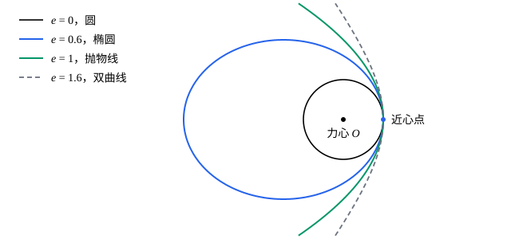

## 这一节要回答的问题

开普勒从第谷几十年的观测记录里总结出：行星沿椭圆轨道绕太阳运动，太阳在椭圆的一个焦点上；离太阳越远的行星，绕一圈用的时间越长，周期的平方和轨道半长轴（semi-major axis）的立方成正比。为什么偏偏是椭圆？这些规律能不能由:term[万有引力定律]{id="physics.newtonian-mechanics.law-of-gravitation"}（law of universal gravitation）推出来？

## 讲解

### 轨道方程

设质点受指向力心、大小为$\frac k{r^2}$（$k>0$）的:term[力]{id="physics.newtonian-mechanics.force"}（force），:term[势能]{id="physics.newtonian-mechanics.potential-energy"}（potential energy）$U=-\frac kr$，:term[角动量]{id="physics.newtonian-mechanics.angular-momentum"}（angular momentum）$L>0$，在极坐标里$\dv\varphi t=\frac L{mr^2}$。由[有心力与有效势](lesson:physics.newtonian-mechanics.central-forces)，:term[机械能]{id="physics.newtonian-mechanics.mechanical-energy"}（mechanical energy）$E=\frac12m\Bigl(\dv rt\Bigr)^2+\frac{L^2}{2mr^2}-\frac kr$守恒。

::anchor{id="thm-orbit-equation"}
定理：把$u=\frac1r$看成极角$\varphi$的函数，它满足$\dv{^2u}{\varphi^2}+u=\frac{mk}{L^2}$（比奈方程，Binet equation），轨道的极坐标方程是$r=\frac p{1+e\cos(\varphi-\varphi_0)}$，其中$p=\frac{L^2}{mk}$，常数$e\ge0$和$\varphi_0$由运动的初始情况决定。

证明思路：由链式法则（chain rule），$\dv rt=\dv r\varphi\dv\varphi t=-\frac1{u^2}\dv u\varphi\cdot\frac{Lu^2}m=-\frac Lm\dv u\varphi$，代进机械能，$E=\frac{L^2}{2m}\Bigl[\Bigl(\dv u\varphi\Bigr)^2+u^2\Bigr]-ku$。两边对$\varphi$求导，左边是常数，$\frac{L^2}m\dv u\varphi\Bigl(\dv{^2u}{\varphi^2}+u\Bigr)-k\dv u\varphi=0$；在$\dv u\varphi\ne0$处约去它就得到比奈方程，$\dv u\varphi=0$的孤立点由连续性也成立，圆轨道上$u$是常数$\frac{mk}{L^2}$，也满足它。这是常系数非齐次线性方程：常数$\frac{mk}{L^2}$是一个特解（particular solution），齐次方程的通解（general solution）是$C_1\cos\varphi+C_2\sin\varphi=A\cos(\varphi-\varphi_0)$，$A\ge0$。所以$u=\frac{mk}{L^2}\bigl[1+e\cos(\varphi-\varphi_0)\bigr]$，$e=\frac{AL^2}{mk}$，取倒数即得。

### 圆锥曲线

取极轴指向$\varphi=\varphi_0$的方向，轨道方程化成$r=\frac p{1+e\cos\varphi}$，$\varphi=0$处$r$最小，是:term[近心点]{id="physics.newtonian-mechanics.pericenter"}（pericenter）。

::anchor{id="thm-conic"}
定理：轨道$r=\frac p{1+e\cos\varphi}$是一个焦点在力心的圆锥曲线，$e$就是它的偏心率（eccentricity）：$e=0$是圆，$0<e<1$是椭圆，$e=1$是抛物线，$e>1$是双曲线的一支。$e<1$时，椭圆的半长轴$a=\frac p{1-e^2}$，半短轴（semi-minor axis）$b=\frac p{\sqrt{1-e^2}}$，近心点、:term[远心点]{id="physics.newtonian-mechanics.apocenter"}（apocenter）到力心的距离分别是$a(1-e)$和$a(1+e)$。

证明思路：$r+er\cos\varphi=p$，即$r=p-ex$，两边平方，$x^2+y^2=(p-ex)^2$，$(1-e^2)x^2+2pex+y^2=p^2$。$e<1$时配方，$(1-e^2)\Bigl(x+\frac{pe}{1-e^2}\Bigr)^2+y^2=\frac{p^2}{1-e^2}$，是中心在$x=-ae$、半轴为$a$和$b$的椭圆；焦点到中心的距离$\sqrt{a^2-b^2}=ae$，所以原点正是一个焦点。$e=1$时是$y^2=p^2-2px$，焦点也在原点的抛物线；$e>1$时是双曲线，取$1+e\cos\varphi>0$的那一支。

::anchor{id="thm-eccentricity-energy"}
定理：$E=\frac{mk^2}{2L^2}(e^2-1)$。所以$E<0$时$e<1$，轨道是椭圆，而且$E=-\frac k{2a}$，只和半长轴有关；$E=0$时是抛物线；$E>0$时是双曲线。

证明思路：在近心点，$r=\frac p{1+e}$，:term[速度]{id="physics.newtonian-mechanics.velocity"}（velocity）垂直于半径，:term[动能]{id="physics.newtonian-mechanics.kinetic-energy"}（kinetic energy）是$\frac{L^2}{2mr^2}$。代入$p=\frac{L^2}{mk}$，$E=\frac{L^2(1+e)^2}{2mp^2}-\frac{k(1+e)}p=\frac{mk^2}{2L^2}\bigl[(1+e)^2-2(1+e)\bigr]=\frac{mk^2}{2L^2}(e^2-1)$。$e<1$时由$1-e^2=\frac pa$，$E=-\frac{mk^2}{2L^2}\cdot\frac pa=-\frac k{2a}$。

这和[有心力与有效势](lesson:physics.newtonian-mechanics.central-forces#thm-orbit-types)里的结论对得上：$E<0$的轨道有界，正是椭圆和圆；$E\ge0$的一去不回，是抛物线和双曲线。

### 开普勒三定律

::anchor{id="thm-kepler"}
定理：行星只受太阳的:term[引力]{id="physics.newtonian-mechanics.gravitation"}（gravitation），把太阳当作不动的质点。行星的轨道是椭圆，太阳在椭圆的一个焦点上，这是:term[开普勒第一定律]{id="physics.newtonian-mechanics.keplers-first-law"}（Kepler's first law）；行星和太阳的连线在相等的时间里扫过相等的面积，这是:term[开普勒第二定律]{id="physics.newtonian-mechanics.keplers-second-law"}（Kepler's second law）；各个行星绕太阳一周的时间$T$的平方和轨道半长轴$a$的立方之比都相同，$\frac{T^2}{a^3}=\frac{4\pi^2}{GM}$，$M$是太阳的:term[质量]{id="physics.newtonian-mechanics.mass"}（mass），这是:term[开普勒第三定律]{id="physics.newtonian-mechanics.keplers-third-law"}（Kepler's third law）。

证明思路：引力的$k=GMm$。行星的轨道有界，$E<0$，由上面的定理是焦点在太阳的椭圆，这是第一定律。:term[角动量守恒]{id="physics.newtonian-mechanics.conservation-of-angular-momentum"}（conservation of angular momentum），扫过面积的快慢$\frac L{2m}$不变（见[力矩与角动量](lesson:physics.newtonian-mechanics.angular-momentum#thm-conservation)），这是第二定律。椭圆的面积是$\pi ab$（见[微元法与平面图形的面积](lesson:math.calculus.area-between-curves)），所以$T=\frac{\pi ab}{L/(2m)}$；由$a$、$b$的式子，$b^2=ap$，又$L^2=mkp$，于是$T^2=\frac{4\pi^2m^2a^2b^2}{mkp}=\frac{4\pi^2ma^3}k=\frac{4\pi^2a^3}{GM}$，这是第三定律。

第二定律对任何:term[有心力]{id="physics.newtonian-mechanics.central-force"}（central force）都成立，第一、第三定律却要求引力和距离的平方成反比。牛顿正是反过来，由开普勒定律推断出引力和距离的平方成反比的。三条定律对绕地球的卫星、绕木星的卫星同样成立，只是$M$要换成中心天体的质量；太阳本身也被行星拉着动，见[二体问题与约化质量](lesson:physics.newtonian-mechanics.two-body-problem)。

## 几何图像

四条轨道的力心都在$O$，:term[近心点]{id="physics.newtonian-mechanics.pericenter"}也在同一处，只是质点在近心点的:term[速率]{id="physics.newtonian-mechanics.speed"}（speed）不同：由$p=\frac{L^2}{mk}$和$r_{\text{近}}=\frac p{1+e}$，近心点处速率越大，$e$越大。$e=0$时速率正好等于圆轨道的速率；速率增大，轨道拉成椭圆，力心偏在一个焦点上；速率达到刚好能逃到无穷远的值时是抛物线，再大就是双曲线。

## 例题

### 例 1　哈雷彗星

哈雷彗星（Halley's comet）绕太阳一周约$76$年，:term[近日点]{id="physics.newtonian-mechanics.pericenter"}离太阳约$0.59\,\mathrm{AU}$。$1\,\mathrm{AU}$（天文单位，astronomical unit）是地球到太阳的平均距离，地球的轨道近似是圆。求哈雷彗星轨道的半长轴、:term[远日点]{id="physics.newtonian-mechanics.apocenter"}到太阳的距离和偏心率。

**为什么想到这么做**：哈雷彗星和地球都绕太阳转，由:term[开普勒第三定律]{id="physics.newtonian-mechanics.keplers-third-law"}，$\frac{T^2}{a^3}$相同，拿地球（$T=1$年，$a=1\,\mathrm{AU}$）作比较；再用近日点、远日点的距离$a(1\mp e)$。

**推导**：$a^3=76^2\,\mathrm{AU^3}$，$a=76^{2/3}\,\mathrm{AU}\approx17.9\,\mathrm{AU}$。近日点、远日点的距离之和是$2a$，远日点约$35.9-0.59\approx35.3\,\mathrm{AU}$，比海王星还远。偏心率$e=1-\frac{0.59}a\approx0.967$，轨道是一个极扁的椭圆。

### 例 2　转移轨道

卫星在离地心$r_1=6.67\times10^6\,\mathrm m$的圆轨道上，要去离地心$r_2=4.22\times10^7\,\mathrm m$的同步轨道。一种省燃料的办法是让它沿一个椭圆走半圈：:term[近地点]{id="physics.newtonian-mechanics.pericenter"}在$r_1$，:term[远地点]{id="physics.newtonian-mechanics.apocenter"}在$r_2$。走这半圈要多久，在近地点，卫星的:term[速率]{id="physics.newtonian-mechanics.speed"}要从圆轨道的速率增加到多少？地球的$GM$取$3.98\times10^{14}\,\mathrm{m^3/s^2}$。

**为什么想到这么做**：椭圆的半长轴是$\frac{r_1+r_2}2$，周期由:term[开普勒第三定律]{id="physics.newtonian-mechanics.keplers-third-law"}求；近地点的速率由:term[机械能]{id="physics.newtonian-mechanics.mechanical-energy"}$E=-\frac{GMm}{2a}$求。

**推导**：$a=\frac{r_1+r_2}2\approx2.44\times10^7\,\mathrm m$，走半圈用$\frac T2=\pi\sqrt{\frac{a^3}{GM}}\approx1.90\times10^4\,\mathrm s$，约$5.3$小时。由$\frac12mv^2-\frac{GMm}r=-\frac{GMm}{2a}$，$v^2=GM\Bigl(\frac2r-\frac1a\Bigr)$；近地点$v\approx10.2\,\mathrm{km/s}$，比圆轨道的速率$\sqrt{\frac{GM}{r_1}}\approx7.72\,\mathrm{km/s}$大约$2.4\,\mathrm{km/s}$。

## 常见误区

- 「太阳在行星椭圆轨道的中心。」太阳在一个焦点上。地球轨道的偏心率只有$0.017$，近乎是圆，太阳离中心很近；彗星的轨道很扁，太阳就偏得很远。
- 「:term[开普勒第三定律]{id="physics.newtonian-mechanics.keplers-third-law"}里的$\frac{T^2}{a^3}$对所有天体都一样。」它等于$\frac{4\pi^2}{GM}$，由中心天体的:term[质量]{id="physics.newtonian-mechanics.mass"}决定：绕地球的卫星和绕太阳的行星，这个比值不同。
- 「:term[开普勒第二定律]{id="physics.newtonian-mechanics.keplers-second-law"}只对平方反比的引力成立。」它只用到:term[角动量守恒]{id="physics.newtonian-mechanics.conservation-of-angular-momentum"}，对任何:term[有心力]{id="physics.newtonian-mechanics.central-force"}都成立。
