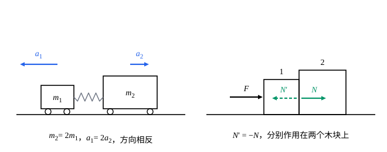

## 这一节要回答的问题

空的小推车一推就走，装满货物就很难推动。:term[加速度]{id="physics.newtonian-mechanics.acceleration"}（acceleration）和作用的强弱、物体的轻重是什么关系？这个关系在哪些:term[参考系]{id="physics.newtonian-mechanics.reference-frame"}（reference frame）里成立？

## 讲解

### 惯性系与第一定律

在转弯的车厢里，桌上的小球没有被谁推，却滚向外侧：在这样的:term[参考系]{id="physics.newtonian-mechanics.reference-frame"}里，运动的变化不全来自别的物体。

::anchor{id="def-inertial-frame"}
一个质点离其他物体都足够远、不受它们的作用时，如果它在某个参考系里保持静止或做匀速直线运动，这个参考系叫作:term[惯性系]{id="physics.newtonian-mechanics.inertial-frame"}（inertial frame）。

为什么这样定义：在这样的参考系里，「不受作用，运动就不变」才成立，运动规律最简单。由:term[伽利略变换]{id="physics.newtonian-mechanics.galilean-transformation"}（Galilean transformation），相对惯性系做匀速直线运动的参考系，:term[加速度]{id="physics.newtonian-mechanics.acceleration"}和它相同，也是惯性系；加速、转动的参考系不是。边界情况：地面随地球自转，只是近似的惯性系，平常的实验里足够好。

::anchor{id="thm-first-law"}
:term[牛顿第一定律]{id="physics.newtonian-mechanics.newtons-first-law"}（Newton's first law）：惯性系存在；在惯性系里，不受其他物体作用的质点保持静止或匀速直线运动。物体保持原有:term[速度]{id="physics.newtonian-mechanics.velocity"}（velocity）的这种性质叫作:term[惯性]{id="physics.newtonian-mechanics.inertia"}（inertia）。

### 质量与力

两辆小车夹着压缩的弹簧放在光滑的水平轨道上，放开后向两边加速，:term[加速度]{id="physics.newtonian-mechanics.acceleration"}大小之比总是同一个数，换一根弹簧也不变。

::anchor{id="def-mass"}
两个质点只相互作用时，在:term[惯性系]{id="physics.newtonian-mechanics.inertial-frame"}里它们的加速度方向相反，大小之比不随作用的方式和强弱改变；规定$\frac{m_1}{m_2}=\frac{a_2}{a_1}$，再取一个标准物体为$1\,\mathrm{kg}$，就给每个物体定出一个数$m$，叫作它的:term[质量]{id="physics.newtonian-mechanics.mass"}（mass）。

为什么这样定义：加速度越难改变，质量越大，质量量的正是:term[惯性]{id="physics.newtonian-mechanics.inertia"}的大小；实验发现这样的比值可以传递（$m_1=2m_2$、$m_2=3m_3$时，直接比较正好$m_1=6m_3$），所以每个物体一个数就够了。边界情况：质量和物体在哪里、怎样运动无关，在月球上也一样。

::anchor{id="def-force"}
其他物体对质点的作用叫作:term[力]{id="physics.newtonian-mechanics.force"}（force）：一个作用使质量为$m$的质点在惯性系里产生加速度$\vb a$，这个作用的力就是矢量$\vb F=m\vb a$，单位是牛顿，$1\,\mathrm N=1\,\mathrm{kg\cdot m/s^2}$。

为什么这样定义：用拉长同样长度的同一根弹簧去拉不同的物体，加速度和质量成反比，$m\vb a$只由弹簧和它拉长了多少决定，和拉的是哪个物体无关，正好刻画了「弹簧用了多大的劲」。边界情况：在加速的车厢里量到的加速度不全来自别的物体，这个定义只在惯性系里用。

### 第二定律和第三定律

::anchor{id="thm-second-law"}
:term[牛顿第二定律]{id="physics.newtonian-mechanics.newtons-second-law"}（Newton's second law）：在:term[惯性系]{id="physics.newtonian-mechanics.inertial-frame"}里，几个物体同时作用于质点时，各个:term[力]{id="physics.newtonian-mechanics.force"}按矢量相加，它们的和$\vb F$叫作:term[合力]{id="physics.newtonian-mechanics.net-force"}（net force），质点的:term[加速度]{id="physics.newtonian-mechanics.acceleration"}满足$m\vb a=\vb F$。

它的实质内容是：力只由施力的物体和它的状态决定（弹簧拉长了多少），和受力的是谁无关；几个力同时作用时按矢量相加。

::anchor{id="thm-third-law"}
:term[牛顿第三定律]{id="physics.newtonian-mechanics.newtons-third-law"}（Newton's third law）：两个质点相互作用时，甲对乙的力和乙对甲的力大小相等、方向相反，在同一条直线上：$\vb F_{\text{甲对乙}}=-\vb F_{\text{乙对甲}}$。

它和:term[质量]{id="physics.newtonian-mechanics.mass"}的定义互相印证：只相互作用的两个质点，$m_1\vb a_1=-m_2\vb a_2$。

### 运动方程

::anchor{id="def-equation-of-motion"}
把作用于质点的:term[合力]{id="physics.newtonian-mechanics.net-force"}写成位置、:term[速度]{id="physics.newtonian-mechanics.velocity"}和时间的函数，第二定律就成了$m\frac{\dd^2\vb r}{\dd t^2}=\vb F\bigl(\vb r,\dv{\vb r}t,t\bigr)$，这个方程叫作质点的:term[运动方程]{id="physics.newtonian-mechanics.equation-of-motion"}（equation of motion）。

为什么这样定义：知道了:term[力]{id="physics.newtonian-mechanics.force"}怎样依赖位置和速度（[常见的力](lesson:physics.newtonian-mechanics.common-forces)讲各种力），再给出某一时刻的位置和速度这两个:term[初始条件]{id="physics.newtonian-mechanics.initial-conditions"}（initial conditions），运动一般就唯一确定了。边界情况：合力只随时间变化时，求两次原函数就够了（例 1）。

## 几何图像

左图：弹簧推开两辆小车，$m_2=2m_1$，:term[加速度]{id="physics.newtonian-mechanics.acceleration"}$a_1$是$a_2$的两倍、方向相反，这正是:term[质量]{id="physics.newtonian-mechanics.mass"}的定义。右图：木块 1 推木块 2 的:term[力]{id="physics.newtonian-mechanics.force"}$\vb N$和木块 2 推木块 1 的力$\vb N'$大小相等、方向相反，分别作用在两个木块上（例 2）。

## 例题

### 例 1　随时间变化的力

:term[质量]{id="physics.newtonian-mechanics.mass"}$m=2.0\,\mathrm{kg}$的质点静止在原点，从$t=0$起只受到沿$x$轴的:term[力]{id="physics.newtonian-mechanics.force"}$F=F_0\cos\omega t$，$F_0=8.0\,\mathrm N$，$\omega=2.0\,\mathrm{rad/s}$。求质点的运动，它会跑到原点的另一侧吗？

**为什么想到这么做**：力只随时间变化，:term[运动方程]{id="physics.newtonian-mechanics.equation-of-motion"}是$\frac{\dd^2x}{\dd t^2}=\frac{F_0}m\cos\omega t$，按:term[初始条件]{id="physics.newtonian-mechanics.initial-conditions"}求两次原函数。

**推导**：由$v(0)=0$，$v=\frac{F_0}{m\omega}\sin\omega t$；由$x(0)=0$，$x=\frac{F_0}{m\omega^2}(1-\cos\omega t)$。$\frac{F_0}{m\omega^2}=1.0\,\mathrm m$，质点在$0$到$2.0\,\mathrm m$之间来回，每隔$\frac{2\pi}\omega\approx3.1\,\mathrm s$回到原点一次，却从不跑到另一侧。在力为零的时刻$\omega t=\frac\pi2$，:term[速度]{id="physics.newtonian-mechanics.velocity"}反而最大：力决定的是:term[加速度]{id="physics.newtonian-mechanics.acceleration"}，不是速度。

### 例 2　推并排的两个木块

光滑水平面上，:term[质量]{id="physics.newtonian-mechanics.mass"}$m_1=1.0\,\mathrm{kg}$和$m_2=3.0\,\mathrm{kg}$的两个木块并排靠着，用$8.0\,\mathrm N$的水平:term[力]{id="physics.newtonian-mechanics.force"}推木块 1。只看水平方向，两个木块之间的作用力多大？

**为什么想到这么做**：两个木块一起加速，:term[加速度]{id="physics.newtonian-mechanics.acceleration"}相同。对木块 2 用:term[牛顿第二定律]{id="physics.newtonian-mechanics.newtons-second-law"}，它在水平方向只受木块 1 的推力；木块 1 受到的反推力由:term[牛顿第三定律]{id="physics.newtonian-mechanics.newtons-third-law"}给出。

**推导**：两块之间的一对力相加为零，所以两块合起来只受$F$，$a=\frac{F}{m_1+m_2}=2.0\,\mathrm{m/s^2}$。木块 2：$N=m_2a=6.0\,\mathrm N$；木块 1 受到$6.0\,\mathrm N$的反推力，:term[合力]{id="physics.newtonian-mechanics.net-force"}$8.0-6.0=2.0\,\mathrm N=m_1a$。改推重的那块，两块之间的力只有$m_1a=2.0\,\mathrm N$。

## 常见误区

- 「甲对乙的:term[力]{id="physics.newtonian-mechanics.force"}和乙对甲的力大小相等、方向相反，所以互相抵消。」它们作用在两个不同的物体上（例 2）。
- 「物体运动要靠力来维持。」不受作用的物体保持匀速直线运动；车会慢慢停下，是因为受到了阻碍。
- 「力越大，:term[速度]{id="physics.newtonian-mechanics.velocity"}越大。」力决定的是:term[加速度]{id="physics.newtonian-mechanics.acceleration"}，例 1 里力为零的时刻速度反而最大。
