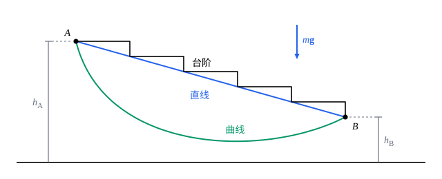

## 这一节要回答的问题

把石头举高，它好像「存」下了什么，一放手就落下来，越落越快；压缩的弹簧一松开，能把木块弹出去。这些存起来的东西是什么？它什么时候能原封不动地变回:term[动能]{id="physics.newtonian-mechanics.kinetic-energy"}（kinetic energy）？

## 讲解

### 保守力

::anchor{id="def-conservative-force"}
如果一个:term[力]{id="physics.newtonian-mechanics.force"}（force）对质点做的:term[功]{id="physics.newtonian-mechanics.work"}（work）只取决于质点的起点和终点，和中间走过的路径无关，这个力就叫作:term[保守力]{id="physics.newtonian-mechanics.conservative-force"}（conservative force）；不是保守力的力叫作:term[非保守力]{id="physics.newtonian-mechanics.nonconservative-force"}（nonconservative force）。

为什么这样定义：:term[重力]{id="physics.newtonian-mechanics.weight"}（weight）是保守力：它是恒力，做的功是$\int m\vb g\cdot\vb v\,\dd t=m\vb g\cdot\Delta\vb r=-mg(h_2-h_1)$，只看高度的改变。沿直线运动、只随位置变化的力也是保守力，例如弹簧的:term[弹力]{id="physics.newtonian-mechanics.elastic-force"}（elastic force），它做的功$\int_{x_1}^{x_2}F\,\dd x$只取决于两端。边界情况：:term[滑动摩擦力]{id="physics.newtonian-mechanics.kinetic-friction"}（kinetic friction，见[摩擦力](lesson:physics.newtonian-mechanics.friction)）总和相对运动的方向相反，它做的功是负的，大小等于它乘走过的路程，路径越长做的负功越多，所以它是非保守力。

### 势能

::anchor{id="def-potential-energy"}
:term[保守力]{id="physics.newtonian-mechanics.conservative-force"}从$A$到$B$做的:term[功]{id="physics.newtonian-mechanics.work"}只取决于$A$、$B$两点，可以写成一个位置函数的差$W_{AB}=U(A)-U(B)$；函数$U$叫作这个保守力的:term[势能]{id="physics.newtonian-mechanics.potential-energy"}（potential energy）。选定参考点$O$，规定$U(O)=0$，质点在$A$处的势能就是从$A$移到$O$时保守力做的功。

为什么这样定义：从$A$经$B$到$O$和直接从$A$到$O$，保守力做的功相同，所以$W_{AB}+W_{BO}=W_{AO}$，即$W_{AB}=U(A)-U(B)$：保守力做多少正功，势能就减少多少，像是把功「存」进了势能，又从里面取了出来。边界情况：换一个参考点，各处的势能都加上同一个常数，势能的差不变，有意义的只是差；:term[非保守力]{id="physics.newtonian-mechanics.nonconservative-force"}做的功和路径有关，没有势能。

### 重力势能和弹性势能

::anchor{id="def-gravitational-pe"}
:term[重力]{id="physics.newtonian-mechanics.weight"}的:term[势能]{id="physics.newtonian-mechanics.potential-energy"}是$U=mgh$，$h$是质点比参考点高出的高度，叫作:term[重力势能]{id="physics.newtonian-mechanics.gravitational-potential-energy"}（gravitational potential energy）；弹簧的:term[弹力]{id="physics.newtonian-mechanics.elastic-force"}的势能是$U=\frac12kx^2$，$x$是弹簧的伸长量或压缩量，参考点取在原长，叫作:term[弹性势能]{id="physics.newtonian-mechanics.elastic-potential-energy"}（elastic potential energy）。

为什么这样定义：这两个式子是由势能的定义算出来的。从高$h$处移到参考点，重力做的:term[功]{id="physics.newtonian-mechanics.work"}是$mgh$；弹簧从形变量$x$回到原长，弹力$-kx'$做的功是$\int_x^0(-kx')\,\dd x'=\frac12kx^2$。边界情况：重力势能可以是负的，参考点上方为正、下方为负；弹性势能总不为负，伸长和压缩同样多时，弹性势能相同。

### 由势能求力

::anchor{id="thm-force-from-potential"}
定理：质点沿$x$轴运动，受的:term[保守力]{id="physics.newtonian-mechanics.conservative-force"}$F(x)$只随位置变化时，$F(x)=-U'(x)$，即:term[力]{id="physics.newtonian-mechanics.force"}等于:term[势能]{id="physics.newtonian-mechanics.potential-energy"}对$x$的导数的相反数。

证明思路：取参考点$x_0$。由势能的定义和[功与动能定理](lesson:physics.newtonian-mechanics.work-energy#def-work-general)里一维的:term[功]{id="physics.newtonian-mechanics.work"}$\int F\,\dd x$，$U(x)=\int_x^{x_0}F(s)\,\dd s=-\int_{x_0}^xF(s)\,\dd s$。由微积分基本定理（fundamental theorem of calculus），变上限积分（integral with variable upper limit）对上限的导数是被积函数（integrand），所以$U'(x)=-F(x)$。

验算：:term[弹性势能]{id="physics.newtonian-mechanics.elastic-potential-energy"}$\frac12kx^2$给出$F=-kx$，正是弹簧的:term[弹力]{id="physics.newtonian-mechanics.elastic-force"}；$x$轴竖直向上时，:term[重力势能]{id="physics.newtonian-mechanics.gravitational-potential-energy"}$mgx$给出$F=-mg$。力总指向势能降低的一边。

### 机械能守恒

::anchor{id="def-mechanical-energy"}
质点的:term[动能]{id="physics.newtonian-mechanics.kinetic-energy"}和:term[势能]{id="physics.newtonian-mechanics.potential-energy"}之和$E=K+U$叫作它的:term[机械能]{id="physics.newtonian-mechanics.mechanical-energy"}（mechanical energy）。

::anchor{id="thm-mechanical-energy"}
定理（:term[机械能守恒]{id="physics.newtonian-mechanics.conservation-of-mechanical-energy"}，conservation of mechanical energy）：在:term[惯性系]{id="physics.newtonian-mechanics.inertial-frame"}（inertial frame）里，只有:term[保守力]{id="physics.newtonian-mechanics.conservative-force"}做:term[功]{id="physics.newtonian-mechanics.work"}、别的:term[力]{id="physics.newtonian-mechanics.force"}都不做功时，质点的机械能保持不变。

证明思路：由:term[动能定理]{id="physics.newtonian-mechanics.work-energy-theorem"}（work-energy theorem），所有力做的功之和等于动能的改变$\Delta K$。保守力做的功等于势能的减少$-\Delta U$，别的力不做功，所以$\Delta K=-\Delta U$，即$\Delta(K+U)=0$。

:term[非保守力]{id="physics.newtonian-mechanics.nonconservative-force"}做功$W'$时，同样的推理给出$\Delta E=W'$：:term[滑动摩擦力]{id="physics.newtonian-mechanics.kinetic-friction"}做负功，机械能减少，变成了内能（internal energy）。「别的力不做功」包括受力却不做功的情形：沿光滑的曲面滑动的物体，曲面的:term[支持力]{id="physics.newtonian-mechanics.normal-force"}（normal force）和:term[速度]{id="physics.newtonian-mechanics.velocity"}（velocity）垂直，从高处由静止滑下$h$时，:term[速率]{id="physics.newtonian-mechanics.speed"}（speed）是$\sqrt{2gh}$，和曲面的形状无关。

## 几何图像

台阶状的路径最容易看清：水平的每一段，:term[重力]{id="physics.newtonian-mechanics.weight"}和:term[位移]{id="physics.newtonian-mechanics.displacement"}（displacement）垂直，不做:term[功]{id="physics.newtonian-mechanics.work"}；竖直的每一段，重力做的功是$mg$乘下降的高度，加起来是$mg(h_A-h_B)$。另外两条路径上的功也是这么多，弯曲的路径降到$B$以下再升上来，多做的正功又被上升时的负功抵掉，所以重力是:term[保守力]{id="physics.newtonian-mechanics.conservative-force"}。

## 例题

### 例 1　过山车

过山车从高$20\,\mathrm m$的坡顶由静止出发，沿轨道滑下，再冲上高$12\,\mathrm m$的第二个坡。轨道的摩擦和空气的影响可以忽略，$g$取$9.8\,\mathrm{m/s^2}$，过山车到第二个坡顶时的:term[速率]{id="physics.newtonian-mechanics.speed"}多大？

**为什么想到这么做**：过山车受:term[重力]{id="physics.newtonian-mechanics.weight"}和轨道的:term[支持力]{id="physics.newtonian-mechanics.normal-force"}，支持力和:term[速度]{id="physics.newtonian-mechanics.velocity"}垂直，不做:term[功]{id="physics.newtonian-mechanics.work"}，:term[机械能守恒]{id="physics.newtonian-mechanics.conservation-of-mechanical-energy"}。轨道的形状很复杂，可是用不着知道。

**推导**：取地面为参考点，$mg\times20=\frac12mv^2+mg\times12$，$v=\sqrt{2\times9.8\times8}\approx12.5\,\mathrm{m/s}$。:term[质量]{id="physics.newtonian-mechanics.mass"}（mass）约掉了，坐满人和空车的速率一样。

### 例 2　落在弹簧上的小球

:term[质量]{id="physics.newtonian-mechanics.mass"}$0.50\,\mathrm{kg}$的小球从竖直弹簧的上端正上方$0.40\,\mathrm m$处由静止落下，弹簧的:term[劲度系数]{id="physics.newtonian-mechanics.spring-constant"}（spring constant）是$200\,\mathrm{N/m}$，空气的影响可以忽略，$g$取$9.8\,\mathrm{m/s^2}$。弹簧最多被压缩多少？

**为什么想到这么做**：小球只受:term[重力]{id="physics.newtonian-mechanics.weight"}和弹簧的:term[弹力]{id="physics.newtonian-mechanics.elastic-force"}，两个都是:term[保守力]{id="physics.newtonian-mechanics.conservative-force"}，:term[机械能]{id="physics.newtonian-mechanics.mechanical-energy"}守恒；压缩最多时:term[速度]{id="physics.newtonian-mechanics.velocity"}为零。

**推导**：设最多压缩$x$，取这时小球的位置为:term[重力势能]{id="physics.newtonian-mechanics.gravitational-potential-energy"}的参考点。开始时机械能是$mg(0.40+x)$，最低点是$\frac12kx^2$，所以$100x^2-4.9x-1.96=0$，正根$x\approx0.167\,\mathrm m$。比小球静止放在弹簧上时的压缩量$\frac{mg}k\approx0.0245\,\mathrm m$大得多。

## 常见误区

- 「物体在某处的:term[势能]{id="physics.newtonian-mechanics.potential-energy"}有确定的值。」势能的值随参考点变，有意义的只是两处的势能差。
- 「物体除了:term[保守力]{id="physics.newtonian-mechanics.conservative-force"}还受别的:term[力]{id="physics.newtonian-mechanics.force"}，例如:term[支持力]{id="physics.newtonian-mechanics.normal-force"}，:term[机械能]{id="physics.newtonian-mechanics.mechanical-energy"}就不守恒。」要看那些力做的:term[功]{id="physics.newtonian-mechanics.work"}是不是零：沿光滑的曲面滑动时，支持力和:term[速度]{id="physics.newtonian-mechanics.velocity"}垂直，不做功，机械能照样守恒（例 1）。
- 「:term[机械能守恒]{id="physics.newtonian-mechanics.conservation-of-mechanical-energy"}就是:term[动能]{id="physics.newtonian-mechanics.kinetic-energy"}和势能都不变。」守恒的是两者之和，动能和势能一直在互相转化。
