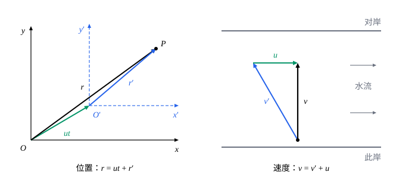

## 这一节要回答的问题

在匀速行驶的列车上竖直上抛一个球，车上的人看它直上直下，站台上的人却看到一条抛物线。同一个运动，在不同的观察者看来，位置、:term[速度]{id="physics.newtonian-mechanics.velocity"}（velocity）都不一样，它们之间怎样换算？有没有对谁都一样的量？

## 讲解

### 参考系

::anchor{id="def-frame"}
描述运动时选作标准的物体，连同固定在它上面的坐标系和计时用的钟，叫作:term[参考系]{id="physics.newtonian-mechanics.reference-frame"}（reference frame）。

为什么这样定义：位置、:term[速度]{id="physics.newtonian-mechanics.velocity"}都是相对某个物体说的，离开参考系，「静止」「运动」都没有意义；[直线运动](lesson:physics.newtonian-mechanics.kinematics-1d)、[平面运动与抛体](lesson:physics.newtonian-mechanics.kinematics-vectors)里的位置和速度，其实都默认以地面为参考系。边界情况：地面、列车、太阳都可以当参考系，参考系也可以在加速、在转动；这一节只看两个参考系做匀速直线相对运动的情形。

### 伽利略变换

设:term[参考系]{id="physics.newtonian-mechanics.reference-frame"}$S'$相对$S$以不变的:term[速度]{id="physics.newtonian-mechanics.velocity"}$\vb u$运动，两者的坐标轴互相平行，$t=0$时原点重合；两个参考系用同样的钟和尺子，时间、长度都量得一样。

::anchor{id="thm-galilean"}
定理（:term[伽利略变换]{id="physics.newtonian-mechanics.galilean-transformation"}，Galilean transformation）：同一个质点在两个参考系里的位置、速度和:term[加速度]{id="physics.newtonian-mechanics.acceleration"}（acceleration）满足$\vb r'=\vb r-\vb ut$，$\vb v'=\vb v-\vb u$，$\vb a'=\vb a$。这组换算关系叫作伽利略变换。

证明思路：在$S$里看，$S'$的原点$t$时刻在$\vb ut$处，质点相对它的位置就是$\vb r-\vb ut$，这一步用到了两个参考系量的时间、长度相同。对$t$求导，$\vb u$不变，得到$\vb v'=\vb v-\vb u$；再求一次导数（derivative），得到$\vb a'=\vb a$。

速度的换算常写成$\vb v=\vb v'+\vb u$：质点相对$S$的速度，等于它相对$S'$的速度加上$S'$相对$S$的速度。加速度在两个参考系里完全相同，讲[牛顿运动定律](lesson:physics.newtonian-mechanics.newtons-laws)时这一点最要紧。边界情况：时间、长度对谁都一样只是低速时的近似，速度接近光速时伽利略变换不再成立（见狭义相对论的[洛伦兹变换](lesson:physics.special-relativity.lorentz-transformation)一节）。

## 几何图像

左图是位置：$S'$的原点$O'$相对$O$移动了$\vb ut$，同一点$P$在两个:term[参考系]{id="physics.newtonian-mechanics.reference-frame"}里的位置满足$\vb r=\vb ut+\vb r'$，这就是:term[伽利略变换]{id="physics.newtonian-mechanics.galilean-transformation"}的第一式。右图是:term[速度]{id="physics.newtonian-mechanics.velocity"}：船相对水的速度$\vb v'$偏向上游，加上水流的速度$\vb u$，船相对河岸的速度$\vb v$正好垂直于河岸，船就能正对岸过河（例 1）。

## 例题

### 例 1　渡河

河宽$120\,\mathrm m$，水流的:term[速度]{id="physics.newtonian-mechanics.velocity"}是$1.5\,\mathrm{m/s}$，船相对水的:term[速率]{id="physics.newtonian-mechanics.speed"}（speed）是$3.0\,\mathrm{m/s}$。

（1）船头始终垂直于河岸，过河要多久，到对岸时被冲向下游多远？（2）要正对岸到达，船头应偏向上游多少度，过河要多久？

**为什么想到这么做**：以河岸为$S$、以水为$S'$，船相对水的速度是$\vb v'$，水相对河岸的速度是$\vb u$，船相对河岸的速度$\vb v=\vb v'+\vb u$。过河的时间只由垂直于河岸的分速度决定。

**推导**：（1）垂直分速度是$3.0\,\mathrm{m/s}$，用时$\frac{120}{3.0}=40\,\mathrm s$；这段时间里沿岸方向以$1.5\,\mathrm{m/s}$漂移，被冲下$60\,\mathrm m$。（2）要$\vb v$垂直于河岸，$\vb v'$沿岸的分量要抵消水流：$3.0\sin\beta=1.5$，$\beta=30^\circ$；垂直分速度$3.0\cos30^\circ\approx2.60\,\mathrm{m/s}$，用时约$46\,\mathrm s$，比（1）慢。

### 例 2　车窗上的雨痕

无风时雨滴以$6.0\,\mathrm{m/s}$竖直下落，汽车以$72\,\mathrm{km/h}$在平路上行驶。车里的人看到雨滴以多大的:term[速率]{id="physics.newtonian-mechanics.speed"}、沿什么方向落下？

**为什么想到这么做**：以地面为$S$、汽车为$S'$，$\vb u$是汽车的:term[速度]{id="physics.newtonian-mechanics.velocity"}。雨滴相对汽车的速度$\vb v'=\vb v-\vb u$。

**推导**：取车行方向为$x$轴、竖直向上为$y$轴，$\vb v=(0,-6.0)$，$\vb u=(20,0)$（单位$\mathrm{m/s}$），$\vb v'=(-20,-6.0)$。速率$\sqrt{20^2+6.0^2}\approx20.9\,\mathrm{m/s}$，和竖直方向的夹角$\arctan\frac{20}{6.0}\approx73^\circ$，斜着向后落下；车开得越快，侧窗上的雨痕越斜。

## 常见误区

- 「:term[速度]{id="physics.newtonian-mechanics.velocity"}是物体自己的属性。」速度总是相对某个:term[参考系]{id="physics.newtonian-mechanics.reference-frame"}说的：坐在列车里的人相对车厢静止，相对地面却以列车的速度运动。
- 「换到运动的参考系，:term[加速度]{id="physics.newtonian-mechanics.acceleration"}也要减去$\vb u$。」$\vb u$不变，它的导数是零，两个参考系里的加速度相同。
- 「船头对准对岸，船就垂直过河。」水流会把船带向下游；要正对岸到达，船头要偏向上游（例 1）。
