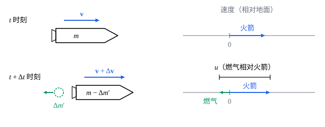

## 这一节要回答的问题

太空里没有空气可以「推」，火箭怎样加速？喷出的燃气越快、带的燃料越多，火箭就飞得越快，可燃料占了火箭的绝大部分:term[质量]{id="physics.newtonian-mechanics.mass"}（mass），最后能达到多大的:term[速度]{id="physics.newtonian-mechanics.velocity"}（velocity）？

## 讲解

### 反冲

::anchor{id="def-recoil"}
原来静止的物体在:term[内力]{id="physics.newtonian-mechanics.internal-force"}（internal force）作用下分成两部分，总:term[动量]{id="physics.newtonian-mechanics.momentum"}（momentum）仍然为零，$m_1\vb v_1+m_2\vb v_2=\vb 0$，两部分朝相反的方向运动，:term[速度]{id="physics.newtonian-mechanics.velocity"}的大小和:term[质量]{id="physics.newtonian-mechanics.mass"}成反比，这叫作:term[反冲]{id="physics.newtonian-mechanics.recoil"}（recoil）。

为什么这样定义：开枪时枪身向后撞肩膀，两个人在冰面上互推后各自滑开，都是这样；火箭把燃气一小份一小份地向后喷出，就是连续不断的反冲。边界情况：原来在运动的物体分成两部分，两部分的动量之和等于原来的动量，它们不一定朝相反的方向运动。

### 变质量系统

::anchor{id="def-variable-mass"}
不断有一部分:term[质量]{id="physics.newtonian-mechanics.mass"}离开或并入、自身质量随时间变化的物体，叫作:term[变质量系统]{id="physics.newtonian-mechanics.variable-mass-system"}（variable-mass system），例如喷气的火箭、在雨中不断接住雨水的敞篷车。

为什么这样定义：:term[牛顿第二定律]{id="physics.newtonian-mechanics.newtons-second-law"}（Newton's second law）是对质量不变的质点说的，质量在变时，不能直接把$\dv{(m\vb v)}t$当作:term[合力]{id="physics.newtonian-mechanics.net-force"}（net force）。办法是把这段时间里离开或并入的那一小部分也算进系统，对这个质量不变的系统用:term[动量守恒]{id="physics.newtonian-mechanics.conservation-of-momentum"}（conservation of momentum）。边界情况：光滑轨道上滑行的车从底部竖直漏沙，沙子离开时和车的:term[速度]{id="physics.newtonian-mechanics.velocity"}相同，带走的正是自己原有的那份:term[动量]{id="physics.newtonian-mechanics.momentum"}，车的速度不变；照搬「$mv$不变」会错算成车越来越快。

### 火箭的运动方程

设$t$时刻火箭连同剩下的燃料的:term[质量]{id="physics.newtonian-mechanics.mass"}是$m$，沿$x$轴的:term[速度]{id="physics.newtonian-mechanics.velocity"}是$v$，不受:term[外力]{id="physics.newtonian-mechanics.external-force"}（external force）。在$\dd t$里它向后喷出质量为$\dd m'$的燃气，燃气离开时相对火箭的速度是$-u$，相对地面就是$v+\dd v-u$。火箭和这份燃气合起来，由:term[动量守恒]{id="physics.newtonian-mechanics.conservation-of-momentum"}，$mv=(m-\dd m')(v+\dd v)+\dd m'(v+\dd v-u)$，化简得$m\,\dd v=u\,\dd m'$。火箭的质量减少了$\dd m'$，即$\dd m=-\dd m'$，所以$m\dv vt=-u\dv mt$。

::anchor{id="def-thrust"}
上式里燃气相对火箭喷出的速度大小$u$叫作:term[排气速度]{id="physics.newtonian-mechanics.exhaust-velocity"}（exhaust velocity），右边的$-u\dv mt=u\Bigl|\dv mt\Bigr|$叫作火箭的:term[推力]{id="physics.newtonian-mechanics.thrust"}（thrust）。

为什么这样定义：方程$m\dv vt=u\bigl|\dv mt\bigr|$和:term[牛顿第二定律]{id="physics.newtonian-mechanics.newtons-second-law"}的样子相同，推力就像一个推着火箭的:term[力]{id="physics.newtonian-mechanics.force"}（force）。它其实是燃气对火箭的反作用：火箭每秒把质量$\bigl|\dv mt\bigr|$的燃气向后加速到相对速度$u$，燃气就以这么大的力向前推火箭。边界情况：推力只取决于排气速度和每秒喷出的质量，用不着周围有空气，在真空里照样有。

### 火箭方程

::anchor{id="thm-rocket-equation"}
定理（火箭方程，rocket equation，也叫齐奥尔科夫斯基公式，Tsiolkovsky rocket equation）：火箭不受:term[外力]{id="physics.newtonian-mechanics.external-force"}、:term[排气速度]{id="physics.newtonian-mechanics.exhaust-velocity"}$u$不变时，:term[质量]{id="physics.newtonian-mechanics.mass"}从$m_0$减到$m$，:term[速度]{id="physics.newtonian-mechanics.velocity"}就从$v_0$增加到$v=v_0+u\ln\frac{m_0}m$。

证明思路：$m\dv vt=-u\dv mt$是一个可分离变量的方程（separable equation），分离变量得$\dv vt=-\frac um\dv mt$。由链式法则（chain rule），右边是$-u\ln m$对$t$的导数，所以$v+u\ln m$不随时间变化，$v+u\ln m=v_0+u\ln m_0$。

末速度只取决于排气速度和质量比（mass ratio）$\frac{m_0}m$，和燃料烧得快慢无关。对数增长得很慢：要达到$3u$，质量比得是$e^3\approx20$，燃料要占起飞质量的$95\%$。真实的火箭做成多级（multistage），一级的燃料烧完，就把它的空壳扔掉，后面不必再给空壳加速。

## 几何图像

图里$\Delta m'$取$m$的十分之一，所以$\Delta v=u\frac{\Delta m'}{m}$是$u$的十分之一。燃气相对火箭向后喷出，相对地面却未必向后：火箭的:term[速度]{id="physics.newtonian-mechanics.velocity"}超过$u$以后，喷出的燃气相对地面也向前运动，只是比火箭慢。不管哪种情况，火箭和燃气的总:term[动量]{id="physics.newtonian-mechanics.momentum"}都不变。

## 例题

### 例 1　单级火箭够不够快

一枚火箭的:term[排气速度]{id="physics.newtonian-mechanics.exhaust-velocity"}是$3.0\,\mathrm{km/s}$，燃料占:term[起飞质量]{id="physics.newtonian-mechanics.mass"}的$90\%$。不计:term[外力]{id="physics.newtonian-mechanics.external-force"}，它从静止出发，燃料烧完时:term[速度]{id="physics.newtonian-mechanics.velocity"}是多少？绕地球表面附近做圆周运动需要约$7.9\,\mathrm{km/s}$（见[万有引力定律](lesson:physics.newtonian-mechanics.gravitation)），它够吗？

**为什么想到这么做**：不计外力，直接用火箭方程，质量比$\frac{m_0}m=\frac1{1-0.90}=10$。

**推导**：$v=3.0\times\ln10\approx6.9\,\mathrm{km/s}$，不到$7.9\,\mathrm{km/s}$。实际上还要克服地球的吸引和空气，差得更多，所以单级的化学火箭很难把东西送上轨道，要用多级火箭。

### 例 2　竖直起飞

火箭竖直起飞，:term[起飞质量]{id="physics.newtonian-mechanics.mass"}$1.0\times10^4\,\mathrm{kg}$，每秒喷出$100\,\mathrm{kg}$燃气，:term[排气速度]{id="physics.newtonian-mechanics.exhaust-velocity"}$2.5\,\mathrm{km/s}$。空气的影响可以忽略，$g$取$9.8\,\mathrm{m/s^2}$且不随高度变化。起飞时的:term[推力]{id="physics.newtonian-mechanics.thrust"}和:term[重力]{id="physics.newtonian-mechanics.weight"}（weight）各是多少？$60\,\mathrm s$末火箭的:term[速度]{id="physics.newtonian-mechanics.velocity"}多大？

**为什么想到这么做**：有重力时，把它加进:term[运动方程]{id="physics.newtonian-mechanics.equation-of-motion"}（equation of motion）：$m\dv vt=u\bigl|\dv mt\bigr|-mg$，两边除以$m$，速度的变化率是火箭方程那一项减去$g$。

**推导**：推力$2500\times100=2.5\times10^5\,\mathrm N$，比重力$9.8\times10^4\,\mathrm N$大，火箭能起飞。$\dv vt=-\frac um\dv mt-g$，积分得$v=u\ln\frac{m_0}m-gt$。$60\,\mathrm s$末$m=4000\,\mathrm{kg}$，$v=2500\ln2.5-9.8\times60\approx2291-588\approx1.70\times10^3\,\mathrm{m/s}$。减去的$gt$叫作重力损失（gravity loss），燃料烧得越慢，它越大。

## 常见误区

- 「火箭靠喷出的燃气推开周围的空气前进，在真空里就飞不动了。」:term[推力]{id="physics.newtonian-mechanics.thrust"}来自燃气对火箭的反作用，和外面有没有空气无关。
- 「火箭的:term[速度]{id="physics.newtonian-mechanics.velocity"}不会超过:term[排气速度]{id="physics.newtonian-mechanics.exhaust-velocity"}。」由火箭方程，质量比超过$e\approx2.72$，速度的增加就超过排气速度。
- 「:term[质量]{id="physics.newtonian-mechanics.mass"}在变的物体，也可以用$\vb F=\dv{(m\vb v)}t$。」这只对质量不变的物体成立；:term[变质量系统]{id="physics.newtonian-mechanics.variable-mass-system"}要把离开或并入的部分算进来，见讲解里漏沙的车。
