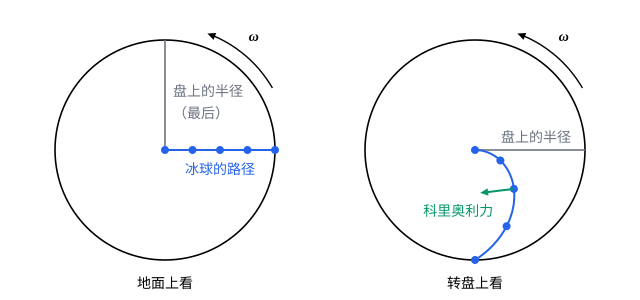

## 这一节要回答的问题

在转动的旋转木马上，把小球朝正前方的人滚过去，小球却拐向一边；坐在快速转动的转椅上，人觉得被往外甩。在转动的:term[参考系]{id="physics.newtonian-mechanics.reference-frame"}（reference frame）里，物体好像受到了找不到来源的:term[力]{id="physics.newtonian-mechanics.force"}（force）。这些力是什么，怎样计算？

## 讲解

### 角速度矢量

::anchor{id="def-angular-velocity-vector"}
:term[参考系]{id="physics.newtonian-mechanics.reference-frame"}绕一根固定的轴转动，:term[角速度]{id="physics.newtonian-mechanics.angular-velocity"}（angular velocity）是$\omega$时，把它写成矢量$\boldsymbol\omega$：大小是$|\omega|$，方向沿转轴，按右手定则（right-hand rule）确定，右手四指顺着转动的方向弯曲，拇指的指向就是$\boldsymbol\omega$的方向。这个矢量叫作:term[角速度矢量]{id="physics.newtonian-mechanics.angular-velocity-vector"}（angular velocity vector）。

为什么这样定义：固定在转动的参考系里、离转轴$\rho$的点做圆周运动，:term[速率]{id="physics.newtonian-mechanics.speed"}（speed）是$|\omega|\rho$，方向沿圆的切线。设这一点相对轴上一点的位置是$\vb r$，$\vb r$和$\boldsymbol\omega$的夹角是$\alpha$，则$\rho=r\sin\alpha$，叉积（cross product）$\boldsymbol\omega\times\vb r$的大小正是$|\omega|r\sin\alpha$，方向垂直于转轴和$\vb r$，正是这一点运动的方向。所以这一点的:term[速度]{id="physics.newtonian-mechanics.velocity"}（velocity）是$\boldsymbol\omega\times\vb r$，大小和方向都在里面了。边界情况：转轴上的点，$\vb r$平行于$\boldsymbol\omega$，$\boldsymbol\omega\times\vb r=\vb 0$，不动。

### 矢量在两个参考系里的变化率

::anchor{id="def-rotating-frame"}
相对:term[惯性系]{id="physics.newtonian-mechanics.inertial-frame"}（inertial frame）绕一根固定的轴转动的:term[参考系]{id="physics.newtonian-mechanics.reference-frame"}，叫作:term[转动参考系]{id="physics.newtonian-mechanics.rotating-frame"}（rotating frame）。

为什么这样定义：转盘、旋转木马、自转的地球都是这样的参考系；它里面的点都在做圆周运动，有:term[加速度]{id="physics.newtonian-mechanics.acceleration"}（acceleration），所以它是:term[非惯性系]{id="physics.newtonian-mechanics.noninertial-frame"}（non-inertial frame），而且各处的加速度不同。边界情况：$\boldsymbol\omega=\vb 0$时，它和惯性系相对静止。

::anchor{id="thm-rotating-derivative"}
定理：转动参考系$S'$绕惯性系$S$里的一根固定轴转动，:term[角速度矢量]{id="physics.newtonian-mechanics.angular-velocity-vector"}是$\boldsymbol\omega$（大小可以随时间变化）。同一个矢量$\vb A$在$S$里看的变化率，和在$S'$里看的变化率相差$\boldsymbol\omega\times\vb A$：$\Bigl(\dv{\vb A}t\Bigr)_S=\Bigl(\dv{\vb A}t\Bigr)_{S'}+\boldsymbol\omega\times\vb A$。

证明思路：在$S'$里取三个互相垂直、固定在$S'$里的单位矢量$\vb e_1'$、$\vb e_2'$、$\vb e_3'$，写$\vb A=A_1'\vb e_1'+A_2'\vb e_2'+A_3'\vb e_3'$。在$S'$里看，$\vb e_i'$不变，变化率是$\sum_i\dv{A_i'}t\vb e_i'$。在$S$里看，$\vb e_i'$跟着转：把它的起点放在转轴上，末端是固定在$S'$里的点，由上面的结论，$\dv{\vb e_i'}t=\boldsymbol\omega\times\vb e_i'$。用乘积法则（product rule），多出来的一项是$\sum_iA_i'\,\boldsymbol\omega\times\vb e_i'=\boldsymbol\omega\times\vb A$。

固定在$S'$里的矢量，在$S$里的变化率就是$\boldsymbol\omega\times\vb A$；分析力学的[欧拉方程与自由刚体](lesson:physics.analytical-mechanics.euler-equations)用的正是这个关系。

### 转动参考系里的牛顿第二定律

::anchor{id="thm-rotating-newton"}
定理：$S'$绕过$S$的原点的固定轴以不变的$\boldsymbol\omega$转动，两个:term[参考系]{id="physics.newtonian-mechanics.reference-frame"}的原点重合。质点在$S'$里的位置、:term[速度]{id="physics.newtonian-mechanics.velocity"}、:term[加速度]{id="physics.newtonian-mechanics.acceleration"}记作$\vb r'$、$\vb v'$、$\vb a'$，则在$S'$里$m\vb a'=\vb F-2m\boldsymbol\omega\times\vb v'-m\boldsymbol\omega\times(\boldsymbol\omega\times\vb r')$，$\vb F$是质点受的真实的:term[力]{id="physics.newtonian-mechanics.force"}的:term[合力]{id="physics.newtonian-mechanics.net-force"}（net force）。

证明思路：对位置矢量用上面的定理，$\vb v=\vb v'+\boldsymbol\omega\times\vb r'$。对$\vb v$再用一次，$\vb a=\Bigl(\dv{\vb v}t\Bigr)_{S'}+\boldsymbol\omega\times\vb v$；$\boldsymbol\omega$不变，$\Bigl(\dv{\vb v}t\Bigr)_{S'}=\vb a'+\boldsymbol\omega\times\vb v'$。所以$\vb a=\vb a'+2\boldsymbol\omega\times\vb v'+\boldsymbol\omega\times(\boldsymbol\omega\times\vb r')$，代入:term[惯性系]{id="physics.newtonian-mechanics.inertial-frame"}里的$m\vb a=\vb F$即得。

### 离心力和科里奥利力

::anchor{id="def-centrifugal-force"}
$-m\boldsymbol\omega\times(\boldsymbol\omega\times\vb r')$叫作:term[离心力]{id="physics.newtonian-mechanics.centrifugal-force"}（centrifugal force）。它背离转轴，大小是$m\omega^2\rho$，$\rho$是质点到转轴的距离。

为什么这样定义：$\boldsymbol\omega\times(\boldsymbol\omega\times\vb r')$是固定在$S'$里、和质点同在一处的那一点的:term[向心加速度]{id="physics.newtonian-mechanics.centripetal-acceleration"}（centripetal acceleration），指向转轴，大小$\omega^2\rho$。相对$S'$静止的物体，真实的:term[力]{id="physics.newtonian-mechanics.force"}要和离心力平衡；在:term[惯性系]{id="physics.newtonian-mechanics.inertial-frame"}里看，这些真实的力正是它随$S'$转圈所需的:term[向心力]{id="physics.newtonian-mechanics.centripetal-force"}（centripetal force）。边界情况：离心力只在:term[转动参考系]{id="physics.newtonian-mechanics.rotating-frame"}里出现，惯性系里没有它（见[圆周运动的动力学](lesson:physics.newtonian-mechanics.circular-dynamics)）；转轴上的物体不受离心力。

::anchor{id="def-coriolis-force"}
$-2m\boldsymbol\omega\times\vb v'$叫作:term[科里奥利力]{id="physics.newtonian-mechanics.coriolis-force"}（Coriolis force）。

为什么这样定义：物体相对$S'$运动时，单靠离心力解释不了它的轨迹。从上往下看逆时针转动时，$\boldsymbol\omega$向上，沿盘面运动的物体受的科里奥利力总指向它前进方向的右边，轨迹向右弯（见几何图像）。它垂直于$\vb v'$，只改变运动的方向，不改变:term[速率]{id="physics.newtonian-mechanics.speed"}。边界情况：相对$S'$静止或沿转轴运动时，它为零。

离心力和科里奥利力都来自:term[参考系]{id="physics.newtonian-mechanics.reference-frame"}的转动，不是哪个物体施加的，和:term[质量]{id="physics.newtonian-mechanics.mass"}（mass）成正比，也没有反作用力，都是:term[惯性力]{id="physics.newtonian-mechanics.inertial-force"}（inertial force）。

## 几何图像

盘面光滑，冰球在水平方向不受真实的:term[力]{id="physics.newtonian-mechanics.force"}。地面上看，它沿直线匀速滑出；转盘上看，它离中心越来越远，同时相对转盘往后转，轨迹向右弯：使它右弯的是:term[科里奥利力]{id="physics.newtonian-mechanics.coriolis-force"}，使它越滑越快的是:term[离心力]{id="physics.newtonian-mechanics.centrifugal-force"}。

## 例题

### 例 1　空间站里的人造重力

空间站做成半径$100\,\mathrm m$的圆环，绕中心轴转动，人站在环最外侧的地板上，头朝着转轴。要让人感到和地面上一样的「重力」，转动的周期是多少？人以$2.0\,\mathrm{m/s}$的:term[速率]{id="physics.newtonian-mechanics.speed"}顺着转动的方向沿环走，感到的「重力」变成多少？$g$取$9.8\,\mathrm{m/s^2}$。

**为什么想到这么做**：在随空间站转动的:term[参考系]{id="physics.newtonian-mechanics.reference-frame"}里，人静止时受地板的:term[支持力]{id="physics.newtonian-mechanics.normal-force"}（normal force）和:term[离心力]{id="physics.newtonian-mechanics.centrifugal-force"}，离心力就像:term[重力]{id="physics.newtonian-mechanics.weight"}（weight）；人走动时还要加上:term[科里奥利力]{id="physics.newtonian-mechanics.coriolis-force"}。

**推导**：静止时$N=m\omega^2R$，要$\omega^2R=g$，$\omega=\sqrt{\frac{9.8}{100}}\approx0.313\,\mathrm{rad/s}$，周期$\frac{2\pi}\omega\approx20\,\mathrm s$。顺着转动的方向走时，$\vb v'$沿切线，$-2m\boldsymbol\omega\times\vb v'$背离转轴，大小$2m\omega v'$；人在:term[转动参考系]{id="physics.newtonian-mechanics.rotating-frame"}里还在沿半径$R$的圆走，需要指向轴的:term[合力]{id="physics.newtonian-mechanics.net-force"}$\frac{mv'^2}R$。所以$N=m\Bigl(\omega^2R+2\omega v'+\frac{v'^2}R\Bigr)\approx m(9.8+1.25+0.04)\,\mathrm{m/s^2}$，感到的「重力」大了约$13\%$；逆着转动的方向走，则小了约$12\%$。

## 常见误区

- 「:term[离心力]{id="physics.newtonian-mechanics.centrifugal-force"}是:term[向心力]{id="physics.newtonian-mechanics.centripetal-force"}的反作用力。」向心力是真实的:term[力]{id="physics.newtonian-mechanics.force"}的:term[合力]{id="physics.newtonian-mechanics.net-force"}的分量，它的反作用力作用在别的物体上；离心力只在:term[转动参考系]{id="physics.newtonian-mechanics.rotating-frame"}里出现，作用在物体自己身上。
- 「:term[科里奥利力]{id="physics.newtonian-mechanics.coriolis-force"}会让物体变快或变慢。」它垂直于物体相对转动参考系的:term[速度]{id="physics.newtonian-mechanics.velocity"}，只改变速度的方向，不改变:term[速率]{id="physics.newtonian-mechanics.speed"}。
- 「在转动参考系里静止的物体，不受:term[惯性力]{id="physics.newtonian-mechanics.inertial-force"}。」它仍受离心力，正是离心力和真实的力平衡，它才静止。
