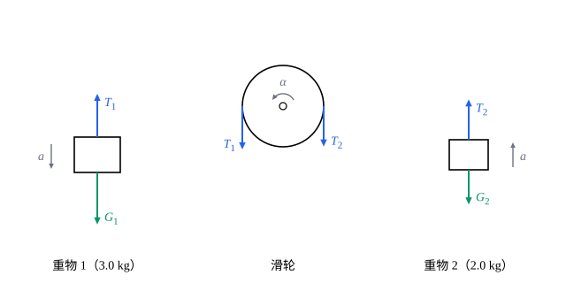

## 这一节要回答的问题

推门时推在把手那里很轻松，推在门轴附近就很费劲。用绳子跨过一个很重的定滑轮吊起重物，绳子两边的:term[拉力]{id="physics.newtonian-mechanics.tension"}（tension）还一样大吗？要让:term[刚体]{id="physics.newtonian-mechanics.rigid-body"}（rigid body）转得越来越快，需要什么？

## 讲解

### 转动定律

::anchor{id="thm-rotation-law"}
定理（:term[转动定律]{id="physics.newtonian-mechanics.law-of-rotation"}，law of rotation）：:term[刚体]{id="physics.newtonian-mechanics.rigid-body"}绕$z$轴:term[定轴转动]{id="physics.newtonian-mechanics.fixed-axis-rotation"}（rotation about a fixed axis）时，:term[外力]{id="physics.newtonian-mechanics.external-force"}（external force）对转轴上一点的:term[力矩]{id="physics.newtonian-mechanics.torque"}（torque）之和沿转轴的分量$\tau_z$，等于刚体对转轴的:term[转动惯量]{id="physics.newtonian-mechanics.moment-of-inertia"}（moment of inertia）乘:term[角加速度]{id="physics.newtonian-mechanics.angular-acceleration"}（angular acceleration）：$\tau_z=I\alpha$。$\tau_z$对转轴上哪一点算都一样，叫作外力对转轴的力矩。

证明思路：在:term[惯性系]{id="physics.newtonian-mechanics.inertial-frame"}（inertial frame）里，对转轴上一个固定点，由[质点系的角动量守恒](lesson:physics.newtonian-mechanics.angular-momentum-systems#thm-system-angular-momentum)里的定理，$\dv{\vb L}t=\boldsymbol\tau_{\text{外}}$，取沿转轴的分量，$\dv{L_z}t=\tau_z$。由[刚体的定轴转动与转动惯量](lesson:physics.newtonian-mechanics.fixed-axis-rotation#def-moment-of-inertia)，$L_z=I\omega$，$I$不变，所以$\tau_z=I\dv\omega t=I\alpha$。:term[力]{id="physics.newtonian-mechanics.force"}（force）$\vb F$作用在$(x,y,z)$处时，$\tau_z=xF_y-yF_x$，和参考点在转轴上的哪个位置无关。

$\tau_z=I\alpha$和$F=ma$一一对应：力矩对应力，转动惯量对应:term[质量]{id="physics.newtonian-mechanics.mass"}（mass），角加速度对应:term[加速度]{id="physics.newtonian-mechanics.acceleration"}（acceleration）。平行于转轴的力、作用线通过转轴的力，$\tau_z$都是零，转轴光滑时转轴对刚体的力就是这样；垂直于转轴的力，$\tau_z$的大小是力乘它的作用线到转轴的距离，也就是:term[力臂]{id="physics.newtonian-mechanics.moment-arm"}（moment arm）。推门推在门轴附近费劲，正是因为力臂短。边界情况：转动惯量会变的物体（收拢手臂的溜冰者）不能用$\tau_z=I\alpha$，要回到$\dv{L_z}t=\tau_z$。

### 绕质心的转动

::anchor{id="thm-cm-rotation"}
定理：:term[刚体]{id="physics.newtonian-mechanics.rigid-body"}一边运动、一边绕过:term[质心]{id="physics.newtonian-mechanics.center-of-mass"}（center of mass）的轴转动，只要这根轴的方向不变（质心可以加速），:term[外力]{id="physics.newtonian-mechanics.external-force"}对这根轴的:term[力矩]{id="physics.newtonian-mechanics.torque"}之和$\tau_{\mathrm C}$就等于$I_{\mathrm C}\alpha$，$I_{\mathrm C}$是刚体对这根轴的:term[转动惯量]{id="physics.newtonian-mechanics.moment-of-inertia"}；质心的运动由:term[质心运动定理]{id="physics.newtonian-mechanics.center-of-mass-theorem"}（center-of-mass theorem）$\vb F_{\text{外}}=M\vb a_{\mathrm C}$决定。

证明思路：由[质点系的角动量守恒](lesson:physics.newtonian-mechanics.angular-momentum-systems#thm-cm-torque)里对质心的:term[角动量]{id="physics.newtonian-mechanics.angular-momentum"}（angular momentum）定理，$\dv{\vb L'}t=\sum_i\vb r_i'\times\vb F_i$，不论质心是否加速都成立。各质点相对质心的位置$\vb r_i'$绕这根轴转动，和:term[定轴转动]{id="physics.newtonian-mechanics.fixed-axis-rotation"}的计算一样，$\vb L'$沿轴的分量是$I_{\mathrm C}\omega$；取沿轴的分量即得。

所以刚体的这种运动可以拆成两件事：质心像一个质点那样，在全部外力作用下运动；绕质心的转动只看外力对过质心那根轴的力矩。边转边落的线轴（例 2）、滚下斜面的轮子，都可以这样分析。

### 绳子和有质量的滑轮

绳子绕在滑轮上、不打滑时，绳子的:term[加速度]{id="physics.newtonian-mechanics.acceleration"}等于轮缘上的点的:term[切向加速度]{id="physics.newtonian-mechanics.tangential-acceleration"}（tangential acceleration），$a=R\alpha$（见[圆周运动](lesson:physics.newtonian-mechanics.circular-motion#thm-tangential)）。把滑轮和绕在上面的那段:term[轻绳]{id="physics.newtonian-mechanics.light-string"}（light string）看作一个整体，它受两边绳子的:term[拉力]{id="physics.newtonian-mechanics.tension"}$T_1$、$T_2$，都沿轮缘的切线（tangent line），:term[力臂]{id="physics.newtonian-mechanics.moment-arm"}都是$R$，所以$(T_1-T_2)R=I\alpha$。滑轮静止或匀速转动时$\alpha=0$，两边的拉力一样大；滑轮有:term[质量]{id="physics.newtonian-mechanics.mass"}又要加速转动时，两边的拉力就不相等，要质量不计、$I=0$，加速转动时两边才一样大，[受力分析与连接体](lesson:physics.newtonian-mechanics.free-body-diagrams)里正是这样处理的。

## 几何图像

三个:term[受力图]{id="physics.newtonian-mechanics.free-body-diagram"}（free-body diagram）按例 1 的数画，箭头的长短和:term[力]{id="physics.newtonian-mechanics.force"}的大小成正比。左边重物受的:term[重力]{id="physics.newtonian-mechanics.weight"}（weight）比:term[拉力]{id="physics.newtonian-mechanics.tension"}大，加速下落；右边重物受的拉力比重力大，加速上升。滑轮左侧受的拉力$T_1$比右侧的$T_2$大，两者的:term[力矩]{id="physics.newtonian-mechanics.torque"}之差使滑轮逆时针加速转动，左侧轮缘跟着加速下落的重物往下走；滑轮受的重力和转轴的力通过转轴，对转轴没有力矩，图里没有画。

## 例题

### 例 1　有质量的滑轮

:term[质量]{id="physics.newtonian-mechanics.mass"}$3.0\,\mathrm{kg}$和$2.0\,\mathrm{kg}$的两个重物用:term[轻绳]{id="physics.newtonian-mechanics.light-string"}连着，跨过一个质量$2.0\,\mathrm{kg}$、半径$0.10\,\mathrm m$的定滑轮。滑轮是均匀圆盘，转轴光滑，绳子在滑轮上不打滑，$g$取$9.8\,\mathrm{m/s^2}$。从静止放开，重物的:term[加速度]{id="physics.newtonian-mechanics.acceleration"}和两边绳子的:term[拉力]{id="physics.newtonian-mechanics.tension"}各是多少？

**为什么想到这么做**：两个重物各用:term[牛顿第二定律]{id="physics.newtonian-mechanics.newtons-second-law"}（Newton's second law），滑轮用:term[转动定律]{id="physics.newtonian-mechanics.law-of-rotation"}，一共三个方程；绳子不打滑，把重物的$a$和滑轮的$\alpha$联系起来。

**推导**：左边的重物以向下为正，右边的以向上为正，滑轮以逆时针为正：$m_1g-T_1=m_1a$，$T_2-m_2g=m_2a$，$(T_1-T_2)R=\frac12MR^2\cdot\frac aR$。前两式相加，再用第三式消去$T_1-T_2=\frac12Ma$，得$a=\frac{(m_1-m_2)g}{m_1+m_2+\frac12M}=\frac{9.8}{6.0}\approx1.63\,\mathrm{m/s^2}$。于是$T_1=m_1(g-a)\approx24.5\,\mathrm N$，$T_2=m_2(g+a)\approx22.9\,\mathrm N$；滑轮的质量不计时，$a=1.96\,\mathrm{m/s^2}$，两边的拉力都是$23.5\,\mathrm N$。

### 例 2　边落边转的线轴

一根:term[轻绳]{id="physics.newtonian-mechanics.light-string"}绕在:term[质量]{id="physics.newtonian-mechanics.mass"}为$M$、半径为$R$的均匀圆柱上，绳的上端固定。圆柱从静止放开，绳子保持竖直，圆柱一边下落一边转动。圆柱:term[质心]{id="physics.newtonian-mechanics.center-of-mass"}的:term[加速度]{id="physics.newtonian-mechanics.acceleration"}和绳子的:term[拉力]{id="physics.newtonian-mechanics.tension"}各是多少？

**为什么想到这么做**：圆柱的运动不是:term[定轴转动]{id="physics.newtonian-mechanics.fixed-axis-rotation"}，用:term[质心运动定理]{id="physics.newtonian-mechanics.center-of-mass-theorem"}管质心的下落，用绕质心的:term[转动定律]{id="physics.newtonian-mechanics.law-of-rotation"}管转动。绳子不动、不打滑，圆柱放出的绳长等于它转过的弧长，所以质心下落的距离是$R\theta$，$a_{\mathrm C}=R\alpha$。

**推导**：竖直方向$Mg-T=Ma_{\mathrm C}$；对过质心的轴，只有拉力有:term[力矩]{id="physics.newtonian-mechanics.torque"}，$TR=\frac12MR^2\cdot\frac{a_{\mathrm C}}R$，即$T=\frac12Ma_{\mathrm C}$。两式相加得$a_{\mathrm C}=\frac23g$，$T=\frac13Mg$：拉力抵消了三分之一的:term[重力]{id="physics.newtonian-mechanics.weight"}，圆柱就比自由落体慢。

## 常见误区

- 「绳子两边的:term[拉力]{id="physics.newtonian-mechanics.tension"}总是一样大。」滑轮静止或匀速转动时确实一样大；滑轮有:term[质量]{id="physics.newtonian-mechanics.mass"}又要加速转动时，靠两边拉力之差提供:term[力矩]{id="physics.newtonian-mechanics.torque"}，两边就不一样大。
- 「:term[力]{id="physics.newtonian-mechanics.force"}越大，:term[刚体]{id="physics.newtonian-mechanics.rigid-body"}的:term[角加速度]{id="physics.newtonian-mechanics.angular-acceleration"}越大。」要看力矩：力平行于转轴或者作用线通过转轴时，再大也不能让刚体绕这根轴转起来。
- 「对任何一点都可以用$\tau=I\alpha$。」可以放心用的是两种轴：固定的转轴，和过:term[质心]{id="physics.newtonian-mechanics.center-of-mass"}、方向不变的轴；对别的加速运动的点，一般不成立。
