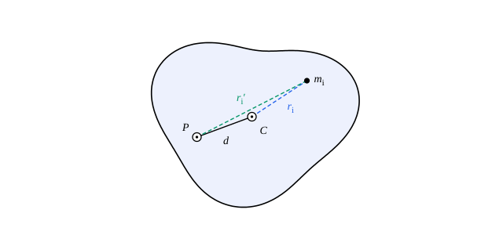

## 这一节要回答的问题

飞轮转起来以后，整体并没有移动，却储存着能量，能带着机器继续转一阵。这份能量怎样算？一根杆绕一端从水平位置摆下来，到最低点时转得多快？同一根杆对不同的轴，:term[转动惯量]{id="physics.newtonian-mechanics.moment-of-inertia"}（moment of inertia）之间有没有简单的关系？

## 讲解

### 转动动能

::anchor{id="thm-rotational-ke"}
定理：:term[刚体]{id="physics.newtonian-mechanics.rigid-body"}（rigid body）:term[定轴转动]{id="physics.newtonian-mechanics.fixed-axis-rotation"}（rotation about a fixed axis）、:term[角速度]{id="physics.newtonian-mechanics.angular-velocity"}（angular velocity）为$\omega$时，总:term[动能]{id="physics.newtonian-mechanics.kinetic-energy"}（kinetic energy）是$K=\frac12I\omega^2$，叫作:term[转动动能]{id="physics.newtonian-mechanics.rotational-kinetic-energy"}（rotational kinetic energy）。

证明思路：离转轴$d_i$的质点:term[速率]{id="physics.newtonian-mechanics.speed"}（speed）是$d_i|\omega|$，各质点的动能加起来，$\sum_i\frac12m_id_i^2\omega^2=\frac12\Bigl(\sum_im_id_i^2\Bigr)\omega^2=\frac12I\omega^2$。

$\frac12I\omega^2$和$\frac12mv^2$对应，:term[转动惯量]{id="physics.newtonian-mechanics.moment-of-inertia"}又一次扮演了:term[质量]{id="physics.newtonian-mechanics.mass"}（mass）的角色。同样的角速度，转动惯量大的刚体储存的能量多，飞轮把质量集中在边缘，就是为了这个。边界情况：刚体一边转动一边整体移动时（滚动的轮子），动能还要算上整体移动的那一部分。

### 平行轴定理

::anchor{id="thm-parallel-axis"}
定理（:term[平行轴定理]{id="physics.newtonian-mechanics.parallel-axis-theorem"}，parallel axis theorem）：:term[刚体]{id="physics.newtonian-mechanics.rigid-body"}对任一转轴的:term[转动惯量]{id="physics.newtonian-mechanics.moment-of-inertia"}$I$，等于它对过:term[质心]{id="physics.newtonian-mechanics.center-of-mass"}（center of mass）、和这条轴平行的轴的转动惯量$I_{\mathrm C}$，加上总:term[质量]{id="physics.newtonian-mechanics.mass"}$M$乘两轴距离$d$的平方：$I=I_{\mathrm C}+Md^2$。

证明思路：两条轴都沿$z$方向，以过质心的轴为$z$轴，另一条轴过$(a,b)$，$a^2+b^2=d^2$。第$i$个质点到两条轴的距离的平方分别是$x_i^2+y_i^2$和$(x_i-a)^2+(y_i-b)^2=x_i^2+y_i^2-2ax_i-2by_i+d^2$。乘$m_i$再相加，由质心的定义$\sum_im_ix_i=\sum_im_iy_i=0$，中间两项是零，即得。

所以在一族平行的轴里，过质心的那一条转动惯量最小。细杆对一端的转动惯量是$\frac1{12}Ml^2+M\Bigl(\frac l2\Bigr)^2=\frac13Ml^2$，和[刚体的定轴转动与转动惯量](lesson:physics.newtonian-mechanics.fixed-axis-rotation#thm-rod-disc)里直接积分的结果一样。边界情况：两条轴都不过质心时，不能直接用$I_2=I_1+Md^2$，要先换算到过质心的轴（第 7 题）。

### 力矩的功

::anchor{id="thm-rotational-work"}
定理：:term[刚体]{id="physics.newtonian-mechanics.rigid-body"}:term[定轴转动]{id="physics.newtonian-mechanics.fixed-axis-rotation"}时，:term[外力]{id="physics.newtonian-mechanics.external-force"}（external force）$\vb F$的:term[功率]{id="physics.newtonian-mechanics.power"}（power）是$\tau_z\omega$，$\tau_z$是它对转轴上一点的:term[力矩]{id="physics.newtonian-mechanics.torque"}（torque）沿转轴的分量；转角从$\theta_1$变到$\theta_2$，它做的:term[功]{id="physics.newtonian-mechanics.work"}（work）是$W=\int_{\theta_1}^{\theta_2}\tau_z\,\dd\theta$。外力做功之和等于:term[转动动能]{id="physics.newtonian-mechanics.rotational-kinetic-energy"}的改变。

证明思路：:term[力]{id="physics.newtonian-mechanics.force"}（force）作用在离转轴$d$的点上，那一点的:term[速度]{id="physics.newtonian-mechanics.velocity"}（velocity）沿圆的切线（tangent line），是$d\omega$乘切线方向（$\theta$增加的方向）的单位矢量，所以功率$\vb F\cdot\vb v=F_{\mathrm t}d\omega$，$F_{\mathrm t}$是力沿这个方向的分量，而$F_{\mathrm t}d$正是$\tau_z$。再看刚体内部：两个质点之间的一对:term[内力]{id="physics.newtonian-mechanics.internal-force"}（internal force）沿它们的连线，等大反向，功率之和是$\vb f\cdot(\vb v_i-\vb v_j)$。

两点距离不变，对$|\vb r_i-\vb r_j|^2$求导得$(\vb r_i-\vb r_j)\cdot(\vb v_i-\vb v_j)=0$，而$\vb f$平行于$\vb r_i-\vb r_j$，所以刚体的内力不做功。对每个质点用:term[动能定理]{id="physics.newtonian-mechanics.work-energy-theorem"}（work-energy theorem）再相加，外力做功之和就等于$\Delta\Bigl(\frac12I\omega^2\Bigr)$。

### 能量方法

:term[刚体]{id="physics.newtonian-mechanics.rigid-body"}各质点的:term[重力势能]{id="physics.newtonian-mechanics.gravitational-potential-energy"}（gravitational potential energy）加起来是$\sum_im_igh_i=Mgh_{\mathrm C}$，$h_{\mathrm C}$是:term[质心]{id="physics.newtonian-mechanics.center-of-mass"}的高度，好像全部:term[质量]{id="physics.newtonian-mechanics.mass"}集中在质心。转轴光滑时，转轴的:term[力]{id="physics.newtonian-mechanics.force"}作用在不动的点上，不做:term[功]{id="physics.newtonian-mechanics.work"}，:term[内力]{id="physics.newtonian-mechanics.internal-force"}也不做功，所以$\frac12I\omega^2+Mgh_{\mathrm C}$不变，这就是刚体的:term[机械能守恒]{id="physics.newtonian-mechanics.conservation-of-mechanical-energy"}（conservation of mechanical energy）。它只看始末两个状态，不用管中途转得多快。

## 几何图像

两条转轴都垂直于纸面。质点到过$P$的轴的距离，由它相对$C$的位置和$P$相对$C$的位置定下来；把各质点的$m_ir_i'^2$加起来，交叉项因为$C$是:term[质心]{id="physics.newtonian-mechanics.center-of-mass"}而抵消，只剩$I_{\mathrm C}+Md^2$。$P$离$C$越远，:term[转动惯量]{id="physics.newtonian-mechanics.moment-of-inertia"}越大。

## 例题

### 例 1　摆下的杆

长$l$、:term[质量]{id="physics.newtonian-mechanics.mass"}$M$的均匀细杆，一端装在光滑的水平转轴上，从水平位置由静止放开。杆转到竖直位置时，:term[角速度]{id="physics.newtonian-mechanics.angular-velocity"}是多少？另一端的:term[速率]{id="physics.newtonian-mechanics.speed"}是多少？

**为什么想到这么做**：转轴光滑，它的:term[力]{id="physics.newtonian-mechanics.force"}不做:term[功]{id="physics.newtonian-mechanics.work"}，只有:term[重力]{id="physics.newtonian-mechanics.weight"}（weight）做功，:term[机械能守恒]{id="physics.newtonian-mechanics.conservation-of-mechanical-energy"}；:term[重力势能]{id="physics.newtonian-mechanics.gravitational-potential-energy"}的变化看:term[质心]{id="physics.newtonian-mechanics.center-of-mass"}下降了多少。

**推导**：质心下降$\frac l2$，$Mg\frac l2=\frac12\cdot\frac13Ml^2\omega^2$，所以$\omega=\sqrt{\frac{3g}l}$。另一端的速率是$l\omega=\sqrt{3gl}$，比从$l$高处自由落下的速率$\sqrt{2gl}$还大。

### 例 2　用能量算滑轮和重物

:term[质量]{id="physics.newtonian-mechanics.mass"}$M$、半径$R$的均匀圆盘装在光滑的水平固定轴上，盘边绕着:term[轻绳]{id="physics.newtonian-mechanics.light-string"}（light string），绳下挂着质量为$m$的重物，绳子不打滑。重物从静止开始下落$h$时，:term[速率]{id="physics.newtonian-mechanics.speed"}是多少？

**为什么想到这么做**：把圆盘、绳子和重物看成一个整体：转轴的:term[力]{id="physics.newtonian-mechanics.force"}不做:term[功]{id="physics.newtonian-mechanics.work"}；轻绳不伸长，它对重物做的负功和对圆盘做的正功相加为零；只有:term[重力]{id="physics.newtonian-mechanics.weight"}做功，:term[机械能守恒]{id="physics.newtonian-mechanics.conservation-of-mechanical-energy"}。绳子不打滑，$v=R\omega$。

**推导**：$mgh=\frac12mv^2+\frac12\cdot\frac12MR^2\cdot\frac{v^2}{R^2}$，所以$v=\sqrt{\frac{2mgh}{m+\frac12M}}$。和自由下落的$\sqrt{2gh}$比，好像重物多了$\frac12M$的质量，重力却没有多：一部分:term[势能]{id="physics.newtonian-mechanics.potential-energy"}（potential energy）变成了圆盘的:term[转动动能]{id="physics.newtonian-mechanics.rotational-kinetic-energy"}。

## 常见误区

- 「原地转动的物体没有移动，就没有:term[动能]{id="physics.newtonian-mechanics.kinetic-energy"}。」飞轮原地转动，各质点都在动，动能是$\frac12I\omega^2$。
- 「:term[刚体]{id="physics.newtonian-mechanics.rigid-body"}的动能等于$\frac12Mv_{\mathrm C}^2$。」绕:term[质心]{id="physics.newtonian-mechanics.center-of-mass"}转动的刚体，质心不动，动能却不是零。
- 「杆绕一端摆下时，杆上各点都像从各自的高度自由落下那样运动。」各点的:term[速率]{id="physics.newtonian-mechanics.speed"}由同一个$\omega$决定，远端比自由落体快，近端比自由落体慢（例 1）。
