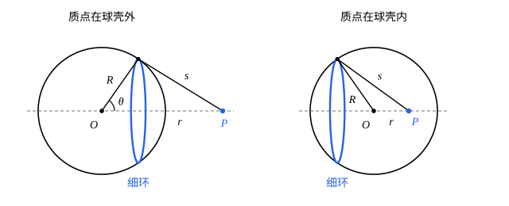

## 这一节要回答的问题

算地球对月球、对地面上的苹果的:term[引力]{id="physics.newtonian-mechanics.gravitation"}（gravitation）时，都把地球当作:term[质量]{id="physics.newtonian-mechanics.mass"}（mass）集中在地心的质点。地球这么大，离苹果近的部分和远的部分，拉苹果的方向、远近都不一样，这样算为什么对？如果挖一条穿过地心的隧道，隧道里的物体受多大的引力？

## 讲解

### 引力势能的叠加

几个质点同时吸引质点$m$时，它们的:term[引力]{id="physics.newtonian-mechanics.gravitation"}按矢量相加；:term[合力]{id="physics.newtonian-mechanics.net-force"}（net force）做的:term[功]{id="physics.newtonian-mechanics.work"}（work）等于各个:term[力]{id="physics.newtonian-mechanics.force"}（force）做的功之和，所以合力的:term[势能]{id="physics.newtonian-mechanics.potential-energy"}（potential energy）就是各个:term[引力势能]{id="physics.newtonian-mechanics.gravitational-potential-energy-universal"}（gravitational potential energy）之和，$U=-\sum_i\frac{GM_im}{r_i}$，$r_i$是$m$到第$i$个质点的距离。连续分布的物体，把它分成许多小块，求和就变成积分。势能是标量，把它们加起来，比把一个个引力按矢量相加省事得多。

### 球壳定理

::anchor{id="thm-shell"}
定理（:term[球壳定理]{id="physics.newtonian-mechanics.shell-theorem"}，shell theorem）：:term[质量]{id="physics.newtonian-mechanics.mass"}为$M$、半径为$R$、质量均匀分布的薄球壳，和离球心$r$的质点$m$：$r>R$时，球壳对质点的:term[引力]{id="physics.newtonian-mechanics.gravitation"}和质量全部集中在球心时一样，指向球心，大小是$\frac{GMm}{r^2}$；$r<R$时，球壳对质点的引力为零。

证明思路：以球心$O$为原点、$OP$为$z$轴取球坐标（spherical coordinates），$P$是质点所在的位置。半径$R$处的体积元（volume element）是$R^2\sin\theta\,\dd R\dd\theta\dd\varphi$，所以球壳上极角在$\theta$到$\theta+\dd\theta$之间的细环，体积占整个球壳的$\frac{2\pi R^2\sin\theta\,\dd\theta}{4\pi R^2}$，质量是$\dd M=\frac M2\sin\theta\,\dd\theta$。由余弦定理（law of cosines），环上每一点到$P$的距离都是$s=\sqrt{r^2+R^2-2rR\cos\theta}$，所以质点的:term[势能]{id="physics.newtonian-mechanics.potential-energy"}是

$$
U(r)=-\frac{GMm}2\int_0^\pi\frac{\sin\theta}{s}\,\dd\theta .
$$

由链式法则（chain rule），$\dv s\theta=\frac{rR\sin\theta}s$，所以被积函数（integrand）有原函数（antiderivative）$\frac s{rR}$，由牛顿-莱布尼茨公式（Newton-Leibniz formula），$U(r)=-\frac{GMm}{2rR}\bigl[s(\pi)-s(0)\bigr]=-\frac{GMm}{2rR}\bigl[(r+R)-|r-R|\bigr]$。$r>R$时方括号是$2R$，$U=-\frac{GMm}r$，和质量集中在球心时的:term[引力势能]{id="physics.newtonian-mechanics.gravitational-potential-energy-universal"}一样；$r<R$时方括号是$2r$，$U=-\frac{GMm}R$，是常数。

每个细环都关于$OP$对称，对$P$的引力沿着$OP$，整个球壳的引力也沿着$OP$。让$P$沿$OP$所在的直线移动，由[势能与机械能守恒](lesson:physics.newtonian-mechanics.potential-energy#thm-force-from-potential)里的定理，沿这条直线的:term[力]{id="physics.newtonian-mechanics.force"}是$-\dv Ur$：球壳外是$-\frac{GMm}{r^2}$，即指向球心、大小为$\frac{GMm}{r^2}$；球壳内是零。

这个定理说明，质量球对称分布的天体，对外面的质点可以当作质点，[万有引力定律](lesson:physics.newtonian-mechanics.gravitation)里算$g$和圆轨道时正是这样做的。两件事缺一不可：质量分布要球对称，引力要和距离的平方成反比，换成别的规律，$s$就约不掉，球壳里面也不再没有引力。

### 均匀球体

::anchor{id="thm-solid-sphere"}
定理：:term[质量]{id="physics.newtonian-mechanics.mass"}为$M$、半径为$R$的均匀球体，对离球心$r$的质点$m$的:term[引力]{id="physics.newtonian-mechanics.gravitation"}指向球心：$r\ge R$时大小是$\frac{GMm}{r^2}$，如同质量集中在球心；$r<R$时大小是$\frac{GMmr}{R^3}$，和$r$成正比。

证明思路：把球体分成许多同心的薄球壳。半径大于$r$的球壳，对质点的引力都是零；半径小于$r$的，每一个都像质量集中在球心，合起来就是半径为$r$的那部分球体的质量$M\frac{r^3}{R^3}$集中在球心，引力$\frac{Gm}{r^2}\cdot M\frac{r^3}{R^3}=\frac{GMmr}{R^3}$。$r\ge R$时所有的球壳都在里面。

同样的道理，密度只随到球心的距离变化的球体，对外面的质点也如同质量集中在球心，对里面的质点只有半径$r$以内的质量起作用。均匀的地球里，$g$从地面到地心按$r$线性减小到零；真实的地球越往里越密，从地面往下走，$g$起先反而略有增大。

## 几何图像

左图：以$OP$为轴把球壳切成细环，同一个细环上的点到$P$的距离都是$s$；$\theta$从$0$变到$\pi$，$s$从$r-R$变到$r+R$。右图：质点在球壳内，$s$从$R-r$变到$R+r$。两种情形只差在$s$最小是多少，算出的:term[引力势能]{id="physics.newtonian-mechanics.gravitational-potential-energy-universal"}一个随$r$变，一个是常数。

:::anim{component="function-plot"}
range: { x: [0, 3], y: [0, 1.15] }
functions:
  - expr: "min(x, 1)^3/x^2"
    label: |
      均匀球体
  - expr: "max(min(x, 1)^3 - a^3, 0)/((1 - a^3)*x^2)"
    label: |
      内半径为$aR$的空心球
sliders:
  - name: a
    min: 0
    max: 0.95
    step: 0.05
    default: 0.6
    label: |
      空心球的内半径$a$（以$R$为单位）
:::

横轴是$\frac rR$，图上写作$x$；纵轴是:term[引力]{id="physics.newtonian-mechanics.gravitation"}的大小，以球面上的$\frac{GMm}{R^2}$为单位，两个球的:term[质量]{id="physics.newtonian-mechanics.mass"}都是$M$、外半径都是$R$。蓝线是均匀球体：球内引力和$r$成正比，球外按$\frac1{r^2}$减小。橙线是挖去中心的空心球：$r<aR$时引力为零，正是:term[球壳定理]{id="physics.newtonian-mechanics.shell-theorem"}；$r>R$时两条线重合。$a$接近$1$时，空心球成了薄球壳。

## 例题

### 例 1　地面下的重力加速度

把地球当作均匀球体，半径$6.37\times10^6\,\mathrm m$，地面上的:term[重力加速度]{id="physics.newtonian-mechanics.gravitational-acceleration"}（gravitational acceleration）是$9.8\,\mathrm{m/s^2}$。地下$1000\,\mathrm{km}$处的重力加速度是多少？离地面多高处和它相同？

**为什么想到这么做**：地下只有半径$r$以内的部分起作用，:term[引力]{id="physics.newtonian-mechanics.gravitation"}和$r$成正比，所以$g(r)=g\frac rR$；地面以上照旧是$g\frac{R^2}{r^2}$。

**推导**：地下$1000\,\mathrm{km}$处，$r=5.37\times10^6\,\mathrm m$，$g(r)=9.8\times\frac{5.37}{6.37}\approx8.26\,\mathrm{m/s^2}$。地面以上要$\frac{R^2}{(R+h)^2}=\frac{5.37}{6.37}$，$R+h=R\sqrt{\frac{6.37}{5.37}}\approx1.089R$，$h\approx5.7\times10^5\,\mathrm m$，约$570\,\mathrm{km}$：往上走，$g$减小得比往下走快。

### 例 2　穿过地心的隧道

沿地球的一条直径挖一条光滑的隧道，不计空气，把地球当作均匀球体，半径$R=6.37\times10^6\,\mathrm m$，地面上$g=9.8\,\mathrm{m/s^2}$。物体从隧道口由静止落下，到达地心时:term[速率]{id="physics.newtonian-mechanics.speed"}（speed）多大？

**为什么想到这么做**：隧道里物体只受:term[引力]{id="physics.newtonian-mechanics.gravitation"}，沿隧道做直线运动，引力随位置变化；用一维的:term[功]{id="physics.newtonian-mechanics.work"}$\int F\,\dd r$和:term[动能定理]{id="physics.newtonian-mechanics.work-energy-theorem"}（work-energy theorem）。

**推导**：离地心$r$处引力指向地心，大小$\frac{GMmr}{R^3}=\frac{mgr}R$。从$r=R$落到$r=0$，引力做的功是$\int_R^0\Bigl(-\frac{mgr}R\Bigr)\dd r=\frac12mgR$，所以$\frac12mv^2=\frac12mgR$，$v=\sqrt{gR}\approx7.9\,\mathrm{km/s}$，正好是:term[第一宇宙速度]{id="physics.newtonian-mechanics.first-cosmic-velocity"}（first cosmic velocity）。物体冲过地心，减速到另一端的隧道口时:term[速度]{id="physics.newtonian-mechanics.velocity"}（velocity）为零，然后再落回来。

## 常见误区

- 「均匀球壳里面没有:term[引力]{id="physics.newtonian-mechanics.gravitation"}，那里的:term[引力势能]{id="physics.newtonian-mechanics.gravitational-potential-energy-universal"}也是零。」引力为零说明:term[势能]{id="physics.newtonian-mechanics.potential-energy"}处处相同，不说明它是零；球壳里的引力势能是$-\frac{GMm}R$。
- 「越往地心走，引力越大。」地球内部只有半径$r$以内的部分起作用，均匀球体内的引力和$r$成正比，到地心是零。
- 「任何形状的物体，对外面的质点的引力都可以看作:term[质量]{id="physics.newtonian-mechanics.mass"}集中在它的中心。」只有质量球对称分布时才行，一根长棒就不行。
