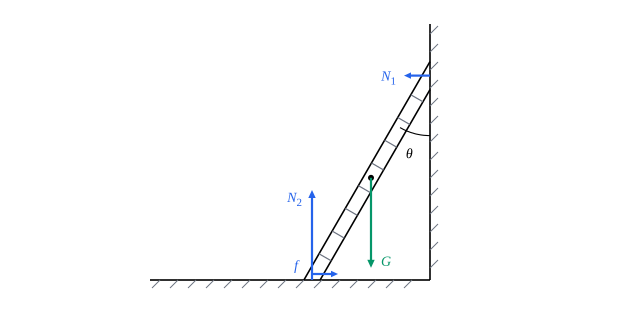

## 这一节要回答的问题

梯子靠在光滑的墙上，地面要有多大的:term[摩擦力]{id="physics.newtonian-mechanics.friction"}（friction）才托得住它？墙上伸出的一根横杆用绳子斜拉着，绳子要承受多大的:term[力]{id="physics.newtonian-mechanics.force"}（force）？一个物体要保持静止，光是受的力加起来为零就够了吗？

## 讲解

### 平衡条件

::anchor{id="thm-equilibrium"}
定理：:term[刚体]{id="physics.newtonian-mechanics.rigid-body"}（rigid body）保持静止，:term[外力]{id="physics.newtonian-mechanics.external-force"}（external force）之和必须为零，外力对任一点的:term[力矩]{id="physics.newtonian-mechanics.torque"}（torque）之和也必须为零。

证明思路：刚体静止，:term[质心]{id="physics.newtonian-mechanics.center-of-mass"}（center of mass）的:term[加速度]{id="physics.newtonian-mechanics.acceleration"}（acceleration）为零，由:term[质心运动定理]{id="physics.newtonian-mechanics.center-of-mass-theorem"}（center-of-mass theorem），外力之和为零；对任一固定点，:term[角动量]{id="physics.newtonian-mechanics.angular-momentum"}（angular momentum）一直是零，由[质点系的角动量守恒](lesson:physics.newtonian-mechanics.angular-momentum-systems#thm-system-angular-momentum)里的定理，外力矩之和为零。反过来，原来静止的刚体满足这两个条件时，质心不会动起来；在平面问题里，绕质心的角动量$I_{\mathrm C}\omega$也一直是零，刚体不会转起来。

::anchor{id="thm-any-point"}
推论：外力之和为零时，外力对任意两点的力矩之和相等。

证明思路：设$\vb a=\overrightarrow{O'O}$，第$i$个:term[力]{id="physics.newtonian-mechanics.force"}的作用点相对$O'$的位置是$\vb a+\vb r_i$，$\vb r_i$是它相对$O$的位置。所以$\sum_i(\vb a+\vb r_i)\times\vb F_i=\vb a\times\sum_i\vb F_i+\sum_i\vb r_i\times\vb F_i$，外力之和为零时第一项是零。

所以力矩可以对任意一点取，最方便的是取在未知力的作用线上：它的:term[力臂]{id="physics.newtonian-mechanics.moment-arm"}（moment arm）是零，方程里就没有它。所有力都在一个平面里时，一共有三个独立的方程：两个方向的力之和为零，加上对一点的力矩之和为零。边界情况：未知量比独立的方程多时，单靠平衡条件定不出每个力，例如四条腿的桌子，四条腿的力都竖直，独立的方程只有三个（第 8 题）。

### 重心

::anchor{id="def-center-of-gravity"}
:term[重力]{id="physics.newtonian-mechanics.weight"}（weight）对:term[刚体]{id="physics.newtonian-mechanics.rigid-body"}各部分的:term[力矩]{id="physics.newtonian-mechanics.torque"}之和，等于把总重力作用在相对刚体固定的某一点上产生的力矩，而且不论物体怎样摆放都成立，这一点叫作:term[重心]{id="physics.newtonian-mechanics.center-of-gravity"}（center of gravity）。:term[重力加速度]{id="physics.newtonian-mechanics.gravitational-acceleration"}（gravitational acceleration）处处相同时，重心就是:term[质心]{id="physics.newtonian-mechanics.center-of-mass"}：$\sum_i\vb r_i\times m_i\vb g=\Bigl(\sum_im_i\vb r_i\Bigr)\times\vb g=\vb r_{\mathrm C}\times M\vb g$。

为什么这样定义：有了重心，分析平衡时就可以把物体受的重力当作作用在重心上的一个:term[力]{id="physics.newtonian-mechanics.force"}。用绳子吊起一个物体，静止时重心在吊点的正下方，否则重力对吊点有力矩；换一个吊点再吊一次，两条竖直线的交点就是重心。边界情况：重心不一定在物体上，圆环的重心在环的中心；物体大到各处的重力明显不同时，重心和质心就不再重合。

### 杠杆

::anchor{id="def-lever"}
能绕一个固定点转动的硬棒叫作:term[杠杆]{id="physics.newtonian-mechanics.lever"}（lever），这个固定点叫作支点（fulcrum）。不计杠杆受的:term[重力]{id="physics.newtonian-mechanics.weight"}时，它平衡的条件是$F_1l_1=F_2l_2$，$l_1$、$l_2$是两个:term[力]{id="physics.newtonian-mechanics.force"}的:term[力臂]{id="physics.newtonian-mechanics.moment-arm"}。

为什么这样定义：撬棍、剪刀、跷跷板都是杠杆。对支点取:term[力矩]{id="physics.newtonian-mechanics.torque"}，支点的力不出现，平衡条件就是两个力的力矩大小相等、方向相反；人用力的那一边力臂长，就能用小力撬起重物，反过来费力却省距离，比如筷子。边界情况：杠杆受的重力不能忽略时，还要算上它作用在:term[重心]{id="physics.newtonian-mechanics.center-of-gravity"}上的力矩。

## 几何图像

按例 2 的数画，$\theta=30^\circ$，箭头的长短和:term[力]{id="physics.newtonian-mechanics.force"}的大小成正比。竖直方向，:term[支持力]{id="physics.newtonian-mechanics.normal-force"}（normal force）$N_2$和:term[重力]{id="physics.newtonian-mechanics.weight"}$G$平衡；水平方向，:term[静摩擦力]{id="physics.newtonian-mechanics.static-friction"}（static friction）$f$和墙的支持力$N_1$平衡。$N_1$和$f$这一对力组成:term[力偶]{id="physics.newtonian-mechanics.couple"}（couple），它的:term[力矩]{id="physics.newtonian-mechanics.torque"}和$N_2$、$G$这一对的力矩抵消，梯子才不转。

## 例题

### 例 1　斜拉着的横杆

一根长$1.2\,\mathrm m$、:term[质量]{id="physics.newtonian-mechanics.mass"}（mass）$4.0\,\mathrm{kg}$的均匀横杆，一端用铰链（hinge）装在竖直的墙上，另一端用绳子斜拉到墙上，绳子和杆成$30^\circ$角，杆保持水平；杆的另一端还挂着$6.0\,\mathrm{kg}$的重物，$g$取$9.8\,\mathrm{m/s^2}$。绳子的:term[拉力]{id="physics.newtonian-mechanics.tension"}（tension）和铰链对杆的:term[力]{id="physics.newtonian-mechanics.force"}各是多少？

**为什么想到这么做**：铰链的力大小、方向都不知道，对铰链取:term[力矩]{id="physics.newtonian-mechanics.torque"}，它就不出现，一个方程就解出拉力；再由水平、竖直方向的力之和为零求铰链的力。杆受的:term[重力]{id="physics.newtonian-mechanics.weight"}作用在中点。

**推导**：对铰链，$T\sin30^\circ\times1.2=4.0\times9.8\times0.6+6.0\times9.8\times1.2$，$T=156.8\,\mathrm N$。水平方向，铰链的力的分量$H=T\cos30^\circ\approx136\,\mathrm N$，指向离开墙的方向；竖直方向$V=(4.0+6.0)\times9.8-T\sin30^\circ=19.6\,\mathrm N$，向上。铰链的力约$137\,\mathrm N$，并不沿着杆。

### 例 2　靠墙的梯子

长$l$、:term[质量]{id="physics.newtonian-mechanics.mass"}$m$的均匀梯子靠在光滑的竖直墙上，下端放在粗糙的水平地面上，梯子和墙成$\theta$角静止。地面对梯子的:term[摩擦力]{id="physics.newtonian-mechanics.friction"}多大？$\theta=30^\circ$时，地面的:term[静摩擦因数]{id="physics.newtonian-mechanics.coefficient-of-static-friction"}（coefficient of static friction）至少要多大？

**为什么想到这么做**：梯子受:term[重力]{id="physics.newtonian-mechanics.weight"}、墙的:term[支持力]{id="physics.newtonian-mechanics.normal-force"}$N_1$（墙光滑，只有水平方向）、地面的支持力$N_2$和摩擦力$f$。对下端取:term[力矩]{id="physics.newtonian-mechanics.torque"}，$N_2$和$f$都不出现。

**推导**：竖直方向$N_2=mg$，水平方向$f=N_1$。对下端，$N_1l\cos\theta=mg\cdot\frac l2\sin\theta$，所以$f=N_1=\frac12mg\tan\theta$。要$f\le\mu_{\mathrm s}N_2$，就要$\mu_{\mathrm s}\ge\frac12\tan\theta$，$\theta=30^\circ$时约为$0.289$；梯子越斜，要的摩擦越大。

## 常见误区

- 「:term[外力]{id="physics.newtonian-mechanics.external-force"}之和为零，物体就保持静止。」还要:term[力矩]{id="physics.newtonian-mechanics.torque"}之和为零：:term[力偶]{id="physics.newtonian-mechanics.couple"}的两个:term[力]{id="physics.newtonian-mechanics.force"}之和为零，却能让物体转起来。
- 「力矩一定要对支点或转轴取。」外力之和为零时，对哪一点取都一样，取在未知力最多的那一点最省事。
- 「:term[重心]{id="physics.newtonian-mechanics.center-of-gravity"}一定在物体上。」圆环、弯成 U 形的铁丝，重心都在物体外面。
