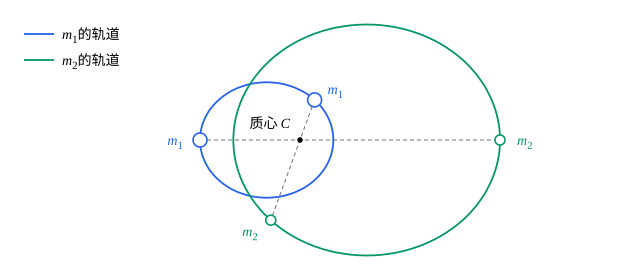

## 这一节要回答的问题

讲开普勒定律时，太阳被当作不动的；可行星吸引太阳的:term[力]{id="physics.newtonian-mechanics.force"}（force）和太阳吸引行星的一样大，太阳也在动。天文学家正是靠一颗恒星周期性的微小晃动，发现了绕它转的行星。两个物体互相吸引、都在运动时，怎样求它们的运动？

## 讲解

### 质心运动和相对运动

两个质点$m_1$、$m_2$只受彼此的:term[力]{id="physics.newtonian-mechanics.force"}，设$m_2$对$m_1$的力是$\vb F$，由:term[牛顿第三定律]{id="physics.newtonian-mechanics.newtons-third-law"}（Newton's third law），$m_1$对$m_2$的力是$-\vb F$。取:term[质心]{id="physics.newtonian-mechanics.center-of-mass"}（center of mass）的位置$\vb r_{\mathrm C}=\frac{m_1\vb r_1+m_2\vb r_2}M$（$M=m_1+m_2$）和相对位置$\vb r=\vb r_1-\vb r_2$作新的变量，反解出$\vb r_1=\vb r_{\mathrm C}+\frac{m_2}M\vb r$，$\vb r_2=\vb r_{\mathrm C}-\frac{m_1}M\vb r$。

::anchor{id="def-reduced-mass"}
$\mu=\frac{m_1m_2}{m_1+m_2}$叫作这两个质点的:term[约化质量]{id="physics.newtonian-mechanics.reduced-mass"}（reduced mass）。

为什么这样定义：由下面的定理，相对位置$\vb r$的运动，就像一个:term[质量]{id="physics.newtonian-mechanics.mass"}（mass）为$\mu$的质点受力$\vb F$，两个物体的问题化成了一个物体的问题。$\frac1\mu=\frac1{m_1}+\frac1{m_2}$，所以$\mu$比$m_1$、$m_2$都小。边界情况：$m_2\gg m_1$时$\mu\approx m_1$，重的那个几乎不动，回到把它当作固定力心的做法；两个质量相等时，$\mu$是其中一个的一半。

::anchor{id="thm-two-body"}
定理：两个质点只受彼此的力时，质心做匀速直线运动；相对位置满足$\mu\dv{^2\vb r}{t^2}=\vb F$。

证明思路：这两个质点组成的系统不受:term[外力]{id="physics.newtonian-mechanics.external-force"}（external force），由[质心与动量守恒](lesson:physics.newtonian-mechanics.momentum-conservation#thm-cm-motion)里的定理，质心的:term[加速度]{id="physics.newtonian-mechanics.acceleration"}（acceleration）为零。又$m_1\vb a_1=\vb F$，$m_2\vb a_2=-\vb F$，所以$\vb a_1-\vb a_2=\Bigl(\frac1{m_1}+\frac1{m_2}\Bigr)\vb F=\frac{\vb F}\mu$。

$\vb F$沿两者的连线、大小只和距离$r$有关时，对相对运动来说它是一个:term[有心力]{id="physics.newtonian-mechanics.central-force"}（central force），力心就是另一个质点所在的地方。[有心力与有效势](lesson:physics.newtonian-mechanics.central-forces)里的结论全都可以照搬，只是把$m$换成$\mu$。

### 能量和角动量

:term[质心]{id="physics.newtonian-mechanics.center-of-mass"}做匀速直线运动，:term[质心系]{id="physics.newtonian-mechanics.center-of-mass-frame"}（center-of-mass frame）是:term[惯性系]{id="physics.newtonian-mechanics.inertial-frame"}（inertial frame）。在质心系里，$\vb r_1'=\frac{m_2}M\vb r$，$\vb r_2'=-\frac{m_1}M\vb r$，两个质点总在质心的两侧，和质心在一条直线上。

::anchor{id="thm-two-body-energy"}
定理：两个质点的总:term[动能]{id="physics.newtonian-mechanics.kinetic-energy"}（kinetic energy）是$\frac12Mv_{\mathrm C}^2+\frac12\mu v^2$，$\vb v=\dv{\vb r}t$是:term[相对速度]{id="physics.newtonian-mechanics.velocity"}（relative velocity）；在质心系里，两个质点对质心的:term[角动量]{id="physics.newtonian-mechanics.angular-momentum"}（angular momentum）之和是$\mu\vb r\times\vb v$，并且保持不变。

证明思路：由:term[柯尼希定理]{id="physics.newtonian-mechanics.koenigs-theorem"}（König's theorem，见[质心系](lesson:physics.newtonian-mechanics.center-of-mass-frame#thm-koenig)），总动能是质心的动能加上质心系里的动能。质心系里$\vb v_1'=\frac{m_2}M\vb v$，$\vb v_2'=-\frac{m_1}M\vb v$，动能是$\frac12m_1\frac{m_2^2}{M^2}v^2+\frac12m_2\frac{m_1^2}{M^2}v^2=\frac12\mu v^2$；同样，$m_1\vb r_1'\times\vb v_1'+m_2\vb r_2'\times\vb v_2'=\mu\vb r\times\vb v$。$\vb F$沿两者的连线，而这条连线过质心，所以它对质心的:term[力矩]{id="physics.newtonian-mechanics.torque"}（torque）为零，每个质点对质心的角动量都不变。

所以相对运动的能量$\frac12\mu v^2+U(r)$和角动量$\mu\vb r\times\vb v$都守恒，:term[有效势]{id="physics.newtonian-mechanics.effective-potential"}（effective potential）是$U(r)+\frac{L^2}{2\mu r^2}$。

### 引力下的二体问题

::anchor{id="thm-two-body-gravity"}
定理：两个质点只受彼此的:term[万有引力]{id="physics.newtonian-mechanics.gravitation"}（gravitation），相对位置的运动和一个质点绕固定不动、:term[质量]{id="physics.newtonian-mechanics.mass"}为$m_1+m_2$的天体的运动一样。轨道有界时，相对轨道是椭圆，周期$T$和半长轴$a$满足$T^2=\frac{4\pi^2a^3}{G(m_1+m_2)}$；两个质点各自沿相似的椭圆绕:term[质心]{id="physics.newtonian-mechanics.center-of-mass"}运动，焦点都在质心，大小之比是$m_2:m_1$。

证明思路：$\vb F=-\frac{Gm_1m_2}{r^2}\uv r$，$\uv r=\frac{\vb r}r$，所以$\dv{^2\vb r}{t^2}=\frac{\vb F}\mu=-\frac{G(m_1+m_2)}{r^2}\uv r$。这正是质点绕固定的、质量为$m_1+m_2$的天体运动的方程（质点自己的质量约掉了），由[开普勒定律与轨道方程](lesson:physics.newtonian-mechanics.kepler-orbits)，有界的轨道是焦点在$\vb r=\vb 0$的椭圆，周期满足上式。:term[质心系]{id="physics.newtonian-mechanics.center-of-mass-frame"}里$\vb r_1'=\frac{m_2}M\vb r$，$\vb r_2'=-\frac{m_1}M\vb r$，是把相对轨道按比例缩小、一个反向得到的。

所以严格地说，:term[开普勒第三定律]{id="physics.newtonian-mechanics.keplers-third-law"}（Kepler's third law）里的$\frac{T^2}{a^3}$是$\frac{4\pi^2}{G(M+m)}$，对各个行星略有不同；木星的质量约是太阳的$\frac1{1047}$，差别也只有千分之一。

## 几何图像

$m_1$的:term[质量]{id="physics.newtonian-mechanics.mass"}是$m_2$的两倍。每个时刻，$m_1$、:term[质心]{id="physics.newtonian-mechanics.center-of-mass"}$C$、$m_2$在一条直线上，$m_1$到$C$的距离是$m_2$到$C$的一半；两条轨道都是焦点在$C$的椭圆，偏心率相同，$m_1$的小一半，朝相反的方向伸展。相对位置$\vb r=\vb r_1-\vb r_2$走的是一个更大的椭圆，它的半长轴是两条轨道的半长轴之和。

## 例题

### 例 1　双星的质量

两颗恒星绕共同的:term[质心]{id="physics.newtonian-mechanics.center-of-mass"}做:term[匀速圆周运动]{id="physics.newtonian-mechanics.uniform-circular-motion"}（uniform circular motion），周期是$10$年，相距$10\,\mathrm{AU}$，星 1 到质心的距离是星 2 的一半。两颗星的:term[质量]{id="physics.newtonian-mechanics.mass"}各是太阳的多少倍？地球绕太阳的轨道近似是半径$1\,\mathrm{AU}$的圆，周期$1$年，地球的质量相对太阳可以不计。

**为什么想到这么做**：相对轨道是半径$10\,\mathrm{AU}$的圆，由$T^2=\frac{4\pi^2a^3}{G(m_1+m_2)}$求出总质量，拿地球和太阳作比较；再由两颗星到质心的距离之比，求出质量之比。

**推导**：对地球和太阳，$GM_{\text{日}}=\frac{4\pi^2(1\,\mathrm{AU})^3}{(1\,\text{年})^2}$，所以$\frac{m_1+m_2}{M_{\text{日}}}=\frac{10^3}{10^2}=10$。两颗星到质心的距离$r_1$、$r_2$满足$m_1r_1=m_2r_2$，$r_1=\frac{r_2}2$，所以$m_1=2m_2$，$m_1\approx6.7M_{\text{日}}$，$m_2\approx3.3M_{\text{日}}$。只量出相对轨道，只能得到总质量；要分出各自的质量，还得知道它们各自绕质心转的大小。

### 例 2　太阳也在转

木星的:term[质量]{id="physics.newtonian-mechanics.mass"}约是太阳的$\frac1{1047}$，轨道的半长轴约$7.78\times10^{11}\,\mathrm m$，周期约$11.9$年，把木星的轨道当作圆。只考虑木星，太阳绕两者的:term[质心]{id="physics.newtonian-mechanics.center-of-mass"}转的半径和:term[速率]{id="physics.newtonian-mechanics.speed"}（speed）各是多少？太阳的半径约$6.96\times10^8\,\mathrm m$。

**为什么想到这么做**：太阳和木星各自绕质心转，到质心的距离和质量成反比；两者转一圈的时间相同。

**推导**：太阳到质心的距离是$\frac{m_{\text{木}}}{M_{\text{日}}+m_{\text{木}}}a=\frac{7.78\times10^{11}}{1048}\approx7.42\times10^8\,\mathrm m$，比太阳的半径还大一点，质心在太阳表面外面。太阳的速率$\frac{2\pi\times7.42\times10^8}{11.9\times3.16\times10^7\,\mathrm s}\approx12.4\,\mathrm{m/s}$。远处的人看这颗恒星，它以$12\,\mathrm{m/s}$左右的速率来回晃动，周期约$12$年，由此就能推断出有一颗木星那样的行星绕它转，这正是寻找太阳系外行星的一种办法。

## 常见误区

- 「:term[约化质量]{id="physics.newtonian-mechanics.reduced-mass"}是两个:term[质量]{id="physics.newtonian-mechanics.mass"}的平均值。」它比两个质量都小，$\frac1\mu=\frac1{m_1}+\frac1{m_2}$。
- 「地球绕着太阳的中心转。」地球和太阳都绕两者的:term[质心]{id="physics.newtonian-mechanics.center-of-mass"}转，这个质心离太阳的中心只有约$450\,\mathrm{km}$，所以把太阳当作不动的误差很小。
- 「质量大的那个绕质心转得慢，周期也长。」两者总在质心的两侧、和质心在一条直线上，周期相同；质量大的轨道小，:term[速率]{id="physics.newtonian-mechanics.speed"}也小。
