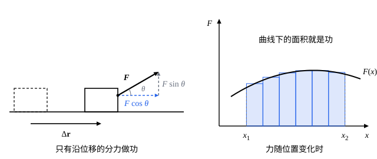

## 这一节要回答的问题

用同样大的:term[力]{id="physics.newtonian-mechanics.force"}（force）推着箱子在光滑的地面上走同样远，顺着地面推和斜着往下推，箱子得到的:term[速度]{id="physics.newtonian-mechanics.velocity"}（velocity）不一样。提着水桶沿水平路面走，手一直在使劲，水桶却没有变快。力在一段路程上的累积效果该怎样量？力随位置变化时，比如拉长的弹簧，又怎样算它让物体快了多少？

## 讲解

### 功

::anchor{id="def-work"}
大小、方向都不变的:term[力]{id="physics.newtonian-mechanics.force"}$\vb F$作用在沿直线运动的质点上，质点的:term[位移]{id="physics.newtonian-mechanics.displacement"}（displacement）是$\Delta\vb r$，点积（dot product）$W=\vb F\cdot\Delta\vb r=F|\Delta\vb r|\cos\theta$叫作这个力做的:term[功]{id="physics.newtonian-mechanics.work"}（work），$\theta$是力和位移的夹角。功的单位是焦耳，$1\,\mathrm J=1\,\mathrm{N\cdot m}$。

为什么这样定义：只有沿位移方向的分力$F\cos\theta$让质点变快或变慢，垂直于位移的分力只改变运动的方向，这一点下面会说明。所以功只算沿位移的分力，乘上位移的大小。边界情况：$\theta>90^\circ$时功是负的，例如竖直上抛的物体上升时，:term[重力]{id="physics.newtonian-mechanics.weight"}（weight）做负功；力和位移垂直时不做功，提着水桶水平走时，手对水桶的力就不做功。

### 功率与变力的功

::anchor{id="def-power"}
:term[力]{id="physics.newtonian-mechanics.force"}$\vb F$作用在:term[速度]{id="physics.newtonian-mechanics.velocity"}为$\vb v$的质点上，$P=\vb F\cdot\vb v$叫作这个力的:term[功率]{id="physics.newtonian-mechanics.power"}（power），单位是瓦特，$1\,\mathrm W=1\,\mathrm{J/s}$。

为什么这样定义：在很短的时间$\Delta t$里，质点的:term[位移]{id="physics.newtonian-mechanics.displacement"}约为$\vb v\Delta t$，力近似不变，做的:term[功]{id="physics.newtonian-mechanics.work"}约为$\vb F\cdot\vb v\Delta t$，所以$P$是做功的快慢。边界情况：力和速度的夹角大于$90^\circ$时，功率是负的，这个力正在使质点变慢，例如用手接住飞来的球时手对球的力。

::anchor{id="def-work-general"}
力和速度都随时间变化、质点沿曲线运动时，力从$t_1$到$t_2$做的功规定为功率对时间的积分：$W=\int_{t_1}^{t_2}\vb F\cdot\vb v\,\dd t$。

为什么这样规定：把这段时间分成许多小段，每一小段里的功近似是$\vb F\cdot\vb v\Delta t$，加起来再越分越细就是这个积分。力不变、质点沿直线运动时，$\int\vb v\,\dd t=\Delta\vb r$，回到上面的$\vb F\cdot\Delta\vb r$。边界情况：质点沿$x$轴运动、力$F(x)$只随位置变化时，$W=\int_{x_1}^{x_2}F(x)\,\dd x$，就是$F$随$x$变化的曲线下的面积，即使质点中途折返也成立：设$G'=F$，由链式法则（chain rule），$G\bigl(x(t)\bigr)$对$t$的导数是$F\bigl(x(t)\bigr)v(t)$，再用牛顿-莱布尼茨公式（Newton-Leibniz formula）就得到它。

### 动能定理

::anchor{id="def-kinetic-energy"}
:term[质量]{id="physics.newtonian-mechanics.mass"}（mass）为$m$、:term[速率]{id="physics.newtonian-mechanics.speed"}（speed）为$v$的质点，$K=\frac12mv^2$叫作它的:term[动能]{id="physics.newtonian-mechanics.kinetic-energy"}（kinetic energy）。

为什么这样定义：下面的定理说明，:term[合力]{id="physics.newtonian-mechanics.net-force"}（net force）做的:term[功]{id="physics.newtonian-mechanics.work"}恰好等于$\frac12mv^2$的改变，这个量值得起一个名字。边界情况：动能是标量，只和速率有关，以原来的速率弹回的球，:term[速度]{id="physics.newtonian-mechanics.velocity"}反了向，动能却没有变。

::anchor{id="thm-work-energy"}
定理（:term[动能定理]{id="physics.newtonian-mechanics.work-energy-theorem"}，work-energy theorem）：在:term[惯性系]{id="physics.newtonian-mechanics.inertial-frame"}（inertial frame）里，质点的动能的变化率等于合力的:term[功率]{id="physics.newtonian-mechanics.power"}，$\dv Kt=\vb F\cdot\vb v$；所以合力在一段时间里做的功等于动能的改变，$W=K_2-K_1$。

证明思路：$v^2=\vb v\cdot\vb v=v_x^2+v_y^2+v_z^2$，逐个分量求导，$\dv{(v^2)}t=2\vb v\cdot\vb a$。由:term[牛顿第二定律]{id="physics.newtonian-mechanics.newtons-second-law"}（Newton's second law），$\dv Kt=m\vb v\cdot\vb a=\vb F\cdot\vb v$。把它从$t_1$到$t_2$积分，由牛顿-莱布尼茨公式，左边是$K_2-K_1$，右边就是合力做的功。

## 几何图像

左图：只有:term[力]{id="physics.newtonian-mechanics.force"}沿:term[位移]{id="physics.newtonian-mechanics.displacement"}的分量$F\cos\theta$做:term[功]{id="physics.newtonian-mechanics.work"}，竖直的分量$F\sin\theta$和位移垂直，不做功。右图：力随位置变化时，把位移分成许多小段，每段的功近似是$F(x_i)\Delta x$，加起来越分越细，就是曲线下面的面积$\int_{x_1}^{x_2}F\,\dd x$；:term[弹力]{id="physics.newtonian-mechanics.elastic-force"}（elastic force）$-kx$的曲线是直线，面积是三角形（例 1）。

## 例题

### 例 1　弹簧把木块弹出

光滑水平面上，:term[劲度系数]{id="physics.newtonian-mechanics.spring-constant"}（spring constant）$k=200\,\mathrm{N/m}$的弹簧一端固定，另一端顶着:term[质量]{id="physics.newtonian-mechanics.mass"}$0.50\,\mathrm{kg}$的木块，弹簧被压缩了$0.10\,\mathrm m$。放手后，木块离开弹簧时的:term[速率]{id="physics.newtonian-mechanics.speed"}多大？

**为什么想到这么做**：弹簧的:term[弹力]{id="physics.newtonian-mechanics.elastic-force"}随位置变化，用$\int F\,\dd x$算它做的:term[功]{id="physics.newtonian-mechanics.work"}，再由:term[动能定理]{id="physics.newtonian-mechanics.work-energy-theorem"}求速率。竖直方向的:term[重力]{id="physics.newtonian-mechanics.weight"}和:term[支持力]{id="physics.newtonian-mechanics.normal-force"}（normal force）和运动方向垂直，不做功。

**推导**：取弹簧原长时木块的位置为原点，木块从$x=-0.10\,\mathrm m$运动到$x=0$，弹力是$F=-kx$。功$W=\int_{-0.10}^0(-kx)\,\dd x=-\frac12kx^2\Big|_{-0.10}^0=\frac12\times200\times0.10^2=1.0\,\mathrm J$。由动能定理，$\frac12\times0.50\,v^2=1.0$，$v=2.0\,\mathrm{m/s}$。

### 例 2　拉短绳子，越转越快

[力矩与角动量](lesson:physics.newtonian-mechanics.angular-momentum)的例 2 里，光滑水平桌面上的小球绕小孔做圆周运动，在桌下慢慢拉绳，半径从$0.50\,\mathrm m$拉到$0.25\,\mathrm m$，:term[速率]{id="physics.newtonian-mechanics.speed"}从$2.0\,\mathrm{m/s}$增大到$4.0\,\mathrm{m/s}$。小球的:term[质量]{id="physics.newtonian-mechanics.mass"}是$0.20\,\mathrm{kg}$，拉绳的人对小球做了多少:term[功]{id="physics.newtonian-mechanics.work"}？

**为什么想到这么做**：竖直方向的:term[重力]{id="physics.newtonian-mechanics.weight"}、:term[支持力]{id="physics.newtonian-mechanics.normal-force"}和:term[速度]{id="physics.newtonian-mechanics.velocity"}垂直，不做功，做功的只有绳子的:term[拉力]{id="physics.newtonian-mechanics.tension"}（tension）。拉力怎样随时间变化不容易写出来，用:term[动能定理]{id="physics.newtonian-mechanics.work-energy-theorem"}，只要知道始末的速率。

**推导**：$W=\frac12\times0.20\times(4.0^2-2.0^2)=1.2\,\mathrm J$。拉力沿绳指向小孔，而半径在慢慢变短，小球的速度除了沿圆周的分量，还有一个很小的指向小孔的分量，拉力和这个分量同向，:term[功率]{id="physics.newtonian-mechanics.power"}为正。正是这些功让小球越转越快；直接把拉力对半径积分来验证，见第 5 题。

## 常见误区

- 「:term[力]{id="physics.newtonian-mechanics.force"}越大，做的:term[功]{id="physics.newtonian-mechanics.work"}越多。」还要看:term[位移]{id="physics.newtonian-mechanics.displacement"}和夹角：提着水桶水平走，手的力和位移垂直，一点功也不做。
- 「:term[功率]{id="physics.newtonian-mechanics.power"}大的机器做的功多。」功率是做功的快慢，做功的多少还要乘上时间。
- 「力做了负功，就是没有做功。」负功表示这个力使:term[动能]{id="physics.newtonian-mechanics.kinetic-energy"}减少，和正功一样实实在在：上抛的物体上升时，:term[重力]{id="physics.newtonian-mechanics.weight"}的负功使它慢下来。
