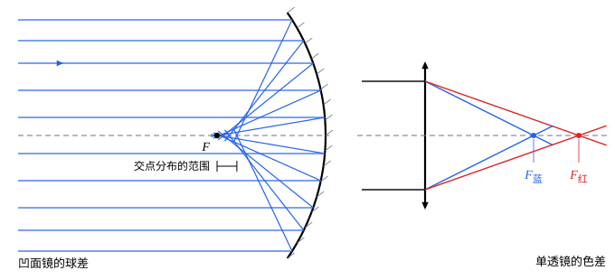

## 这一节要回答的问题

用放大镜看东西，靠近边缘的地方为什么会模糊、带彩边？照相机的镜头为什么要用好几片透镜？1990 年发射的哈勃空间望远镜，刚上天时拍出的照片为什么是模糊的？

## 讲解

### 理想的像和像差

[球面折射与近轴近似](lesson:physics.optics.paraxial-refraction)、[薄透镜](lesson:physics.optics.thin-lenses)里的成像公式都是在:term[近轴近似]{id="physics.optics.paraxial-approximation"}（paraxial approximation）下推出来的，而且只用了一种颜色的:term[折射率]{id="physics.optics.refractive-index"}（refractive index）。实际的光线既有离:term[光轴]{id="physics.optics.optical-axis"}（optical axis）远的，也有各种颜色的，它们并不都会聚到公式算出的那一点。

::anchor{id="def-aberration"}
实际的光学系统所成的像，和近轴理论预言的理想像之间的偏差叫作:term[像差]{id="physics.optics.aberration"}（aberration）。

为什么这样定义：近轴公式给出的是理想情形，设计光学仪器时要知道离理想差多少、差在哪里。像差分两类：一类即使只有一种颜色也存在，来自$\sin\theta$和$\theta$的差别；另一类来自玻璃的:term[色散]{id="physics.optics.dispersion"}（dispersion），不同颜色的像不重合。边界情况：平面镜对任何光线都成完美的像，没有像差。

### 球差

::anchor{id="def-spherical-aberration"}
平行于:term[光轴]{id="physics.optics.optical-axis"}、离光轴远近不同的光线经过球面以后，会聚到光轴上不同的点，这种:term[像差]{id="physics.optics.aberration"}叫作:term[球差]{id="physics.optics.spherical-aberration"}（spherical aberration）。

为什么这样定义：近轴公式里光线的高度$h$消去了，实际上离光轴越远的光线，射到球面上的入射角越大，偏折得比近轴公式算出的多，会聚得越靠近透镜或镜面。像点于是拉成沿光轴的一段，像变模糊，而这完全是球面的形状造成的。边界情况：抛物面镜（parabolic mirror）能把平行于轴的光精确地会聚到:term[焦点]{id="physics.optics.focal-point"}（focal point），没有这种球差（见[球面镜成像](lesson:physics.optics.spherical-mirrors)第 6 题）。

::anchor{id="thm-mirror-sa"}
定理（球面镜的球差）：半径为$R$、:term[焦距]{id="physics.optics.focal-length"}（focal length）$f=\frac R2$的凹面镜，平行于光轴、高为$h$的光线反射后交光轴于离顶点$R-\frac{R}{2\cos\theta}$处，$\sin\theta=\frac hR$；$h$比$R$小得多时，交点比焦点靠近镜面约$\frac{h^2}{4R}=\frac{h^2}{8f}$。

证明思路：法线过球心，三角形$CPF_h$在球心和入射点两处的角都是入射角$\theta$，是等腰三角形，$CF_h=\frac{R}{2\cos\theta}$（见[球面镜成像](lesson:physics.optics.spherical-mirrors)第 5 题）。把$\frac1{\cos\theta}$展开成$1+\frac{\theta^2}2+\cdots$，$\theta\approx\frac hR$，得交点离顶点约$\frac R2-\frac{h^2}{4R}$。

::anchor{id="def-stop"}
光学系统里限制光束粗细的开孔叫作:term[光阑]{id="physics.optics.aperture-stop"}（aperture stop），例如照相机镜头里可以调大调小的光圈。

为什么这样定义：哪些光线能进入系统、参与成像，由光阑决定，像差的大小、像的亮度都和它有关，所以设计和使用镜头时都要说清光阑在哪里、开多大。边界情况：光阑缩得太小，光的衍射（diffraction）又会让每一点的像扩成一个光斑，像反而变模糊（第 6 题），光阑并不是越小越好。

球差随$h^2$增大，所以减小它的办法首先是用光阑挡住离光轴远的光，只让中间的光通过，代价是进来的光少了。其次是改变形状：抛物面镜和非球面透镜（aspheric lens）可以消除轴上的球差；同一个焦距的透镜，两个面分担偏折的比例不同，球差也不同。再就是把会聚透镜和发散透镜组合起来，让它们的球差互相抵消，照相机的镜头用好几片透镜，原因之一就在这里。

哈勃空间望远镜是一个出名的例子。它 1990 年发射后，人们发现主镜有球差：制造时用来检验镜面形状的仪器里，一块镜片的位置偏了$1.3\,\mathrm{mm}$，按它磨出的主镜边缘磨平了约$2\,\mu\mathrm m$。这点误差只有头发直径的几十分之一，可是比光的波长大好几倍，星光会聚不到一点。1993 年 12 月，航天飞机的宇航员给它装上了一套带校正镜的光学装置（COSTAR）和自带校正光学的新相机，用大小相等、方向相反的球差把它抵消掉，望远镜的像才变得清晰。

### 色差

::anchor{id="def-chromatic-aberration"}
透镜对不同颜色的光:term[折射率]{id="physics.optics.refractive-index"}不同，:term[焦距]{id="physics.optics.focal-length"}也不同，不同颜色的像成在不同位置，这种:term[像差]{id="physics.optics.aberration"}叫作:term[色差]{id="physics.optics.chromatic-aberration"}（chromatic aberration）。

为什么这样定义：透镜的边缘可以看成一块:term[薄棱镜]{id="physics.optics.thin-prism"}（thin prism），像[棱镜与色散](lesson:physics.optics.prisms-dispersion)里那样，把光偏折得越多，颜色就分得越开；玻璃对蓝光的折射率大，蓝光的:term[焦点]{id="physics.optics.focal-point"}比红光近。用白光成像时，焦点处的像会带一圈彩边。边界情况：反射对各种颜色一样，反射镜没有色差，这正是牛顿造反射望远镜的原因（见[球面镜成像](lesson:physics.optics.spherical-mirrors)）。

::anchor{id="thm-chromatic-shift"}
定理（单透镜的色差）：用:term[阿贝数]{id="physics.optics.abbe-number"}（Abbe number）为$V$的玻璃做成、对 d 线焦距为$f$的:term[薄透镜]{id="physics.optics.thin-lens"}（thin lens），C 线和 F 线的焦距之差约为$f_{\mathrm C}-f_{\mathrm F}\approx\frac fV$。

证明思路：由[薄透镜](lesson:physics.optics.thin-lenses)的:term[磨镜者公式]{id="physics.optics.lensmakers-equation"}（lensmaker's equation），$\frac1f=(n-1)K$，$K=\frac1{R_1}-\frac1{R_2}$只由形状决定。所以$\frac1{f_{\mathrm F}}-\frac1{f_{\mathrm C}}=(n_{\mathrm F}-n_{\mathrm C})K=\frac{n_{\mathrm F}-n_{\mathrm C}}{n_{\mathrm d}-1}\cdot\frac1f=\frac1{Vf}$；三个焦距相差很小，左边约为$\frac{f_{\mathrm C}-f_{\mathrm F}}{f^2}$，即得（第 5 题）。

::anchor{id="thm-achromat"}
定理（消色差双透镜，achromatic doublet）：两块薄透镜贴在一起，:term[光焦度]{id="physics.optics.optical-power"}（optical power）分别为$\Phi_1$、$\Phi_2$，玻璃的阿贝数分别为$V_1$、$V_2$。总光焦度$\Phi=\Phi_1+\Phi_2$；要让 C 线和 F 线的焦距相同，须$\frac{\Phi_1}{V_1}+\frac{\Phi_2}{V_2}=0$，即$\Phi_1=\frac{V_1}{V_1-V_2}\Phi$，$\Phi_2=-\frac{V_2}{V_1-V_2}\Phi$。

证明思路：每块透镜的光焦度正比于$n-1$，从 C 线到 F 线变化$\Delta\Phi_i=\frac{\Phi_i}{V_i}$。贴在一起的光焦度相加，总的变化是$\frac{\Phi_1}{V_1}+\frac{\Phi_2}{V_2}$，令它为零，再和$\Phi_1+\Phi_2=\Phi$联立。

两块玻璃的阿贝数要不同：阿贝数大的:term[冕牌玻璃]{id="physics.optics.crown-glass"}（crown glass）做成会聚透镜，阿贝数小的:term[火石玻璃]{id="physics.optics.flint-glass"}（flint glass）做成较弱的发散透镜，发散透镜的:term[色散]{id="physics.optics.dispersion"}大，用较小的光焦度就把颜色收回来，会聚却只抵掉一部分。1729 年前后，英国的霍尔（Chester Moor Hall）用冕牌玻璃和火石玻璃找到了这样的组合，但没有公开；1758 年，伦敦的光学仪器商多朗德（John Dollond）为消色差透镜申请了专利，它才流行起来。这样只能让两种颜色的焦点重合，其他颜色还剩一点很小的偏差。

### 其他像差

物点不在:term[光轴]{id="physics.optics.optical-axis"}上时，还有别的:term[单色像差]{id="physics.optics.aberration"}（monochromatic aberration）：离轴的点光源成像拖出一条彗星似的尾巴，即彗差（coma）；横着和竖着的线不能同时成像清晰，即像散（astigmatism）；平面的物成像在一个弯曲的面上，即场曲（field curvature）；放大率随离光轴的距离变化，方格成像成桶形或枕形，即畸变（distortion）。它们和:term[球差]{id="physics.optics.spherical-aberration"}一样，来自:term[近轴近似]{id="physics.optics.paraxial-approximation"}的失效，靠选择各个面的形状、透镜的间隔和:term[光阑]{id="physics.optics.aperture-stop"}的位置来平衡，这是镜头设计的主要工作。

## 几何图像

左图是按:term[反射定律]{id="physics.optics.law-of-reflection"}（law of reflection）精确画出的光线，最外面那条光线的高度约为半径的$0.53$倍，它和:term[光轴]{id="physics.optics.optical-axis"}的交点比:term[焦点]{id="physics.optics.focal-point"}靠近镜面约半径的$0.09$倍。右图的:term[色差]{id="physics.optics.chromatic-aberration"}画得夸大了，真实的单透镜，C 线和 F 线的焦点只相差:term[焦距]{id="physics.optics.focal-length"}的$\frac1V$，常用的玻璃是百分之二左右。

:::anim{component="function-plot"}
range: { x: [400, 700], y: [97, 103] }
functions:
  - expr: "100*0.51674/(0.50452 + 4219/x^2)"
    label: |
      单块冕牌玻璃透镜
  - expr: "1000/((10 + 13.2*k)*(0.50452 + 4219/x^2)/0.51674 - 13.2*k*(0.59434 + 8898.7/x^2)/0.62011)"
    label: |
      加上火石玻璃发散透镜
points:
  - x: "486.1"
    y: "100"
  - x: "656.3"
    y: "100"
sliders:
  - name: k
    min: 0
    max: 1.5
    step: 0.05
    default: 1
    label: |
      火石玻璃透镜的光焦度（以消色差所需的为 1）
:::

横轴是真空中的波长（$\mathrm{nm}$），纵轴是焦距（$\mathrm{mm}$），两种玻璃的:term[折射率]{id="physics.optics.refractive-index"}都用$n=A+\frac{B}{\lambda^2}$的形式拟合，:term[冕牌玻璃]{id="physics.optics.crown-glass"}按 N-BK7 的 C、F 线数据，:term[火石玻璃]{id="physics.optics.flint-glass"}按[棱镜与色散](lesson:physics.optics.prisms-dispersion)第 4 题的数据，对 d 线的总焦距都是$100\,\mathrm{mm}$。单块透镜的焦距从紫光到红光变化约$3\,\mathrm{mm}$；滑块为$1$时，两块透镜按消色差的条件组合，焦距在 C 线和 F 线（图上的两个点）相同，整条曲线几乎变平；滑块小于$1$时色差没有消尽，大于$1$时过了头，蓝光的焦距反而更长。实际玻璃的:term[色散]{id="physics.optics.dispersion"}不完全符合这个简单的式子，消色差透镜在其他颜色上还剩一点偏差。

## 例题

### 例 1　凹面镜的球差

一面凹面镜的:term[焦距]{id="physics.optics.focal-length"}是$1.0\,\mathrm m$。平行于:term[光轴]{id="physics.optics.optical-axis"}、离光轴$0.20\,\mathrm m$的光线，反射后和光轴的交点比:term[焦点]{id="physics.optics.focal-point"}靠近镜面多少？分别用精确的式子和近似式计算。

**为什么想到这么做**：$R=2.0\,\mathrm m$，$h=0.20\,\mathrm m$，$\frac hR=0.1$不算很小，用两种方法比较。

**推导**：精确：$\sin\theta=0.10$，$\cos\theta\approx0.99499$，交点离顶点$R-\frac{R}{2\cos\theta}\approx2.0-1.00504=0.99496\,\mathrm m$，比焦点近约$5.04\,\mathrm{mm}$。近似：$\frac{h^2}{8f}=\frac{0.04}{8}\,\mathrm m=5.0\,\mathrm{mm}$。两者相差不到$1\%$。要让交点的范围小于$1\,\mathrm{mm}$，光线的高度只能到$\sqrt{8f\times0.001\,\mathrm m}\approx0.09\,\mathrm m$，或者把镜面做成抛物面。

### 例 2　设计消色差双透镜

用 N-BK7（$V\approx64.2$）和 N-F2（$V\approx36.4$）设计一块:term[焦距]{id="physics.optics.focal-length"}$100\,\mathrm{mm}$的消色差双透镜，两块透镜贴在一起。求两块透镜的焦距，并和只用一块 N-BK7 透镜时的:term[色差]{id="physics.optics.chromatic-aberration"}比较。

**为什么想到这么做**：总:term[光焦度]{id="physics.optics.optical-power"}$\Phi=\frac{1}{0.100\,\mathrm m}=10\,\mathrm D$，用消色差的条件分配给两块透镜。

**推导**：$\Phi_1=\frac{64.2}{64.2-36.4}\times10\,\mathrm D\approx23.1\,\mathrm D$，焦距约$43.3\,\mathrm{mm}$，:term[冕牌玻璃]{id="physics.optics.crown-glass"}会聚透镜；$\Phi_2=-\frac{36.4}{27.8}\times10\,\mathrm D\approx-13.1\,\mathrm D$，焦距约$-76.4\,\mathrm{mm}$，:term[火石玻璃]{id="physics.optics.flint-glass"}发散透镜。只用一块 N-BK7 透镜时，C、F 两线的焦距差约$\frac{100}{64.2}\,\mathrm{mm}\approx1.6\,\mathrm{mm}$；组合以后，这两条线的:term[焦点]{id="physics.optics.focal-point"}重合。代价是两块透镜各自的光焦度都比$10\,\mathrm D$大，表面弯得更厉害。

## 常见误区

- 「:term[像差]{id="physics.optics.aberration"}是透镜没磨好造成的，磨得再精确就没有了。」:term[球差]{id="physics.optics.spherical-aberration"}、:term[色差]{id="physics.optics.chromatic-aberration"}是球面形状和玻璃:term[色散]{id="physics.optics.dispersion"}本身带来的，磨得再准也有；哈勃望远镜的问题倒确实是磨错了形状。
- 「把透镜挡掉一圈，像就缺了一圈。」:term[光阑]{id="physics.optics.aperture-stop"}挡住离:term[光轴]{id="physics.optics.optical-axis"}远的光，像变暗，但仍然完整，球差反而变小。
- 「消色差透镜把所有颜色的:term[焦点]{id="physics.optics.focal-point"}都对齐了。」双透镜只能让两种颜色的焦点重合，其他颜色还有很小的偏差。
- 「反射镜和透镜一样有色差。」反射对各种颜色的光都一样，反射镜没有色差，但球面的反射镜照样有:term[球差]{id="physics.optics.spherical-aberration"}。
