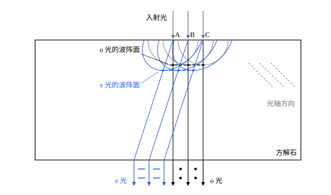

## 这一节要回答的问题

把一块方解石（calcite）压在报纸上，透过它看，每个字都变成了两个；转动方解石，一个像不动，另一个绕着它转。光在晶体里为什么分成了两束？3D 电影的眼镜里有一层透明的薄晶片，它怎样把:term[圆偏振]{id="physics.optics.circular-polarization"}（circular polarization）光变回线偏振（linear polarization）光？

## 讲解

### 双折射

1669 年，丹麦的巴托林（Rasmus Bartholin）发现，冰岛出产的透明方解石晶体能把一个像变成两个。1690 年，惠更斯在《光论》里用两种:term[次波]{id="physics.optics.secondary-wavelet"}（secondary wavelet）解释了它，下面就沿着他的思路走。

::anchor{id="def-birefringence"}
一束光射进晶体以后分成两束折射光，这种现象叫作:term[双折射]{id="physics.optics.birefringence"}（birefringence）。

为什么这样定义：在玻璃、水这样各个方向性质相同的介质里，一束光只有一束折射光，满足:term[折射定律]{id="physics.optics.law-of-refraction"}（law of refraction）；双折射说的正是某些晶体偏离了这条规律，折射光成了两束。用:term[偏振片]{id="physics.optics.polarizer"}（polarizer）检查，两束光都是线偏振光，偏振方向互相垂直。边界情况：食盐这类原子排列在三个方向上完全对称的晶体，和玻璃一样不发生双折射。

成因在于晶体的各向异性：原子在晶体里排成规则的点阵，各个方向上的排列不一样，电子在不同方向上被束缚得松紧不同。光的电场推着电子振动，电场沿不同方向振动的光，带动电子的难易不同，在晶体里传播的速度就不同（在电磁学里，介质中的光速由电场引起的极化决定，见[介质中的电磁波](lesson:physics.electromagnetism.waves-in-media)）。偏振方向不同的两种光速度不同、:term[折射率]{id="physics.optics.refractive-index"}（refractive index）不同，偏折得也不同，一束光就分成了两束。

### 光轴、寻常光和非常光

方解石、石英这类晶体里有一个特殊的方向。

::anchor{id="def-optic-axis"}
绕着某个方向转动、性质保持不变的晶体叫作单轴晶体（uniaxial crystal）；光沿这个方向传播时不分成两束，这个方向叫作晶体的光轴（optic axis）。

为什么这样定义：光沿这个方向传播时，电场总垂直于它，晶体绕它转动又不变，不管电场朝哪个方向振动，晶体对它都一样，两种偏振的光速度相同，所以不分开。它是一个方向，不是一条线，晶体里过每一点都有一条沿这个方向的光轴。边界情况：它和[球面折射与近轴近似](lesson:physics.optics.paraxial-refraction#def-optical-axis)里透镜系统的光轴（optical axis）同名，意思完全不同，那是一条确定的对称轴。

::anchor{id="def-o-e"}
光在单轴晶体里传播时，电场垂直于光轴和传播方向所在平面的那一束叫作:term[寻常光]{id="physics.optics.ordinary-ray"}（ordinary ray，简称 o 光），电场在这个平面里的那一束叫作:term[非常光]{id="physics.optics.extraordinary-ray"}（extraordinary ray，简称 e 光）。o 光沿各个方向的:term[折射率]{id="physics.optics.refractive-index"}都是$n_{\mathrm o}$；e 光的折射率随方向变，垂直于光轴传播时是$n_{\mathrm e}$，$n_{\mathrm o}$、$n_{\mathrm e}$叫作晶体的主折射率（principal refractive indices）。

为什么这样定义：o 光的电场总是垂直于光轴，往哪个方向走，推动电子的方式都一样，速度总是$\frac c{n_{\mathrm o}}$，满足:term[折射定律]{id="physics.optics.law-of-refraction"}，所以叫「寻常」；e 光的电场和光轴的夹角随传播方向变，速度在$\frac c{n_{\mathrm o}}$（沿光轴）和$\frac c{n_{\mathrm e}}$（垂直于光轴）之间，一般不满足折射定律。波长$589\,\mathrm{nm}$时，方解石$n_{\mathrm o}=1.658$、$n_{\mathrm e}=1.486$，石英$n_{\mathrm o}=1.544$、$n_{\mathrm e}=1.553$。边界情况：沿光轴传播时两者速度相同，没有区别，这正是光轴的定义；垂直于光轴传播时两者速度相差最大。

::anchor{id="thm-wavelets"}
定理（单轴晶体里的:term[次波]{id="physics.optics.secondary-wavelet"}）：从晶体里一点发出的 o 光次波是球面，半径$\frac c{n_{\mathrm o}}t$；e 光次波是绕光轴的旋转椭球面，沿光轴的半轴是$\frac c{n_{\mathrm o}}t$，垂直于光轴的半轴是$\frac c{n_{\mathrm e}}t$，两者在光轴方向上相切。

证明思路：o 光往哪个方向速度都一样，次波是球面。e 光沿光轴走时电场垂直于光轴，速度和 o 光一样；垂直于光轴走时电场沿光轴，速度是$\frac c{n_{\mathrm e}}$。在两者之间的方向上，速度连续地变化，按:term[惠更斯原理]{id="physics.optics.huygens-principle"}（Huygens' principle），次波面上每一点到中心的距离就是那个方向上的速度乘$t$；由晶体的电磁理论可以算出这个面正好是旋转椭球面，这里不证。

有了两种次波，就能用惠更斯原理作出两种:term[波阵面]{id="physics.optics.wavefront"}（wavefront）。平行光垂直射到晶体表面上，表面上各点同时发出次波，o 光次波的包络和 e 光次波的包络都是平行于表面的平面，两束光的波阵面都不偏转。可光是从次波中心传到包络上的切点的：o 光的切点在中心正下方，光线笔直向下；光轴斜着时，e 光次波是斜放的椭圆，切点偏到一边，光线就斜着走，和它的波阵面不垂直（见下面的「几何图像」）。射出晶体以后两束光恢复平行，却错开了一段距离，这就是透过方解石看到两个像的原因（例 2）。

### 波片

::anchor{id="def-wave-plate"}
把单轴晶体切成表面平行于光轴的薄片，光垂直射入时，电场沿光轴和垂直于光轴的两个分量传播方向相同、速度不同，穿过厚为$d$的晶片后产生相位差$\delta=\frac{2\pi}{\lambda}|n_{\mathrm e}-n_{\mathrm o}|d$，这样的晶片叫作:term[波片]{id="physics.optics.wave-plate"}（wave plate）。两个方向里光走得快的那个叫作:term[快轴]{id="physics.optics.fast-axis"}（fast axis），走得慢的叫作:term[慢轴]{id="physics.optics.slow-axis"}（slow axis）。

为什么这样定义：光轴平行于表面、光垂直射入时，两个分量都垂直于光轴传播，方向相同、不会分开，速度差却最大。光在:term[折射率]{id="physics.optics.refractive-index"}为$n$的晶片里波长变成$\frac\lambda n$，走过厚度$d$，相位变化$\frac{2\pi nd}\lambda$，两个分量相位变化之差就是$\delta$，慢轴方向的分量射出时落后这么多。方解石的$n_{\mathrm e}<n_{\mathrm o}$，光轴方向是快轴；石英正好相反，光轴方向是慢轴。边界情况：$\delta$相差$2\pi$的整数倍时效果完全一样；$\delta$和波长成反比，一片波片只对一个波长恰好产生要的相位差。

::anchor{id="def-qwp-hwp"}
$\delta=\frac\pi2$的波片叫作:term[四分之一波片]{id="physics.optics.quarter-wave-plate"}（quarter-wave plate），$\delta=\pi$的叫作:term[二分之一波片]{id="physics.optics.half-wave-plate"}（half-wave plate），也叫半波片；$\delta$再加上$2\pi$的整数倍，作用不变。

为什么这样定义：$\delta=\frac\pi2$时，慢的分量晚到四分之一个周期，相当于在晶片里多耽搁了四分之一个波长，名字由此而来；$\delta=\pi$时晚到半个周期。这两种最常用，因为它们恰好能完成两件事：线偏振和:term[圆偏振]{id="physics.optics.circular-polarization"}互相转换，把线偏振光的偏振方向转一个角度（下面的定理）。反例：零级的石英四分之一波片只有十几微米厚，太薄，很难加工，实用的多是厚一些、$\delta$多出几个$2\pi$的多级波片（第 7 题）。

::anchor{id="thm-wave-plates"}
定理（波片对偏振态的作用）：（1）线偏振光的偏振方向和:term[四分之一波片]{id="physics.optics.quarter-wave-plate"}的:term[快轴]{id="physics.optics.fast-axis"}成$45^\circ$时，射出的是圆偏振光；偏振方向沿快轴或:term[慢轴]{id="physics.optics.slow-axis"}时，偏振态不变。（2）圆偏振光通过四分之一波片，变成和快轴成$45^\circ$的线偏振光。（3）线偏振光的偏振方向和:term[二分之一波片]{id="physics.optics.half-wave-plate"}的快轴成$\theta$角，射出的仍是线偏振光，偏振方向和快轴成$-\theta$角，即转过了$2\theta$。

证明思路：沿快轴取$x$轴、慢轴取$y$轴，按[偏振](lesson:physics.optics.polarization)里的写法，波片只让$E_y$多落后$\delta_0$（波片的相位差），即$\delta\to\delta+\delta_0$。（1）偏振方向成$45^\circ$时$A_x=A_y$、$\delta=0$，变成$\delta=\frac\pi2$，正是圆偏振；只有一个分量时，相位怎么变都还是线偏振。（2）圆偏振的$\delta=\pm\frac\pi2$，加上$\frac\pi2$变成$\pi$或$0$，成了沿$-45^\circ$或$45^\circ$的线偏振。（3）$\delta$从$0$变成$\pi$，$E_y$反号，和快轴成$\theta$的线段就变成和快轴成$-\theta$的线段。

转向：快轴沿$x$、偏振方向在$+45^\circ$时，射出的$\delta=\frac\pi2$，迎着光看是左旋；偏振方向在$-45^\circ$（$\delta=\pi$变成$\frac{3\pi}2$，和$-\frac\pi2$一样）时是右旋。把四分之一波片转过$90^\circ$，快轴、慢轴对调，转向也就反过来。3D 电影的两只镜片正是这样：放映机给左右两眼的画面分别配上左旋、右旋的圆偏振光，每只镜片里有一片四分之一波片，把对应转向的圆偏振光变回线偏振光，再由后面的:term[偏振片]{id="physics.optics.polarizer"}放过它、挡住另一种。

## 几何图像

图里灰色的半圆是 :term[o 光]{id="physics.optics.ordinary-ray"}的:term[次波]{id="physics.optics.secondary-wavelet"}，蓝色的半个椭圆是 :term[e 光]{id="physics.optics.extraordinary-ray"}的次波，它们在光轴方向（右上角的虚线）上相切。两条虚线是两种次波的包络，也就是两种:term[波阵面]{id="physics.optics.wavefront"}，都平行于表面；黑点和蓝点是各次波和包络的切点。o 光从$A$、$B$、$C$笔直向下，e 光斜向左下，射出晶体后两束光平行但错开：这就是:term[双折射]{id="physics.optics.birefringence"}。图里夸大了两种光的速度差，e 光偏得比真实的多，真实的方解石里 e 光大约偏$6^\circ$（例 2）。

:::anim{component="function-plot"}
range: { x: [400, 700], y: [0, 1.05] }
functions:
  - expr: "sin(pi*0.009*d*1000/x)^2"
    label: |
      两片偏振片的透振方向互相垂直
  - expr: "cos(pi*0.009*d*1000/x)^2"
    label: |
      两片偏振片的透振方向互相平行
sliders:
  - name: d
    min: 5
    max: 1000
    step: 5
    default: 15
    label: |
      石英片的厚度$d$（$\mu\mathrm m$）
:::

两片:term[偏振片]{id="physics.optics.polarizer"}之间夹一片石英:term[波片]{id="physics.optics.wave-plate"}，光轴平行于表面，和第一片的:term[透振方向]{id="physics.optics.transmission-axis"}（transmission axis）成$45^\circ$。横轴是波长$\lambda$（$\mathrm{nm}$，图上写作$x$），纵轴是透过第二片的光强，以透过第一片的光强为单位，$|n_{\mathrm e}-n_{\mathrm o}|$取$0.009$。厚度$15\,\mu\mathrm m$时，石英片对约$540\,\mathrm{nm}$的绿光是:term[四分之一波片]{id="physics.optics.quarter-wave-plate"}，两条曲线在那里相交，各透过一半；对哪个波长恰好是:term[二分之一波片]{id="physics.optics.half-wave-plate"}，那个颜色在两片偏振片垂直时最亮。用白光照射，透过的光就带上颜色，转动第二片，颜色变成互补色；把厚度调大，曲线在可见光范围里起伏许多次，各种颜色混在一起，又变回白色。

## 例题

### 例 1　石英四分之一波片有多厚

用石英（$n_{\mathrm o}=1.544$，$n_{\mathrm e}=1.553$）做波长$589\,\mathrm{nm}$的:term[四分之一波片]{id="physics.optics.quarter-wave-plate"}。最薄要多厚？如果做成相位差多出$10$个$2\pi$的:term[多级波片]{id="physics.optics.wave-plate"}，又有多厚？

**为什么想到这么做**：:term[波片]{id="physics.optics.wave-plate"}的相位差$\delta=\frac{2\pi}\lambda|n_{\mathrm e}-n_{\mathrm o}|d$，令它等于$\frac\pi2$或$\frac\pi2+2\pi m$，解出$d$。

**推导**：$|n_{\mathrm e}-n_{\mathrm o}|=0.009$。最薄时$d=\frac{\lambda}{4\times0.009}=\frac{589\,\mathrm{nm}}{0.036}\approx1.64\times10^4\,\mathrm{nm}=16.4\,\mu\mathrm m$，比一张纸还薄得多。多出$10$个$2\pi$时，$d=\Bigl(10+\frac14\Bigr)\frac{\lambda}{0.009}\approx6.71\times10^5\,\mathrm{nm}\approx0.67\,\mathrm{mm}$，好加工得多，代价是对波长和温度的变化敏感得多（第 7 题）。

### 例 2　方解石里的两个像

平行光垂直射到一块厚$1.0\,\mathrm{cm}$的方解石上，光轴在入射面内、和表面的法线成$45^\circ$（沿天然解理面裂开的方解石大致如此），$n_{\mathrm o}=1.658$，$n_{\mathrm e}=1.486$。:term[e 光]{id="physics.optics.extraordinary-ray"}在晶体里偏离法线多大角度？射出后两束光错开多远？

**为什么想到这么做**：e 光的:term[波阵面]{id="physics.optics.wavefront"}平行于表面，光线从:term[次波]{id="physics.optics.secondary-wavelet"}中心指向椭圆上法线方向和表面法线相同的那一点。在以光轴为$X$轴的坐标里，椭圆是$\frac{X^2}{a^2}+\frac{Y^2}{b^2}=1$，$a=\frac c{n_{\mathrm o}}t$，$b=\frac c{n_{\mathrm e}}t$。

**推导**：椭圆上$(X_0,Y_0)$处的法线方向是$\Bigl(\frac{X_0}{a^2},\frac{Y_0}{b^2}\Bigr)$，它要沿表面的法线，和光轴成$45^\circ$，所以$\frac{Y_0/b^2}{X_0/a^2}=\tan45^\circ$。光线沿$(X_0,Y_0)$，和光轴的夹角$\varphi$满足$\tan\varphi=\frac{Y_0}{X_0}=\frac{b^2}{a^2}\tan45^\circ=\Bigl(\frac{n_{\mathrm o}}{n_{\mathrm e}}\Bigr)^2\approx1.245$，$\varphi\approx51.2^\circ$，比法线离光轴远了约$6.2^\circ$。所以 e 光偏离法线约$6.2^\circ$，射出时错开$1.0\,\mathrm{cm}\times\tan6.2^\circ\approx1.1\,\mathrm{mm}$，正是两个像的间距；转动晶体时 e 光偏的方向跟着光轴转，:term[o 光]{id="physics.optics.ordinary-ray"}的像不动。

## 常见误区

- 「:term[四分之一波片]{id="physics.optics.quarter-wave-plate"}总能把线偏振光变成:term[圆偏振]{id="physics.optics.circular-polarization"}光。」只有偏振方向和:term[快轴]{id="physics.optics.fast-axis"}成$45^\circ$时才是圆偏振；成别的角度是:term[椭圆偏振]{id="physics.optics.elliptical-polarization"}（elliptical polarization），沿快轴或:term[慢轴]{id="physics.optics.slow-axis"}时偏振态不变。
- 「:term[波片]{id="physics.optics.wave-plate"}的快轴就是晶体的光轴。」方解石这类$n_{\mathrm e}<n_{\mathrm o}$的晶体如此；石英的光轴方向是慢轴。
- 「光在晶体里总是分成两束。」光沿光轴传播时不分开；光轴平行于表面、光垂直射入时，两束光方向相同、并不分开，只是速度不同，这正是波片。
- 「:term[e 光]{id="physics.optics.extraordinary-ray"}的光线总垂直于它的:term[波阵面]{id="physics.optics.wavefront"}。」只有:term[o 光]{id="physics.optics.ordinary-ray"}是这样；e 光的光线一般和波阵面斜交（例 2），这也是[惠更斯原理](lesson:physics.optics.huygens-principle)那一节提到的例外。
