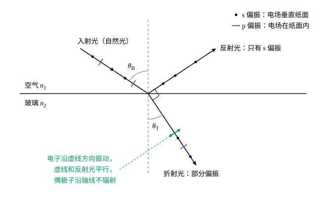

## 这一节要回答的问题

湖面、路面的反光里，电场平行于地面的成分占多数，所以偏振太阳镜能把它挡掉大半（见[界面上的反射与折射：菲涅耳公式](lesson:physics.electromagnetism.fresnel-equations)例 2）。光以某个特定的角度射到玻璃上，反射光甚至是完全的线偏振（linear polarization）光。这个角度是多少？反射光为什么会是偏振的？

## 讲解

### 布儒斯特角

光从折射率（refractive index）为$n_1$的介质射到折射率为$n_2$的介质上，入射角为$\theta_{\mathrm I}$，折射角为$\theta_{\mathrm T}$。电场垂直于入射面（plane of incidence）的 s 偏振（s polarization）和电场在入射面内的 p 偏振（p polarization），反射时各按自己的菲涅耳公式（Fresnel equations）算。p 偏振的振幅反射系数是$r_{\mathrm p}=\frac{n_1\cos\theta_{\mathrm T}-n_2\cos\theta_{\mathrm I}}{n_1\cos\theta_{\mathrm T}+n_2\cos\theta_{\mathrm I}}$，分子在某个入射角上为零（见[菲涅耳公式](lesson:physics.electromagnetism.fresnel-equations#thm-fresnel)）。

::anchor{id="thm-brewster"}
定理（:term[布儒斯特角]{id="physics.optics.brewster-angle"}，Brewster's angle）：两种不显磁性、不吸收光的线性介质的界面上，入射角$\theta_{\mathrm B}$满足$\tan\theta_{\mathrm B}=\frac{n_2}{n_1}$时，p 偏振的反射光为零，这时反射光和折射光互相垂直，$\theta_{\mathrm B}+\theta_{\mathrm T}=90^\circ$；这个入射角叫作布儒斯特角。

证明思路：$r_{\mathrm p}=0$要求$n_1\cos\theta_{\mathrm T}=n_2\cos\theta_{\mathrm I}$，同时有:term[折射定律]{id="physics.optics.law-of-refraction"}（law of refraction）$n_1\sin\theta_{\mathrm I}=n_2\sin\theta_{\mathrm T}$。两式相除得$\sin\theta_{\mathrm T}\cos\theta_{\mathrm T}=\sin\theta_{\mathrm I}\cos\theta_{\mathrm I}$，即$\sin2\theta_{\mathrm T}=\sin2\theta_{\mathrm I}$；$n_1\ne n_2$时$\theta_{\mathrm T}\ne\theta_{\mathrm I}$，只能$2\theta_{\mathrm T}=180^\circ-2\theta_{\mathrm I}$，也就是$\theta_{\mathrm I}+\theta_{\mathrm T}=90^\circ$。于是$\sin\theta_{\mathrm T}=\cos\theta_{\mathrm I}$，代回折射定律得$\tan\theta_{\mathrm I}=\frac{n_2}{n_1}$；反射光和法线成$\theta_{\mathrm I}$，所以它和折射光的夹角是$180^\circ-\theta_{\mathrm I}-\theta_{\mathrm T}=90^\circ$。

1815 年，布儒斯特（David Brewster）由实验发现了$\tan\theta_{\mathrm B}=n$这条规律，这个角也叫起偏角（polarizing angle）。光从空气射到玻璃（$n=1.50$）上，$\theta_{\mathrm B}\approx56.3^\circ$；射到水（$n=1.33$）上，$\theta_{\mathrm B}\approx53.1^\circ$。按[菲涅耳公式](lesson:physics.electromagnetism.fresnel-equations#thm-fresnel)里的正负约定，$n_2>n_1$时，入射角小于$\theta_{\mathrm B}$时$r_{\mathrm p}<0$，和垂直入射时一样；过了$\theta_{\mathrm B}$，$r_{\mathrm p}$变号成正，经过零的地方就是布儒斯特角。s 偏振在这个角度并不为零：这时$r_{\mathrm s}=\frac{n_1^2-n_2^2}{n_1^2+n_2^2}$（第 5 题）。

光从玻璃射向空气时也有布儒斯特角，$\tan\theta_{\mathrm B}=\frac1{1.50}$，$\theta_{\mathrm B}\approx33.7^\circ$，正好是从空气射进来时的折射角。它总比:term[全反射]{id="physics.optics.total-internal-reflection"}（total internal reflection）的:term[临界角]{id="physics.optics.critical-angle"}（critical angle）小：$\tan\theta_{\mathrm B}=\frac{n_2}{n_1}=\sin\theta_{\mathrm c}<\tan\theta_{\mathrm c}$。

### 为什么 p 偏振不反射

反射光和折射光是怎样产生的？光射进玻璃，推着玻璃里的电子振动，每个分子都成了一个振荡的电偶极子（electric dipole）；这些偶极子辐射的波，和入射波叠加成玻璃里的折射波，向后辐射的部分就是反射波。电子顺着玻璃里的电场振动，而电场垂直于折射光的传播方向。

对 p 偏振，电场在入射面内、垂直于折射光，偶极子也在入射面内沿这个方向振动。以:term[布儒斯特角]{id="physics.optics.brewster-angle"}入射时，反射光正好垂直于折射光，也就是正好沿着偶极子的轴线；振荡的电偶极子沿轴线不辐射（见[电偶极辐射](lesson:physics.electromagnetism.dipole-radiation#thm-dipole-power)），所以这个方向上没有 p 偏振的反射光。对 s 偏振，偶极子垂直于入射面振动，入射面里的各个方向都和它的轴线垂直，都有辐射，反射光不会消失。

这是帮助理解的图像，不是严格的推导：严格的结果来自菲涅耳公式，它和这个图像在$r_{\mathrm p}=0$的位置上完全一致。图像的好处是说明了两件事：p 偏振的反射为零，正发生在反射光和折射光垂直时；s 偏振的反射没有这样的零点。

### 反射光和透射光的偏振

:term[自然光]{id="physics.optics.natural-light"}（natural light）里 s 偏振和 p 偏振各占一半。以:term[布儒斯特角]{id="physics.optics.brewster-angle"}入射时，反射光里只剩 s 偏振，是电场垂直于入射面的线偏振光；透射光里 p 偏振全部透过，s 偏振少了反射掉的那部分，是:term[部分偏振光]{id="physics.optics.partially-polarized-light"}（partially polarized light）。别的入射角下，反射光里 s 偏振多、p 偏振少，也是部分偏振光。

::anchor{id="def-degree"}
用:term[偏振片]{id="physics.optics.polarizer"}（polarizer）检查一束光，转动时透过的光强最大为$I_{\max}$、最小为$I_{\min}$，$P=\frac{I_{\max}-I_{\min}}{I_{\max}+I_{\min}}$叫作这束光的:term[偏振度]{id="physics.optics.degree-of-polarization"}（degree of polarization）。

为什么这样定义：部分偏振光是自然光和偏振光混合而成的，自然光不管偏振片怎样转都透过一半，只有偏振光的部分让光强起伏，$I_{\max}-I_{\min}$正是偏振光那部分的光强，分母是总光强，$P$就是偏振光所占的比例。它和总光强的大小无关，只说明偏振的程度。边界情况：自然光$P=0$，线偏振光$P=1$；反过来，:term[圆偏振]{id="physics.optics.circular-polarization"}（circular polarization）光转动偏振片时光强也不变，$P$按这个式子算出来是$0$，所以这个式子只适用于自然光和线偏振光混合的情形。

对反射光，s 偏振和 p 偏振的反射率（reflectance）分别是$R_{\mathrm s}=r_{\mathrm s}^2$、$R_{\mathrm p}=r_{\mathrm p}^2$，自然光入射时偏振度$P=\frac{R_{\mathrm s}-R_{\mathrm p}}{R_{\mathrm s}+R_{\mathrm p}}$，在布儒斯特角达到$1$。马吕斯 1808 年透过一块方解石看卢森堡宫窗玻璃反射的夕阳，转动方解石时两个像一明一暗，由此发现了反射光是偏振的；七年后布儒斯特找到了让反射光完全偏振的这个角度。

## 几何图像

纸面就是入射面，点表示电场垂直于纸面（s 偏振），短线表示电场在纸面内、垂直于光线（p 偏振）。绿色的双箭头是 p 偏振的折射光推动电子振动的方向，它和折射光垂直；以:term[布儒斯特角]{id="physics.optics.brewster-angle"}入射时，反射光和折射光互相垂直，虚线因此和反射光平行。偶极子沿自己的轴线不辐射，反射光里只剩下点所代表的 s 偏振。

:::anim{component="function-plot"}
range: { x: [0, 90], y: [0, 1.05] }
functions:
  - expr: "((cos(x*pi/180) - m*sqrt(1 - (sin(x*pi/180)/m)^2))^2/(cos(x*pi/180) + m*sqrt(1 - (sin(x*pi/180)/m)^2))^2 - (sqrt(1 - (sin(x*pi/180)/m)^2) - m*cos(x*pi/180))^2/(sqrt(1 - (sin(x*pi/180)/m)^2) + m*cos(x*pi/180))^2)/((cos(x*pi/180) - m*sqrt(1 - (sin(x*pi/180)/m)^2))^2/(cos(x*pi/180) + m*sqrt(1 - (sin(x*pi/180)/m)^2))^2 + (sqrt(1 - (sin(x*pi/180)/m)^2) - m*cos(x*pi/180))^2/(sqrt(1 - (sin(x*pi/180)/m)^2) + m*cos(x*pi/180))^2)"
    label: |
      反射光的偏振度
  - expr: "(m^2 - 1)*(1 - (sin(x*pi/180)/m)^2 - cos(x*pi/180)^2)/((1 + m^2)*(1 - (sin(x*pi/180)/m)^2 + cos(x*pi/180)^2) + 4*m*cos(x*pi/180)*sqrt(1 - (sin(x*pi/180)/m)^2))"
    label: |
      透射光的偏振度
points:
  - { x: "atan(m)*180/pi", y: "1" }
sliders:
  - name: m
    min: 1.1
    max: 2.5
    step: 0.05
    default: 1.5
    label: |
      折射率之比$\frac{n_2}{n_1}$
:::

:term[自然光]{id="physics.optics.natural-light"}从空气射到一个表面上，横轴是入射角$\theta_{\mathrm I}$（度，图上写作$x$），纵轴是反射光和透射光的:term[偏振度]{id="physics.optics.degree-of-polarization"}，只算这一个表面，不计多次反射。反射光的偏振度在垂直入射和掠射时为零，在:term[布儒斯特角]{id="physics.optics.brewster-angle"}（图上的点）达到$1$。透射光的偏振度在大部分入射角下都比反射光的小得多：比值为$1.5$时，在布儒斯特角只有约$0.08$，因为透过去的光里两种偏振都很多；入射角再大，它才慢慢升高，过了约$83^\circ$反而超过反射光的，可那时透过的光也越来越少。滑块调两边折射率之比，比值越大，布儒斯特角越大，同一入射角下透射光的偏振度也越大。

## 例题

### 例 1　什么时候湖面的反光完全偏振

平静的湖面，水的折射率取$1.33$。太阳在地平线上多高时，湖面反射的阳光是线偏振光？这时它的电场沿什么方向，偏振太阳镜的:term[透振方向]{id="physics.optics.transmission-axis"}（transmission axis）该沿什么方向？

**为什么想到这么做**：入射角等于:term[布儒斯特角]{id="physics.optics.brewster-angle"}时反射光完全偏振；入射角从竖直的法线量起，太阳的高度角是从水平面量起的，两者互余。

**推导**：$\theta_{\mathrm B}=\arctan1.33\approx53.1^\circ$，太阳的高度角$90^\circ-53.1^\circ\approx36.9^\circ$。反射光只剩 s 偏振，电场垂直于入射面，入射面是竖直的，所以电场沿水平方向，平行于湖面。偏振太阳镜的透振方向沿竖直方向，就能把它完全挡住；太阳高一些或低一些时，反光不再完全偏振，但 s 偏振仍占多数，照样能挡掉大半。

### 例 2　以布儒斯特角穿过一块玻璃

:term[自然光]{id="physics.optics.natural-light"}以:term[布儒斯特角]{id="physics.optics.brewster-angle"}射到一块空气中的平行玻璃板（$n=1.50$）上，不计玻璃里的多次反射。透过玻璃板的光里，s 偏振和 p 偏振的光强各是入射光的多少？透射光的:term[偏振度]{id="physics.optics.degree-of-polarization"}是多少？

**为什么想到这么做**：先看光在第二个表面上的入射角：它等于第一个表面的折射角$\theta_{\mathrm T}$，而$\tan\theta_{\mathrm T}=\frac1{1.50}$，正好是玻璃射向空气的布儒斯特角，所以 p 偏振在两个表面上都不反射。s 偏振每个表面反射$R_{\mathrm s}$，$R_{\mathrm s}$由布儒斯特角下的$r_{\mathrm s}=\frac{n_1^2-n_2^2}{n_1^2+n_2^2}$算出，两个表面的$r_{\mathrm s}$只差一个正负号。

**推导**：$r_{\mathrm s}=\frac{1-2.25}{1+2.25}\approx-0.385$，$R_{\mathrm s}\approx0.148$，s 偏振透过两个表面剩下$(1-0.148)^2\approx0.726$。入射的自然光里两种偏振各占一半，透过的 p 偏振是入射光的$0.500$，s 偏振是$0.363$。转动:term[偏振片]{id="physics.optics.polarizer"}看透射光，$I_{\max}=0.500$，$I_{\min}=0.363$，偏振度$P=\frac{0.500-0.363}{0.500+0.363}\approx0.16$：一块玻璃只让透射光稍微偏振，要叠许多块才行（第 5 题）。

## 常见误区

- 「以:term[布儒斯特角]{id="physics.optics.brewster-angle"}入射时，光不反射。」只有 p 偏振不反射，s 偏振照样反射；:term[自然光]{id="physics.optics.natural-light"}以布儒斯特角射到玻璃上，仍有约$7\%$被反射。
- 「以布儒斯特角入射时，透射光也是线偏振的。」透射光里 p 偏振全部透过，s 偏振也大部分透过，只是:term[部分偏振光]{id="physics.optics.partially-polarized-light"}，而且:term[偏振度]{id="physics.optics.degree-of-polarization"}很小（例 2）。
- 「反射光的电场在入射面内。」以布儒斯特角入射时反射光恰恰只剩电场垂直于入射面的 s 偏振；湖面的反光，电场多半平行于湖面。
- 「布儒斯特角只在光从空气射进玻璃时才有。」光从玻璃射向空气时也有，约$33.7^\circ$，比:term[全反射]{id="physics.optics.total-internal-reflection"}的:term[临界角]{id="physics.optics.critical-angle"}小，在那个入射角上 p 偏振的反射同样消失。
