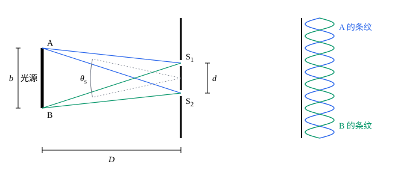

## 这一节要回答的问题

做杨氏双缝实验，用激光能看到一长排条纹，用白光却只能看到中央附近几条；照亮双缝的那条单缝开宽一些，条纹就糊成一片。同一光源分出的两束光，要满足什么条件才能:term[干涉]{id="physics.optics.interference"}（interference）？条纹清楚到什么程度，又怎样衡量？

## 讲解

### 条纹可见度

条纹清楚不清楚，要看亮处和暗处的光强差多少。只看差值不够：光源亮一倍，差值也大一倍，条纹却并没有更清楚，所以要拿它和光强本身比较。

::anchor{id="def-visibility"}
干涉条纹最亮处的光强为$I_{\max}$、最暗处为$I_{\min}$，$V=\frac{I_{\max}-I_{\min}}{I_{\max}+I_{\min}}$叫作:term[条纹可见度]{id="physics.optics.fringe-visibility"}（fringe visibility）。

为什么这样定义：分母是最亮和最暗处的光强之和，用它去除，光源亮一倍时分子分母一起加倍，$V$不变，只反映明暗的对比。边界情况：暗纹全黑时$V=1$，条纹最清楚；光强处处一样时$V=0$，看不到条纹；$V$总在$0$和$1$之间。

两束:term[相干光]{id="physics.optics.coherent-light"}（coherent light）单独照射时的光强为$I_1$、$I_2$，由[双光束干涉](lesson:physics.optics.two-beam-interference#thm-two-beam)的光强公式，$I_{\max}=I_1+I_2+2\sqrt{I_1I_2}$，$I_{\min}=I_1+I_2-2\sqrt{I_1I_2}$，所以$V=\frac{2\sqrt{I_1I_2}}{I_1+I_2}$，只有两束光一样强时才等于$1$。可见度降低还有更常见的原因：光不是严格单色的，或者光源有一定大小，屏上叠着好几套互相错开的条纹。下面分别讨论这两种情况。

### 时间相干性

实际的光都不是严格单色的，而是包含一段波长范围。设光的波长分布在$\lambda$附近宽为$\Delta\lambda$的范围里（$\Delta\lambda\ll\lambda$），各个波长的光各自产生一套条纹，它们互不相干，光强直接相加。:term[光程差]{id="physics.optics.optical-path-difference"}（optical path difference）为零处，各套条纹都是亮纹；光程差越大，不同波长的条纹错开得越多，:term[可见度]{id="physics.optics.fringe-visibility"}越低。

::anchor{id="def-coherence-length"}
一束光分成两束再会合，光程差增大到条纹基本看不见时的光程差，叫作这束光的:term[相干长度]{id="physics.optics.coherence-length"}（coherence length），记作$l_c$；光在真空中走过相干长度所用的时间$\tau_c=\frac{l_c}c$叫作:term[相干时间]{id="physics.optics.coherence-time"}（coherence time）。一束光和它自己延迟一段时间后的光能够:term[干涉]{id="physics.optics.interference"}的性质，叫作:term[时间相干性]{id="physics.optics.temporal-coherence"}（temporal coherence）；相干时间越长，时间相干性越好。

为什么这样定义：两束光会合时有光程差，相当于让一束光和它自己晚一段时间的那部分相遇，用条纹消失时的光程差作标准，量的正是光能和多久以前的自己保持相位关系。条纹是逐渐变模糊的，消失得快慢还和各个波长的光强怎样分布有关，所以相干长度只是一个量级。边界情况：严格单色的光，光程差多大条纹都一样清楚，相干长度无限大；白光的相干长度只有约$1\,\mu\mathrm m$（见下面的定理）。

::anchor{id="thm-coherence-length"}
定理（相干长度的估计）：光的波长分布在$\lambda$附近宽为$\Delta\lambda$的范围里（$\Delta\lambda\ll\lambda$），:term[相干长度]{id="physics.optics.coherence-length"}$l_c\approx\frac{\lambda^2}{\Delta\lambda}$；用频率范围$\Delta\nu$表示，:term[相干时间]{id="physics.optics.coherence-time"}$\tau_c\approx\frac1{\Delta\nu}$。

证明思路：设范围里各个波长的光一样强。光程差为$\Delta$时，波长$\lambda$和$\lambda+\Delta\lambda$的光两路之间的相位差分别是$\frac{2\pi\Delta}{\lambda}$和$\frac{2\pi\Delta}{\lambda+\Delta\lambda}$，两者相差约$\frac{2\pi\Delta\,\Delta\lambda}{\lambda^2}$。这个差达到$2\pi$时，范围里各个波长的条纹依次错开，正好均匀铺满一个明暗周期，叠加成均匀的光，所以$l_c=\frac{\lambda^2}{\Delta\lambda}$。频率$\nu=\frac c\lambda$，$\Delta\nu\approx\frac{c\,\Delta\lambda}{\lambda^2}$，于是$\tau_c=\frac{l_c}c\approx\frac1{\Delta\nu}$。

从发光的过程也能看出这个结论：普通光源里每个原子每次发光只持续极短的时间，发出的是一段有限长的波，先后发出的各段之间相位毫无关系。两束光的光程差小于这段波的长度时，会合的是同一段波分出来的两部分，相位差固定，能够干涉；光程差更大，会合的就是先后发出的两段波，相位差乱变。所以相干长度大致就是这段波的长度，波越短，包含的波长范围越宽。

白光的波长从约$400\,\mathrm{nm}$到$700\,\mathrm{nm}$，取$\lambda\approx550\,\mathrm{nm}$、$\Delta\lambda\approx300\,\mathrm{nm}$，$l_c\approx1\,\mu\mathrm m$，只有两个波长左右，所以白光的双缝条纹只在中央附近看得见（见[双光束干涉](lesson:physics.optics.two-beam-interference)第 8 题）。能看清的亮纹数大约是$\frac{l_c}{\lambda}=\frac{\lambda}{\Delta\lambda}$：光的波长范围越窄，看得清的条纹越多。

### 空间相干性

光源有一定大小时，问题出在另一个方向。宽为$b$的光源离双缝$D$，光源上每一点发出的光都穿过双缝，在屏上产生一套条纹；光源上不同的点各自发光，互不相干，这些条纹的光强直接相加（图见下面的「几何图像」）。光源上偏离中轴$s$的点产生的条纹整体移动$\frac{sL}D$，方向和$s$相反（见[双光束干涉](lesson:physics.optics.two-beam-interference)第 6 题），所以各点的条纹互相错开。

::anchor{id="def-spatial-coherence"}
光源不动，把双缝间距增大到条纹基本看不见时的缝间距，叫作光在双缝处的:term[相干宽度]{id="physics.optics.coherence-width"}（coherence width），记作$w$。同一:term[波阵面]{id="physics.optics.wavefront"}（wavefront）上横向分开的两点，光振动能够:term[干涉]{id="physics.optics.interference"}的性质，叫作:term[空间相干性]{id="physics.optics.spatial-coherence"}（spatial coherence）；相干宽度越大，空间相干性越好。

为什么这样定义：两条缝在同一波阵面上，它们发出的光能不能干涉，取决于两条缝相隔多远，用条纹消失时的缝间距作标准，量的就是波阵面上横向相隔多远仍然相干。和:term[相干长度]{id="physics.optics.coherence-length"}一样，条纹是逐渐变模糊的，相干宽度也只是一个量级。边界情况：点光源发出的光，同一波阵面上任意两点都相干，相干宽度无限大；照到双缝上的光来自许多互不相干的点，相干宽度才有限。

::anchor{id="thm-coherence-width"}
定理（相干宽度的估计）：宽为$b$的光源各处一样亮，离双缝$D\gg b$，对双缝张的角$\theta_s\approx\frac bD$，光的波长为$\lambda$，:term[相干宽度]{id="physics.optics.coherence-width"}$w\approx\frac{\lambda}{\theta_s}$。双缝间距远小于$w$时条纹清楚，增大到$w$时条纹消失。

证明思路：双缝间距为$d$、屏离双缝$L$时，光源两端的点产生的条纹相互错开$\frac{bL}D$，中间各点的条纹依次排在两者之间。错开的距离等于一个条纹间距$\frac{L\lambda}d$时，各点的条纹均匀铺满一个明暗周期，叠加成均匀的光，这时$\frac{bL}D=\frac{L\lambda}d$，即$d=\frac{\lambda D}b=\frac\lambda{\theta_s}$。屏的距离$L$在等式两边约掉了：相干宽度只由光源对双缝张的角和波长决定。

阳光直接照射时，相干宽度只有几十微米（例 2）。所以杨在 1803 年的实验里，先在窗板上开孔、盖上厚纸，用细针在纸上扎一个小孔，让阳光穿过它再做干涉实验。反过来，量出条纹消失时的缝间距，就能算出光源张的角：1920 年，迈克耳孙和皮斯用这个办法量出了参宿四的角直径（angular diameter，第 7 题）。激光的:term[空间相干性]{id="physics.optics.spatial-coherence"}和:term[时间相干性]{id="physics.optics.temporal-coherence"}通常都比普通光源好得多（见[激光](lesson:physics.optics.lasers)）。

## 几何图像

图里只画了光源两端 A、B 的光，它们的两套条纹错开半个间距，一套的亮纹落在另一套的暗纹上：如果光源只有这两个点，叠加后就是均匀的光。实际的光源上，A 和 B 之间的点连续分布，它们的条纹依次排在这两套之间，两端要错开一整个间距，叠加后才完全均匀（上面的定理）。光源对双缝张的角$\theta_s$越大，两端的条纹错开得越多。

:::anim{component="function-plot"}
range: { x: [0, 20], y: [0, 1.15] }
functions:
  - expr: "(1 + sin(pi*w*x/360 + 1e-9)/(pi*w*x/360 + 1e-9)*cos(2*pi*x/0.6))/2"
    label: |
      光强
  - expr: "abs(sin(pi*w*x/360 + 1e-9)/(pi*w*x/360 + 1e-9))"
    label: |
      条纹可见度$V$
sliders:
  - name: w
    min: 10
    max: 100
    step: 1
    default: 30
    label: |
      波长范围$\Delta\lambda$（$\mathrm{nm}$）
:::

横轴是两束光的:term[光程差]{id="physics.optics.optical-path-difference"}$\Delta$（$\mu\mathrm m$），纵轴是光强，以光程差为零处为$1$。光的中心波长$600\,\mathrm{nm}$，各个波长在宽为$\Delta\lambda$的范围里一样强。光程差增大，明暗起伏越来越小，在$\Delta=\frac{\lambda^2}{\Delta\lambda}$处第一次完全消失；再往后，条纹以很低的:term[可见度]{id="physics.optics.fringe-visibility"}重新出现，亮暗和原来颠倒。滑块调$\Delta\lambda$：范围越窄，条纹消失得越晚，:term[相干长度]{id="physics.optics.coherence-length"}越长。

## 例题

### 例 1　发光二极管的相干长度

一只红色发光二极管（LED）发出的光，中心波长$630\,\mathrm{nm}$，波长范围约$20\,\mathrm{nm}$。求它的:term[相干长度]{id="physics.optics.coherence-length"}和:term[相干时间]{id="physics.optics.coherence-time"}；用它做双缝实验，中央两侧大约各能看清几条亮纹？

**为什么想到这么做**：相干长度由波长范围决定，$l_c\approx\frac{\lambda^2}{\Delta\lambda}$；第$m$条亮纹处:term[光程差]{id="physics.optics.optical-path-difference"}是$m\lambda$，光程差超过$l_c$，条纹就看不清了。

**推导**：$l_c\approx\frac{(630\times10^{-9})^2}{20\times10^{-9}}\,\mathrm m\approx1.98\times10^{-5}\,\mathrm m\approx20\,\mu\mathrm m$，$\tau_c=\frac{l_c}c\approx\frac{1.98\times10^{-5}}{3.00\times10^8}\,\mathrm s\approx6.6\times10^{-14}\,\mathrm s$。看得清的亮纹到$m\approx\frac{l_c}\lambda=\frac\lambda{\Delta\lambda}\approx31$为止，中央两侧各约$30$条，比白光多得多，但远不如窄带的激光（第 3 题）。

### 例 2　阳光的相干宽度

从地球上看，太阳的角直径约$0.533^\circ$。（1）用阳光直接照射双缝（波长取$550\,\mathrm{nm}$），缝间距多大时条纹消失？（2）先让阳光穿过直径$0.50\,\mathrm{mm}$的小孔，在小孔后$1.0\,\mathrm m$处放双缝，:term[相干宽度]{id="physics.optics.coherence-width"}是多少？

**为什么想到这么做**：相干宽度$w\approx\frac\lambda{\theta_s}$只由光源对双缝张的角决定；小孔被阳光照亮，相当于一个张角小得多的新光源。

**推导**：（1）$\theta_s=0.533^\circ\approx9.30\times10^{-3}\,\mathrm{rad}$，$w\approx\frac{550\times10^{-9}}{9.30\times10^{-3}}\,\mathrm m\approx5.9\times10^{-5}\,\mathrm m=59\,\mu\mathrm m$。双缝间距一般是零点几毫米，比它大得多，阳光直接照射看不到条纹。（2）小孔的直径比阳光的相干宽度大得多，孔上各点的光互不相干，可以看作宽$0.50\,\mathrm{mm}$的光源；$\theta_s=\frac{0.50\times10^{-3}}{1.0}=5.0\times10^{-4}\,\mathrm{rad}$，$w\approx\frac{550\times10^{-9}}{5.0\times10^{-4}}\,\mathrm m=1.1\,\mathrm{mm}$，比缝间距大，条纹就看得清了。太阳和小孔都是圆的，精确的结果要乘约$1.22$（第 7 题），量级不变。

## 常见误区

- 「只有激光才能:term[干涉]{id="physics.optics.interference"}，普通光源的光不能。」普通光源的光，只要:term[光程差]{id="physics.optics.optical-path-difference"}小于:term[相干长度]{id="physics.optics.coherence-length"}、缝间距小于:term[相干宽度]{id="physics.optics.coherence-width"}，同样能干涉；杨在 1803 年用的就是阳光。
- 「光程差超过相干长度，两束光就不再叠加了。」两束光照样叠加，只是相位差乱变，交叉项平均为零，光强等于两束光强之和，看不到条纹。
- 「相干宽度只和光源的大小有关。」它由光源对双缝张的角决定：同一个光源挪远一些，张角变小，相干宽度就变大；恒星本身极大，却离得极远，星光的相干宽度可达几米（第 7 题）。
- 「:term[时间相干性]{id="physics.optics.temporal-coherence"}和:term[空间相干性]{id="physics.optics.spatial-coherence"}说的是一回事。」时间相干性管的是光和它自己延迟一段时间后的光，由波长范围决定；空间相干性管的是同一:term[波阵面]{id="physics.optics.wavefront"}上横向分开的两点，由光源对观察处张的角决定。很大的单色光源，时间相干性好，空间相干性却差。
