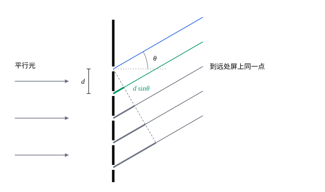

## 这一节要回答的问题

阳光照在光盘上，反射出彩虹般的颜色；光谱仪里一块刻满细线的玻璃或反射镜，能把光按波长分开。几千条缝一起:term[衍射]{id="physics.optics.diffraction"}（diffraction），屏上的亮纹为什么变得又细又亮？用它怎样量波长，又能把多么接近的两条谱线分开？

## 讲解

### 衍射光栅

::anchor{id="def-grating"}
在一块平板上刻出大量等宽、等间距的平行狭缝（或反射光的刻痕），叫作:term[衍射光栅]{id="physics.optics.diffraction-grating"}（diffraction grating）；相邻两条缝对应点之间的距离$d$叫作:term[光栅常量]{id="physics.optics.grating-constant"}（grating constant）。

为什么这样定义：光栅的作用全靠许多条缝的光一起叠加，而各条缝的位置只由间距决定，所以用$d$描述它。常见的光栅每毫米刻几百到上千条，$d$在微米量级，和可见光的波长相差不多，不同颜色的光偏离的角度才相差得开。边界情况：只有两条缝时就是杨氏双缝；刻在反射面上的光栅把透过换成反射，光盘上一圈圈的信息轨道就相当于一块，下面的结论照样成立。

1821 年，夫琅禾费（Joseph von Fraunhofer）用 260 根平行的细金属丝做成光栅，量出了太阳光谱里 D 线的波长。

### 光栅方程

::anchor{id="thm-grating-equation"}
定理（:term[光栅方程]{id="physics.optics.grating-equation"}，grating equation）：波长为$\lambda$的平行光垂直照到:term[光栅常量]{id="physics.optics.grating-constant"}为$d$的:term[光栅]{id="physics.optics.diffraction-grating"}上，在:term[夫琅禾费衍射]{id="physics.optics.fraunhofer-diffraction"}（Fraunhofer diffraction）中，偏离原方向$\theta$处满足$d\sin\theta=m\lambda$（$m=0,\pm1,\pm2,\dots$）时，所有缝的光同相，相互加强。

证明思路：如下面的图，相邻两条缝到远处同一点的:term[光程差]{id="physics.optics.optical-path-difference"}（optical path difference）都是$d\sin\theta$。它等于$m\lambda$时，相邻两条缝的光同相；第一条缝和第$k$条缝的光程差是$(k-1)m\lambda$，也同相，所有缝的光都相互加强。条件和双缝的亮纹条件形式相同（见[双光束干涉](lesson:physics.optics.two-beam-interference#thm-young)），不同的是这里有成千上万条缝一起加强。

::anchor{id="def-principal-maximum"}
:term[光栅衍射]{id="physics.optics.diffraction"}中，满足:term[光栅方程]{id="physics.optics.grating-equation"}的方向上所有缝的光同相，光强最大，这些又细又亮的亮纹叫作:term[主极大]{id="physics.optics.principal-maximum"}（principal maximum）；整数$m$是它的:term[级次]{id="physics.optics.interference-order"}（order），$m=0$的是零级，在正前方。

为什么这样定义：光栅衍射图样里最亮、也最有用的就是这些亮纹，它们的位置只由$d$和$\lambda$决定，和缝的数目、缝宽都无关，分光、测波长都靠它们。边界情况：$|\sin\theta|\le1$，所以级次$|m|\le\frac d\lambda$，只有有限几级；零级对所有波长都在正前方，不能分光。

### 主极大为什么又细又亮

::anchor{id="thm-n-slit"}
定理（:term[多缝衍射]{id="physics.optics.diffraction"}的光强）：$N$条宽为$a$的缝组成:term[光栅常量]{id="physics.optics.grating-constant"}为$d$的:term[光栅]{id="physics.optics.diffraction-grating"}，平行光垂直照射，偏离原方向$\theta$处的光强$I=I_0\Bigl(\frac{\sin\beta}\beta\Bigr)^2\Bigl(\frac{\sin N\gamma}{N\sin\gamma}\Bigr)^2$，$\beta=\frac{\pi a\sin\theta}\lambda$，$\gamma=\frac{\pi d\sin\theta}\lambda$，$I_0$是零级:term[主极大]{id="physics.optics.principal-maximum"}中心的光强。

证明思路：每条缝在$\theta$方向产生的振动，振幅都正比于$\frac{\sin\beta}\beta$（见[单缝衍射](lesson:physics.optics.single-slit-diffraction#thm-single-slit-intensity)），相邻两条缝的相位依次差$2\gamma$。用复数表示，$N$条缝的振动之和正比于等比数列的和$1+e^{2i\gamma}+\dots+e^{2i(N-1)\gamma}=\frac{1-e^{2iN\gamma}}{1-e^{2i\gamma}}$，它的模是$\Bigl|\frac{\sin N\gamma}{\sin\gamma}\Bigr|$。光强正比于模的平方，$\theta\to0$时$\frac{\sin N\gamma}{\sin\gamma}\to N$，于是得到上式。

光强是两个因子的乘积：$\Bigl(\frac{\sin N\gamma}{N\sin\gamma}\Bigr)^2$在$\gamma=m\pi$，即$d\sin\theta=m\lambda$时等于$1$，给出主极大的位置；$\Bigl(\frac{\sin\beta}\beta\Bigr)^2$是单缝衍射的因子，决定各级主极大有多亮。两个相邻主极大之间，$\sin N\gamma=0$的地方有$N-1$个暗处，夹着$N-2$个很弱的小亮纹。主极大的中心到旁边第一个暗处，$\gamma$只变化$\frac\pi N$，对应的角度$\Delta\theta=\frac\lambda{Nd\cos\theta}$，和宽为$Nd$的单缝的中央亮纹一样窄；中心的光强是一条缝单独照射时的$N^2$倍。

### 缺级

::anchor{id="def-missing-order"}
:term[光栅方程]{id="physics.optics.grating-equation"}要求的某一级:term[主极大]{id="physics.optics.principal-maximum"}的方向，正好落在:term[单缝衍射]{id="physics.optics.diffraction"}的暗纹上，这一级主极大就看不到了，这叫作:term[缺级]{id="physics.optics.missing-order"}（missing order）。

为什么这样定义：这个方向上各条缝的光虽然同相，但每条缝自己的光在这里已经抵消成零，叠加起来还是零。同时满足$d\sin\theta=m\lambda$和$a\sin\theta=k\lambda$，得$m=k\frac da$。边界情况：$d=3a$时第$\pm3$、$\pm6$……级缺级，$d=2a$时第$\pm2$、$\pm4$……级都缺；$\frac da$不是简单的整数比时没有恰好缺的级，但靠近单缝暗纹的主极大都很弱。

### 用光栅分光

对:term[光栅方程]{id="physics.optics.grating-equation"}两边求微分，$d\cos\theta\,\dd\theta=m\,\dd\lambda$，同一级里波长差$\dd\lambda$的两种光分开的角度是$\dd\theta=\frac{m\,\dd\lambda}{d\cos\theta}$：:term[级次]{id="physics.optics.interference-order"}越高、:term[光栅常量]{id="physics.optics.grating-constant"}越小，分得越开。白光照射时，零级仍是白色，其余每一级都展开成一条光谱，紫光在内侧、红光在外侧，和棱镜把紫光偏折得更多正好相反。级次高时，相邻两级的光谱会重叠（例 1）。

::anchor{id="def-chromatic-resolving-power"}
两条波长相近的谱线，一条的:term[主极大]{id="physics.optics.principal-maximum"}正好落在另一条同一级主极大旁边的第一个暗处时，认为它们刚好能分开；这时的波长差记作$\Delta\lambda$，$R=\frac\lambda{\Delta\lambda}$叫作:term[光栅]{id="physics.optics.diffraction-grating"}的:term[色分辨本领]{id="physics.optics.chromatic-resolving-power"}（chromatic resolving power）。

为什么这样定义：主极大有一定的宽度，两条谱线靠得太近，两个主极大就叠成一条；以落在第一个暗处为界，两个主极大之间还有一个看得出的凹陷，能认出是两条。$R$越大，能分开的波长差越小；它是两个波长之比，和用什么长度单位无关。边界情况：这是一种约定的标准，判断两个光斑能不能分开时还会用到（见[圆孔衍射与分辨本领](lesson:physics.optics.resolving-power)）；光源本身的谱线有宽度时，再好的光栅也分不开比谱线还近的两条。

::anchor{id="thm-resolving-power"}
定理（光栅的色分辨本领）：照亮$N$条缝的光栅，在第$m$级的色分辨本领$R=mN$。

证明思路：波长$\lambda$的第$m$级主极大在$d\sin\theta=m\lambda$，它旁边的第一个暗处在$d\sin\theta=m\lambda+\frac\lambda N$（$\gamma$多变化$\frac\pi N$）。波长$\lambda+\Delta\lambda$的第$m$级主极大在$d\sin\theta=m(\lambda+\Delta\lambda)$，两者重合时$m\Delta\lambda=\frac\lambda N$，所以$R=\frac\lambda{\Delta\lambda}=mN$。

色分辨本领只由级次和照亮的缝数决定，和光栅常量没有直接关系：光栅一样宽时，光栅常量小，缝数就多。要分开钠的两条黄线（约$589.0\,\mathrm{nm}$和$589.6\,\mathrm{nm}$），$R\approx1000$，在第一级只要照亮约一千条缝（例 2）。

## 几何图像

图里虚线过最上面一条缝、和光线垂直，从它往后各条光线到远处同一点的路程相同。第二条缝的光多走$d\sin\theta$（绿色粗线），往下各条缝依次多走$2d\sin\theta$、$3d\sin\theta$……（灰色粗线）。$d\sin\theta=\lambda$时，每条缝都比上一条多走一个波长，所有缝的光同相。

:::anim{component="function-plot"}
range: { x: [-3.5, 3.5], y: [0, 1.1] }
functions:
  - expr: "(sin(k*pi*(x + 1e-7))/(k*sin(pi*(x + 1e-7))))^2*(sin(pi*(x + 1e-7)/3)/(pi*(x + 1e-7)/3))^2"
    label: |
      光栅衍射的光强
  - expr: "(sin(pi*(x + 1e-7)/3)/(pi*(x + 1e-7)/3))^2"
    label: |
      单缝衍射的因子
sliders:
  - name: k
    min: 1
    max: 12
    step: 1
    default: 5
    label: |
      缝数$N$
:::

横轴是$\frac{d\sin\theta}\lambda$，:term[主极大]{id="physics.optics.principal-maximum"}落在整数上；纵轴是光强，以零级主极大的中心为$1$。:term[光栅常量]{id="physics.optics.grating-constant"}是缝宽的$3$倍，第二条曲线是:term[单缝衍射]{id="physics.optics.diffraction"}的因子，各级主极大的高度都被它限制住。滑块调缝数$N$：$N=1$时就是单缝衍射；$N$增大，主极大的位置不变，越来越细，相邻主极大之间出现$N-1$个暗处；第$\pm3$级正好落在单缝衍射的暗纹上，:term[缺级]{id="physics.optics.missing-order"}。

## 例题

### 例 1　光盘上的彩虹

光盘上信息轨道的间距约$1.6\,\mu\mathrm m$，可以看作:term[光栅常量]{id="physics.optics.grating-constant"}$1.6\,\mu\mathrm m$的:term[反射光栅]{id="physics.optics.diffraction-grating"}。白光（$400\,\mathrm{nm}$到$700\,\mathrm{nm}$）垂直照射，第一级、第二级光谱各在什么角度范围？第三级呢？

**为什么想到这么做**：垂直入射的反射光栅，:term[主极大]{id="physics.optics.principal-maximum"}的方向也满足$d\sin\theta=m\lambda$；分别代入光谱两端的波长。

**推导**：第一级：$\sin\theta=\frac{0.40}{1.6}=0.25$到$\frac{0.70}{1.6}\approx0.44$，$\theta$从$14.5^\circ$到$25.9^\circ$。第二级：$\sin\theta=0.50$到$0.875$，从$30.0^\circ$到$61.0^\circ$，和第一级不重叠。第三级：$\sin\theta=\frac{3\lambda}d\le1$要求$\lambda\le533\,\mathrm{nm}$，从$48.6^\circ$开始，和第二级重叠：$48.6^\circ$处，第三级的$400\,\mathrm{nm}$紫光和第二级的$600\,\mathrm{nm}$橙光落在一起。

### 例 2　分开钠的两条黄线

钠灯的黄光主要是$589.0\,\mathrm{nm}$和$589.6\,\mathrm{nm}$两条谱线。用每毫米$600$条线的:term[光栅]{id="physics.optics.diffraction-grating"}在第一级观察，至少要照亮多宽的光栅？两条谱线在第一级相隔多大的角度？

**为什么想到这么做**：所需的:term[色分辨本领]{id="physics.optics.chromatic-resolving-power"}$R=\frac\lambda{\Delta\lambda}$，第一级要照亮$N=R$条缝；角度差用$\dd\theta=\frac{m\,\dd\lambda}{d\cos\theta}$。

**推导**：$R=\frac{589.3}{0.6}\approx982$，第一级至少照亮$982$条缝。:term[光栅常量]{id="physics.optics.grating-constant"}$d=\frac1{600}\,\mathrm{mm}\approx1.667\,\mu\mathrm m$，照亮的宽度至少$982\times1.667\,\mu\mathrm m\approx1.64\,\mathrm{mm}$。$\sin\theta=\frac{0.5893}{1.667}\approx0.354$，$\cos\theta\approx0.935$，两条线相隔$\dd\theta\approx\frac{0.6\times10^{-9}}{1.667\times10^{-6}\times0.935}\,\mathrm{rad}$，约$3.8\times10^{-4}\,\mathrm{rad}\approx0.022^\circ$。

## 常见误区

- 「缝越多，:term[主极大]{id="physics.optics.principal-maximum"}离中央越远。」主极大的位置只由$d\sin\theta=m\lambda$决定，和缝数无关；缝多了，主极大只是变细、变亮。
- 「:term[光栅]{id="physics.optics.diffraction-grating"}把紫光偏折得多、红光偏折得少，和棱镜一样。」正好相反：光栅里波长越长，$\sin\theta=\frac{m\lambda}d$越大，红光偏离得最多。
- 「满足:term[光栅方程]{id="physics.optics.grating-equation"}的方向上一定有亮纹。」:term[单缝衍射]{id="physics.optics.diffraction"}的因子在那里为零时，这一级:term[缺级]{id="physics.optics.missing-order"}，看不到。
- 「照亮的缝数相同时，:term[光栅常量]{id="physics.optics.grating-constant"}越小，同一级的:term[色分辨本领]{id="physics.optics.chromatic-resolving-power"}越高。」缝数和:term[级次]{id="physics.optics.interference-order"}都不变，$R=mN$就不变：光栅常量小，同一级里不同颜色分得更开，可主极大也按同样的比例变宽，能分开的最小波长差不变。光栅一样宽时才不同：光栅常量小，缝数多，同一级的$R$就大（第 4 题）。
