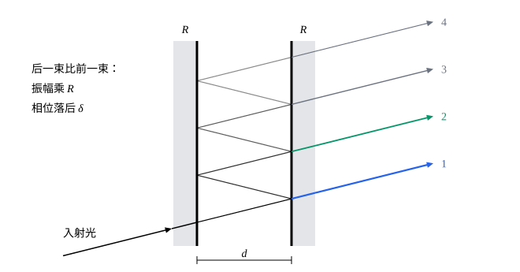

## 这一节要回答的问题

[薄膜干涉](lesson:physics.optics.thin-film-interference)只算了上下两个表面的两束反射光，因为第三束以后的光弱得多。把两个表面都镀上:term[反射率]{id="physics.optics.reflectance"}（reflectance）很高的膜，光会在两面之间来回反射几十次，每次都漏出一点，这些光一样不能忽略。它们叠加起来，透过的光随波长怎样变化？为什么这样的装置能分开比:term[光栅]{id="physics.optics.diffraction-grating"}（diffraction grating）还近的谱线？

## 讲解

### 多光束干涉

两个平行的表面相距$d$，中间介质的:term[折射率]{id="physics.optics.refractive-index"}（refractive index）为$n$，两个表面的:term[反射率]{id="physics.optics.reflectance"}都是$R$，不吸收光。光在两面之间以倾角$\theta$传播，每碰到右边的表面一次，就漏出一束透射光（见下面的图）。第一束透过了两个表面，光强是入射光的$(1-R)^2$倍，振幅是$1-R$倍；以后每一束都比前一束多在两面之间来回一趟、多反射两次，振幅再乘$R$，相位落后$\delta=\frac{4\pi nd\cos\theta}\lambda$。这里设光在两个表面上各反射一次，相位变化合起来是$2\pi$的整数倍，比如两次都有:term[半波损失]{id="physics.optics.half-wave-loss"}（half-wave loss）；一般情况下，反射的相位变化只让所有的峰一起平移，峰的形状和间隔不变。

::anchor{id="def-multiple-beam"}
光在两个平行的表面之间多次反射，分出的许多束光相互叠加产生的:term[干涉]{id="physics.optics.interference"}（interference），叫作:term[多光束干涉]{id="physics.optics.multiple-beam-interference"}（multiple-beam interference）。

为什么这样定义：表面反射率低时，第三束以后的光弱得可以不计，就是双光束的:term[薄膜干涉]{id="physics.optics.thin-film-interference"}（thin-film interference）；反射率高时，几十束光都不弱，必须一起算，结果和双光束干涉大不相同（下面的定理）。边界情况：$R\to0$时只剩一束透射光，没有干涉；$R$接近$1$时，透射光的振幅要经过约$\frac1{1-R}$束才降到第一束的$\frac1e$，参与叠加的光束非常多。

::anchor{id="thm-airy"}
定理（多光束干涉的透射光）：上面两个表面透过的总光强和入射光强之比，即透射率（transmittance），$T=\frac1{1+F\sin^2\frac\delta2}$，$F=\frac{4R}{(1-R)^2}$。

证明思路：用复数表示，透射光的振幅之和正比于$(1-R)\bigl(1+Re^{-i\delta}+R^2e^{-2i\delta}+\cdots\bigr)=\frac{1-R}{1-Re^{-i\delta}}$，这是公比为$Re^{-i\delta}$的无穷等比数列的和，$R<1$时收敛。光强正比于模的平方，而$|1-Re^{-i\delta}|^2=1-2R\cos\delta+R^2$，也就是$(1-R)^2+4R\sin^2\frac\delta2$。所以$T=\frac{(1-R)^2}{(1-R)^2+4R\sin^2\frac\delta2}=\frac1{1+F\sin^2\frac\delta2}$。

$\delta=2\pi m$，即$2nd\cos\theta=m\lambda$时$T=1$：不管反射率多高，光都全部透过。两个透射峰正中间$\delta=(2m+1)\pi$处$T$最小，为$\frac1{1+F}=\Bigl(\frac{1-R}{1+R}\Bigr)^2$。$R=0.04$（不镀膜的玻璃）时$F\approx0.17$，$T$在$0.85$和$1$之间缓慢起伏，和双光束干涉的余弦形状差不多；$R=0.9$时$F=360$，两个峰之间$T$几乎为零，峰变得极细。

::anchor{id="def-fabry-perot"}
两块玻璃板平行放置，相对的两个表面镀上反射率很高的膜，利用透射光的多光束干涉精密测量波长的装置，叫作:term[法布里-珀罗干涉仪]{id="physics.optics.fabry-perot-interferometer"}（Fabry–Pérot interferometer）。

为什么这样定义：1899 年，法布里（Charles Fabry）和珀罗（Alfred Pérot）发表了这种装置和用它测量光谱的方法，所以用他们的名字命名。两个表面严格平行时，透射光只在满足$2nd\cos\theta=m\lambda$的方向和波长上出现，峰又细又亮，适合精密地量波长、分开很近的谱线。边界情况：两个表面之间可以是空气，也可以是一块两面镀膜的平行玻璃板；镀的金属膜会吸收一部分光，透射峰就达不到$1$（第 8 题）。

### 精细度和自由光谱范围

::anchor{id="def-finesse"}
相邻两个透射峰之间的间隔，和一个峰在一半高度处的宽度之比，叫作:term[精细度]{id="physics.optics.finesse"}（finesse），记作$\mathcal F$。

为什么这样定义：对任何装置，相邻两个峰之间$\delta$都变化$2\pi$，用这个间隔和峰宽相比，得到的是一个只由:term[反射率]{id="physics.optics.reflectance"}决定的数，直接说明峰有多尖锐；它也大致是参与叠加的光束数。边界情况：反射率低时峰和谷一样宽，谈不上尖锐的峰；$R=0.9$时$\mathcal F$约为$30$，$R=0.99$时约为$310$。

::anchor{id="thm-finesse"}
定理（精细度）：反射率$R$接近$1$时，透射峰在一半高度处的宽度是$\Delta\delta=\frac4{\sqrt F}$，:term[精细度]{id="physics.optics.finesse"}$\mathcal F=\frac{2\pi}{\Delta\delta}=\frac{\pi\sqrt F}2=\frac{\pi\sqrt R}{1-R}$。

证明思路：峰在$\delta=2\pi m$，在它附近$\sin\frac\delta2\approx\pm\frac{\delta-2\pi m}2$，$T\approx\frac1{1+\frac F4(\delta-2\pi m)^2}$。$T=\frac12$时$\delta-2\pi m=\pm\frac2{\sqrt F}$，宽度为$\frac4{\sqrt F}$；$R$接近$1$时$F$很大，这个宽度很小，上面的近似成立。代入$F=\frac{4R}{(1-R)^2}$得$\frac{\pi\sqrt F}2=\frac{\pi\sqrt R}{1-R}$。

::anchor{id="def-fsr"}
相邻两个透射峰对应的频率之差，叫作:term[自由光谱范围]{id="physics.optics.free-spectral-range"}（free spectral range）。垂直入射时，$\delta=\frac{4\pi nd\nu}c$，峰在$\nu_m=\frac{mc}{2nd}$，自由光谱范围是$\Delta\nu=\frac c{2nd}$，换成波长约为$\frac{\lambda^2}{2nd}$。

为什么这样定义：两条谱线的频率差超过它时，一条的第$m$级峰会和另一条的第$m+1$级峰落在一起，分不清谁是谁，所以它是这台装置不会混淆的测量范围。边界情况：间距$d$越大，自由光谱范围越小，峰越密；峰的宽度按频率算是$\frac{\Delta\nu}{\mathcal F}$，这也大致是能分开的最小频率差（第 6 题）。

## 几何图像

图里只画了前四束透射光，越往后越弱。$R$接近$1$时，后面几十束都和第一束差不多强，只要$\delta$偏离$2\pi$的整数倍一点点，它们的相位就依次错开、铺满一整圈，相互抵消；这就是峰变得极细的原因，和:term[光栅]{id="physics.optics.diffraction-grating"}的缝越多:term[主极大]{id="physics.optics.principal-maximum"}（principal maximum）越细是同一个道理。

:::anim{component="function-plot"}
range: { x: [0, 2.5], y: [0, 1.1] }
functions:
  - expr: "1/(1 + 4*r/(1 - r)^2*sin(pi*x)^2)"
    label: |
      反射率为$R$
  - expr: "1/(1 + 4*0.04/(1 - 0.04)^2*sin(pi*x)^2)"
    label: |
      反射率为$0.04$
sliders:
  - name: r
    min: 0.04
    max: 0.95
    step: 0.01
    default: 0.8
    label: |
      反射率$R$
:::

横轴是$\frac\delta{2\pi}$，透射峰落在整数上；纵轴是透射率$T$。第二条曲线是不镀膜的玻璃表面（$R=0.04$），$T$只在$0.85$和$1$之间缓慢起伏。滑块调:term[反射率]{id="physics.optics.reflectance"}：$R$越大，峰越细，峰之间越暗，峰顶始终是$1$；$R=0.95$时:term[精细度]{id="physics.optics.finesse"}约为$61$。

## 例题

### 例 1　法布里-珀罗干涉仪的分辨本领

空气间隔$d=5.0\,\mathrm{mm}$、两面:term[反射率]{id="physics.optics.reflectance"}$0.90$的:term[法布里-珀罗干涉仪]{id="physics.optics.fabry-perot-interferometer"}，在波长$500\,\mathrm{nm}$附近垂直入射使用。求它的:term[自由光谱范围]{id="physics.optics.free-spectral-range"}、:term[精细度]{id="physics.optics.finesse"}，以及能分开的最小波长差。

**为什么想到这么做**：自由光谱范围$\Delta\nu=\frac c{2nd}$，换成波长$\frac{\lambda^2}{2nd}$；能分开的最小差约为自由光谱范围除以精细度。

**推导**：$\Delta\nu=\frac{3.0\times10^8}{2\times5.0\times10^{-3}}\,\mathrm{Hz}=3.0\times10^{10}\,\mathrm{Hz}$，换成波长$\frac{(500\times10^{-9})^2}{2\times5.0\times10^{-3}}\,\mathrm m=2.5\times10^{-11}\,\mathrm m=0.025\,\mathrm{nm}$。$\mathcal F=\frac{\pi\sqrt{0.90}}{0.10}\approx29.8$，能分开的最小波长差约$\frac{0.025\,\mathrm{nm}}{29.8}\approx8.4\times10^{-4}\,\mathrm{nm}$，$\frac\lambda{\Delta\lambda}\approx6\times10^5$，比[衍射光栅](lesson:physics.optics.diffraction-gratings)第 4 题那块宽$5\,\mathrm{cm}$的:term[光栅]{id="physics.optics.diffraction-grating"}还高十倍。代价是自由光谱范围只有$0.025\,\mathrm{nm}$，测量前要先用光栅或棱镜把光大致分开。

### 例 2　等倾的圆环

用一块被照亮的毛玻璃作光源，各个方向的光都有，照到例 1 的:term[法布里-珀罗干涉仪]{id="physics.optics.fabry-perot-interferometer"}上（$\lambda=500\,\mathrm{nm}$）。正对着装置看，透射光是一圈圈同心的亮环。中心恰好是亮点，求最里面两圈亮环对应的倾角。

**为什么想到这么做**：倾角$\theta$相同的光$\delta$相同，同一圈亮环上$2d\cos\theta=m\lambda$；中心$\theta=0$，:term[级次]{id="physics.optics.interference-order"}（order）$m_0=\frac{2d}\lambda$最高，往外每一圈级次减$1$。

**推导**：$m_0=\frac{2\times5.0\times10^{-3}}{500\times10^{-9}}=20000$，是整数，中心亮。第$k$圈：$\cos\theta_k=\frac{m_0-k}{m_0}=1-\frac k{m_0}$，角度小时$1-\cos\theta_k\approx\frac{\theta_k^2}2$，$\theta_k\approx\sqrt{\frac{2k}{m_0}}$。$\theta_1\approx\sqrt{10^{-4}}=0.010\,\mathrm{rad}\approx0.57^\circ$，$\theta_2\approx0.014\,\mathrm{rad}\approx0.81^\circ$：亮环的倾角和$\sqrt k$成正比，越往外越密。用:term[焦距]{id="physics.optics.focal-length"}（focal length）为$f$的透镜把这些光会聚到:term[焦点]{id="physics.optics.focal-point"}（focal point）所在的平面上，环的半径约为$f\theta_k$（见[薄透镜](lesson:physics.optics.thin-lenses)）。

## 常见误区

- 「:term[反射率]{id="physics.optics.reflectance"}越高，透射峰的峰顶越低，满足$2nd\cos\theta=m\lambda$的光也透不过去多少。」不吸收光时，峰顶总是$1$，满足条件的光全部透过；反射率高只是让峰变窄、峰之间变暗，所以各种波长平均起来，透过的光确实少了。镀的膜会吸收光时，峰顶才低于$1$（第 8 题）。
- 「:term[精细度]{id="physics.optics.finesse"}越高，能测的频率范围越大。」精细度说的是峰有多尖，测量范围由:term[自由光谱范围]{id="physics.optics.free-spectral-range"}决定，只和间距有关；两者之比才是能分开的最小频率差。
- 「:term[多光束干涉]{id="physics.optics.multiple-beam-interference"}的峰和:term[双光束干涉]{id="physics.optics.interference"}的亮纹位置不同。」同样的两个表面，两种情形的峰都在往返一趟的相位差（连同反射的相位变化）是$2\pi$整数倍的地方，按上面的约定就是$2nd\cos\theta=m\lambda$；多光束只是让峰变尖、峰之间变暗。
