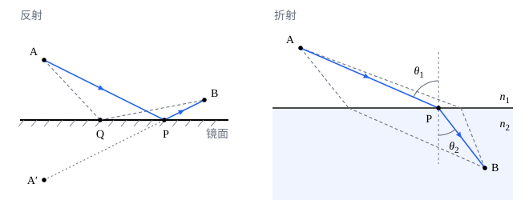

## 这一节要回答的问题

光在均匀介质里走直线，碰到镜面反射，碰到界面折射，这几条规律能不能归结成一条？从水里的鱼射到岸上人眼睛的光，为什么偏偏走那条折线，而不走两点之间的直线？常听人说「光走用时最短的路」，这句话对不对？

## 讲解

### 光程

光在介质里比在真空中慢，同样一段路，在玻璃里要走更久。比较光走几条路各用多少时间，可以把每一段路换算成「同样的时间里光在真空中走多远」。

::anchor{id="def-optical-path"}
光在:term[折射率]{id="physics.optics.refractive-index"}（refractive index）为$n$的均匀介质里走过几何路程$s$，乘积$ns$叫作这段路的:term[光程]{id="physics.optics.optical-path-length"}（optical path length）；光先后经过几种介质时，光程是各段的光程之和。

为什么这样定义：光在介质里的速度是$v=\frac cn$，走过$s$用时$\frac sv=\frac{ns}c$，所以光程就是同样的时间里光在真空中走的路程，比较光程就是比较用时。边界情况：空气的$n$几乎是$1$，光程和几何路程几乎相等；同样厚$1.0\,\mathrm{cm}$的玻璃（$n=1.5$）和水（$n=1.33$），光程分别是$1.5\,\mathrm{cm}$和约$1.33\,\mathrm{cm}$。

### 费马原理

::anchor{id="def-fermat"}
光从一点传到另一点，沿:term[光程]{id="physics.optics.optical-path-length"}取极值的路径传播：把实际的路径稍微改动一点，用一个参数描述这种改动，光程对这个参数的导数为零。这叫作:term[费马原理]{id="physics.optics.fermat-principle"}（Fermat's principle）；多数情况下这个极值是最小值，所以也常说成「光走用时最短的路径」。

为什么这样定义：在均匀介质里，两点之间光程最小的路径是直线，光沿直线传播就是它的特例；:term[反射定律]{id="physics.optics.law-of-reflection"}（law of reflection）和:term[折射定律]{id="physics.optics.law-of-refraction"}（law of refraction）也都能由它推出（下面两个定理）。约 1 世纪，亚历山大城的希罗（Hero of Alexandria）用「光走最短的路」解释了反射；1662 年，费马（Pierre de Fermat）假定光在越密的介质里越慢，由「用时最短」推出了折射定律。边界情况：「最短」并不总对，凹面镜里的实际光路可以是光程的极大值（第 6 题），所以原理只要求导数为零，即驻点（stationary point，见[最值问题](lesson:math.calculus.optimization)）。

### 由费马原理推出反射定律和折射定律

::anchor{id="thm-reflection-fermat"}
定理（由:term[费马原理]{id="physics.optics.fermat-principle"}推出:term[反射定律]{id="physics.optics.law-of-reflection"}）：$A$、$B$两点在平面镜的同一侧，光从$A$经镜面反射到$B$，:term[光程]{id="physics.optics.optical-path-length"}最小的反射点$P$使入射角等于反射角。

证明思路：作$A$关于镜面的对称点$A'$。镜面上任意一点$Q$到$A$和到$A'$的距离相等，所以$AQ+QB=A'Q+QB\ge A'B$，等号只在$Q$落在线段$A'B$上时成立，这一点就是$P$。$A'P$和$AP$关于镜面对称，又和$PB$在一条直线上，所以$AP$、$PB$和法线的夹角相等。

::anchor{id="thm-snell-fermat"}
定理（由费马原理推出:term[折射定律]{id="physics.optics.law-of-refraction"}）：光从:term[折射率]{id="physics.optics.refractive-index"}为$n_1$的介质里的$A$点，传到折射率为$n_2$的介质里的$B$点，光程取极值的路径满足$n_1\sin\theta_1=n_2\sin\theta_2$，$\theta_1$、$\theta_2$是两段光线和法线的夹角。

证明思路：取界面为$x$轴，$A$在界面上方$a$处，$B$在界面下方$b$处，两者沿界面相距$d$。光在界面上横坐标为$x$的点折射时，光程$L(x)=n_1\sqrt{a^2+x^2}+n_2\sqrt{b^2+(d-x)^2}$。令$L'(x)=n_1\frac{x}{\sqrt{a^2+x^2}}-n_2\frac{d-x}{\sqrt{b^2+(d-x)^2}}=0$，而$\frac{x}{\sqrt{a^2+x^2}}=\sin\theta_1$，$\frac{d-x}{\sqrt{b^2+(d-x)^2}}=\sin\theta_2$，就得到$n_1\sin\theta_1=n_2\sin\theta_2$；$L''(x)>0$，这个驻点是最小值。

[反射定律与折射定律](lesson:physics.optics.reflection-refraction#thm-snell)里把光看成波推出过同一个定律，费马原理给出了另一条路：只假定光程取极值，再用一次求导。光在越密的介质里越慢，正是费马推导的前提，这一点直到 1850 年傅科（Léon Foucault）测出水中的光速才得到实验的证实。

### 物和像之间的光程

::anchor{id="thm-equal-path"}
定理（物像之间的:term[光程]{id="physics.optics.optical-path-length"}相等）：从物点发出、经过光学系统会聚到像点的各条光线，光程都相等。

证明思路：每条光线都是从物点到像点的实际光路，都满足:term[费马原理]{id="physics.optics.fermat-principle"}。这些光线可以用一个连续变化的参数（例如出射的角度）排成一族，沿着这一族改变参数，就是把实际路径稍微改动成另一条实际路径；光程对参数的导数处处为零，所以光程处处相等。

这给了成像一个直观的说法：透镜中间厚、边缘薄，穿过中间的光线在玻璃里走得多，在空气里走得少，两者正好抵消（第 4 题）。抛物面镜把平行于轴的光会聚到:term[焦点]{id="physics.optics.focal-point"}（focal point，见[球面镜成像](lesson:physics.optics.spherical-mirrors)第 6 题），用光程相等看最简单：从垂直于轴的同一个平面出发，经抛物面反射到焦点的各条光线一样长（第 8 题）。

## 几何图像

左图里$A$离镜面$3$个单位，$B$离镜面$1$个单位，两者水平相距$8$个单位，$P$在离$A$水平$6$个单位处；经过$Q$的虚线路径比$APB$长。右图下面介质的:term[折射率]{id="physics.optics.refractive-index"}是上面的$1.5$倍，实线是:term[光程]{id="physics.optics.optical-path-length"}最小的路径，两条虚线经过界面上别的点，光程都更大；在$P$点，$\sin\theta_1=1.5\sin\theta_2$。

:::anim{component="function-plot"}
range: { x: [-0.5, 2.5], y: [-2, 6] }
functions:
  - expr: "sqrt(1 + x^2) + q*sqrt(1 + (2 - x)^2)"
    label: |
      光程$L$
  - expr: "x/sqrt(1 + x^2) - q*(2 - x)/sqrt(1 + (2 - x)^2)"
    label: |
      光程的导数$\frac{\mathrm dL}{\mathrm dx}$
sliders:
  - name: q
    min: 1
    max: 2
    step: 0.01
    default: 1.33
    label: |
      两种介质的折射率之比$\frac{n_2}{n_1}$
:::

$A$在界面上方$1$，$B$在界面下方$1$，两者沿界面相距$2$；横轴是折射点的横坐标$x$，第一条曲线是光程（以$n_1$乘长度单位计），第二条是它对$x$的导数。导数过零的地方光程最小，这正是满足:term[折射定律]{id="physics.optics.law-of-refraction"}的那一点。滑块为$1$时两种介质一样，最小点在$x=1$，光走直线；比值越大，最小点越往右移，光在折射率大的介质里走得越短。

## 例题

### 例 1　平面镜：最短的路

$A$点离平面镜$3.0\,\mathrm m$，$B$点离镜面$1.0\,\mathrm m$，在镜子的同一侧，两点沿镜面方向相距$8.0\,\mathrm m$。光从$A$经镜面反射到$B$，反射点在哪里？光走的总路程是多少？

**为什么想到这么做**：在镜面上找一点使$AP+PB$最小，用对称点把折线拉成直线。

**推导**：$A$关于镜面的对称点$A'$在镜后$3.0\,\mathrm m$处。$A'$和$B$的连线跨过的竖直距离是$3.0+1.0=4.0\,\mathrm m$，交镜面的点离$A$的垂足$8.0\times\frac{3.0}{4.0}=6.0\,\mathrm m$。总路程等于$A'B=\sqrt{8.0^2+4.0^2}\,\mathrm m\approx8.94\,\mathrm m$。验算：两段光线和法线的夹角，正切都是$\frac{6.0}{3.0}=\frac{2.0}{1.0}=2$，入射角等于反射角。

### 例 2　光为什么不走直线

$A$点在水面上方$1.0\,\mathrm m$的空气里，$B$点在水面下方$1.0\,\mathrm m$，两点沿水面方向相距$2.0\,\mathrm m$，水的:term[折射率]{id="physics.optics.refractive-index"}取$1.33$。光从$A$射到$B$在水面上哪一点折射？和走直线相比，:term[光程]{id="physics.optics.optical-path-length"}短了多少？

**为什么想到这么做**：按:term[折射定律]{id="physics.optics.law-of-refraction"}的证明，折射点$x$满足$L'(x)=0$，即$\frac{x}{\sqrt{1+x^2}}=1.33\frac{2-x}{\sqrt{1+(2-x)^2}}$（长度以$\mathrm m$为单位）；这个方程没有简单的解，就试几个值。

**推导**：$x=1.25$时左边约$0.781$、右边约$0.798$；$x=1.28$时左边约$0.788$、右边约$0.777$。所以折射点在$x\approx1.27\,\mathrm m$处，$\theta_1\approx51.7^\circ$，$\theta_2\approx36.2^\circ$，$\frac{\sin\theta_1}{\sin\theta_2}\approx1.33$。光程$L\approx1.615+1.33\times1.239\approx3.26\,\mathrm m$；走直线时$L=\sqrt2+1.33\sqrt2\approx3.30\,\mathrm m$。折线的光程短了约$0.03\,\mathrm m$：多在空气里走一点、少在水里走一点，用时更少。

## 常见误区

- 「:term[光程]{id="physics.optics.optical-path-length"}就是光走过的路程。」光程是:term[折射率]{id="physics.optics.refractive-index"}乘路程，在玻璃、水里比几何路程长；只有在真空、空气里两者才几乎相等。
- 「光总是走光程最短的路。」原理要求的是光程取极值，多数时候是最小值，但也有极大值的情形（第 6 题），还有许多路径光程都相等的情形，例如物点和像点之间。
- 「光事先『知道』哪条路最近，才选它走。」:term[费马原理]{id="physics.optics.fermat-principle"}描述的是结果；在波动光学里，它来自邻近路径的波叠加时互相加强（第 7 题）。
- 「费马原理和:term[折射定律]{id="physics.optics.law-of-refraction"}是两件事，要分别记。」两者等价：由费马原理推出折射定律，反过来，满足折射定律的路径也正是光程的驻点。
