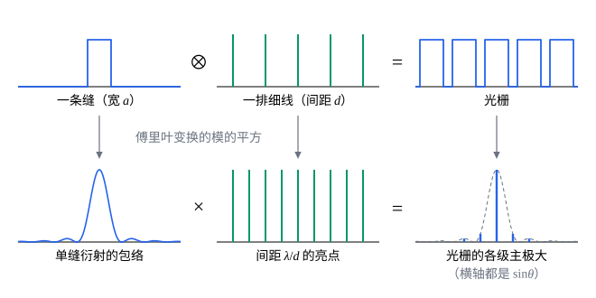

## 这一节要回答的问题

单缝、双缝、:term[光栅]{id="physics.optics.diffraction-grating"}（diffraction grating），每换一种孔，都要把缝上的:term[次波]{id="physics.optics.secondary-wavelet"}（secondary wavelet）重新叠加一遍。有没有一个统一的办法，由孔的形状直接读出远处的:term[衍射]{id="physics.optics.diffraction"}（diffraction）图样？光栅的光强为什么正好是单缝因子乘多缝因子？一根头发和同样宽的单缝，衍射图样为什么几乎一样？

## 讲解

### 孔径函数和它的傅里叶变换

下面只看沿$y$方向很长的缝这类孔，透过的光只随$x$变化，平行光垂直照射，在远处观察（:term[夫琅禾费衍射]{id="physics.optics.fraunhofer-diffraction"}，Fraunhofer diffraction）。

::anchor{id="def-aperture-function"}
孔所在平面上，$x$处透过的光的振幅和入射光振幅之比$t(x)$，叫作:term[孔径函数]{id="physics.optics.aperture-function"}（aperture function）。

为什么这样定义：衍射图样完全由孔上各处透过多少光、相位怎样决定，$t(x)$把这些都记下了：透光处$t=1$，不透光处$t=0$；半透明的地方$t$在$0$和$1$之间，盖了一层使相位落后$\varphi$的透明膜的地方，$t$乘上$e^{-i\varphi}$。边界情况：$t(x)$处处等于$1$就是没有遮挡，宽为$a$的单缝是一个高为$1$、宽为$a$的「矩形」。

照[单缝衍射](lesson:physics.optics.single-slit-diffraction#thm-single-slit-intensity)的算法，$x$处的:term[次波]{id="physics.optics.secondary-wavelet"}到远处$\theta$方向，:term[光程]{id="physics.optics.optical-path-length"}（optical path length）比从原点出发的少$x\sin\theta$，用$e^{i\omega t}$的写法，相位多出$kx\sin\theta$，$k=\frac{2\pi}\lambda$。各处的次波按$t(x)$加权叠加，$\theta$方向的振幅正比于$\int t(x)e^{ikx\sin\theta}\,\dd x$。这里取函数$f$的傅里叶变换（Fourier transform）为$F(q)=\int_{-\infty}^{\infty}f(x)e^{-iqx}\,\dd x$（见[傅里叶变换](lesson:math.pde.fourier-transform)；有的书多一个常数因子或把指数的正负号反过来，不影响下面的结论）。

::anchor{id="thm-fraunhofer-fourier"}
定理（夫琅禾费衍射与傅里叶变换）：孔径函数为$t(x)$的孔被平行光垂直照射，在夫琅禾费衍射中，$\theta$方向的振幅正比于$t$的傅里叶变换在$q=-k\sin\theta$处的值$T(-k\sin\theta)$；$t$是实函数时，光强正比于$|T(k\sin\theta)|^2$。

证明思路：上面的积分$\int t(x)e^{ikx\sin\theta}\,\dd x$正是$T(q)$在$q=-k\sin\theta$处的值。$t$是实函数时，$T(-q)$是$T(q)$的共轭，模相等，光强就是$|T(k\sin\theta)|^2$，图样左右对称。正负号来自$e^{i\omega t}$的写法，换成$e^{-i\omega t}$就成了$T(k\sin\theta)$，光强不受影响。

例如宽为$a$的单缝，$T(q)=\int_{-a/2}^{a/2}e^{-iqx}\,\dd x=a\frac{\sin(qa/2)}{qa/2}$，$q=k\sin\theta$时$\frac{qa}2=\frac{\pi a\sin\theta}\lambda=\beta$，光强正比于$\Bigl(\frac{\sin\beta}\beta\Bigr)^2$，正是:term[单缝衍射]{id="physics.optics.diffraction"}的结果。傅里叶变换的性质都能直接读成衍射的规律：缝在自己的平面里平移$x_0$，$T$只乘一个模为$1$的因子$e^{-iqx_0}$，光强不变，图样不动；孔径函数在$x$方向拉宽为原来的$s$倍，变换在$q$方向缩窄为原来的$\frac1s$，孔越宽，衍射图样越窄。

::anchor{id="def-spatial-frequency"}
孔径函数里按$e^{iqx}$变化的成分，每单位长度重复$\frac q{2\pi}$次，$\frac q{2\pi}$叫作它的:term[空间频率]{id="physics.optics.spatial-frequency"}（spatial frequency）；由上面的定理，它把光送往$\sin\theta=\lambda\frac{q}{2\pi}$的方向（正负号只差左右）。

为什么这样定义：时间上振荡的频率是每秒重复几次，空间频率说的是孔径函数沿$x$每单位长度起伏几次。孔上越细的结构，空间频率越高，衍射光偏离原方向越远；周期为$d$的结构，空间频率是$\frac1d$，送出的光在$\sin\theta=\frac\lambda d$，正是:term[光栅方程]{id="physics.optics.grating-equation"}（grating equation）的第一级。边界情况：空间频率高到$\frac1\lambda$以上的成分，$\sin\theta$要大于$1$，它的光传不到远处，所以比波长还细的结构在远处的图样里看不出来。

### 卷积定理

双缝的:term[孔径函数]{id="physics.optics.aperture-function"}是两条单缝之和，一条中心在$x=\frac d2$，一条在$x=-\frac d2$。由平移的性质，$T(q)=T_1(q)\bigl(e^{-iqd/2}+e^{iqd/2}\bigr)=2T_1(q)\cos\frac{qd}2$，$T_1$是一条缝的变换；光强正比于$\Bigl(\frac{\sin\beta}\beta\Bigr)^2\cos^2\gamma$，$\gamma=\frac{\pi d\sin\theta}\lambda$，单缝因子乘:term[双缝干涉]{id="physics.optics.interference"}（double-slit interference）的因子。$N$条缝也一样，$T=T_1(q)\sum_je^{-iqx_j}$，第二个因子只由各条缝的位置决定，这就是[衍射光栅](lesson:physics.optics.diffraction-gratings#thm-n-slit)里单缝因子乘多缝因子的来历。

::anchor{id="def-convolution"}
函数$f$和$g$的卷积（convolution）是$(f*g)(x)=\int_{-\infty}^{\infty}f(x-x')g(x')\,\dd x'$。

为什么这样定义：$f(x-x')$是把$f$平移到$x'$处，$g(x')\,\dd x'$是那里的权重，卷积就是把$f$平移到$g$所在的各处、按$g$的大小加权叠加起来。:term[光栅]{id="physics.optics.diffraction-grating"}正是这样：把一条缝放到一排间距为$d$的位置上，即一条缝和「一排很窄的尖峰」的卷积。边界情况：$g$是一个很窄、面积为$1$的尖峰时，$f*g$就是$f$本身；$g$是几个这样的尖峰时，$f*g$是几个平移过的$f$之和。

::anchor{id="thm-convolution"}
定理（卷积定理，convolution theorem）：$f*g$的傅里叶变换等于$F(q)G(q)$。

证明思路：$f*g$是许多平移过的$f$按权重$g(x')\,\dd x'$叠加而成；平移到$x'$处的$f$，变换是$F(q)e^{-iqx'}$，加权叠加起来就是$F(q)\int g(x')e^{-iqx'}\,\dd x'=F(q)G(q)$。严格的证明要交换两重积分的次序（第 5 题）。

由这个定理，一个孔若是由同一个单元按某种排列重复而成，它的衍射图样就是「单元的衍射图样」乘「排列的衍射图样」：:term[主极大]{id="physics.optics.principal-maximum"}（principal maximum）的位置由排列决定，各级的亮暗由单元决定。晶体的 :term[X 射线衍射]{id="physics.optics.diffraction"}也是这样：原子排成的点阵决定衍射斑点的位置，每个晶胞里原子怎样分布决定各个斑点的亮度。

### 巴比涅原理

::anchor{id="thm-babinet"}
定理（:term[巴比涅原理]{id="physics.optics.babinet-principle"}，Babinet's principle）：两个互补的屏，即一个透光的地方正好是另一个不透光的地方，它们的:term[夫琅禾费衍射]{id="physics.optics.fraunhofer-diffraction"}图样除了原方向附近以外完全相同。

证明思路：互补的两个屏，:term[孔径函数]{id="physics.optics.aperture-function"}之和$t_1+t_2=1$，傅里叶变换是线性的，$T_1+T_2$等于没有遮挡时的变换。没有遮挡的平行光只沿原方向传播，在夫琅禾费衍射里，它的变换只在$\theta=0$附近很窄的范围里不为零，别的方向上为零。所以那些方向上$T_2=-T_1$，光强相同。

[单缝衍射](lesson:physics.optics.single-slit-diffraction)第 8 题的头发和同样宽的单缝，正是一对互补的屏，用:term[次波]{id="physics.optics.secondary-wavelet"}叠加得到的结论就是这条原理。它以巴比涅（Jacques Babinet）的名字命名，他在 1837 年提出了这一点。量头发、细丝的粗细，用的就是它。

## 几何图像

上一行，:term[光栅]{id="physics.optics.diffraction-grating"}的:term[孔径函数]{id="physics.optics.aperture-function"}是一条缝和一排细线的卷积；下一行是它们的傅里叶变换的模的平方，也就是衍射图样，横轴都是$\sin\theta$。按卷积定理，光栅的图样是两者相乘：一排细线决定:term[主极大]{id="physics.optics.principal-maximum"}（principal maximum）落在哪些方向，一条缝的包络决定它们各有多亮。图里缝宽是间距的约$0.7$倍，包络的第一个零点落在第一级和第二级之间，第二级被压得很暗。

:::anim{component="function-plot"}
range: { x: [-8.5, 8.5], y: [0, 1] }
functions:
  - expr: "(sum(j, 0, 47, cos(pi*x*w*(j + 0.5)/48))/48)^2"
    label: |
      一条缝的衍射因子（包络）
sequences:
  - expr: "(sum(j, 0, 47, cos(pi*n*w*(j + 0.5)/48))/48)^2"
    n: [-8, 8]
    label: |
      各级主极大的光强
sliders:
  - name: w
    min: 0.05
    max: 0.95
    step: 0.05
    default: 0.25
    label: |
      缝宽和光栅常量之比$\frac ad$
:::

横轴是$\frac{d\sin\theta}\lambda$（图上写作$x$），点落在整数$m$上，就是第$m$级:term[主极大]{id="physics.optics.principal-maximum"}；纵轴是光强，以零级为$1$，滑块调缝宽和:term[光栅常量]{id="physics.optics.grating-constant"}（grating constant）之比。各点的高度都落在曲线上：曲线是一条缝的衍射因子，点的位置来自缝的周期排列，两者相乘就是卷积定理。默认$\frac ad=0.25$，第$\pm4$、$\pm8$级落在包络的零点上，:term[缺级]{id="physics.optics.missing-order"}（missing order）；缝宽越大，包络越窄，高的:term[级次]{id="physics.optics.interference-order"}（order）越暗，$\frac ad=0.5$时偶数级全都缺级。

## 例题

### 例 1　透过率按余弦变化的光栅

一块宽为$W$的:term[光栅]{id="physics.optics.diffraction-grating"}，透过率不是一条条的缝，而是连续地按余弦变化：$t(x)=\frac12\Bigl(1+\cos\frac{2\pi x}d\Bigr)$，$W$比$d$大得多。用波长$\lambda$的平行光垂直照射，远处能看到哪几级:term[主极大]{id="physics.optics.principal-maximum"}？它们的光强之比是多少？

**为什么想到这么做**：把余弦写成$\frac12\bigl(e^{2\pi ix/d}+e^{-2\pi ix/d}\bigr)$，:term[孔径函数]{id="physics.optics.aperture-function"}就是三个成分之和，每个成分只有一个:term[空间频率]{id="physics.optics.spatial-frequency"}；乘上$e^{iq_0x}$，变换就整体平移$q_0$：$\int f(x)e^{iq_0x}e^{-iqx}\,\dd x=F(q-q_0)$。

**推导**：记宽为$W$的透光区的变换为$T_W(q)$，它只在$q=0$附近宽约$\frac{2\pi}W$的范围里不为零。$t(x)=\frac12+\frac14e^{2\pi ix/d}+\frac14e^{-2\pi ix/d}$（限在宽$W$的范围里），变换是$\frac12T_W(q)+\frac14T_W\Bigl(q-\frac{2\pi}d\Bigr)+\frac14T_W\Bigl(q+\frac{2\pi}d\Bigr)$，只在$q=0$、$\pm\frac{2\pi}d$附近不为零，即$\sin\theta=0$、$\pm\frac\lambda d$：只有零级和正负一级。振幅之比$\frac12:\frac14:\frac14$，光强之比$4:1:1$。一条条的缝组成的光栅却有许多级，因为矩形的起伏里除了基本的空间频率$\frac1d$，还有$\frac2d$、$\frac3d$……的成分。

### 例 2　宽窄不同的双缝

两条缝的宽度分别是$a$和$2a$，中心相距$d$，$d$比$a$大得多。正前方附近，干涉条纹最亮处的光强是最暗处的多少倍？

**为什么想到这么做**：:term[孔径函数]{id="physics.optics.aperture-function"}是两个矩形之和，各自的变换由平移的性质乘上$e^{\mp iqd/2}$；正前方附近$q$很小，每条缝的变换约等于它的宽度。

**推导**：$T(q)=T_a(q)e^{-iqd/2}+T_{2a}(q)e^{iqd/2}$，$q$很小时$T_a\approx a$，$T_{2a}\approx2a$，$|T|^2\approx a^2+4a^2+4a^2\cos qd$。最亮处$\cos qd=1$，$|T|^2=9a^2$；最暗处$\cos qd=-1$，$|T|^2=a^2$，最亮处是最暗处的$9$倍。两条缝不一样宽，暗纹就不再全黑。

## 常见误区

- 「把单缝在自己的平面里横着挪一挪，远处的衍射图样也跟着挪。」平移只让傅里叶变换乘一个模为$1$的因子，:term[夫琅禾费衍射]{id="physics.optics.fraunhofer-diffraction"}的图样不动（在透镜的焦平面上看也是这样）。
- 「:term[巴比涅原理]{id="physics.optics.babinet-principle"}说互补的两个屏的衍射图样处处相同。」原方向附近不同：那里还有没被挡住的直射光。
- 「孔越宽，衍射图样越宽。」正好相反，:term[孔径函数]{id="physics.optics.aperture-function"}拉宽，傅里叶变换缩窄，图样越窄。
- 「量出衍射图样，就能还原出孔的样子。」光强只给出傅里叶变换的模，丢掉了相位，不同的孔径函数可以有相同的衍射图样，比如左右翻过来的孔（第 8 题）。
