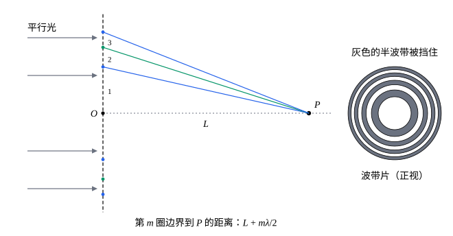

## 这一节要回答的问题

用一个点光源照射一块小圆盘，按几何光学，后面的屏上是一个圆形的影子；实际上影子的正中央有一个亮点。平行光照射一个圆孔，孔后轴上的某一点，把孔开大一些，那里反而可能变暗。[单缝衍射](lesson:physics.optics.single-slit-diffraction)那一节只算了离得足够远的情形，这些离得近的现象怎样分析？

## 讲解

### 菲涅耳衍射

[单缝衍射](lesson:physics.optics.single-slit-diffraction#def-fraunhofer)一节里，观察屏离宽为$a$的缝要满足$L\gg\frac{a^2}\lambda$，到达观察点的各条光线才能看成平行，缝上各点到观察点的:term[光程差]{id="physics.optics.optical-path-difference"}（optical path difference）才和该点的位置成正比。离得不够远时，孔上离中心$r$的一点到轴上观察点的距离是$\sqrt{L^2+r^2}\approx L+\frac{r^2}{2L}$，光程差随$r$的平方变化，原来的算法就不能用了。

::anchor{id="def-fresnel-diffraction"}
光源或观察点离障碍物不够远，到达观察点的各条光线不能看成互相平行时的:term[衍射]{id="physics.optics.diffraction"}（diffraction），叫作:term[菲涅耳衍射]{id="physics.optics.fresnel-diffraction"}（Fresnel diffraction）。

为什么这样定义：和:term[夫琅禾费衍射]{id="physics.optics.fraunhofer-diffraction"}（Fraunhofer diffraction）一样，算的仍是:term[波阵面]{id="physics.optics.wavefront"}（wavefront）上各点发出的:term[次波]{id="physics.optics.secondary-wavelet"}（secondary wavelet）按相位叠加，即:term[惠更斯-菲涅耳原理]{id="physics.optics.huygens-fresnel-principle"}（Huygens–Fresnel principle，见[单缝衍射](lesson:physics.optics.single-slit-diffraction#def-huygens-fresnel)），只是各次波到观察点的距离差不再和位置成正比，图样随观察距离变化。边界情况：观察点越来越远时，它就变成夫琅禾费衍射，图样只按比例放大、形状不再变；离得很近、孔又比波长大得多时，屏上基本就是孔的几何投影，只在边缘附近有明暗条纹。

### 菲涅耳半波带

下面看最简单的情形：平行光垂直照到半径为$a$的圆孔上，求孔后轴上离孔$L$的一点$P$的光振动。孔里的:term[波阵面]{id="physics.optics.wavefront"}是一个平面，上面各点到$P$的距离从中心的$L$起，向外越来越大。

::anchor{id="def-zones"}
以$P$为中心，把孔所在的波阵面分成一圈圈圆环，使相邻两圈边界到$P$的距离依次相差半个波长，即第$m$圈的外边界到$P$的距离是$L+\frac{m\lambda}2$，这些圆环叫作:term[菲涅耳半波带]{id="physics.optics.half-period-zone"}（Fresnel half-period zones），简称半波带。

为什么这样定义：相邻两个半波带上对应的点到$P$的距离相差$\frac\lambda2$，:term[次波]{id="physics.optics.secondary-wavelet"}到达$P$时相位相反，相互抵消，这正是[单缝衍射](lesson:physics.optics.single-slit-diffraction#thm-single-slit-dark)里配对抵消的办法，只是缝上的一段段换成了一圈圈。由$\sqrt{L^2+r_m^2}=L+\frac{m\lambda}2$，角度小时第$m$圈的外半径$r_m\approx\sqrt{m\lambda L}$，各个半波带的面积$\pi(r_m^2-r_{m-1}^2)$都约为$\pi\lambda L$，一样大。边界情况：$\lambda=500\,\mathrm{nm}$、$L=1\,\mathrm m$时，第一个半波带的半径只有约$0.7\,\mathrm{mm}$，半径$1\,\mathrm{cm}$的孔里就有约$200$个半波带。

::anchor{id="thm-zones"}
定理（半波带的叠加）：$P$点的光振动是各个半波带的贡献之和，第$m$个半波带贡献的振幅$a_m$随$m$缓慢减小，相邻两个相位相反。圆孔里恰好露出$m$个半波带时，$P$点的合振幅约为$\frac{a_1}2+\frac{a_m}2$（$m$为奇数）或$\frac{a_1}2-\frac{a_m}2$（$m$为偶数）；不加任何遮挡时约为$A_0=\frac{a_1}2$。

证明思路：各半波带面积相同，越往外次波射向$P$的方向越斜，贡献越小，但变化很慢，相邻两个的振幅几乎相等。合振幅$a_1-a_2+a_3-\dots\pm a_m$可以写成$\frac{a_1}2+\Bigl(\frac{a_1}2-a_2+\frac{a_3}2\Bigr)+\Bigl(\frac{a_3}2-a_4+\frac{a_5}2\Bigr)+\cdots$，每个括号里$a_k$约为两边的平均，括号近似为零，剩下首尾两个一半。不加遮挡相当于$m\to\infty$，$a_m\to0$，只剩$\frac{a_1}2$。

所以孔里只露出第一个半波带时，$P$点的振幅约为$a_1=2A_0$，光强是不加遮挡时的$4$倍；露出两个时几乎全暗。孔里露出的半波带数是$N=\frac{a^2}{\lambda L}$：孔开大或$P$移近，$N$增大，轴上的亮暗交替出现；$N$远小于$1$时，孔只占第一个半波带的一小部分，这正是:term[夫琅禾费衍射]{id="physics.optics.fraunhofer-diffraction"}的条件$L\gg\frac{a^2}\lambda$。

用[复数表示与旋转矢量](lesson:physics.oscillations-waves.phasors)看得更清楚：把每个半波带再分成许多细圈，各细圈的旋转矢量首尾相接，每过一个半波带转过半圈，长度又慢慢变短，排成一条向里收的螺线。第一个半波带是螺线上的半圈，合振幅约是这个半圈的直径；不加遮挡时，合振幅是从螺线的起点到它的中心，约是直径的一半。不计倾斜带来的减小时，螺线就是一个圆，露出$N$个半波带时从圆上转过$N\pi$，合振幅是直径乘$\bigl|\sin\frac{N\pi}2\bigr|$，光强$I=4I_0\sin^2\frac{N\pi}2$，$I_0$是不加遮挡时的光强。

### 泊松亮斑

把圆孔换成同样大小的不透光圆屏，挡住前$m$个:term[半波带]{id="physics.optics.half-period-zone"}，其余的都露着，$P$点的合振幅约为$a_{m+1}-a_{m+2}+\cdots\approx\frac{a_{m+1}}2$。$m$不太大时，$a_{m+1}$和$a_1$差不多，阴影中心的亮度和不放圆屏时几乎一样。

::anchor{id="def-poisson-spot"}
点光源或平行光照射不透光的圆屏，在它的几何阴影中心出现的亮点，叫作:term[泊松亮斑]{id="physics.optics.poisson-spot"}（Poisson spot），也叫阿拉戈亮斑（Arago spot）。

为什么这样定义：1818 年，法国科学院以:term[衍射]{id="physics.optics.diffraction"}为题悬赏征文，菲涅耳（Augustin-Jean Fresnel）用:term[次波]{id="physics.optics.secondary-wavelet"}的:term[干涉]{id="physics.optics.interference"}（interference）算出了衍射图样。评委泊松（Siméon Denis Poisson）相信光是微粒，他从菲涅耳的理论推出圆屏影子的中心应该是亮的，认为这荒谬得足以驳倒波动说；另一位评委阿拉戈（François Arago）做了实验，果然看到了这个亮点，菲涅耳的论文于 1819 年获奖。边界情况：亮点要求圆屏的边缘光滑、很圆，光源又近似是一个点，否则各处的亮点错开，糊成一片，所以日常物体的影子里看不到它。

### 波带片

::anchor{id="def-zone-plate"}
对轴上的一点$P$，把它的偶数号（或奇数号）:term[半波带]{id="physics.optics.half-period-zone"}全部挡住、只让另一半透光的屏，叫作:term[波带片]{id="physics.optics.zone-plate"}（zone plate）。

为什么这样定义：留下的半波带到$P$都同相，振幅不再相互抵消，而是一个个加起来：露出$N$个时，合振幅约为$Na_1=2NA_0$，光强约是不加遮挡时的$4N^2$倍，光就像被透镜会聚到了$P$。平行光照射时，$r_m^2=m\lambda f$，$f=\frac{r_1^2}\lambda$就是它的:term[焦距]{id="physics.optics.focal-length"}（focal length）：离它$f$处的一点，各圈正好是这一点的半波带。边界情况：焦距和波长成反比，不同颜色的光聚在不同的地方；玻璃透镜对 X 射线几乎不起作用，波带片却照样能用，X 射线显微镜就靠它成像。

1875 年，索雷（Jacques-Louis Soret）做出了第一块波带片。用波带片给离它$s$的点光源成像，:term[像距]{id="physics.optics.image-distance"}（image distance）$s'$满足$\frac1s+\frac1{s'}=\frac1f$，和:term[薄透镜]{id="physics.optics.thin-lens"}（thin lens）的成像公式一样（第 5 题）。

## 几何图像

左图的三条斜线从各圈边界连到$P$，长度依次比$OP$多半个波长；相邻两条线之间的那一圈就是一个:term[菲涅耳半波带]{id="physics.optics.half-period-zone"}，图里把波长夸大了许多。右图是一块:term[波带片]{id="physics.optics.zone-plate"}，各圈半径正比于$\sqrt m$，越往外越窄，面积却都一样；灰色的偶数号半波带被挡住，白色的奇数号半波带到$P$同相，光在$P$点会聚。

:::anim{component="function-plot"}
range: { x: [0.2, 6], y: [0, 4.4] }
functions:
  - expr: "4*sin(pi*a^2/x)^2"
    label: |
      圆孔后轴上的光强
  - expr: "1"
    label: |
      圆屏阴影中心的光强
sliders:
  - name: a
    min: 0.5
    max: 1.5
    step: 0.05
    default: 1
    label: |
      圆孔或圆屏的半径$a$（$\mathrm{mm}$）
:::

平行光（波长$500\,\mathrm{nm}$）照射半径为$a$的圆孔或圆屏。横轴是观察点离孔的距离$L$（$\mathrm m$，图上写作$x$），纵轴是轴上的光强，以不加遮挡时为$1$，按上面不计倾斜的式子$I=4I_0\sin^2\frac{N\pi}2$算出。孔里露出的半波带数$N=\frac{a^2}{\lambda L}$，观察点从远处移近，$N$增大，光强在$0$和$4$之间起伏；比$N=1$的位置更远，光强一路下降，进入:term[夫琅禾费衍射]{id="physics.optics.fraunhofer-diffraction"}的范围。圆屏阴影的中心，按同样的近似，光强一直等于不加遮挡时，这就是:term[泊松亮斑]{id="physics.optics.poisson-spot"}；滑块把半径加大，起伏的位置都往远处挪。

## 例题

### 例 1　圆孔后的亮点和暗点

平行光（波长$500\,\mathrm{nm}$）垂直照射半径$1.00\,\mathrm{mm}$的圆孔。轴上离孔多远的地方，孔里恰好露出$1$个、$2$个、$3$个:term[菲涅耳半波带]{id="physics.optics.half-period-zone"}？这些地方是亮还是暗？

**为什么想到这么做**：孔里露出的半波带数$N=\frac{a^2}{\lambda L}$，反过来$L=\frac{a^2}{N\lambda}$；$N$为奇数时亮，偶数时暗。

**推导**：$\frac{a^2}\lambda=\frac{(1.00\times10^{-3})^2}{500\times10^{-9}}\,\mathrm m=2.00\,\mathrm m$。$N=1$时$L=2.00\,\mathrm m$，中心最亮，光强约是不加遮挡时的$4$倍；$N=2$时$L=1.00\,\mathrm m$，中心几乎全暗；$N=3$时$L\approx0.667\,\mathrm m$，又亮了。比$2\,\mathrm m$更远，孔里只有第一个半波带的一部分，中心的光强随距离单调减小，图样逐渐变成:term[夫琅禾费衍射]{id="physics.optics.fraunhofer-diffraction"}的样子。

### 例 2　波带片的焦距

一块:term[波带片]{id="physics.optics.zone-plate"}第一圈的半径是$0.200\,\mathrm{mm}$，外半径$2.00\,\mathrm{mm}$。用平行的氦氖激光（$633\,\mathrm{nm}$）和蓝光（$450\,\mathrm{nm}$）照射，:term[焦距]{id="physics.optics.focal-length"}各是多少？离它$f$的:term[焦点]{id="physics.optics.focal-point"}（focal point）上，光强约是不加遮挡时的多少倍？

**为什么想到这么做**：平行光照射时$r_m^2=m\lambda f$，焦距$f=\frac{r_1^2}\lambda$；外半径对应的$m$就是:term[半波带]{id="physics.optics.half-period-zone"}的总数，一半透光。

**推导**：$f=\frac{(0.200\times10^{-3})^2}{633\times10^{-9}}\,\mathrm m\approx6.32\,\mathrm{cm}$，蓝光$f=\frac{4.00\times10^{-8}}{450\times10^{-9}}\,\mathrm m\approx8.89\,\mathrm{cm}$：波长越短，焦距越长，和玻璃透镜正好相反。外半径$2.00\,\mathrm{mm}$对应$m=\Bigl(\frac{2.00}{0.200}\Bigr)^2=100$个半波带，透光的有$50$个，合振幅约为$50a_1=100A_0$，光强约是不加遮挡时的$10^4$倍。

## 常见误区

- 「圆孔越大，孔后轴上的点越亮。」露出的:term[菲涅耳半波带]{id="physics.optics.half-period-zone"}从奇数个变成偶数个时，轴上的点反而变暗（例 1）。
- 「挡住光源中心的那部分光，影子中心一定最暗。」小圆屏阴影的中心有:term[泊松亮斑]{id="physics.optics.poisson-spot"}，亮度和不放圆屏时差不多。
- 「:term[波带片]{id="physics.optics.zone-plate"}和透镜一样，只有一个:term[焦点]{id="physics.optics.focal-point"}。」平行光照射时，在$\frac f3$、$\frac f5$……处还有焦点，只是那里会聚的光能少得多（第 8 题）。
- 「:term[菲涅耳衍射]{id="physics.optics.fresnel-diffraction"}和:term[夫琅禾费衍射]{id="physics.optics.fraunhofer-diffraction"}是两种不同的物理现象。」两者都是:term[次波]{id="physics.optics.secondary-wavelet"}按相位叠加，区别只在观察点离得近还是远、能不能把光线看成平行。
