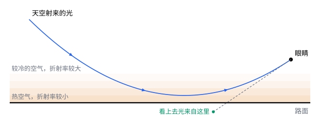

## 这一节要回答的问题

夏天开车，远处的柏油路面上好像有一摊水，开近了路面却是干的。光在空气里不是走直线吗，为什么会看到路面下的「倒影」？:term[折射率]{id="physics.optics.refractive-index"}（refractive index）不是在界面上突变、而是一点一点连续变化时，光线怎么走？

## 讲解

### 分层介质里的光线

空气的:term[折射率]{id="physics.optics.refractive-index"}只比$1$大万分之三左右，而且随密度变化：贴近晒热的路面，空气热、密度小，折射率也小一点。这样的折射率处处都在变，没有明确的界面。

::anchor{id="def-grin"}
折射率在介质里连续变化、不只在界面上突变，这样的介质叫作:term[渐变折射率]{id="physics.optics.graded-index"}（graded index，GRIN）介质。

为什么这样定义：大气、温度不均匀的水、专门制造的光纤和透镜，折射率都是逐点变化的，前面各节「均匀介质里光走直线、在界面上折射」的图像不够用，需要单独讨论。边界情况：折射率变化的距离比光的波长大得多时，才能像这一节这样只追光线；变化剧烈到在一个波长里就变得很多，就要按波来处理。

::anchor{id="thm-layered"}
定理（分层介质里的:term[折射定律]{id="physics.optics.law-of-refraction"}，law of refraction in a layered medium）：折射率只随高度$y$变化时，光线和竖直方向的夹角$\theta$满足$n(y)\sin\theta=$常数。

证明思路：把介质切成许多水平的薄层，每层里折射率近似不变，光线走直线；相邻两层的界面上用折射定律（law of refraction），$n_1\sin\theta_1=n_2\sin\theta_2=n_3\sin\theta_3=\cdots$，同一个量一层一层传下去。薄层越来越薄，就得到连续的$n(y)\sin\theta=$常数。

由这个定理，光线向折射率大的一侧弯：光线往折射率小的方向走时，$\sin\theta$变大，光线越来越平；$\sin\theta$增大到$1$，光线变成水平，再往后就折回来。1697 年，约翰·伯努利（Johann Bernoulli）正是把下滑的小球想成在这样的介质里走用时最短的路的光，解出了最速降线（brachistochrone，见[贝尔特拉米恒等式与最速降线](lesson:math.calculus-of-variations.beltrami-identity)第 7 题）。

### 光线方程

:term[光程]{id="physics.optics.optical-path-length"}（optical path length）在:term[折射率]{id="physics.optics.refractive-index"}连续变化时要用积分写：光线是曲线$y(x)$时，光程$L=\int n(y)\sqrt{1+y'^2}\,\dd x$，是曲线的泛函（functional）。按:term[费马原理]{id="physics.optics.fermat-principle"}（Fermat's principle），实际的光线让它取极值，也就满足欧拉-拉格朗日方程（Euler-Lagrange equation，见[第一变分与欧拉-拉格朗日方程](lesson:math.calculus-of-variations.euler-lagrange)）。

::anchor{id="thm-ray-equation"}
定理（光线方程）：折射率只随$y$变化、光线和$x$轴的夹角很小时，光线满足$y''\approx\frac{1}{n}\dv{n}{y}$。

证明思路：被积函数$F=n(y)\sqrt{1+y'^2}$，$\frac{\partial F}{\partial y'}=\frac{ny'}{\sqrt{1+y'^2}}$，$\frac{\partial F}{\partial y}=n'(y)\sqrt{1+y'^2}$。欧拉-拉格朗日方程是$\dv{}{x}\frac{ny'}{\sqrt{1+y'^2}}=n'(y)\sqrt{1+y'^2}$。$|y'|$很小时根号都近似为$1$，左边$\approx\dv{}{x}(ny')=ny''+n'y'^2\approx ny''$，于是$y''\approx\frac{n'}{n}$。

$y''$是光线弯曲的程度：$\dv ny>0$时$y''>0$，光线向上弯，正是折射率增大的方向；弯曲的程度由折射率的相对变化率$\frac1n\dv ny$决定。空气里这个量很小，所以平常看不出光线在弯，只有贴着地面或水面、光线走得很远而又几乎水平时才显露出来。

### 海市蜃楼

::anchor{id="def-mirage"}
大气里:term[折射率]{id="physics.optics.refractive-index"}随高度的变化使远处物体的光线弯曲，眼睛看到物体的像出现在别的位置，这种现象叫作海市蜃楼（mirage）。

为什么这样定义：这些像的共同来源是空气折射率的连续变化，和镜面反射、普通的折射都不同，用一个名字概括。边界情况：折射率随高度变化的方向不同，像的位置也不同。贴近热路面，空气下热上冷，折射率向上增大，天空射下来的光向上弯，像出现在路面以下，好像一摊水，叫下现蜃景（inferior mirage）；海面上空气下冷上热，折射率向上减小，光线向下弯，远处的船好像浮在空中，叫上现蜃景（superior mirage）。

折射率的差只有十万分之几，光线只有几乎贴着路面射来时，才会在到达路面之前被弯回去（例 1）。所以路面上的「水」总在很远的地方，走近了就看不到了：离得近，眼睛看路面的角度太大。

### 渐变折射率光纤

[全反射与光纤](lesson:physics.optics.total-internal-reflection)里的光纤，:term[纤芯]{id="physics.optics.fiber-core"}（core）和:term[包层]{id="physics.optics.cladding"}（cladding）的:term[折射率]{id="physics.optics.refractive-index"}在界面上突变，光靠:term[全反射]{id="physics.optics.total-internal-reflection"}（total internal reflection）走锯齿形的路，走远路的光到得晚（那一节第 6 题）。:term[渐变折射率]{id="physics.optics.graded-index"}光纤的纤芯从中心向外，折射率按抛物线逐渐减小：$n(r)=n_0\Bigl(1-\frac{\alpha r^2}2\Bigr)$。

由光线方程，:term[近轴光线]{id="physics.optics.paraxial-ray"}（paraxial ray）满足$r''\approx-\alpha r$，是简谐振动的方程，光线沿正弦曲线前进，周期$\Lambda=\frac{2\pi}{\sqrt\alpha}$和射入的角度无关。从轴上同一点以不同角度射入的光线，每走半个周期又会聚到轴上同一点；离轴远的光线走的路长，可它经过的地方折射率小、光速快，到达的时间几乎一样，不同路径造成的时间差因此大大减小。常见的多模（multimode）渐变折射率光纤，纤芯直径约$50\,\mu\mathrm m$。

## 几何图像

图里光线弯曲的角度画得夸大了，真实的光线和水平方向的夹角不到$1^\circ$。光线的最低点在路面上方：它在那里变成水平，然后向上弯。眼睛只能沿光线射来的方向看，于是把天空的光看成来自路面以下，路面上就像有一摊映着天空的水。

:::anim{component="function-plot"}
range: { x: [0, 3], y: [-25, 25] }
functions:
  - expr: "1000*0.10/(sqrt(2*c/1.48)/0.025)*sin(sqrt(2*c/1.48)/0.025*x)"
    label: |
      从轴上以$0.10\,\mathrm{rad}$射入
  - expr: "1000*0.05/(sqrt(2*c/1.48)/0.025)*sin(sqrt(2*c/1.48)/0.025*x)"
    label: |
      从轴上以$0.05\,\mathrm{rad}$射入
  - expr: "15*cos(sqrt(2*c/1.48)/0.025*x)"
    label: |
      离轴$15\,\mu\mathrm m$处平行于轴射入
sliders:
  - name: c
    min: 0.005
    max: 0.03
    step: 0.001
    default: 0.02
    label: |
      纤芯中心和边缘的折射率之差
:::

横轴是沿光纤走过的距离（$\mathrm{mm}$），纵轴是光线离轴的距离（$\mu\mathrm m$），画面的上下边就是半径$25\,\mu\mathrm m$的:term[纤芯]{id="physics.optics.fiber-core"}边缘，中心的:term[折射率]{id="physics.optics.refractive-index"}是$1.48$。三条光线射入的方式不同，周期却一样，每走半个周期，从轴上出发的两条又同时回到轴上。滑块调纤芯中心和边缘的折射率之差：差越小，光线弯得越慢，周期越长，同样的角度射入，光线离轴也越远；差太小时，以$0.10\,\mathrm{rad}$射入的光线跑出了画面，也就是跑出了纤芯。

## 例题

### 例 1　路面上的「水」

设晒热的路面贴近处空气是$60\,^\circ\mathrm C$，上方是$30\,^\circ\mathrm C$。$0\,^\circ\mathrm C$、一个大气压的空气:term[折射率]{id="physics.optics.refractive-index"}约为$1.000293$，$n-1$和空气的密度近似成正比，压强一定时密度和热力学温度成反比。

（1）求两处空气的折射率之差。（2）从上方射来的光和水平方向的夹角小于多少，才会在到达路面之前被弯回去？（3）眼睛离地$1.2\,\mathrm m$，路面上的「水」大约从多远处开始？

**为什么想到这么做**：折射率只随高度变化，用$n(y)\sin\theta=$常数；改用和水平方向的夹角$\alpha$，就是$n\cos\alpha=$常数，光线在路面上方变成水平，就是在那里$\cos\alpha=1$。

**推导**：（1）$30\,^\circ\mathrm C$：$n-1=2.93\times10^{-4}\times\frac{273}{303}\approx2.64\times10^{-4}$；$60\,^\circ\mathrm C$：$2.93\times10^{-4}\times\frac{273}{333}\approx2.40\times10^{-4}$，差约$2.4\times10^{-5}$。（2）光线在上方的夹角为$\alpha$，到贴近路面处变成水平：$n_{\text{上}}\cos\alpha=n_{\text{下}}$，$\cos\alpha=1-\frac{\Delta n}{n}$，小角度时$\alpha\approx\sqrt{2\Delta n}\approx\sqrt{4.8\times10^{-5}}$，约$6.9\times10^{-3}\,\mathrm{rad}\approx0.40^\circ$。（3）眼睛沿这个角度向下看，视线到路面要走约$\frac{1.2\,\mathrm m}{\tan0.40^\circ}\approx1.7\times10^2\,\mathrm m$，所以「水」在一两百米以外。

### 例 2　渐变折射率光纤里光线的周期

一根:term[渐变折射率]{id="physics.optics.graded-index"}光纤的:term[纤芯]{id="physics.optics.fiber-core"}半径$25\,\mu\mathrm m$，中心:term[折射率]{id="physics.optics.refractive-index"}$1.48$，纤芯边缘降到$1.46$，折射率按$n_0\Bigl(1-\frac{\alpha r^2}2\Bigr)$分布。求:term[近轴光线]{id="physics.optics.paraxial-ray"}的周期。

**为什么想到这么做**：由边缘的折射率定出$\alpha$，周期$\Lambda=\frac{2\pi}{\sqrt\alpha}$。

**推导**：$1.46=1.48\Bigl(1-\frac{\alpha a^2}2\Bigr)$，$\alpha=\frac{2}{a^2}\Bigl(1-\frac{1.46}{1.48}\Bigr)=\frac{2\times0.01351}{(25\times10^{-6})^2}\,\mathrm{m^{-2}}$，约$4.32\times10^7\,\mathrm{m^{-2}}$。$\sqrt\alpha\approx6.58\times10^3\,\mathrm{m^{-1}}$，$\Lambda=\frac{2\pi}{\sqrt\alpha}\approx9.6\times10^{-4}\,\mathrm m$，不到$1\,\mathrm{mm}$：光每走约$1\,\mathrm{mm}$就在纤芯里来回摆动一次。

## 常见误区

- 「路面上的『水』是光在路面上反射形成的。」路面并不光滑，光也没有碰到路面，而是在路面上方的空气里一路弯回去的。
- 「光线向:term[折射率]{id="physics.optics.refractive-index"}小的一侧弯。」方向正好相反：$y''\approx\frac1n\dv ny$，光线向折射率增大的方向弯。
- 「:term[渐变折射率]{id="physics.optics.graded-index"}光纤也是靠:term[全反射]{id="physics.optics.total-internal-reflection"}传光。」它的:term[纤芯]{id="physics.optics.fiber-core"}里没有突变的界面，光线是连续弯回来的，路径是平滑的正弦曲线，不是锯齿。
- 「空气的折射率几乎是 1，对光线没有影响。」在近处确实看不出，可光线走几百米、几乎贴着地面走时，十万分之几的差别就足以让它弯回来。
