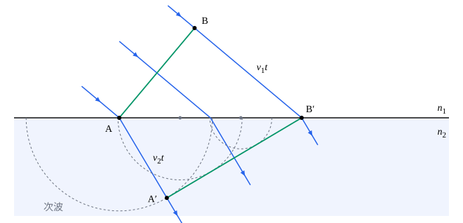

## 这一节要回答的问题

光是波，可它在空气里走直线，碰到镜面、界面按:term[反射定律]{id="physics.optics.law-of-reflection"}（law of reflection）和:term[折射定律]{id="physics.optics.law-of-refraction"}（law of refraction）偏折，这和水面上一圈圈散开的波很不一样。能不能从「波怎样一步步向前传」推出这些规律？牛顿和惠更斯对光在水里比在空气里快还是慢，为什么给出了相反的预言？

## 讲解

### 波阵面

点波源发出的波向四面八方传开，振动状态相同的各点连起来是一个个球面；离波源很远时，一小块球面几乎是平面（见[平面波与球面波](lesson:physics.oscillations-waves.waves-in-3d)）。

::anchor{id="def-wavefront"}
波传播时，同一时刻振动相位（phase）相同的各点连成的面，叫作:term[波阵面]{id="physics.optics.wavefront"}（wavefront）。

为什么这样定义：波阵面记录了波此刻传到了哪里，下一刻它移到哪里，波就传到哪里；在各向同性的介质里，波沿着垂直于波阵面的方向前进，这个方向就是光线。边界情况：方解石这类晶体里，光在不同方向上的速度不同，光线可以不和波阵面垂直（见[双折射与波片](lesson:physics.optics.birefringence)）。

### 惠更斯原理

::anchor{id="def-huygens"}
:term[波阵面]{id="physics.optics.wavefront"}上的每一点都可以看作发出球面波（spherical wave）的波源，这些球面波叫作:term[次波]{id="physics.optics.secondary-wavelet"}（secondary wavelet），以波在那一点的速度向前传播；经过一段时间，所有次波的包络面（envelope）就是新的波阵面。这叫作:term[惠更斯原理]{id="physics.optics.huygens-principle"}（Huygens' principle）。

为什么这样定义：它给出了一个作图的规则，知道此刻的波阵面和各处的波速，就能一步步画出以后的波阵面，:term[反射定律]{id="physics.optics.law-of-reflection"}、:term[折射定律]{id="physics.optics.law-of-refraction"}都能这样推出来（下面两个定理）。惠更斯在 1678 年提出这个想法，1690 年发表在《光论》（Traité de la Lumière）里。边界情况：次波向后也传，可实际的波并不向后传，惠更斯原理说明不了这一点；1818 年前后，菲涅耳（Augustin-Jean Fresnel）给次波加上随方向变化的强弱，又让它们互相:term[干涉]{id="physics.optics.interference"}（interference），才解释了这件事和光绕过障碍物的现象（见[单缝衍射](lesson:physics.optics.single-slit-diffraction)）。

均匀介质里，平面波阵面上各点发出的次波半径相同，包络还是一个平行的平面，波沿直线前进；球面波阵面的包络还是同心的球面。这正是光在均匀介质里沿直线传播的波动说法。

### 由次波推出反射定律

::anchor{id="thm-huygens-reflection"}
定理（由:term[惠更斯原理]{id="physics.optics.huygens-principle"}推出:term[反射定律]{id="physics.optics.law-of-reflection"}）：平面波（plane wave）射到平面镜上，反射波仍是平面波，反射角等于入射角。

证明思路：:term[波阵面]{id="physics.optics.wavefront"}$AB$斜着射到镜面上，$A$点先到镜面。$B$点的波再走$vt$到达镜面上的$B'$时，$A$点发出的:term[次波]{id="physics.optics.secondary-wavelet"}在原来的介质里也走了$vt$，半径是$vt$；$A$、$B'$之间各点依次被照到，次波半径依次减小。从$B'$作$A$点次波的切线，切点为$A'$，它就是反射波的波阵面。直角三角形$ABB'$和$B'A'A$共用斜边$AB'$，直角边$BB'=AA'=vt$，两个三角形全等，所以入射的波阵面和反射的波阵面与镜面的夹角相等，也就是入射角等于反射角。

### 由次波推出折射定律

::anchor{id="thm-huygens-refraction"}
定理（由:term[惠更斯原理]{id="physics.optics.huygens-principle"}推出:term[折射定律]{id="physics.optics.law-of-refraction"}）：平面波从波速为$v_1$的介质射进波速为$v_2$的介质，入射角$\theta_1$和折射角$\theta_2$满足$\frac{\sin\theta_1}{\sin\theta_2}=\frac{v_1}{v_2}$；用:term[折射率]{id="physics.optics.refractive-index"}（refractive index）$n=\frac cv$写，就是$n_1\sin\theta_1=n_2\sin\theta_2$。

证明思路：作图和反射的一样，只是$A$点的:term[次波]{id="physics.optics.secondary-wavelet"}在第二种介质里走，半径是$v_2t$，而$B$点的波在第一种介质里走了$v_1t$（见下面的图）。从$B'$作次波的公切线$A'B'$，就是折射波的:term[波阵面]{id="physics.optics.wavefront"}。在直角三角形$ABB'$和$AA'B'$里，$v_1t=AB'\sin\theta_1$，$v_2t=AB'\sin\theta_2$，两式相除即得。

[反射定律与折射定律](lesson:physics.optics.reflection-refraction#thm-snell)里推折射定律的作图，其实就是这里只画$A$、$B$两点的情形；惠更斯原理说明了为什么可以这样画：中间各点的次波都切在同一条直线上。光在第二种介质里慢，次波小，波阵面就向法线转过来。

光是波还是粒子流，当年争论了很久。牛顿把折射看成介质把光的微粒往里拉，平行于界面的速度不变、垂直于界面的速度增大，于是光在水里应该比在空气里快；按惠更斯原理，光偏向法线是因为在水里慢。1850 年，傅科（Léon Foucault）测出光在水里确实比在空气里慢，支持了波动的说法。

## 几何图像

图里下面介质的:term[折射率]{id="physics.optics.refractive-index"}是上面的$1.5$倍，入射角$50^\circ$。两条绿线是两个时刻的:term[波阵面]{id="physics.optics.wavefront"}：$AB$是$A$刚到界面的时刻，$A'B'$是$B$刚到界面的时刻。虚线半圆是界面上三个点发出的:term[次波]{id="physics.optics.secondary-wavelet"}：$A$最早被照到，次波最大；越靠近$B'$的点越晚被照到，次波越小，它们都和$A'B'$相切。由图量出的折射角约$30.7^\circ$，和$\sin\theta_2=\frac{\sin50^\circ}{1.5}$一致。

## 例题

### 例 1　用次波作图求折射角

平面光波从空气射进:term[折射率]{id="physics.optics.refractive-index"}$1.33$的水，入射角$40^\circ$。:term[波阵面]{id="physics.optics.wavefront"}一端$A$刚到水面时，另一端$B$离水面还要走$2.0\,\mathrm{cm}$。（1）$B$到达水面时，$A$点发出的:term[次波]{id="physics.optics.secondary-wavelet"}在水里的半径是多少？（2）用作图的几何关系求折射角。

**为什么想到这么做**：$B$走$2.0\,\mathrm{cm}$的时间里，水里的次波走$\frac{2.0}{1.33}\,\mathrm{cm}$；再用直角三角形求角。

**推导**：（1）$v_2t=\frac{v_1t}{1.33}=\frac{2.0\,\mathrm{cm}}{1.33}\approx1.50\,\mathrm{cm}$。（2）$AB'=\frac{BB'}{\sin40^\circ}=\frac{2.0\,\mathrm{cm}}{0.643}\approx3.11\,\mathrm{cm}$，$\sin\theta_2=\frac{1.50}{3.11}\approx0.483$，$\theta_2\approx28.9^\circ$。和:term[折射定律]{id="physics.optics.law-of-refraction"}$\sin\theta_2=\frac{\sin40^\circ}{1.33}$算出的一样。

### 例 2　牛顿和惠更斯的预言

光从空气以$45^\circ$射进水里，折射角约$32.1^\circ$。按波动的说法和按牛顿的微粒说，光在水里的速度各是在空气里的多少倍？

**为什么想到这么做**：波动的说法用$\frac{\sin\theta_1}{\sin\theta_2}=\frac{v_1}{v_2}$；微粒说认为平行于界面的速度分量不变，$v_1\sin\theta_1=v_2\sin\theta_2$。

**推导**：波动：$\frac{v_2}{v_1}=\frac{\sin32.1^\circ}{\sin45^\circ}\approx\frac{0.531}{0.707}\approx0.75$，水里慢。微粒说：$\frac{v_2}{v_1}=\frac{\sin45^\circ}{\sin32.1^\circ}\approx1.33$，水里快。同一个折射角，两种说法给出的速度之比正好互为倒数，所以测一下水里的光速就能分出对错。

## 常见误区

- 「:term[次波]{id="physics.optics.secondary-wavelet"}是:term[波阵面]{id="physics.optics.wavefront"}上真实存在的一个个小光源。」次波是计算的工具，说的是波阵面上每一点的振动都会带动周围的介质振动；它不是另外加进去的光源。
- 「次波向后也传，所以实际的光也有一部分向后传。」在均匀介质里，光并不向后传；:term[惠更斯原理]{id="physics.optics.huygens-principle"}本身确实说不清这一点，菲涅耳给次波加上随方向变化的强弱以后，向后的次波互相抵消，才和实际一致。
- 「光线和波阵面总是垂直的。」在各向同性的介质里是这样；在双折射晶体里，光线可以斜着穿过波阵面。
- 「光进入水里，频率和波长都变了。」频率由波源决定，不变；变的是速度，波长跟着变成真空中的$\frac1n$（第 3 题）。
