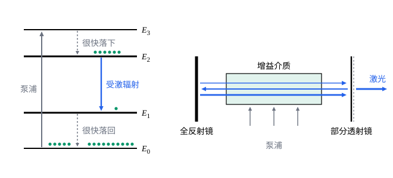

## 这一节要回答的问题

一支$1\,\mathrm{mW}$的激光笔直射进眼睛，比盯着$100\,\mathrm W$的灯泡还危险；激光的:term[相干长度]{id="physics.optics.coherence-length"}（coherence length）能有几百米（[相干性](lesson:physics.optics.coherence)第 3 题算过一台），普通光源只有几微米到几十微米。激光是怎样产生的？它为什么这样亮、颜色这样纯、方向这样集中？

## 讲解

### 受激辐射和光的放大

原子有能量为$E_1$、$E_2$（$E_1<E_2$）的两个能级，频率$\nu=\frac{E_2-E_1}h$的光子（photon）和它打交道的方式有三种（见[原子的辐射跃迁与选择定则](lesson:physics.quantum-mechanics.radiative-transitions)）：低能级的原子吸收一个光子跃迁到高能级；高能级的原子自己跳下来，放出一个方向、相位都随机的光子，即自发辐射（spontaneous emission）；高能级的原子被一个路过的光子「诱发」跳下来，放出一个和它一模一样的光子，频率、方向、相位、偏振（polarization）都相同，即受激辐射（stimulated emission）。爱因斯坦在 1917 年指出，两个能级的简并度相同时，吸收和受激辐射的爱因斯坦系数（Einstein coefficients）相等，一个光子引起吸收和引起受激辐射的机会一样大。

所以一束光穿过一群原子时，受激辐射给它添光子，吸收从它那里拿走光子，两者的速率分别正比于高能级、低能级上的原子数$N_2$、$N_1$。受激辐射添进来的光子和原来的光同频率、同方向、同相位，相干地叠加上去，光就被放大了；可吸收同样多时，净效果取决于$N_2-N_1$的正负。

::anchor{id="thm-gain"}
定理（光的放大）：频率$\nu=\frac{E_2-E_1}h$的光在介质里传播，$N_2>N_1$时光强沿传播方向按$I(z)=I(0)e^{gz}$增长，$g$叫作增益系数（gain coefficient），正比于$N_2-N_1$；$N_2<N_1$时$g<0$，光被吸收而减弱。

证明思路：在$z$到$z+\dd z$这一薄层里，受激辐射每秒添进的光子数正比于$N_2I$，吸收拿走的正比于$N_1I$，比例系数相同，所以$\dd I=\kappa(N_2-N_1)I\,\dd z$，$\kappa$是常数。光强的变化率正比于光强本身，解出来是指数函数，$g=\kappa(N_2-N_1)$。自发辐射的光子方向乱，几乎不进入这束光，这里不计。

热平衡时，按玻尔兹曼分布（Boltzmann distribution），$\frac{N_2}{N_1}=e^{-(E_2-E_1)/(k_{\mathrm B}T)}<1$，低能级上的原子总是更多，光只会被吸收（例 1）。普通光源里的原子大多靠自发辐射发光，各自随机，所以普通光的相位和方向都是杂乱的。

::anchor{id="def-population-inversion"}
高能级上的原子数多于低能级上的原子数（$N_2>N_1$），叫作:term[粒子数反转]{id="physics.optics.population-inversion"}（population inversion）；为此要不断从外界输入能量，把原子送到高能级，这叫作:term[泵浦]{id="physics.optics.pumping"}（pumping）。

为什么这样定义：只有$N_2>N_1$，受激辐射才多于吸收，光才被放大，这正是激光的源头；名字里的「反转」说的是它和热平衡时「低能级上更多」的分布正好颠倒。泵浦可以用强光照射、气体放电或者通电流，红宝石激光器用闪光灯，氦氖激光器用放电，半导体激光器用电流。边界情况：$N_2=N_1$时介质既不放大也不吸收，是透明的；只有两个能级时，用光泵浦，泵浦光引起受激辐射和吸收一样多，最多做到$N_2=N_1$，反转不了，所以实用的激光器都要用三个或四个能级（见下面的「几何图像」）。

### 光学谐振腔

光穿过一次增益介质，往往只放大百分之几。让光在介质里来回走许多趟，就能一趟趟地放大下去。

::anchor{id="def-resonator"}
两面相对的反射镜构成、让光在其间来回反射的装置，叫作:term[光学谐振腔]{id="physics.optics.optical-resonator"}（optical resonator）；增益介质放在谐振腔里，再加上:term[泵浦]{id="physics.optics.pumping"}，就是激光器。

为什么这样定义：谐振腔就是一台:term[法布里-珀罗干涉仪]{id="physics.optics.fabry-perot-interferometer"}（Fabry–Pérot interferometer），它给光提供「反馈」，让沿轴线走的光一次次回到增益介质里；斜着走的光几趟就跑出了腔外，所以留下来的光方向非常集中。最初的光来自沿轴线方向的少数自发辐射光子，它们引起的受激辐射一趟趟积累下去。边界情况：两面镜子的:term[反射率]{id="physics.optics.reflectance"}（reflectance）都等于$1$时光出不来，所以一面镜子要稍微透光，射出的就是激光；两面镜子通常做成凹面，:term[近轴光线]{id="physics.optics.paraxial-ray"}（paraxial ray）才不会越走越偏，一直留在腔里（第 6 题）。

::anchor{id="thm-threshold"}
定理（阈值条件）：谐振腔两面反射镜的反射率为$R_1$、$R_2$，增益介质长$L$，增益系数为$g$，不计别的损耗，$R_1R_2e^{2gL}\ge1$时腔里的光才能越来越强；对应的$g_{\mathrm{th}}=\frac1{2L}\ln\frac1{R_1R_2}$叫作阈值增益（threshold gain）。

证明思路：光在腔里来回一趟，在介质里放大$e^{2gL}$倍，在两面镜子上各剩下$R_1$、$R_2$，光强变成原来的$R_1R_2e^{2gL}$倍。这个数小于$1$，光一趟比一趟弱，起不了振；大于$1$，光一趟比一趟强。光强起来以后，受激辐射把高能级上的原子消耗得更快，反转减弱，$g$降下来，最后稳定在$g_{\mathrm{th}}$，输出一定的功率。

::anchor{id="def-laser"}
由受激辐射在谐振腔里放大而成、增益达到阈值的光，叫作激光（laser），它是 light amplification by stimulated emission of radiation（受激辐射的光放大）的缩写。

为什么这样定义：激光和普通光的区别不在颜色，而在产生的方式：普通光源里的原子各自自发辐射，激光里绝大部分光子是受激辐射复制出来的，彼此同相。边界情况：泵浦不到阈值时，激光器里只有自发辐射和微弱的放大，射出的光和普通光源差不多。1960 年，梅曼（Theodore Maiman）做出了第一台激光器，用的是红宝石；同年年底，贾万（Ali Javan）等人做出了氦氖激光器。

### 纵模和激光的相干性

光在两面镜子之间来回，只有往返一趟的:term[光程]{id="physics.optics.optical-path-length"}（optical path length）是波长整数倍的光才和自己同相，一趟趟加强，这正是:term[法布里-珀罗干涉仪]{id="physics.optics.fabry-perot-interferometer"}的透射峰。

::anchor{id="def-longitudinal-mode"}
谐振腔两镜相距$L$、腔里的:term[折射率]{id="physics.optics.refractive-index"}（refractive index）取$1$时，能在腔里来回加强的频率$\nu_m=\frac{mc}{2L}$（$m$是正整数）叫作谐振腔的:term[纵模]{id="physics.optics.longitudinal-mode"}（longitudinal mode）；相邻两个纵模相差$\frac c{2L}$。

为什么这样定义：$\frac c{2L}$就是这个腔的:term[自由光谱范围]{id="physics.optics.free-spectral-range"}（free spectral range，见[法布里-珀罗干涉仪](lesson:physics.optics.fabry-perot#def-fsr)），腔里只容得下这些频率的驻波，每一个是沿轴线的一种振动方式，所以叫纵模。增益介质只在一段频率范围里放大，这段范围里增益高过阈值的纵模才会起振。边界情况：氦氖激光器的增益曲线宽约$1.5\,\mathrm{GHz}$，腔长几十厘米时纵模相差几百兆赫，有两三个模同时起振；把腔做短，或在腔里加别的选频元件，可以只剩一个纵模。

激光的相干性好，有三层原因。其一，只有一个纵模时，频率范围极窄，可以窄到$1\,\mathrm{MHz}$甚至更窄，由$\tau_c\approx\frac1{\Delta\nu}$，:term[相干长度]{id="physics.optics.coherence-length"}可达几百米（见[相干性](lesson:physics.optics.coherence#thm-coherence-length)）；有几个纵模同时起振时，频率范围按几个模合起来算，相干长度短得多。其二，留在腔里的是沿轴线来回的那一种光，整个光束的截面上是同一列波，:term[空间相干性]{id="physics.optics.spatial-coherence"}（spatial coherence）也很好。其三，光束的发散角只有$\frac\lambda D$的量级（$D$是光束的粗细），功率都集中在极小的立体角（solid angle）和极窄的频率范围里，所以$1\,\mathrm{mW}$的激光在眼睛里会聚成一个小点，比灯泡亮得多。

## 几何图像

左图是四能级的激光介质，绿点表示各能级上原子的多少，基态上最多。:term[泵浦]{id="physics.optics.pumping"}把原子送到$E_3$，它们很快落到寿命较长的$E_2$，积累起来；$E_1$上的原子很快落回基态，几乎总是空的，所以只要泵浦一点点，$E_2$和$E_1$之间就实现了:term[粒子数反转]{id="physics.optics.population-inversion"}。右图是激光器：增益介质夹在:term[光学谐振腔]{id="physics.optics.optical-resonator"}的两面镜子之间，光沿轴线来回走，每趟都被放大，从部分透射的那面镜子射出。

:::anim{component="function-plot"}
range: { x: [-2, 2], y: [0, 3.2] }
functions:
  - expr: "G*exp(-4*ln(2)*x^2/1.5^2)"
    label: |
      增益，以阈值增益为单位
  - expr: "1"
    label: |
      阈值
  - expr: "G*exp(-4*ln(2)*x^2/1.5^2)*(1 + sign(G*exp(-4*ln(2)*x^2/1.5^2) - 1))/2/(1 + 100*sin(pi*x*L/15)^2)"
    label: |
      能起振的纵模
sliders:
  - name: L
    min: 10
    max: 100
    step: 5
    default: 25
    label: |
      腔长$L$（$\mathrm{cm}$）
  - name: G
    min: 0.5
    max: 3
    step: 0.1
    default: 2
    label: |
      增益曲线的峰值，以阈值增益为单位
:::

横轴是离增益曲线中心的频率差（$\mathrm{GHz}$，图上写作$x$），增益曲线按氦氖激光器取宽约$1.5\,\mathrm{GHz}$。:term[纵模]{id="physics.optics.longitudinal-mode"}相隔$\frac c{2L}$，只有落在增益曲线高出阈值的那一段里的纵模才能起振，画成细尖的峰。默认腔长$25\,\mathrm{cm}$，纵模相隔$600\,\mathrm{MHz}$，有$3$个模起振；把腔长调短，纵模变疏，起振的模变少，短到$10\,\mathrm{cm}$只剩一个；把泵浦调弱，增益曲线压到阈值以下，一个模也起不了振。图里假定正好有一个纵模在增益曲线的中心。

## 例题

### 例 1　热平衡时能不能反转

氦氖激光器的激光波长是$632.8\,\mathrm{nm}$。按玻尔兹曼分布，温度为$300\,\mathrm K$时，相差这么多能量的两个能级上原子数之比$\frac{N_2}{N_1}$是多少？在$5800\,\mathrm K$（太阳表面）呢？

**为什么想到这么做**：热平衡时$\frac{N_2}{N_1}=e^{-h\nu/(k_{\mathrm B}T)}$，$h\nu=\frac{hc}\lambda$。

**推导**：$h\nu=\frac{6.626\times10^{-34}\times2.998\times10^8}{632.8\times10^{-9}}\,\mathrm J\approx3.14\times10^{-19}\,\mathrm J$。$300\,\mathrm K$时$k_{\mathrm B}T\approx4.14\times10^{-21}\,\mathrm J$，$\frac{h\nu}{k_{\mathrm B}T}\approx75.8$，$\frac{N_2}{N_1}\approx e^{-75.8}\approx1\times10^{-33}$，高能级上几乎没有原子。$5800\,\mathrm K$时$\frac{h\nu}{k_{\mathrm B}T}\approx3.92$，$\frac{N_2}{N_1}\approx0.02$，仍远小于$1$。温度再高也只能让$\frac{N_2}{N_1}$趋于$1$，不会超过$1$：:term[粒子数反转]{id="physics.optics.population-inversion"}只能靠:term[泵浦]{id="physics.optics.pumping"}，不能靠加热。

### 例 2　氦氖激光器的阈值和纵模

一台氦氖激光器，两面反射镜相距$25.0\,\mathrm{cm}$，放电管差不多和它一样长，:term[反射率]{id="physics.optics.reflectance"}分别是$0.999$和$0.990$。阈值增益是多少？相邻:term[纵模]{id="physics.optics.longitudinal-mode"}相差多少？增益曲线宽约$1.5\,\mathrm{GHz}$时，大约有几个纵模能起振？

**为什么想到这么做**：阈值条件$R_1R_2e^{2gL}=1$；:term[纵模]{id="physics.optics.longitudinal-mode"}间隔$\frac c{2L}$，增益曲线里装得下几个间隔，就大约有几个模。

**推导**：$g_{\mathrm{th}}=\frac1{2\times0.250}\ln\frac1{0.999\times0.990}\,\mathrm m^{-1}\approx\frac{0.0111}{0.500}\,\mathrm m^{-1}\approx0.022\,\mathrm m^{-1}$，即每米放大约$2\%$就够了；氦氖混合气体的增益正是每米百分之几，所以镜子的反射率必须这样高。纵模间隔$\frac{3.00\times10^8}{2\times0.250}\,\mathrm{Hz}=600\,\mathrm{MHz}$，$1.5\,\mathrm{GHz}$里装得下两三个，大约$2$到$3$个纵模同时起振，激光里的频率范围约$1\,\mathrm{GHz}$，:term[相干长度]{id="physics.optics.coherence-length"}只有约$\frac c{\Delta\nu}\approx30\,\mathrm{cm}$。

## 常见误区

- 「激光的能量特别大。」激光笔只有几毫瓦，比灯泡小得多；激光的特别之处是光子同相、方向和频率都高度集中，单位面积、单位立体角里的功率极大。
- 「把介质加热到很高的温度，高能级上的原子就会比低能级多。」热平衡时$\frac{N_2}{N_1}=e^{-(E_2-E_1)/(k_{\mathrm B}T)}$，温度再高也小于$1$（例 1），:term[粒子数反转]{id="physics.optics.population-inversion"}一定是偏离热平衡的状态。
- 「:term[光学谐振腔]{id="physics.optics.optical-resonator"}的镜子:term[反射率]{id="physics.optics.reflectance"}越接近$1$越好，最好是$1$。」两面都是$1$时光出不来；输出镜的反射率要在「容易起振」和「多输出功率」之间取舍。
- 「激光都是单一频率的。」常见的氦氖激光器同时有两三个:term[纵模]{id="physics.optics.longitudinal-mode"}起振（例 2），频率范围约$1\,\mathrm{GHz}$；只有加了选频措施的单纵模激光器，频率范围才窄到兆赫以下。
