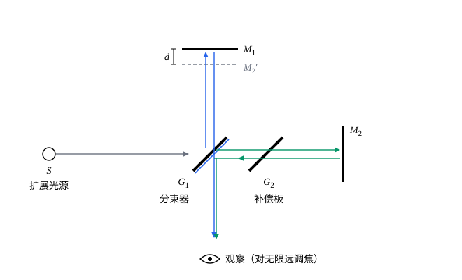

## 这一节要回答的问题

1887 年，迈克耳孙和莫雷用一台干涉仪寻找地球穿过「以太」时的「以太风」，结果什么也没找到；2015 年，臂长$4\,\mathrm{km}$的同一类装置测到了引力波，它让臂长变化的量只有质子直径的几百分之一。这样的干涉仪怎样把一束光分成两束再合起来？移动一面反射镜时条纹怎样变，又怎样用它测量波长和:term[相干长度]{id="physics.optics.coherence-length"}（coherence length）？

## 讲解

### 装置

[双光束干涉](lesson:physics.optics.two-beam-interference)里的双缝，是从同一个:term[波阵面]{id="physics.optics.wavefront"}（wavefront）上取两小块，两束光挨得很近；[薄膜干涉](lesson:physics.optics.thin-film-interference)里的两束光，是一束光在两个表面上分出来的，可膜的两个表面连在一起，没法单独调。迈克耳孙（Albert Michelson）在 1881 年做的干涉仪，把一束光分成两路，各走各的路，再合到一起。

::anchor{id="def-michelson"}
一块背面镀了半透半反膜、斜放$45^\circ$的玻璃板把一束光分成两路，即分束器（beam splitter），两路光各由一面反射镜原路反射回来，再在分束器上会合叠加，这样的干涉装置叫作:term[迈克耳孙干涉仪]{id="physics.optics.michelson-interferometer"}（Michelson interferometer）。另一路上放一块和分束器同样厚、没有镀膜的玻璃板，叫作补偿板（compensator plate），使两路光穿过的玻璃一样厚。

为什么这样定义：两路光来自同一束入射光，是:term[相干光]{id="physics.optics.coherent-light"}（coherent light），会合时发生:term[干涉]{id="physics.optics.interference"}（interference）；两路分开得很远、互相垂直，可以单独移动一面反射镜，或在一路里放进别的东西，看条纹怎样变，这正是它能用来测量的原因。没有补偿板时，一路穿过分束器的玻璃三次，另一路只穿过一次，玻璃对各种颜色的:term[折射率]{id="physics.optics.refractive-index"}（refractive index）不同，各种颜色的:term[光程差]{id="physics.optics.optical-path-difference"}（optical path difference）就不一样；用单色光时这只是一个固定的光程差，用白光时却会让各种颜色的条纹错开。边界情况：两路的光程差超过光的:term[相干长度]{id="physics.optics.coherence-length"}时，干涉仪里照样有两束光，却看不到条纹。

### 等效的空气层

从观察者这边看，反射镜$M_2$经分束器成一个像$M_2'$（下面的图）。走$M_2$那一路的光，等于是从$M_2'$反射回来的；两路光就像是一层空气膜的上下两个表面$M_1$、$M_2'$反射的两束光，这正是[薄膜干涉](lesson:physics.optics.thin-film-interference#thm-thin-film)的情形，只是两个「表面」可以随意挪动、调斜。

::anchor{id="thm-michelson-opd"}
定理（:term[迈克耳孙干涉仪]{id="physics.optics.michelson-interferometer"}的:term[光程差]{id="physics.optics.optical-path-difference"}）：$M_1$和$M_2'$平行、相距$d$时，和反射镜的法线成$\theta$角射来的光，两路的光程差是$2d\cos\theta$，另加分束器反射时带来的一个固定的相位差。

证明思路：两路光相当于厚为$d$的空气膜（:term[折射率]{id="physics.optics.refractive-index"}$1$）的上下两个表面反射的光，按:term[薄膜干涉]{id="physics.optics.thin-film-interference"}（thin-film interference）的光程差$2nt\cos\theta_t$，$n=1$，$t=d$，$\theta_t=\theta$，就是$2d\cos\theta$。两路光在分束器上反射的次数、从哪一侧反射都不同，带来的相位差对各个$\theta$都一样，只让整套条纹平移；$d=0$时中心是亮是暗，取决于分束器镀的膜。

### 等倾条纹

用扩展光源照明，各个方向的光都有。$M_1$和$M_2'$平行时，倾角相同的光:term[光程差]{id="physics.optics.optical-path-difference"}相同，条纹是以法线方向为中心的一圈圈同心圆环。

::anchor{id="def-equal-inclination"}
膜的厚度处处相同、扩展光源的光从各个方向射来时，倾角相同的光光程差相同，明暗条纹沿倾角相同的方向分布，成为同心圆环，这样的条纹叫作:term[等倾条纹]{id="physics.optics.equal-inclination-fringes"}（fringes of equal inclination）。

为什么这样定义：光程差$2d\cos\theta$只随倾角$\theta$变，一条条纹就是一个倾角，像地图上的等高线画出了倾角的分布，和:term[等厚条纹]{id="physics.optics.equal-thickness-fringes"}（fringes of equal thickness，见[薄膜干涉](lesson:physics.optics.thin-film-interference#def-equal-thickness)）沿膜厚相同的地方分布正好对照。中心$\theta=0$处光程差最大，:term[级次]{id="physics.optics.interference-order"}（order）$m_0=\frac{2d}\lambda$最高，往外级次逐渐降低，圆环越来越密（第 4 题）。边界情况：$d=0$时各个方向光程差都相同，整个视场一样亮或一样暗，没有圆环；$M_1$和$M_2'$稍微倾斜时，空气膜成了楔形，看到的是一条条直的等厚条纹。

[多光束干涉与法布里-珀罗干涉仪](lesson:physics.optics.fabry-perot)例 2 里的同心亮环，也是等倾条纹。

::anchor{id="thm-fringe-count"}
定理（移动反射镜与条纹的移动）：一面反射镜沿自己的法线移动$\Delta d$，各处的光程差改变$2\Delta d\cos\theta$；视场中心每冒出或缩进一个圆环，$\Delta d$就是$\frac\lambda2$，数出$N$个，$\Delta d=N\frac\lambda2$。

证明思路：中心$\theta=0$，光程差$2d$，$d$改变$\frac\lambda2$，光程差改变一个波长，中心的级次变$1$，亮暗经历一个周期，正好有一个圆环从中心冒出（$d$增大）或缩进中心消失（$d$减小）。所以数圆环就是用半个波长作尺子量反射镜移动的距离。

### 测波长和相干长度

数出移动$\Delta d$时冒出的圆环数$N$，就得到波长$\lambda=\frac{2\Delta d}N$（例 1）；反过来，已知波长就能精密地量长度。1892 年到 1893 年，迈克耳孙用这种办法把国际米原器的长度和镉红线的波长作了比较，一米约是$155$万个镉红线的波长。

从两路:term[光程]{id="physics.optics.optical-path-length"}（optical path length）相等的位置开始移动反射镜，:term[光程差]{id="physics.optics.optical-path-difference"}$2\Delta d$逐渐增大，条纹的:term[可见度]{id="physics.optics.fringe-visibility"}（visibility）随之变化。光程差增大到光的:term[相干长度]{id="physics.optics.coherence-length"}$l_c\approx\frac{\lambda^2}{\Delta\lambda}$时，条纹基本看不见了（见[相干性](lesson:physics.optics.coherence#thm-coherence-length)），所以反射镜移过的距离告诉我们光的波长范围有多宽。钠灯的两条黄线靠得很近，可见度随光程差周期性地起伏（[相干性](lesson:physics.optics.coherence)第 5 题；实际$D_2$线约是$D_1$线的两倍亮，可见度最低只降到约$\frac13$，设两条一样亮时才降到零），量出起伏的周期，就能算出两条谱线的波长差。白光的相干长度只有约$1\,\mu\mathrm m$，只在两路光程几乎相等时才看得到几条彩色的条纹，正好用来找出光程相等的位置。

1887 年的迈克耳孙-莫雷实验，把干涉仪装在漂浮在水银上的石台上转动，如果光相对以太的速度会随方向变，转过$90^\circ$时条纹应该移动约$0.4$条，实际移动的不到它的二十分之一（第 5 题）。这个结果后来成了[狭义相对论](lesson:physics.special-relativity.postulates)光速不变的实验基础。2015 年 9 月，激光干涉引力波天文台（LIGO）记录到两个黑洞合并发出的引力波，它的两臂各长$4\,\mathrm{km}$，测到的臂长变化约$10^{-18}\,\mathrm m$。

## 几何图像

蓝线是经$M_1$反射的那一路，绿线是经$M_2$反射的那一路，两路在分束器$G_1$上会合，射向观察者。虚线$M_2'$是$M_2$在分束器里的像，从观察者看，干涉仪就是$M_1$和$M_2'$之间一层厚为$d$的空气膜；移动$M_1$就是改变膜厚，把$M_2$调斜就是让膜变成楔形。补偿板$G_2$让两路光穿过的玻璃一样厚。

:::anim{component="function-plot"}
range: { x: [0, 4], y: [0, 1.05] }
functions:
  - expr: "abs(cos(pi*2e6*x*s/589.3^2))*abs(sum(j, 0, 47, cos(pi*2e6*x*w*(j + 0.5)/(48*589.3^2)))/48)"
    label: |
      两条谱线时的可见度
  - expr: "abs(sum(j, 0, 47, cos(pi*2e6*x*w*(j + 0.5)/(48*589.3^2)))/48)"
    label: |
      只有一条谱线时的可见度
sliders:
  - name: s
    min: 0.1
    max: 1
    step: 0.05
    default: 0.6
    label: |
      两条谱线的波长差（$\mathrm{nm}$）
  - name: w
    min: 0.05
    max: 0.2
    step: 0.01
    default: 0.05
    label: |
      每条谱线的宽度（$\mathrm{nm}$）
:::

横轴是反射镜离开:term[光程]{id="physics.optics.optical-path-length"}相等位置的距离$\Delta d$（$\mathrm{mm}$，图上写作$x$），:term[光程差]{id="physics.optics.optical-path-difference"}是它的$2$倍；纵轴是条纹的:term[可见度]{id="physics.optics.fringe-visibility"}。光的中心波长$589.3\,\mathrm{nm}$，两条谱线相差$s$，设它们一样亮，每条在宽为$w$的范围里各个波长一样强。只有一条谱线时，可见度随光程差慢慢下降，降到零的地方光程差就是:term[相干长度]{id="physics.optics.coherence-length"}；两条谱线时，可见度还乘上一个$|\cos|$的因子，周期性地降到零又恢复。默认的$0.6\,\mathrm{nm}$是钠的两条黄线的波长差，按一样亮算，可见度每隔约$0.29\,\mathrm{mm}$降到零一次（实际的钠灯降不到零，见上面「讲解」）；谱线越宽，恢复得越不完全。

## 例题

### 例 1　数圆环测波长

用一台:term[迈克耳孙干涉仪]{id="physics.optics.michelson-interferometer"}测一束激光的波长。把反射镜$M_1$慢慢移动$0.1582\,\mathrm{mm}$，数得视场中心冒出了$500$个圆环。激光的波长是多少？

**为什么想到这么做**：反射镜移动$\Delta d$，中心的:term[光程差]{id="physics.optics.optical-path-difference"}改变$2\Delta d$，每冒出一个圆环改变一个波长，$2\Delta d=N\lambda$。

**推导**：$\lambda=\frac{2\Delta d}N=\frac{2\times0.1582\times10^{-3}}{500}\,\mathrm m\approx6.328\times10^{-7}\,\mathrm m=632.8\,\mathrm{nm}$，是氦氖激光。移动的距离用一个精密的螺旋测出来，数$500$个圆环，波长就有四位有效数字；数的圆环越多，相对误差越小。

### 例 2　量空气的折射率

在一臂里放一个长$5.00\,\mathrm{cm}$、两端是玻璃窗的气室，开始时充满空气，用波长$633\,\mathrm{nm}$的光照明。把气室慢慢抽成真空，视场中心一共缩进了$46$个圆环。空气的:term[折射率]{id="physics.optics.refractive-index"}是多少？

**为什么想到这么做**：光来回两次穿过气室，抽气时这一路的:term[光程]{id="physics.optics.optical-path-length"}（optical path length）变化$2(n-1)l$；每缩进一个圆环，:term[光程差]{id="physics.optics.optical-path-difference"}变化一个波长。

**推导**：$2(n-1)l=N\lambda$，$n-1=\frac{N\lambda}{2l}=\frac{46\times633\times10^{-9}}{2\times5.00\times10^{-2}}\approx2.91\times10^{-4}$，空气的折射率约为$1.000291$。折射率和$1$只差万分之三，用别的办法很难量准，干涉仪却能轻松地数出几十个条纹。

## 常见误区

- 「:term[迈克耳孙干涉仪]{id="physics.optics.michelson-interferometer"}的条纹一定是同心圆环。」$M_1$和$M_2'$平行时才是圆环（:term[等倾条纹]{id="physics.optics.equal-inclination-fringes"}）；两者略微倾斜时是直的:term[等厚条纹]{id="physics.optics.equal-thickness-fringes"}。
- 「两臂的长度差越大，圆环越稀疏。」长度差越大，中心的:term[级次]{id="physics.optics.interference-order"}越高，相邻两环的倾角差越小，圆环越密。
- 「反射镜移动$\Delta d$，:term[光程差]{id="physics.optics.optical-path-difference"}也改变$\Delta d$。」光来回走两次，光程差改变$2\Delta d$，所以中心每变化一个圆环，反射镜只移动半个波长。
- 「补偿板可有可无。」用单色光时它只是改变一个固定的光程差，可以不要；用白光时缺了它，各种颜色的光程差不同，找不到所有颜色同时:term[光程]{id="physics.optics.optical-path-length"}相等的位置，彩色条纹就看不清了。
