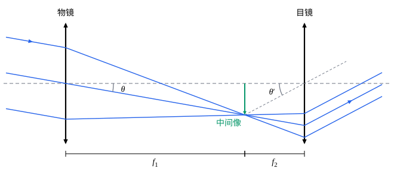

## 这一节要回答的问题

显微镜（microscope）和望远镜（telescope）都由两组以上的透镜组成。光依次穿过几块透镜，最后的像在哪里、有多大？显微镜的「$400$倍」、双筒望远镜上的「$8\times42$」各是什么意思？为什么有的望远镜里看到的像是倒着的？

## 讲解

### 透镜组：逐个成像

光依次穿过几块透镜时，不需要新的公式：每块透镜都按成像公式$\frac1s+\frac1{s'}=\frac1f$处理（见[薄透镜](lesson:physics.optics.thin-lenses#thm-thin-lens)），前一块透镜所成的像，就是后一块透镜的物。

::anchor{id="thm-sequential"}
定理（逐个成像）：两块:term[薄透镜]{id="physics.optics.thin-lens"}（thin lens）相距$d$，光先穿过第一块。第一块透镜的:term[像距]{id="physics.optics.image-distance"}（image distance）为$s_1'$时，第一个像对第二块透镜的:term[物距]{id="physics.optics.object-distance"}（object distance）是$s_2=d-s_1'$；整个透镜组的:term[横向放大率]{id="physics.optics.lateral-magnification"}（lateral magnification）是两块透镜的横向放大率之积，$m=m_1m_2$。

证明思路：按:term[符号规则]{id="physics.optics.sign-convention"}（sign convention），第一个像在第一块透镜右边$s_1'$处（$s_1'<0$时在左边），第二块透镜在右边$d$处，所以第一个像在第二块透镜左边$d-s_1'$处。$s_1'<d$时，第一个像在第二块透镜的入射一侧，光从这里发散开再射到第二块透镜上，$s_2>0$；$s_1'>d$时，光还没有会聚成像就射到了第二块透镜上，第一个像是第二块透镜的:term[虚物]{id="physics.optics.virtual-object"}（virtual object，见[符号规则](lesson:physics.optics.paraxial-refraction#def-sign-convention)），$s_2<0$，成像公式照样成立。第一个像的高度$y_1'=m_1y$就是第二块透镜的物高，最后的像高$y_2'=m_2y_1'=m_1m_2y$。

三块以上的透镜也一样，一块一块往下求。两块透镜贴在一起（$d=0$）时，$s_2=-s_1'$，把两个成像公式相加，$\frac1{s_1'}$消去，就得到:term[光焦度]{id="physics.optics.optical-power"}（optical power）相加；分开一段距离以后，光焦度不再简单相加，要逐个成像，或者用[光线传输矩阵](lesson:physics.optics.ray-transfer-matrices)。

### 视角和角放大率

眼睛看一个物体有多大，取决于它在视网膜上的像有多大，也就是物体两端对眼睛所张的角（视角，visual angle）。把物体拿近，视角变大，能看清更多细节；可是眼睛调节的范围有限，太近了反而看不清。

::anchor{id="def-near-point"}
比较放大本领时，通常把眼前$25\,\mathrm{cm}$作为看清近处物体的标准距离，叫作明视距离（distance of distinct vision）；近处的小物体不用仪器时，就放在这里看。

为什么这样定义：放大镜、显微镜放大了多少，要和不用仪器时看得多清楚比；不用仪器时东西放得越近视角越大，可每个人能看清的最近距离（近点，near point）不同，统一取$25\,\mathrm{cm}$，各种仪器的放大率才能互相比较。边界情况：近点远的人，例如[薄透镜](lesson:physics.optics.thin-lenses)第 4 题里近点在$75\,\mathrm{cm}$的人，不用仪器只能在$75\,\mathrm{cm}$处看，放大镜给他放大视角的倍数是按$25\,\mathrm{cm}$算的$3$倍。

::anchor{id="def-angular-magnification"}
用光学仪器看到的像对眼睛所张的角$\theta'$，和不用仪器直接看物体时物体所张的角$\theta$之比，叫作:term[角放大率]{id="physics.optics.angular-magnification"}（angular magnification），$M=\frac{\theta'}{\theta}$。角度带正负：看到的像倒立时，$\theta'$和$\theta$反号，$M<0$。

为什么这样定义：放大镜、显微镜、望远镜最后都让眼睛去看一个:term[虚像]{id="physics.optics.virtual-image"}（virtual image），这个像常常在无穷远处；像本身可以比物体大很多，离眼睛也远很多，像和物的大小之比说明不了看得清不清，真正决定能看清多少细节的是视角。边界情况：这几种仪器里的角都很小，按:term[近轴近似]{id="physics.optics.paraxial-approximation"}（paraxial approximation），$\theta$和$\tan\theta$不必区分，这一节的推导都是这样做的。

### 放大镜

::anchor{id="thm-magnifier"}
定理（放大镜）：:term[焦距]{id="physics.optics.focal-length"}（focal length）为$f$的会聚透镜当放大镜用，眼睛紧靠透镜。物放在:term[焦点]{id="physics.optics.focal-point"}（focal point）上、像在无穷远时，:term[角放大率]{id="physics.optics.angular-magnification"}$M=\frac{25\,\mathrm{cm}}{f}$；物放在焦点以内、正立的:term[虚像]{id="physics.optics.virtual-image"}成在明视距离处时，$M=1+\frac{25\,\mathrm{cm}}{f}$。

证明思路：物高为$y$，不用放大镜，放在明视距离处看，$\theta=\frac{y}{25\,\mathrm{cm}}$。物在焦点上时，物上每一点发出的光经过透镜都成为平行光，方向和这一点与:term[光心]{id="physics.optics.optical-center"}（optical center）的连线相同，所以$\theta'=\frac yf$，$M=\frac{25\,\mathrm{cm}}{f}$。像在明视距离处时，$s'=-25\,\mathrm{cm}$，由成像公式$\frac1s=\frac1f+\frac1{25\,\mathrm{cm}}$；眼睛在光心处，像对眼睛张的角等于物对光心张的角，$\theta'=\frac ys=y\Bigl(\frac1f+\frac1{25\,\mathrm{cm}}\Bigr)$，所以$M=1+\frac{25\,\mathrm{cm}}{f}$。

后一种情况放大率大$1$，但眼睛要用力调节才能看清$25\,\mathrm{cm}$处的像；像在无穷远时，正常的眼睛不用调节，看久了不累。式子说明焦距越短，放大率越大；可是焦距短的透镜两面弯得厉害，离:term[光轴]{id="physics.optics.optical-axis"}（optical axis）稍远的光线:term[像差]{id="physics.optics.aberration"}（aberration）就很大（见[像差](lesson:physics.optics.aberrations)），单块透镜放大的倍数因此有限。要看更小的东西，就让两组透镜分工：先放大成:term[实像]{id="physics.optics.real-image"}（real image），再用放大镜看这个像，显微镜就是这样做的。

### 显微镜

显微镜由两组透镜组成：靠近物体的物镜（objective）:term[焦距]{id="physics.optics.focal-length"}很短，物体放在它的:term[焦点]{id="physics.optics.focal-point"}稍外一点，成倒立、放大的:term[实像]{id="physics.optics.real-image"}；这个中间像（intermediate image）落在目镜（eyepiece）的焦点上或稍靠里，目镜像放大镜一样把它放大。

::anchor{id="thm-microscope"}
定理（显微镜的放大率）：物镜、目镜的焦距分别为$f_{\mathrm o}$、$f_{\mathrm e}$，物镜的:term[像方焦点]{id="physics.optics.focal-point"}到中间像的距离为$L$。中间像在目镜的焦点上时，显微镜的:term[角放大率]{id="physics.optics.angular-magnification"}$M=-\frac{L}{f_{\mathrm o}}\cdot\frac{25\,\mathrm{cm}}{f_{\mathrm e}}$。

证明思路：物镜的:term[像距]{id="physics.optics.image-distance"}$s'=f_{\mathrm o}+L$，由成像公式$\frac1s=\frac1{f_{\mathrm o}}-\frac1{s'}$，物镜的:term[横向放大率]{id="physics.optics.lateral-magnification"}$m_{\mathrm o}=-\frac{s'}{s}=-\Bigl(\frac{s'}{f_{\mathrm o}}-1\Bigr)=-\frac{L}{f_{\mathrm o}}$，中间像高$y_1'=m_{\mathrm o}y$。目镜把中间像当作放在焦点上的物，$\theta'=\frac{y_1'}{f_{\mathrm e}}$；不用显微镜时，把物体放在明视距离处看，$\theta=\frac{y}{25\,\mathrm{cm}}$。两者相除，$M=m_{\mathrm o}\cdot\frac{25\,\mathrm{cm}}{f_{\mathrm e}}$。

所以显微镜的放大率是物镜的横向放大率和目镜当作放大镜时的角放大率之积，负号表示看到的像是倒的。显微镜的物镜上刻的「$40\times$」是它的横向放大率的大小，目镜上刻的「$10\times$」是$\frac{250\,\mathrm{mm}}{f_{\mathrm e}}$，即目镜焦距$25\,\mathrm{mm}$，两者相乘，总放大率是$400$倍。物体几乎就在物镜的焦点上，$L$比$f_{\mathrm o}$大得多，物镜的放大率因此可以很大。

### 望远镜

望远镜看的是远处的物体，物体拿不近，只能把它的视角放大。最简单的折射望远镜（refracting telescope）也由两块透镜组成：:term[焦距]{id="physics.optics.focal-length"}长的物镜把远处的物体成像在:term[焦点]{id="physics.optics.focal-point"}所在的、垂直于:term[光轴]{id="physics.optics.optical-axis"}的平面（焦平面，focal plane）上，焦距短的目镜再把这个像放大。

::anchor{id="thm-telescope"}
定理（望远镜的放大率）：物镜、目镜的焦距分别为$f_1$、$f_2$，两者相距$f_1+f_2$，物镜的:term[像方焦点]{id="physics.optics.focal-point"}和目镜的物方焦点重合。从远处射来的平行光经过望远镜仍是平行光，:term[角放大率]{id="physics.optics.angular-magnification"}$M=-\frac{f_1}{f_2}$。目镜是会聚透镜（$f_2>0$）时，叫作开普勒望远镜（Keplerian telescope），$M<0$，像是倒的；目镜是发散透镜（$f_2<0$）时，叫作伽利略望远镜（Galilean telescope），$M>0$，像是正的，镜筒长$f_1-|f_2|$，比同样放大率的开普勒望远镜短。

证明思路：先看开普勒望远镜（图见下面）。远处一点射来的光和光轴成$\theta$，经过物镜会聚在焦平面上；过物镜:term[光心]{id="physics.optics.optical-center"}的那条光线不偏折，所以会聚点在光轴的另一侧，离光轴$f_1\tan\theta$。

这一点也在目镜的焦平面上，从它发出的光经过目镜成为平行光，方向和这一点与目镜光心的连线相同，和光轴的夹角$\theta'$满足$\tan\theta'=\frac{f_1\tan\theta}{f_2}$，倾斜的方向和入射光相反。小角度时$M=\frac{\theta'}{\theta}=-\frac{f_1}{f_2}$。伽利略望远镜的推导要用到:term[虚物]{id="physics.optics.virtual-object"}，见第 5 题。

1608 年 10 月，荷兰眼镜匠利伯希（Hans Lipperhey）向荷兰议会申请望远镜的专利，没有获准，这种新仪器的消息很快传遍欧洲。1609 年，伽利略自己磨制透镜，用凸透镜做物镜、凹透镜做目镜，把放大率提高到约$20$倍，1610 年 1 月用它发现了绕木星转动的卫星。1611 年，开普勒在《屈光学》（Dioptrice）里提出把凹透镜目镜换成凸透镜，视野更大，但像是倒的。天文观测不在乎上下颠倒；地面上用的双筒望远镜要正立的像，大多在物镜和目镜之间加棱镜，靠棱镜里的几次反射把像倒正（第 7 题）。

双筒望远镜上常标着「$8\times42$」这样的数：前一个是角放大率的大小，后一个是物镜的直径，以毫米为单位；物镜越大，收进的光越多，在暗处看得越亮（第 6 题）。

## 几何图像

图里物镜的:term[焦距]{id="physics.optics.focal-length"}是目镜的$3$倍，两块透镜相距$f_1+f_2$。三条平行光线经过物镜，会聚在公共的焦平面上，成倒立的中间像（绿色箭头），从目镜射出时又成为平行光，只是更陡：$\theta=10^\circ$，$\theta'\approx28^\circ$，$\tan\theta'=3\tan\theta$。$\theta$画在物镜:term[光心]{id="physics.optics.optical-center"}处，$\theta'$画在目镜光心处：中间像的顶端和两个光心各连一条线，同一个像高分别除以$f_1$和$f_2$，就是两个角的正切，所以焦距之比就是:term[角放大率]{id="physics.optics.angular-magnification"}的大小。为了画出整束光，图里的目镜画得和物镜一样大，实际的目镜比物镜小得多。

:::anim{component="function-plot"}
range: { x: [0, 2], y: [-3, 3] }
functions:
  - expr: "x - 1"
    label: |
      第一个像对目镜的物距$\frac{s_2}{f_1}$
  - expr: "k*(x - 1)/(x - 1 - k)"
    label: |
      最后的像距$\frac{s_2'}{f_1}$
sliders:
  - name: k
    min: -0.45
    max: 0.45
    step: 0.1
    default: 0.25
    label: |
      目镜和物镜的焦距之比$\frac{f_2}{f_1}$
:::

横轴是两块透镜的间距$d$，纵轴是从目镜量起的距离，都以物镜的焦距为单位，物体在无穷远处。直线是第一个像对目镜的:term[物距]{id="physics.optics.object-distance"}$s_2=d-f_1$，$d<f_1$时它是负的，第一个像是:term[虚物]{id="physics.optics.virtual-object"}。曲线是目镜所成的最后的像的:term[像距]{id="physics.optics.image-distance"}。

滑块为正时目镜是会聚透镜：$d$从$0$增大，最后的像先是目镜后面的:term[实像]{id="physics.optics.real-image"}，$d=f_1$时落在目镜上，接着成为目镜前面的:term[虚像]{id="physics.optics.virtual-image"}，$d$接近$f_1+f_2$时退到无穷远，过了这个位置又成为实像。望远镜平常就调在$d=f_1+f_2$附近，这里曲线很陡，目镜前后移动一点，像就移动很多，调焦靠的就是这一点。滑块为负时目镜是发散透镜，就是伽利略望远镜，像在$d=f_1-|f_2|$时退到无穷远。

## 例题

### 例 1　两块会聚透镜

:term[焦距]{id="physics.optics.focal-length"}$10\,\mathrm{cm}$和$15\,\mathrm{cm}$的两块会聚透镜相距$20\,\mathrm{cm}$，物体放在第一块透镜前$15\,\mathrm{cm}$处。求最后的像的位置、正倒和放大率。

**为什么想到这么做**：逐个成像。先求第一块透镜的像，再看它离第二块透镜多远；第一个像如果落在第二块透镜后面，它就是:term[虚物]{id="physics.optics.virtual-object"}，:term[物距]{id="physics.optics.object-distance"}取负值。

**推导**：第一块：$\frac1{s_1'}=\frac1{10}-\frac1{15}=\frac1{30}\,\mathrm{cm^{-1}}$，$s_1'=30\,\mathrm{cm}$，$m_1=-\frac{30}{15}=-2$。第一个像在第二块透镜后面$10\,\mathrm{cm}$处，$s_2=20-30=-10\,\mathrm{cm}$，是虚物。第二块：$\frac1{s_2'}=\frac1{15}-\frac1{-10}=\frac16\,\mathrm{cm^{-1}}$，$s_2'=6.0\,\mathrm{cm}$，$m_2=-\frac{6.0}{-10}=0.6$。

最后的像在第二块透镜后面$6.0\,\mathrm{cm}$处，是:term[实像]{id="physics.optics.real-image"}；$m=m_1m_2=-1.2$，倒立，放大到$1.2$倍。第二块透镜让还没会聚的光提前会聚，像比没有它时近，也小一些。

### 例 2　天文望远镜

一台折射望远镜的物镜:term[焦距]{id="physics.optics.focal-length"}$1000\,\mathrm{mm}$，目镜焦距$25\,\mathrm{mm}$。（1）求:term[角放大率]{id="physics.optics.angular-magnification"}和镜筒的长度。（2）月亮对眼睛张的角约$0.5^\circ$，通过这台望远镜看，月亮的像张多大的角？物镜所成的中间像有多大？

**为什么想到这么做**：两块都是会聚透镜，是开普勒望远镜，看远处时两块透镜相距$f_1+f_2$。中间像在物镜的焦平面上，大小等于$f_1$乘以视角（弧度）。

**推导**：（1）$M=-\frac{1000}{25}=-40$，像是倒的；镜筒长约$1000+25=1025\,\mathrm{mm}$。（2）$\theta'\approx40\times0.5^\circ=20^\circ$；按正切算，月亮边缘到中心的$0.25^\circ$变成约$9.9^\circ$，整个像约$20^\circ$，差别很小。$0.5^\circ\approx0.0087\,\mathrm{rad}$，中间像只有约$1000\,\mathrm{mm}\times0.0087\approx8.7\,\mathrm{mm}$大，望远镜放大的是视角，不是像的大小。

## 常见误区

- 「放大镜、望远镜的放大率是像和物的大小之比。」它们比的是视角。望远镜的中间像比物体小得多（例 2 里月亮的像不到$1\,\mathrm{cm}$），看起来变大，是因为目镜让它对眼睛张了更大的角。
- 「两块透镜组合，:term[光焦度]{id="physics.optics.optical-power"}总是相加。」只有贴在一起时才相加；分开一段距离要逐个成像（例 1），第一个像落在第二块透镜后面时当作:term[虚物]{id="physics.optics.virtual-object"}，:term[物距]{id="physics.optics.object-distance"}取负值。
- 「开普勒望远镜里的像倒立，是目镜造成的。」倒立的是物镜所成的中间像，目镜像放大镜一样看它，不改变正倒；伽利略望远镜的目镜在光会聚成像之前就把它变成平行光，像就是正的。
- 「目镜的:term[焦距]{id="physics.optics.focal-length"}越短，能看清的细节越多。」放大率可以靠目镜一直提高，但物镜送来的中间像本身只有那么多细节，放大过了头，看到的只是更大的模糊光斑（第 8 题）。
