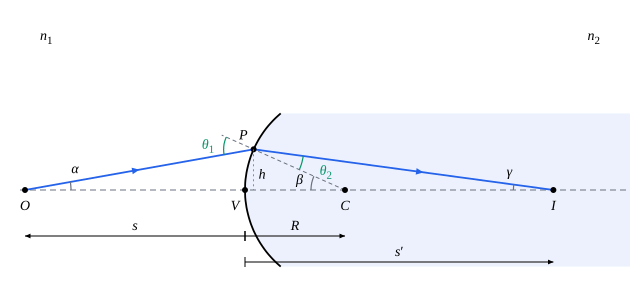

## 这一节要回答的问题

放大镜、照相机的镜头、眼睛的角膜，都靠弯曲的表面把光会聚起来成像。一个球面怎样把从一点发出的光会聚到另一点？像在哪里、有多大，正立还是倒立？为什么只有靠近中心、斜得不厉害的光线才会聚得好？

## 讲解

### 光轴和近轴光线

两种介质以球面分界，球面的半径是$R$，球心是$C$。这样的系统绕某一条直线转动时不变，只要在过这条直线的一个平面里讨论光线就够了。

::anchor{id="def-optical-axis"}
过球面的球心和顶点（vertex）的直线叫作:term[光轴]{id="physics.optics.optical-axis"}（optical axis）；几个球面组成的系统，各个球面的球心都在同一条直线上时，这条直线叫作系统的光轴。

为什么这样定义：光轴是整个系统的对称轴，沿光轴射来的光垂直射到每个球面上，不偏折。边界情况：平面没有球心，和它垂直的任何一条直线都可以当作光轴。

::anchor{id="def-paraxial"}
和光轴的夹角很小、离光轴也很近的光线叫作:term[近轴光线]{id="physics.optics.paraxial-ray"}（paraxial ray）；只考虑近轴光线，把角度的正弦、正切都换成角度本身（用弧度），这种处理叫作:term[近轴近似]{id="physics.optics.paraxial-approximation"}（paraxial approximation）。

为什么这样定义：$\sin\theta$和$\tan\theta$在$\theta=0$附近的线性近似（linear approximation，见[微分与线性近似](lesson:math.calculus.differentials)）都是$\theta$，$\theta=10^\circ$时把$\sin\theta$换成$\theta$只差约$0.5\%$。有了这个近似，从同一点发出的光线经过球面后会聚到同一点，像才清晰（下面的定理）。边界情况：离光轴远、斜得厉害的光线不满足这个近似，它们和近轴光线会聚到不同的点，像就模糊了（见[像差](lesson:physics.optics.aberrations)）。

### 物和像

::anchor{id="def-image"}
从物体上一点（物点，object point）发出的光，经过光学系统以后如果会聚于一点，这一点叫作像点（image point），所成的像叫作:term[实像]{id="physics.optics.real-image"}（real image）；如果射出的光并不会聚，只是它们的反向延长线交于一点，这一点也叫作像点，所成的像叫作:term[虚像]{id="physics.optics.virtual-image"}（virtual image）。

为什么这样定义：实像那里真有光会聚，放一张纸就能接住；虚像那里没有光，纸上接不到，可是眼睛把射来的光反向延长，照样看得见，平面镜里的像就是虚像（见[反射定律与折射定律](lesson:physics.optics.reflection-refraction)）。边界情况：射出的光互相平行时，像在无穷远处。

### 符号规则

::anchor{id="def-sign-convention"}
几何光学成像的各节约定：光从左向右射来；从顶点量起，物点在入射一侧时:term[物距]{id="physics.optics.object-distance"}（object distance）$s$为正，像点在出射一侧时:term[像距]{id="physics.optics.image-distance"}（image distance）$s'$为正（折射时出射一侧在右边，反射时在左边），反过来为负；球心在出射一侧时半径$R$为正，反过来为负；物、像在:term[光轴]{id="physics.optics.optical-axis"}上方时高度为正。这一套约定叫作:term[符号规则]{id="physics.optics.sign-convention"}（sign convention）。物点在出射一侧、物距为负时，射来的光正会聚向这一点，还没有会聚就遇到了球面，这样的物点叫作:term[虚物]{id="physics.optics.virtual-object"}（virtual object）。

为什么这样定义：凸面、凹面、:term[实像]{id="physics.optics.real-image"}、:term[虚像]{id="physics.optics.virtual-image"}有很多种情形，约定好正负以后，一个公式就能管所有情形；这样约定，实物、实像的距离都是正的。边界情况：几块透镜、几个折射面连在一起时，前面射出的光常常正会聚向后一个面后面的一点，这一点就是后一个面的虚物（见[透镜组与光学仪器](lesson:physics.optics.optical-instruments)）。

### 单个球面的成像公式

::anchor{id="thm-single-surface"}
定理（单个球面的折射成像公式）：在:term[近轴近似]{id="physics.optics.paraxial-approximation"}下，:term[折射率]{id="physics.optics.refractive-index"}（refractive index）为$n_1$、$n_2$的两种介质以半径为$R$的球面分界，光从$n_1$一侧射来，:term[光轴]{id="physics.optics.optical-axis"}上:term[物距]{id="physics.optics.object-distance"}为$s$的物点成像在:term[像距]{id="physics.optics.image-distance"}$s'$处，$\frac{n_1}{s}+\frac{n_2}{s'}=\frac{n_2-n_1}{R}$，和光线射到球面上的高度无关。

证明思路：如下面的图，从物点$O$射出的光线和:term[光轴]{id="physics.optics.optical-axis"}成$\alpha$，射到球面上高为$h$的$P$点，法线$CP$和光轴成$\beta$，折射光线和光轴成$\gamma$。由三角形的外角，入射角$\theta_1=\alpha+\beta$，折射角$\theta_2=\beta-\gamma$；近轴时:term[折射定律]{id="physics.optics.law-of-refraction"}（law of refraction）写成$n_1\theta_1=n_2\theta_2$，即$n_1\alpha+n_2\gamma=(n_2-n_1)\beta$。再取$\alpha\approx\frac hs$、$\beta\approx\frac hR$、$\gamma\approx\frac h{s'}$（不计$P$点在光轴上的投影和顶点之间的一小段），两边除以$h$就得到公式；$h$消去了，所以从$O$发出的:term[近轴光线]{id="physics.optics.paraxial-ray"}都经过同一点，那一点就是像点。

$n_2>n_1$、$R>0$时，球面凸向射来的光，把光会聚。物距大时像距为正，得到:term[实像]{id="physics.optics.real-image"}；物点离球面太近时，$\frac{n_1}{s}$超过$\frac{n_2-n_1}{R}$，$s'$成了负数，射出的光仍在发散，得到:term[虚像]{id="physics.optics.virtual-image"}。平面是$R\to\infty$的情形，$s'=-\frac{n_2}{n_1}s$：水里深$h$的物体从空气中看，像在水面下$\frac{h}{1.33}$处，和[反射定律与折射定律](lesson:physics.optics.reflection-refraction)例 2 的结果一致。

### 焦点、光焦度和放大率

::anchor{id="def-focal"}
平行于:term[光轴]{id="physics.optics.optical-axis"}射来的光（$s\to\infty$）经过球面以后会聚的点$F'$，和发出的光经过球面以后平行于光轴射出（$s'\to\infty$）的物点$F$，都叫作:term[焦点]{id="physics.optics.focal-point"}（focal point），$F'$是像方焦点，$F$是物方焦点；它们到顶点的距离$f_2=\frac{n_2R}{n_2-n_1}$、$f_1=\frac{n_1R}{n_2-n_1}$叫作:term[焦距]{id="physics.optics.focal-length"}（focal length），分别是像方焦距和物方焦距。

为什么这样定义：远处的物体，例如太阳，发来的光几乎平行，就成像在像方焦点上；放在物方焦点上的点光源，射出的光变成平行光。两个焦距之比是$\frac{f_2}{f_1}=\frac{n_2}{n_1}$，球面两侧的介质不同时，两个焦距并不相等。边界情况：$n_2>n_1$而$R<0$，或者$n_2<n_1$而$R>0$时，焦距是负的，平行光射出后发散，像是从球面前方的一点（虚焦点，virtual focus）发出的。

::anchor{id="def-power"}
$\Phi=\frac{n_2-n_1}{R}$叫作球面的:term[光焦度]{id="physics.optics.optical-power"}（optical power），单位是$\mathrm m^{-1}$，叫作:term[屈光度]{id="physics.optics.diopter"}（diopter，D）。

为什么这样定义：成像公式写成$\frac{n_1}{s}+\frac{n_2}{s'}=\Phi$，$f_1=\frac{n_1}\Phi$，$f_2=\frac{n_2}\Phi$，$\Phi$越大，球面把光偏折得越厉害。贴在一起的几个折射面、几个:term[薄透镜]{id="physics.optics.thin-lens"}（thin lens），光焦度可以相加（见[薄透镜](lesson:physics.optics.thin-lenses)）。边界情况：平面的光焦度是零；两侧介质相同时，球面对光没有作用，光焦度也是零。

::anchor{id="thm-magnification"}
定理（像的大小）：像高$y'$和物高$y$之比$m=\frac{y'}{y}$叫作:term[横向放大率]{id="physics.optics.lateral-magnification"}（lateral magnification）；单个球面成像时$m=-\frac{n_1s'}{n_2s}$。

证明思路：从物体顶端射向顶点$V$的光线，在$V$点射到球面上，那里的法线就是光轴。近轴时入射角约为$\frac ys$，折射角约为$-\frac{y'}{s'}$（像在光轴下方时$y'<0$），由$n_1\theta_1=n_2\theta_2$得$n_1\frac ys=-n_2\frac{y'}{s'}$，整理即得。

$m<0$时像是倒立的，$m>0$时是正立的；$|m|>1$时像比物大。实物、:term[实像]{id="physics.optics.real-image"}（$s$、$s'$都为正）的放大率是负的：单个折射面所成的实像都是倒立的。

## 几何图像

图里左边是空气，右边按$n_2=2.0$画，球面凸向射来的光，:term[物距]{id="physics.optics.object-distance"}、:term[像距]{id="physics.optics.image-distance"}、半径按:term[符号规则]{id="physics.optics.sign-convention"}都是正的。为了看清各个角，光线画得离:term[光轴]{id="physics.optics.optical-axis"}比较远，近轴时这些角都小得多。

:::anim{component="function-plot"}
range: { x: [0, 10], y: [-10, 12] }
functions:
  - expr: "q/((q - 1) - 1/x)"
    label: |
      像距$\frac{s'}R$
  - expr: "q/(q - 1)"
    label: |
      像方焦距$\frac{f_2}R$
points:
  - x: "1/(q - 1)"
    y: "0"
sliders:
  - name: q
    min: 1.1
    max: 2.5
    step: 0.01
    default: 1.5
    label: |
      折射率之比$\frac{n_2}{n_1}$
:::

横轴是物距、纵轴是像距，都以半径$R$为单位，球面凸向射来的光（$R>0$），右边的:term[折射率]{id="physics.optics.refractive-index"}较大。物点从很远处向球面靠近，像从:term[像方焦点]{id="physics.optics.focal-point"}（橙色水平直线所在的高度）向远处退去；物点到达物方焦点（横轴上的点）时像在无穷远处；物点再近，像距变成负的，得到:term[虚像]{id="physics.optics.virtual-image"}。两种介质的折射率之比越大，两个:term[焦距]{id="physics.optics.focal-length"}都越短。

## 例题

### 例 1　玻璃棒的半球形端面

一根:term[折射率]{id="physics.optics.refractive-index"}$1.50$的长玻璃棒，一端磨成半径$2.0\,\mathrm{cm}$的凸半球面，放在空气里。轴上离端面顶点$8.0\,\mathrm{cm}$处有一个小物体，高$1.0\,\mathrm{mm}$。求像的位置和大小。

**为什么想到这么做**：光从空气射向玻璃，$n_1=1$，$n_2=1.50$，球心在玻璃一侧，即出射一侧，按:term[符号规则]{id="physics.optics.sign-convention"}$R=+2.0\,\mathrm{cm}$，:term[物距]{id="physics.optics.object-distance"}$s=+8.0\,\mathrm{cm}$。

**推导**：$\frac{1}{8.0}+\frac{1.50}{s'}=\frac{1.50-1}{2.0}$，$\frac{1.50}{s'}=0.250-0.125=0.125$，$s'=12.0\,\mathrm{cm}$，像在玻璃里离顶点$12.0\,\mathrm{cm}$处，是:term[实像]{id="physics.optics.real-image"}。$m=-\frac{1\times12.0}{1.50\times8.0}=-1.0$，像高$1.0\,\mathrm{mm}$，倒立。

### 例 2　鱼缸中央的鱼

一个球形鱼缸半径$15\,\mathrm{cm}$，玻璃壁很薄、可以不计，水的:term[折射率]{id="physics.optics.refractive-index"}取$1.33$。鱼在鱼缸的正中央，从外面正对着看，鱼在哪里、放大了多少？

**为什么想到这么做**：光从鱼出发，经过水和空气的球面射进眼睛，$n_1=1.33$，$n_2=1$。鱼在球心，:term[物距]{id="physics.optics.object-distance"}$s=15\,\mathrm{cm}$；球心在水这一侧，即入射一侧，$R=-15\,\mathrm{cm}$。

**推导**：$\frac{1.33}{15}+\frac{1}{s'}=\frac{1-1.33}{-15}$，$\frac1{s'}=\frac{0.33-1.33}{15}=-\frac1{15}$，$s'=-15\,\mathrm{cm}$：像在入射一侧离顶点$15\,\mathrm{cm}$处，正好还在球心，是:term[虚像]{id="physics.optics.virtual-image"}。$m=-\frac{1.33\times(-15)}{1\times15}=1.33$，看上去放大到$1.33$倍、正立，位置不变。这个结果也可以直接看出：从球心发出的光沿半径射到球面上，都是垂直入射，不偏折。

## 常见误区

- 「:term[物距]{id="physics.optics.object-distance"}、:term[像距]{id="physics.optics.image-distance"}总是正的。」按:term[符号规则]{id="physics.optics.sign-convention"}，:term[虚像]{id="physics.optics.virtual-image"}的像距、:term[虚物]{id="physics.optics.virtual-object"}的物距都是负的，代进公式时要带着符号。
- 「平行光会聚的点离顶点的距离就是这个球面的:term[焦距]{id="physics.optics.focal-length"}，两边一样。」球面两侧:term[折射率]{id="physics.optics.refractive-index"}不同时，物方焦距和像方焦距之比是$\frac{n_1}{n_2}$，并不相等。
- 「:term[近轴近似]{id="physics.optics.paraxial-approximation"}只是为了算起来方便，不用它结果也一样。」不用近轴近似，射到不同高度的光线会聚到不同的点，根本没有清晰的像。
- 「凸向入射光的球面总会把光会聚。」只有光射进折射率较大的介质时才会聚；从玻璃射向空气时，凸向玻璃一侧的球面把光发散。
