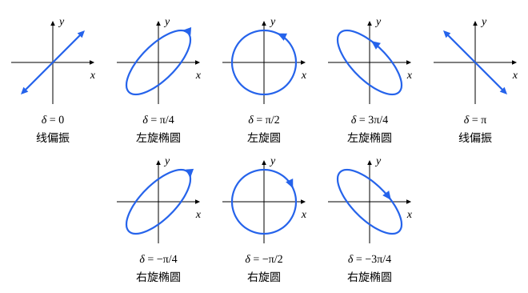

## 这一节要回答的问题

戴上偏振太阳镜看湖面，刺眼的反光不见了；把两片:term[偏振片]{id="physics.optics.polarizer"}（polarizer）叠在一起转动，透过的光时亮时暗，转到某个角度几乎全黑。[真空中的电磁波](lesson:physics.electromagnetism.em-waves)讲了电场沿一条直线振动的线偏振（linear polarization）光，电场还能怎样振动？偏振片对各种光做了什么，透过的光有多强？

## 讲解

### 电场的两个分量

沿$z$方向传播的单色平面波（plane wave），电场在垂直于$z$轴的平面里振动（见[真空中的电磁波](lesson:physics.electromagnetism.em-waves#thm-plane-wave)）。在这个平面里取$x$、$y$两个方向，电场的两个分量是两个频率相同的简谐振动：$E_x=A_x\cos(\omega t-kz)$，$E_y=A_y\cos(\omega t-kz-\delta)$，其中振幅$A_x,A_y\ge0$，$\delta$是$E_y$比$E_x$落后的相位。

::anchor{id="def-state"}
在一个固定的位置上，电场矢量的端点随时间画出的曲线的形状和走向，叫作这束光的偏振态（state of polarization）。

为什么这样定义：偏振（polarization）说的是电场振动的方向特性，可电场的方向一般随时间变，只看某一时刻说不清，要看一个周期里端点走过的整条曲线。$\delta=0$或$\pi$时，$E_y$总是$E_x$的$\pm\frac{A_y}{A_x}$倍，端点在一条过原点的线段上来回振动，就是线偏振；其余情况下，端点不再走直线。边界情况：$A_x$、$A_y$同时乘一个数，曲线按比例放大，形状和走向不变，偏振态也不变；只有光强变了。

### 圆偏振和椭圆偏振

先看$A_x=A_y=A$、$\delta=\pm\frac\pi2$的情形。在$z=0$处，$E_x=A\cos\omega t$，$E_y=A\cos\bigl(\omega t\mp\frac\pi2\bigr)=\pm A\sin\omega t$：电场的大小始终是$A$，方向以角速度$\omega$转圈。

::anchor{id="def-circular"}
电场的大小不变、方向以角速度$\omega$匀速转圈的光，叫作:term[圆偏振]{id="physics.optics.circular-polarization"}（circular polarization）光；迎着光看（光朝着看的人射来），电场顺时针转的叫作右旋（right-handed），逆时针转的叫作左旋（left-handed）。

为什么这样定义：两个振幅相等、相位差$90^\circ$、互相垂直的简谐振动，合起来正是匀速圆周运动，转的方向由哪个分量超前决定。迎着光看时$x$轴向右、$y$轴向上，$\delta=\frac\pi2$时电场从$x$轴转向$y$轴，是左旋；$\delta=-\frac\pi2$时是右旋，[真空中的电磁波](lesson:physics.electromagnetism.em-waves)第 5 题里「从$+z$往回看，电场顺时针转」的波就是右旋圆偏振。边界情况：左旋、右旋取决于从哪一边看，粒子物理和无线电工程按「右手拇指指向传播方向，四指弯曲的方向就是电场转的方向」叫右旋，和光学的叫法正好相反，所以说左旋、右旋时要说明从哪一边看。

::anchor{id="def-elliptical"}
一般情况下，电场的端点画出一个椭圆，这样的光叫作:term[椭圆偏振]{id="physics.optics.elliptical-polarization"}（elliptical polarization）光；迎着光看，$0<\delta<\pi$时端点逆时针转，是左旋，$-\pi<\delta<0$时顺时针转，是右旋。

为什么这样定义：两个频率相同、互相垂直的简谐振动合成，端点的轨迹总是椭圆（第 5 题），线偏振和圆偏振都是它的特殊情形：$\delta=0$或$\pi$时椭圆压扁成线段，$A_x=A_y$、$\delta=\pm\frac\pi2$时变成圆。椭圆的长轴一般不沿$x$轴或$y$轴，例如$A_x=A_y$、$\delta=\frac\pi4$时长轴沿$45^\circ$方向（见下面的「几何图像」）。反过来，任何一束单色平面波都能拆成两个互相垂直的线偏振分量，所以$A_x$、$A_y$、$\delta$三个数就确定了它的偏振态。

在匀速转动的电偶极矩（electric dipole moment）的转轴方向上，它辐射出来的就是圆偏振光（见[电偶极辐射](lesson:physics.electromagnetism.dipole-radiation)第 6 题）。

### 自然光和部分偏振光

太阳、灯泡里的大量原子各自发光，每个原子每次发出的一段波都有自己的偏振，先后发出的、不同原子发出的彼此毫无关系，合起来的偏振态快速而杂乱地变化（见[真空中的电磁波](lesson:physics.electromagnetism.em-waves#def-wave-polarization)）。

::anchor{id="def-natural-light"}
偏振态快速而无规则地变化、在垂直于传播方向的平面里平均下来没有哪个方向特殊的光，叫作:term[自然光]{id="physics.optics.natural-light"}（natural light），也叫非偏振光（unpolarized light）；它的效果相当于两束互相垂直、光强相等、相位差乱变的线偏振光合在一起。

为什么这样定义：眼睛和仪器测的是一段时间里的平均，偏振态变得这样快，测到的只是平均的结果，而平均下来各个方向一样。两个互相垂直的分量，相位差乱变，合起来就不是固定的椭圆，也就没有确定的偏振态；每个方向上各占一半的光强，就是它平均的效果。反例：:term[圆偏振]{id="physics.optics.circular-polarization"}光的电场也是各个方向都转到，透过转动的:term[偏振片]{id="physics.optics.polarizer"}时光强同样不变（第 7 题），可它的两个分量相位差固定，偏振态是确定的，不是自然光。

::anchor{id="def-partial"}
自然光和偏振光混在一起的光，叫作:term[部分偏振光]{id="physics.optics.partially-polarized-light"}（partially polarized light）。

为什么这样定义：天空的散射光、湖面的反光都不是纯粹的自然光，也不是纯粹的偏振光，而是两者以一定比例混合（见[电偶极辐射](lesson:physics.electromagnetism.dipole-radiation)第 7 题和[反射偏振与布儒斯特角](lesson:physics.optics.brewster-angle)）。转动偏振片看它，光强时强时弱，但降不到零，这一点和线偏振光不同。边界情况：混进的偏振光为零时就是自然光，自然光为零时就是完全偏振的光。

### 偏振片和马吕斯定律

::anchor{id="def-polarizer"}
只让电场沿某一个方向的分量通过、把垂直于这个方向的分量吸收掉的光学元件，叫作:term[偏振片]{id="physics.optics.polarizer"}（polarizer）；能通过的那个方向，叫作它的:term[透振方向]{id="physics.optics.transmission-axis"}（transmission axis）。

为什么这样定义：电场在垂直于传播方向的平面里，可以分解成沿某个方向和垂直于它的两个分量，偏振片对这两个分量的作用截然不同，说出这个方向就说清了它的作用。常见的偏振片是一层拉伸过的塑料膜，里面的长链分子排成一个方向，吸附的碘让电子能沿长链移动：电场沿长链的分量推着电子来回跑，能量被吸收，垂直于长链的分量几乎不受影响，所以透振方向垂直于长链；微波用平行的金属丝栅，也是这个道理（第 8 题）。边界情况：理想的偏振片对透振方向上的分量完全透明，实际的偏振片对它也吸收一部分。

::anchor{id="thm-malus"}
定理（:term[马吕斯定律]{id="physics.optics.malus-law"}，Malus's law）：光强为$I_0$的线偏振光射到理想的偏振片上，偏振方向和:term[透振方向]{id="physics.optics.transmission-axis"}成$\theta$角时，透过的光强$I=I_0\cos^2\theta$，透过的光沿透振方向线偏振。

证明思路：把振幅为$A$的电场分解成沿透振方向和垂直于它的两个分量，振幅分别是$A\cos\theta$和$A\sin\theta$，只有前一个透过。光强正比于电场平方的时间平均，也就是正比于振幅的平方（波的:term[能流]{id="physics.oscillations-waves.energy-flux"}（energy flux）和振幅的平方成正比，见[平面波与球面波](lesson:physics.oscillations-waves.waves-in-3d)），所以透过的光强是原来的$\cos^2\theta$倍。

马吕斯（Étienne-Louis Malus）在 1808 年发现窗玻璃反射的阳光是偏振的，随后给出了这条定律。:term[自然光]{id="physics.optics.natural-light"}射到偏振片上，各个方向的偏振都有，$\cos^2\theta$对所有方向的平均是$\frac12$，所以透过一半，透过的光是线偏振光。两片偏振片的透振方向互相垂直时，第一片放过的线偏振光被第二片完全挡住，叠在一起就是全黑。

## 几何图像

图里$A_x=A_y$，迎着光看，$z$轴指向读者，$x$轴向右，$y$轴向上；箭头是电场端点随时间走的方向，线偏振画成两头的箭头。$\delta$从$0$增大到$\pi$，线段先张开成长轴沿$45^\circ$的:term[椭圆偏振]{id="physics.optics.elliptical-polarization"}，$\delta=\frac\pi2$时成为左旋的:term[圆偏振]{id="physics.optics.circular-polarization"}，再压扁成沿$-45^\circ$的线段。$\delta$取负值时形状不变，转向反过来，是右旋。

:::anim{component="function-plot"}
range: { x: [0, 180], y: [0, 1.05] }
functions:
  - expr: "(cos(x*pi/180)^2 + b^2*sin(x*pi/180)^2 + b*sin(2*x*pi/180)*cos(d*pi/180))/(1 + b^2)"
    label: |
      透过的光强，以入射光强为单位
  - expr: "0.5"
    label: |
      自然光透过的光强
sliders:
  - name: b
    min: 0
    max: 2
    step: 0.1
    default: 0
    label: |
      振幅之比$\frac{A_y}{A_x}$
  - name: d
    min: -180
    max: 180
    step: 45
    default: 0
    label: |
      相位差$\delta$（度）
:::

横轴是:term[偏振片]{id="physics.optics.polarizer"}的:term[透振方向]{id="physics.optics.transmission-axis"}和$x$轴的夹角$\theta$（度，图上写作$x$），纵轴是透过的光强，以入射光强为单位。默认$\frac{A_y}{A_x}=0$，入射光沿$x$方向线偏振，曲线就是$\cos^2\theta$，即:term[马吕斯定律]{id="physics.optics.malus-law"}。把振幅之比调到$1$：$\delta=0$时还是线偏振，只是暗处挪到了$135^\circ$；$\delta=\pm90^\circ$时是圆偏振，曲线变成$0.5$的水平线，和:term[自然光]{id="physics.optics.natural-light"}分不出来；$\delta=\pm180^\circ$时又是线偏振，沿$-45^\circ$振动，暗处在$45^\circ$；其他$\delta$是椭圆偏振，光强起伏，但降不到零。

## 例题

### 例 1　三片偏振片

两片:term[偏振片]{id="physics.optics.polarizer"}的:term[透振方向]{id="physics.optics.transmission-axis"}互相垂直，光强为$I_0$的:term[自然光]{id="physics.optics.natural-light"}射过来，透过的光强是零。在它们中间插进第三片，透振方向和第一片成$\theta$角，透过的光强是多少？$\theta$取多少时最大？

**为什么想到这么做**：自然光透过第一片后光强减半，成为线偏振光；之后每经过一片，就用一次:term[马吕斯定律]{id="physics.optics.malus-law"}，夹角是相邻两片透振方向的夹角。

**推导**：透过第一片，光强$\frac{I_0}2$；第三片和第一片成$\theta$，透过$\frac{I_0}2\cos^2\theta$；最后一片和第三片成$90^\circ-\theta$，透过$I=\frac{I_0}2\cos^2\theta\sin^2\theta=\frac{I_0}8\sin^22\theta$。$\theta=45^\circ$时最大，为$\frac{I_0}8$。中间插进一片，原来全黑的地方反而亮了：第三片不只是挡光，它把偏振方向转过去一部分，最后一片才有了可以放过的分量。

### 例 2　椭圆偏振光透过转动的偏振片

一束光的电场是$E_x=2E_0\cos(\omega t-kz)$，$E_y=E_0\cos\bigl(\omega t-kz-\frac\pi2\bigr)$。（1）迎着光看，电场的端点画出什么曲线，往哪边转？（2）让它透过一片:term[偏振片]{id="physics.optics.polarizer"}，:term[透振方向]{id="physics.optics.transmission-axis"}和$x$轴成$\theta$角，透过的光强占入射光强的多少？

**为什么想到这么做**：$\delta=\frac\pi2$，端点在$z=0$处的坐标是$(2E_0\cos\omega t,E_0\sin\omega t)$，直接看出曲线和转向。透过的是电场沿透振方向的分量，求它平方的时间平均。

**推导**：（1）端点画出长轴沿$x$、短轴沿$y$的椭圆，半轴是$2E_0$和$E_0$；$t$增大时从$x$轴转向$y$轴，迎着光看是逆时针，是左旋的:term[椭圆偏振]{id="physics.optics.elliptical-polarization"}光。（2）沿透振方向的分量是$E_\theta=2E_0\cos\omega t\cos\theta+E_0\sin\omega t\sin\theta$，$\cos^2\omega t$、$\sin^2\omega t$的平均都是$\frac12$，$\cos\omega t\sin\omega t$的平均是$0$，所以$\overline{E_\theta^2}=\frac{E_0^2}2(4\cos^2\theta+\sin^2\theta)$。入射光的$\overline{E_x^2+E_y^2}=\frac{E_0^2}2\times5$，透过的比例是$\frac{4\cos^2\theta+\sin^2\theta}5$：$\theta=0$时最大，为$\frac45$，$\theta=90^\circ$时最小，为$\frac15$，转一圈光强起伏，却不会降到零。

## 常见误区

- 「:term[偏振片]{id="physics.optics.polarizer"}总是挡掉一半的光。」只对:term[自然光]{id="physics.optics.natural-light"}才是一半；线偏振光透过的比例是$\cos^2\theta$，从$0$到$1$都可能。
- 「两片:term[透振方向]{id="physics.optics.transmission-axis"}垂直的偏振片中间再插一片，只会更暗。」中间那片和两者都不垂直时，透过的光反而从零变成不为零（例 1）。
- 「转动偏振片时光强不变，这束光就是自然光。」:term[圆偏振]{id="physics.optics.circular-polarization"}光也是这样（第 7 题），要分开两者，还得用别的元件（见[双折射与波片](lesson:physics.optics.birefringence)）。
- 「圆偏振光的电场在空间里画出一个圆。」在一个固定的位置上，电场的端点随时间画圆；在同一时刻沿$z$轴看，各处电场的端点连成一条螺旋线。
