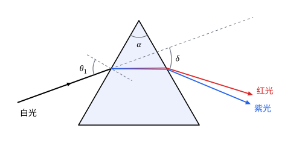

## 这一节要回答的问题

一束白光穿过三棱镜，为什么会散开成红、橙、黄、绿、蓝、紫？棱镜把光偏折多少，和什么有关？光学玻璃的:term[折射率]{id="physics.optics.refractive-index"}（refractive index）是怎样精确测出来的？

## 讲解

### 棱镜的偏向角

三棱镜是两个平面夹着一个角的透明块，这两个面之间的夹角$\alpha$是顶角（apex angle）。光从一个侧面射进去、从另一个侧面射出来，在两个面上各折射一次，每次都偏向棱镜较厚的底边，两次的偏折加在一起。

::anchor{id="def-deviation"}
射出光线的方向和入射光线的方向之间的夹角$\delta$叫作偏向角（angle of deviation）。

为什么这样定义：只看光进去和出来的方向，不管它在棱镜里走了哪条路，$\delta$就是棱镜把光「掰」了多少度。边界情况：顶角$\alpha=0$时两个面平行，就是平行玻璃板，射出的光和入射光平行，$\delta=0$，只有侧移（见[反射定律与折射定律](lesson:physics.optics.reflection-refraction)第 3 题）。

::anchor{id="thm-prism-deviation"}
定理（棱镜的偏向角）：顶角为$\alpha$、:term[折射率]{id="physics.optics.refractive-index"}为$n$的棱镜放在空气里，光在第一个面上的入射角为$\theta_1$、折射角为$\theta_1'$，在第二个面上的入射角为$\theta_2'$、折射角为$\theta_2$，那么$\theta_1'+\theta_2'=\alpha$，$\sin\theta_1=n\sin\theta_1'$，$\sin\theta_2=n\sin\theta_2'$，偏向角$\delta=\theta_1+\theta_2-\alpha$。

证明思路：两个侧面的法线之间的夹角也是$\alpha$，棱镜里那段光线和两条法线围成三角形，所以$\theta_1'+\theta_2'=\alpha$。两个面上分别用:term[折射定律]{id="physics.optics.law-of-refraction"}（law of refraction），空气一侧$n=1$。第一次折射把光转过$\theta_1-\theta_1'$，第二次转过$\theta_2-\theta_2'$，转向相同，相加得$\delta=\theta_1+\theta_2-(\theta_1'+\theta_2')=\theta_1+\theta_2-\alpha$。

::anchor{id="def-thin-prism"}
顶角很小的棱镜叫作:term[薄棱镜]{id="physics.optics.thin-prism"}（thin prism）。光接近垂直地射入时，入射角也很小，正弦可以换成角度本身，$\theta_1\approx n\theta_1'$，$\theta_2\approx n\theta_2'$，于是$\delta\approx(n-1)\alpha$，和入射角无关。

为什么这样定义：顶角小的棱镜，偏向角只由顶角和折射率决定，又正比于$n-1$，比较不同颜色、不同玻璃偏折得多少最方便；透镜的边缘也可以看成一块薄棱镜。边界情况：顶角不小时，偏向角随入射角变化很大，例如例 1 里顶角$60^\circ$的玻璃棱镜，入射角$30^\circ$时偏向角约$52^\circ$，$49^\circ$附近降到最小的$38.65^\circ$，$70^\circ$时又回到约$44^\circ$（下面的动画）。

### 最小偏向角

转动棱镜改变入射角，偏向角先变小、后变大，中间有一个最小值。

::anchor{id="thm-minimum-deviation"}
定理（最小偏向角，minimum deviation）：光对称地穿过棱镜，即$\theta_1=\theta_2$、$\theta_1'=\theta_2'=\frac\alpha2$时，偏向角最小，最小偏向角$\delta_{\min}$满足$n=\frac{\sin\frac{\alpha+\delta_{\min}}2}{\sin\frac\alpha2}$。

证明思路：设偏向角在入射角为$\theta_1$时取最小值，出射角为$\theta_2$。由:term[光路可逆]{id="physics.optics.reversibility"}（principle of reversibility），让光从出射的方向反着射回去，它沿原路走，入射角变成$\theta_2$，偏向角不变。偏向角只有一个最小值（第 5 题用求导验证了这一点），所以$\theta_2=\theta_1$，光对称地穿过，$\theta_1'=\theta_2'=\frac\alpha2$。代入$\delta=\theta_1+\theta_2-\alpha$得$\theta_1=\frac{\alpha+\delta_{\min}}2$，再用$\sin\theta_1=n\sin\frac\alpha2$。

在最小偏向角附近，入射角稍有变化，偏向角几乎不变，射出光线的方向最稳定，读数也最准。所以光谱仪上测棱镜的:term[折射率]{id="physics.optics.refractive-index"}，都是转动棱镜找到偏向角最小的位置，量出$\alpha$和$\delta_{\min}$，再用这个式子算出$n$。1814 年前后，夫琅禾费（Joseph von Fraunhofer）在为望远镜研制玻璃时，就用太阳光谱里的暗线当作固定的波长标记，逐条测出玻璃在光谱各处的折射率。

### 色散

牛顿在 1672 年发表的论文里描述了这样一个实验：让阳光穿过棱镜，在墙上展开成一条彩带；再从彩带里只挑出一种颜色，让它穿过第二块棱镜，它只偏折、不再分出别的颜色。牛顿由此断定，白光是各种颜色的光混在一起的，棱镜对它们的偏折不同，把它们分开了。

::anchor{id="def-dispersion"}
介质的:term[折射率]{id="physics.optics.refractive-index"}随光的波长变化的现象叫作:term[色散]{id="physics.optics.dispersion"}（dispersion）。

为什么这样定义：棱镜分开颜色，靠的就是不同波长的光折射率不同、偏向角不同，这是色散名字的来历。玻璃、水在可见光范围里波长越短折射率越大，紫光偏折得最多、红光最少，这是正常色散（normal dispersion）；折射率为什么随波长变，要用光和物质里电子的相互作用来解释（见[介质的色散](lesson:physics.electromagnetism.dispersion)）。边界情况：真空里各种颜色的光速都是$c$，没有色散；在物质强烈吸收的那几种颜色附近，折射率反而随波长增大而增大。

描述玻璃的色散，常用三条谱线：氢的红线（C 线，$656.3\,\mathrm{nm}$）、氦的黄线（d 线，$587.6\,\mathrm{nm}$）和氢的蓝线（F 线，$486.1\,\mathrm{nm}$）。$n_{\mathrm d}$当作玻璃「的」折射率，$n_{\mathrm F}-n_{\mathrm C}$表示色散的大小。

::anchor{id="def-abbe-number"}
$V=\frac{n_{\mathrm d}-1}{n_{\mathrm F}-n_{\mathrm C}}$叫作玻璃的:term[阿贝数]{id="physics.optics.abbe-number"}（Abbe number）。

为什么这样定义：:term[薄棱镜]{id="physics.optics.thin-prism"}的偏向角$\delta\approx(n-1)\alpha$，红光和蓝光的偏向角之差是$(n_{\mathrm F}-n_{\mathrm C})\alpha$，两者之比正是$\frac1V$。$V$越大，把光偏折同样多时颜色分得越少。边界情况：没有色散的介质$n_{\mathrm F}=n_{\mathrm C}$，$V\to\infty$。

::anchor{id="def-crown-flint"}
阿贝数大、色散小的光学玻璃叫作:term[冕牌玻璃]{id="physics.optics.crown-glass"}（crown glass），阿贝数小、色散大的叫作:term[火石玻璃]{id="physics.optics.flint-glass"}（flint glass）。肖特（SCHOTT）公司的 N-BK7 是常用的冕牌玻璃，$n_{\mathrm d}=1.51680$，$n_{\mathrm F}-n_{\mathrm C}=0.008054$，$V\approx64.2$；火石玻璃 N-F2 的$n_{\mathrm d}\approx1.620$、$V\approx36.4$，色散大得多。

为什么这样定义：要让不同颜色的光会聚到同一点，得把两种色散不同的玻璃组合起来（见[像差](lesson:physics.optics.aberrations)），所以光学玻璃按色散的大小分成这两大类，设计时常从两类里各挑一种。边界情况：两类之间没有物理上的分界，划在哪里是约定：肖特的说法是阿贝数大于约$50$的叫冕牌玻璃，玻璃目录上的分界线在$50$到$55$之间，随折射率略有不同。

## 几何图像

图里白光以中间颜色的最小偏向角射入，红光、紫光在棱镜里就已分开，射出时分得更开。为了看清，:term[色散]{id="physics.optics.dispersion"}画得夸大了：红光按$n=1.50$、紫光按$n=1.56$画，真实的玻璃两者只差约$0.01$。

:::anim{component="function-plot"}
range: { x: [0, 90], y: [0, 70] }
functions:
  - expr: "x + asin(1.52238*sin(a*pi/180 - asin(sin(x*pi/180)/1.52238)))*180/pi - a"
    label: |
      F 线（蓝光），$n=1.52238$
  - expr: "x + asin(1.51432*sin(a*pi/180 - asin(sin(x*pi/180)/1.51432)))*180/pi - a"
    label: |
      C 线（红光），$n=1.51432$
points:
  - x: "asin(1.5168*sin(a*pi/360))*180/pi"
    y: "2*asin(1.5168*sin(a*pi/360))*180/pi - a"
sliders:
  - name: a
    min: 20
    max: 70
    step: 1
    default: 60
    label: |
      顶角$\alpha$（度）
:::

横轴是入射角$\theta_1$，纵轴是偏向角$\delta$，都以度为单位，棱镜是 N-BK7 玻璃。入射角太小时光在第二个面上发生:term[全反射]{id="physics.optics.total-internal-reflection"}（total internal reflection），射不出来，曲线从那里才开始。两条曲线都先降后升，最低点（图上的点画的是 d 线）就是最小偏向角；蓝光的曲线整体比红光高，二者之差就是棱镜把颜色分开的角度。顶角越大，偏向角和两种颜色分开的角度都越大。

## 例题

### 例 1　用最小偏向角

顶角$60^\circ$的 N-BK7 棱镜，对 d 线$n_{\mathrm d}=1.51680$。求 d 线的最小偏向角和这时的入射角。

**为什么想到这么做**：最小偏向角时光对称地穿过棱镜，棱镜里的折射角都是$\frac\alpha2$，由:term[折射定律]{id="physics.optics.law-of-refraction"}求入射角，再由$\delta=\theta_1+\theta_2-\alpha$求偏向角。

**推导**：$\sin\theta_1=n\sin30^\circ=0.7584$，$\theta_1\approx49.32^\circ$；对称时$\theta_2=\theta_1$，$\delta_{\min}=2\times49.32^\circ-60^\circ\approx38.65^\circ$。同样算出 C 线约$38.43^\circ$、F 线约$39.14^\circ$，红光和蓝光相差约$0.71^\circ$，大约是月亮视直径（约$0.5^\circ$）的一倍半。

### 例 2　薄棱镜分开颜色

顶角$6.0^\circ$的 N-BK7 :term[薄棱镜]{id="physics.optics.thin-prism"}，光接近垂直地射入。求 d 线的偏向角，以及 F 线和 C 线的偏向角之差。

**为什么想到这么做**：顶角和入射角都小，用薄棱镜的近似$\delta\approx(n-1)\alpha$；两种颜色的差只来自:term[折射率]{id="physics.optics.refractive-index"}之差。

**推导**：$\delta_{\mathrm d}\approx(1.5168-1)\times6.0^\circ\approx3.10^\circ$。$\delta_{\mathrm F}-\delta_{\mathrm C}\approx(n_{\mathrm F}-n_{\mathrm C})\alpha=0.008054\times6.0^\circ\approx0.048^\circ$，约$2.9'$。两者之比约$\frac1{64}$，正是$\frac1V$：同一种玻璃，把光偏折得越多，颜色也分得越开。

## 常见误区

- 「棱镜把白光染成了彩色。」颜色本来就在白光里，棱镜只是把不同颜色偏折得不一样；单色光再穿过棱镜，不会再分出别的颜色。
- 「紫光的偏向角比红光小。」玻璃对紫光的:term[折射率]{id="physics.optics.refractive-index"}比对红光大，紫光偏折得更多。
- 「偏向角最小时，光在棱镜里走的路最短。」最小偏向角的条件是光对称地穿过棱镜，和棱镜里的路程长短无关。
- 「折射率大的玻璃，:term[色散]{id="physics.optics.dispersion"}一定也大。」两者要分开描述：$n_{\mathrm d}$说明偏折得多不多，$n_{\mathrm F}-n_{\mathrm C}$或:term[阿贝数]{id="physics.optics.abbe-number"}说明颜色分得开不开。
