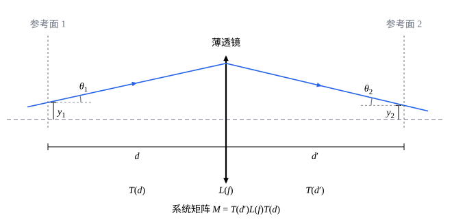

## 这一节要回答的问题

照相机的镜头往往由好几块隔开的透镜组成。逐个成像（见[透镜组与光学仪器](lesson:physics.optics.optical-instruments#thm-sequential)）能求出像，但透镜一多就很繁琐，也看不出整个镜头的:term[焦距]{id="physics.optics.focal-length"}（focal length）是多少。能不能把每块透镜、每段空隙各用一个简单的量表示，组合起来，一下子得到整个系统的性质？

## 讲解

### 光线的高度和角度

::anchor{id="def-ray-vector"}
在:term[近轴近似]{id="physics.optics.paraxial-approximation"}（paraxial approximation）下，取一个垂直于:term[光轴]{id="physics.optics.optical-axis"}（optical axis）的平面作为参考面（reference plane），光线经过参考面时用两个数描述：它离光轴的高度$y$（在光轴上方为正）和它与光轴的夹角$\theta$（向右上方射时为正，以弧度为单位）。把这两个数排成一列，记作$\vb v=\begin{pmatrix}y\\\theta\end{pmatrix}$。

为什么这样定义：在一个参考面上，:term[近轴光线]{id="physics.optics.paraxial-ray"}（paraxial ray）的位置和方向各用一个数就够了。下面会看到，光自由传播或者穿过透镜以后，新的高度和角度都是原来的高度和角度的线性组合（linear combination），正好写成矩阵乘列向量。边界情况：角度要小，$\tan\theta\approx\theta$，这正是近轴近似；离光轴远、角度大的光线，这种办法算不出它们的:term[像差]{id="physics.optics.aberration"}（aberration）。

### 自由传播和薄透镜

::anchor{id="thm-basic-matrices"}
定理（两种基本矩阵）：在:term[近轴近似]{id="physics.optics.paraxial-approximation"}下，（1）光在均匀介质里沿:term[光轴]{id="physics.optics.optical-axis"}方向前进距离$d$，$\begin{pmatrix}y_2\\\theta_2\end{pmatrix}=\begin{pmatrix}1&d\\0&1\end{pmatrix}\begin{pmatrix}y_1\\\theta_1\end{pmatrix}$；（2）光穿过:term[焦距]{id="physics.optics.focal-length"}为$f$的:term[薄透镜]{id="physics.optics.thin-lens"}（thin lens），从紧挨着透镜前的参考面到紧挨着透镜后的参考面，$\begin{pmatrix}y_2\\\theta_2\end{pmatrix}=\begin{pmatrix}1&0\\-\frac1f&1\end{pmatrix}\begin{pmatrix}y_1\\\theta_1\end{pmatrix}$。

证明思路：（1）光线是直线，方向不变，$\theta_2=\theta_1$；前进$d$，高度增加$d\tan\theta_1\approx d\theta_1$。（2）透镜很薄，光线穿过时高度不变，$y_2=y_1$。设入射光线（或它的延长线）和光轴交于透镜前$s$处，则$\theta_1=\frac{y_1}{s}$；由[薄透镜成像公式](lesson:physics.optics.thin-lenses#thm-thin-lens)，出射光线（或它的延长线）和光轴交于透镜后$s'$处，$\theta_2=-\frac{y_1}{s'}=-y_1\Bigl(\frac1f-\frac1s\Bigr)=\theta_1-\frac{y_1}f$。

::anchor{id="def-ray-transfer-matrix"}
像这样把一个参考面上的$\begin{pmatrix}y_1\\\theta_1\end{pmatrix}$变成另一个参考面上的$\begin{pmatrix}y_2\\\theta_2\end{pmatrix}$的$2\times2$矩阵，叫作:term[光线传输矩阵]{id="physics.optics.ray-transfer-matrix"}（ray transfer matrix）；它的四个元素常记作$\begin{pmatrix}A&B\\C&D\end{pmatrix}$，所以也叫 ABCD 矩阵。自由传播的矩阵记作$T(d)$，薄透镜的记作$L(f)$。

为什么这样定义：自由传播只改变高度，薄透镜只改变角度，各是最简单的一种矩阵；由透镜和空隙组成的系统，都能由这两种矩阵乘出来（下面的定理）。在$(y,\theta)$平面上看，$T(d)$把每一点水平推移$d\theta$，$L(f)$把每一点竖直推移$-\frac yf$，两者都是剪切（shear）。

### 系统矩阵

::anchor{id="thm-system-matrix"}
定理（系统矩阵，system matrix）：光依次经过几段，各段的:term[光线传输矩阵]{id="physics.optics.ray-transfer-matrix"}依次为$M_1,M_2,\dots,M_k$，那么从第一个参考面到最后一个参考面，整个系统的光线传输矩阵是$M=M_k\cdots M_2M_1$，先经过的写在右边。

证明思路：前一段的出射光线就是后一段的入射光线：$\vb v_2=M_1\vb v_1$，$\vb v_3=M_2\vb v_2=M_2(M_1\vb v_1)$。由矩阵乘法（matrix multiplication）的定义，$M_2(M_1\vb v_1)=(M_2M_1)\vb v_1$（见[矩阵与矩阵乘法](lesson:math.linear-algebra.matrices#def-matrix-product)），依此类推。

矩阵乘法一般不能交换次序，光经过元件的先后也不能颠倒：先穿过透镜再走一段，和先走一段再穿过透镜，结果不同。两块:term[薄透镜]{id="physics.optics.thin-lens"}相距$d$时，系统矩阵是$L(f_2)T(d)L(f_1)$（例 1）。

### 从矩阵读出焦距和像

::anchor{id="thm-read-matrix"}
定理（从矩阵读出:term[焦距]{id="physics.optics.focal-length"}和像）：两个参考面都在空气里，系统的:term[光线传输矩阵]{id="physics.optics.ray-transfer-matrix"}为$\begin{pmatrix}A&B\\C&D\end{pmatrix}$。（1）平行于:term[光轴]{id="physics.optics.optical-axis"}射入的光线，射出时的角度和入射高度成正比，系统对平行光的作用和一块焦距为$f=-\frac1C$的:term[薄透镜]{id="physics.optics.thin-lens"}相同；这个$f$叫作系统的:term[等效焦距]{id="physics.optics.effective-focal-length"}（effective focal length）。（2）平行光射出后会聚的点，即:term[像方焦点]{id="physics.optics.focal-point"}（image-side focal point），在参考面 2 后$-\frac AC$处。（3）$B=0$时，参考面 1 上一点发出的光都会聚到参考面 2 上的同一点，参考面 2 上成参考面 1 的像，:term[横向放大率]{id="physics.optics.lateral-magnification"}（lateral magnification）是$A$。

证明思路：（1）、（2）入射光线$\begin{pmatrix}y_1\\0\end{pmatrix}$射出时是$\begin{pmatrix}Ay_1\\Cy_1\end{pmatrix}$，角度$Cy_1$和$y_1$成正比；薄透镜把高度为$y_1$的平行光线偏折成$-\frac{y_1}f$，比较得$f=-\frac1C$。这条光线从高度$Ay_1$出发，斜率为$Cy_1$，再走$-\frac AC$到达光轴，这个距离和$y_1$无关，所有平行光线都交于这一点。（3）从参考面 1 上高度为$y_1$的一点发出、角度不同的光线，到达参考面 2 时高度$y_2=Ay_1+B\theta_1$；$B=0$时它和$\theta_1$无关，这些光线会聚到同一点，像高$y_2=Ay_1$。

$C=0$时等效焦距为无穷大，平行光射出后仍是平行光，望远镜就是这样（例 1）。在两个参考面外各加一段自由传播，$A$、$B$、$D$会变，$C$不变，所以等效焦距是系统本身的性质，和参考面选在哪里无关。

### 球面折射和行列式

::anchor{id="thm-refraction-matrix"}
定理（球面折射）：光从:term[折射率]{id="physics.optics.refractive-index"}（refractive index）为$n_1$的介质，经过半径为$R$的球面进入折射率为$n_2$的介质，从紧挨着球面前的参考面到紧挨着球面后的参考面，:term[光线传输矩阵]{id="physics.optics.ray-transfer-matrix"}是$\begin{pmatrix}1&0\\\frac{n_1-n_2}{n_2R}&\frac{n_1}{n_2}\end{pmatrix}$；界面是平面时，令$R\to\infty$，得$\begin{pmatrix}1&0\\0&\frac{n_1}{n_2}\end{pmatrix}$。

证明思路：高度不变。按:term[符号规则]{id="physics.optics.sign-convention"}（sign convention），球心在出射一侧时$R>0$，高度为$y$处的法线从这一点斜向下指向球心，和:term[光轴]{id="physics.optics.optical-axis"}的夹角是$-\frac yR$；光线和法线的夹角，入射时是$\theta_1+\frac yR$，折射后是$\theta_2+\frac yR$。近轴时:term[折射定律]{id="physics.optics.law-of-refraction"}（law of refraction）成为$n_1\Bigl(\theta_1+\frac yR\Bigr)=n_2\Bigl(\theta_2+\frac yR\Bigr)$，解出$\theta_2=\frac{n_1-n_2}{n_2R}y+\frac{n_1}{n_2}\theta_1$。

::anchor{id="thm-determinant"}
定理（行列式，determinant）：起点处的折射率为$n$、终点处的折射率为$n'$时，:term[光线传输矩阵]{id="physics.optics.ray-transfer-matrix"}的行列式等于$\frac{n}{n'}$；起点和终点在同一种介质里时，行列式等于$1$。

证明思路：$T(d)$、$L(f)$的行列式都是$1$，球面折射的是$\frac{n_1}{n_2}$。乘积的行列式等于各个行列式之积（见[行列式的计算与性质](lesson:math.linear-algebra.determinant-properties#thm-det-product)，二阶矩阵也可以直接乘出来验证），经过各个界面的比值连乘，中间的折射率都约掉，剩下$\frac{n}{n'}$。

空气里的系统，$AD-BC$必须等于$1$，这是检查乘法有没有算错的好办法。

## 几何图像

图里的光线从参考面 1 出发，先自由传播$d$，再被:term[薄透镜]{id="physics.optics.thin-lens"}偏折，又自由传播$d'$到达参考面 2。三段依次对应$T(d)$、$L(f)$、$T(d')$；光线的列向量先被$T(d)$作用，所以系统矩阵是$M=T(d')L(f)T(d)$，式子里的次序和光走的次序相反。图里$\theta_1>0$，光线穿过透镜后向右下射，$\theta_2<0$。

:::anim{component="linear-map-2d"}
steps:
  - matrix: [[1, a], [0, 1]]
    label: |
      先自由传播$d=af$
  - matrix: [[1, 0], [-1, 1]]
    label: |
      再穿过焦距为$f$的薄透镜
range: { x: [-2.5, 2.5], y: [-1.5, 1.5] }
show: [grid, det]
vectors:
  - x: 0
    y: 1
    label: |
      从轴上一点射出的光线
  - x: 0
    y: 0.5
  - x: 0
    y: -0.5
sliders:
  - name: a
    min: 0
    max: 2
    step: 0.25
    default: 1
    label: |
      光源到透镜的距离（以焦距为单位）
:::

横轴是光线的高度（以:term[焦距]{id="physics.optics.focal-length"}为单位），纵轴是光线和:term[光轴]{id="physics.optics.optical-axis"}的夹角，角度画得夸大了；矩阵是线性的，等比例放大不影响结论。三个箭头是从光轴上同一点射出、角度不同的三条光线，开始时高度都是零，都在纵轴上。

第一步自由传播把每一点水平推移，角度越大推得越远；第二步薄透镜把每一点竖直推移，离光轴越远推得越多。两步都是剪切，网格变斜了，角上显示的行列式始终是$1$，面积不变。滑块为$1$时，光源在:term[焦点]{id="physics.optics.focal-point"}上，三个箭头最后都落在横轴上，角度都是零，射出的是平行光。滑块为$2$时，它们落在一条斜率为$-\frac12$的直线上，三条光线再走$2f$都到达光轴：物在两倍焦距处，像也在两倍焦距处。

## 例题

### 例 1　两块分开的薄透镜

:term[焦距]{id="physics.optics.focal-length"}为$f_1$、$f_2$的两块:term[薄透镜]{id="physics.optics.thin-lens"}相距$d$。（1）求系统矩阵和:term[等效焦距]{id="physics.optics.effective-focal-length"}。（2）$f_1=f_2=20\,\mathrm{cm}$、$d=10\,\mathrm{cm}$时，等效焦距是多少？:term[像方焦点]{id="physics.optics.focal-point"}在第二块透镜后多远？

**为什么想到这么做**：光先穿过第一块透镜，再走$d$，最后穿过第二块透镜，系统矩阵按相反的次序相乘；等效焦距读$C$，:term[焦点]{id="physics.optics.focal-point"}的位置读$-\frac AC$。

**推导**：（1）$T(d)L(f_1)=\begin{pmatrix}1-\frac d{f_1}&d\\-\frac1{f_1}&1\end{pmatrix}$，再左乘$L(f_2)$，$M=\begin{pmatrix}1-\frac d{f_1}&d\\-\frac1{f_1}-\frac1{f_2}+\frac d{f_1f_2}&1-\frac d{f_2}\end{pmatrix}$。所以$\frac1f=-C=\frac1{f_1}+\frac1{f_2}-\frac d{f_1f_2}$；验算行列式，$\Bigl(1-\frac d{f_1}\Bigr)\Bigl(1-\frac d{f_2}\Bigr)-dC=1$。$d=0$时回到:term[光焦度]{id="physics.optics.optical-power"}（optical power）相加；$d=f_1+f_2$时$C=0$，平行光射出后仍是平行光，这就是[望远镜](lesson:physics.optics.optical-instruments#thm-telescope)。

（2）$\frac1f=\frac1{20}+\frac1{20}-\frac{10}{400}=0.075\,\mathrm{cm^{-1}}$，$f\approx13.3\,\mathrm{cm}$；$A=1-\frac{10}{20}=0.5$，像方焦点在第二块透镜后$-\frac AC=\frac{0.5}{0.075}\,\mathrm{cm}\approx6.67\,\mathrm{cm}$处。用逐个成像验算：第一块把平行光会聚在它后面$20\,\mathrm{cm}$处，对第二块是:term[虚物]{id="physics.optics.virtual-object"}（virtual object），$s_2=10-20=-10\,\mathrm{cm}$，$\frac1{s_2'}=\frac1{20}+\frac1{10}$，$s_2'\approx6.67\,\mathrm{cm}$，一致。

### 例 2　厚的平凸透镜

一块平凸透镜用:term[折射率]{id="physics.optics.refractive-index"}$1.50$的玻璃做成，凸面的半径是$5.0\,\mathrm{cm}$，中心厚$2.0\,\mathrm{cm}$，凸面朝着射来的光。求:term[等效焦距]{id="physics.optics.effective-focal-length"}和:term[像方焦点]{id="physics.optics.focal-point"}到平面的距离，并和当作:term[薄透镜]{id="physics.optics.thin-lens"}算的结果比较。

**为什么想到这么做**：光依次经过凸面的折射、玻璃里$2.0\,\mathrm{cm}$的自由传播、平面的折射，三个矩阵按相反的次序相乘。玻璃里的角度是在玻璃里量的，自由传播的矩阵照样是$T(d)$。

**推导**：长度以$\mathrm{cm}$为单位。凸面$R=5.0$，$n_1=1$，$n_2=1.50$，矩阵是$\begin{pmatrix}1&0\\-\frac1{15}&\frac23\end{pmatrix}$；在玻璃里走$2.0$，是$\begin{pmatrix}1&2\\0&1\end{pmatrix}$；平面从玻璃到空气，是$\begin{pmatrix}1&0\\0&1.5\end{pmatrix}$。相乘，$M=\begin{pmatrix}1&0\\0&1.5\end{pmatrix}\begin{pmatrix}1&2\\0&1\end{pmatrix}\begin{pmatrix}1&0\\-\frac1{15}&\frac23\end{pmatrix}=\begin{pmatrix}\frac{13}{15}&\frac43\\-\frac1{10}&1\end{pmatrix}$，行列式$\frac{13}{15}+\frac2{15}=1$。

等效焦距$f=-\frac1C=10\,\mathrm{cm}$，像方焦点在平面后$-\frac AC=\frac{13}{15}\times10\,\mathrm{cm}\approx8.67\,\mathrm{cm}$处。当作薄透镜，由[磨镜者公式](lesson:physics.optics.thin-lenses#thm-lensmaker)，$\frac1f=(1.50-1)\times\frac1{5.0}\,\mathrm{cm^{-1}}$，:term[焦距]{id="physics.optics.focal-length"}也是$10\,\mathrm{cm}$：厚度不改变这块透镜的等效焦距（第 5 题），但:term[焦点]{id="physics.optics.focal-point"}到平面的距离比焦距短$1.33\,\mathrm{cm}$，正好是$\frac{2.0\,\mathrm{cm}}{1.50}$。要知道焦点在哪里，厚度不能忽略。

## 常见误区

- 「系统矩阵按光经过的先后，从左往右乘。」先经过的元件先作用在列向量上，要写在最右边；矩阵乘法一般不能交换次序，次序弄反，结果一般不同。
- 「换了参考面，:term[等效焦距]{id="physics.optics.effective-focal-length"}也跟着变。」在两头各加一段自由传播，$T(a)MT(b)$的左下角仍是$C$；$-\frac AC$量出的:term[焦点]{id="physics.optics.focal-point"}位置随参考面移动，指的仍是同一个点。
- 「行列式不等于$1$，一定是算错了。」起点和终点在不同的介质里时，行列式是两处的:term[折射率]{id="physics.optics.refractive-index"}之比，例如从空气进入玻璃，是$\frac1{1.5}$。
- 「:term[光线传输矩阵]{id="physics.optics.ray-transfer-matrix"}只能处理:term[薄透镜]{id="physics.optics.thin-lens"}。」球面、平面、玻璃里的传播都有矩阵（例 2），厚透镜、多块透镜都能乘出来；它处理不了的是:term[近轴近似]{id="physics.optics.paraxial-approximation"}以外的光线，比如:term[球差]{id="physics.optics.spherical-aberration"}（spherical aberration）。
