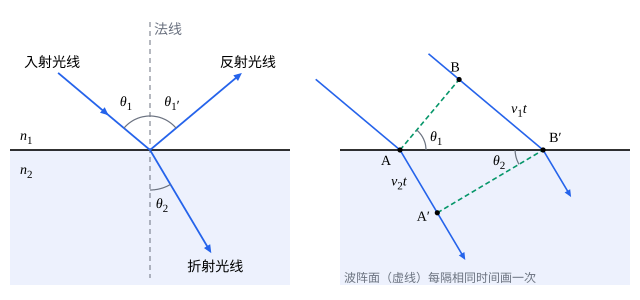

## 这一节要回答的问题

插在水里的筷子，为什么看上去在水面处折了一下？站在泳池边往下看，池底为什么显得比实际浅？镜子里的像在哪里？光从一种透明物质射进另一种，方向改变多少由什么决定？

## 讲解

### 光线

阳光从窗缝射进暗屋，在空气里的灰尘上照出一条笔直的光束；影子的边缘和小孔成像也说明，光在均匀的透明物质里走直线。

::anchor{id="def-ray"}
在均匀的透明物质里光沿直线传播，表示光的传播方向的带箭头的直线叫作光线（light ray）。

为什么这样定义：可见光的波长只有约$0.4$到$0.7\,\mu\mathrm m$，镜子、透镜、:term[光阑]{id="physics.optics.aperture-stop"}（aperture stop）这些东西比波长大得多，光的波动性显不出来，只问光往哪里走就够了，几何光学的各节都这样处理。边界情况：小孔、狭缝小到和波长相当时，光会绕进几何阴影里，光线的说法不再适用（见[单缝衍射](lesson:physics.optics.single-slit-diffraction)）。

### 反射定律

光射到平静的水面、玻璃上，一部分回到原来的介质（medium）里，这是反射；一部分进入另一种介质，方向发生偏折，这是折射。描述它们要先定好从哪里量角度。

::anchor{id="def-incidence"}
光线射到两种介质的界面上，过入射点垂直于界面的直线叫作法线（normal），入射光线和法线确定的平面叫作入射面（plane of incidence）；入射光线、反射光线、折射光线和法线的夹角，分别叫作入射角（angle of incidence）、反射角（angle of reflection）和折射角（angle of refraction）。

为什么这样定义：界面可以是弯的，例如透镜的球面，从入射点的法线量角，在每一点都有同样的基准。边界情况：光垂直射到界面上时三个角都是零；入射角接近$90^\circ$时，光几乎贴着界面射来（掠射，grazing incidence）。

::anchor{id="thm-reflection"}
定理（:term[反射定律]{id="physics.optics.law-of-reflection"}，law of reflection）：反射光线在入射面内，和入射光线分居法线两侧，反射角等于入射角，$\theta_1'=\theta_1$。

证明思路：这是实验总结出的定律。把光看成波，用和下面右图一样的:term[波阵面]{id="physics.optics.wavefront"}（wavefront）作图，只是反射光和入射光在同一种介质里、速度相同，两个直角三角形全等，就得到反射角等于入射角（第 5 题）。

平面镜前一点$S$发出的光，经镜面反射后，每条反射光线反向延长都经过镜后和$S$对称的一点$S'$（第 5 题）。眼睛收到这些反射光，就觉得光是从$S'$发出的，「镜子里的像」就在那里；镜子后面其实没有光，这样的像是:term[虚像]{id="physics.optics.virtual-image"}（virtual image，见[球面折射与近轴近似](lesson:physics.optics.paraxial-refraction)）。所以像和物体关于镜面对称：大小相同，离镜面一样远；你举起右手，镜中的像举起的看上去是左手。

### 折射定律

光从空气斜射进水里，在水面处偏向法线；从水里斜射出来，又偏离法线。偏多少，要看光在两种介质里跑得多快。

::anchor{id="def-refractive-index"}
真空中的光速$c$和光在介质里的速度$v$之比$n=\frac cv$叫作这种介质的:term[折射率]{id="physics.optics.refractive-index"}（refractive index）。

为什么这样定义：光在透明物质里比在真空里慢，$n>1$；下面会看到，光在界面上偏折多少只由两边的$n$决定。1850 年，傅科（Léon Foucault）用旋转镜比较光在水里和空气里的速度，证实光在水里更慢，和用波动解释折射得到的预言一致。边界情况：真空的$n=1$；空气约为$1.0003$，一般当作$1$；水对黄光约为$1.33$，普通玻璃约为$1.5$，钻石约为$2.42$。

光从一种介质进入另一种，频率不变，速度变成$\frac cn$，波长也变成真空中的$\frac1n$。例如真空中波长$589\,\mathrm{nm}$的黄光，在水里的波长只有约$443\,\mathrm{nm}$。

::anchor{id="thm-snell"}
定理（:term[折射定律]{id="physics.optics.law-of-refraction"}，law of refraction）：折射光线在入射面内，和入射光线分居法线两侧，入射角$\theta_1$和折射角$\theta_2$满足$n_1\sin\theta_1=n_2\sin\theta_2$，$n_1$、$n_2$分别是入射一侧和折射一侧介质的折射率；这个关系也叫斯涅耳定律（Snell's law）。

证明思路：把光看成波。平行光同一时刻振动步调相同的点连成的面是:term[波阵面]{id="physics.optics.wavefront"}；波阵面$AB$斜着射到界面上（下面的图），$B$点的光再走$v_1t$到达界面上的$B'$时，$A$点的光在介质 2 里走了$v_2t$到$A'$，新的波阵面是$A'B'$。直角三角形$ABB'$和$AA'B'$共用斜边$AB'$，$v_1t=AB'\sin\theta_1$，$v_2t=AB'\sin\theta_2$，两式相除得$\frac{\sin\theta_1}{\sin\theta_2}=\frac{v_1}{v_2}=\frac{n_2}{n_1}$。

由折射定律，光从折射率小的介质射进折射率大的介质时，$\sin\theta_2<\sin\theta_1$，折射光线偏向法线；反过来就偏离法线。光从水、玻璃射向空气，入射角大到$\sin\theta_1>\frac{n_2}{n_1}$时，折射定律给不出折射角，光全部反射回来（见[全反射与光纤](lesson:physics.optics.total-internal-reflection)）。

折射定律的发现几经周折。约 984 年，伊本·萨赫勒（Ibn Sahl）在《论点火镜和透镜》里就用它设计透镜；1602 年前后英国的哈里奥特（Thomas Harriot）、1621 年荷兰的斯涅耳（Willebrord Snellius）又各自找到它，都没有发表；1637 年笛卡儿（René Descartes）在《屈光学》里第一次把它公开发表。英语里用的名字是斯涅耳定律，法国常用斯涅耳-笛卡儿定律这个名字。

实际上，光射到界面上时反射和折射同时发生。光垂直射到玻璃上，约有$4\%$反射回来，夜里窗玻璃上能看到屋里的影子就是这个缘故；反射和折射各占多少，电磁学里由菲涅耳公式给出（见[界面上的反射与折射：菲涅耳公式](lesson:physics.electromagnetism.fresnel-equations)）。

### 光路可逆

::anchor{id="thm-reversibility"}
定理（:term[光路可逆]{id="physics.optics.reversibility"}，principle of reversibility）：光沿某条路径从$A$传到$B$，那么从$B$沿这条路径反向射出的光，也会沿同一条路径传到$A$。

证明思路：:term[反射定律]{id="physics.optics.law-of-reflection"}里入射角和反射角相等，交换两者不变；:term[折射定律]{id="physics.optics.law-of-refraction"}$n_1\sin\theta_1=n_2\sin\theta_2$交换两边，形式也不变；在均匀介质里走的直线反过来还是直线。每一段反过来都成立，整条路径也就成立。

从水里往外看和从岸上往水里看，光走的是同一条路，只是方向相反（第 7 题）；透镜成像时把物和像交换位置，光路照样成立（见[薄透镜](lesson:physics.optics.thin-lenses)）。

## 几何图像

左图里下面的介质:term[折射率]{id="physics.optics.refractive-index"}较大（$n_2=1.5n_1$），入射角是$50^\circ$，反射角也是$50^\circ$，折射角约$30.7^\circ$。右图画的是同一束光的两条光线和两个时刻的:term[波阵面]{id="physics.optics.wavefront"}（虚线）：$BB'$和$AA'$是同一段时间里光在两种介质里走过的路程，后者短，波阵面就转向法线。

:::anim{component="function-plot"}
range: { x: [0, 90], y: [0, 90] }
functions:
  - expr: "asin(sin(x*pi/180)/r)*180/pi"
    label: |
      折射角$\theta_2$
  - expr: "x"
    label: |
      反射角，等于入射角
points:
  - x: "asin(r)*180/pi"
    y: "90"
sliders:
  - name: r
    min: 0.4
    max: 2.5
    step: 0.01
    default: 1.33
    label: |
      折射率之比$\frac{n_2}{n_1}$
:::

横轴是入射角，纵轴是折射角和反射角，都以度为单位。$\frac{n_2}{n_1}>1$时（例如从空气射进水里，约$1.33$）折射角总比入射角小，入射角到$90^\circ$时，折射角也只到$\arcsin\frac{n_1}{n_2}$。$\frac{n_2}{n_1}<1$时折射角比入射角大，入射角到某个值时折射角已经是$90^\circ$（图上的点），曲线在那里断开，入射角再大就没有折射光。入射角小时曲线近似是直线$\theta_2\approx\frac{n_1}{n_2}\theta_1$。

## 例题

### 例 1　从空气射进水里

一束光从空气以$45^\circ$的入射角射到平静的水面上，水的:term[折射率]{id="physics.optics.refractive-index"}取$1.33$，空气的取$1$。求反射角、折射角，以及反射光线和折射光线之间的夹角。

**为什么想到这么做**：反射角由:term[反射定律]{id="physics.optics.law-of-reflection"}直接得出；折射角用:term[折射定律]{id="physics.optics.law-of-refraction"}，空气一侧$n_1=1$。

**推导**：反射角$\theta_1'=45^\circ$。$\sin\theta_2=\frac{\sin45^\circ}{1.33}\approx\frac{0.7071}{1.33}\approx0.5317$，$\theta_2\approx32.1^\circ$。反射光线在水面上方，和水面成$45^\circ$；折射光线在水面下方，和水面成$90^\circ-32.1^\circ=57.9^\circ$；两者在法线的同一侧，夹角是$45^\circ+57.9^\circ\approx102.9^\circ$。

### 例 2　池底有多深

泳池深$2.0\,\mathrm m$，池水的:term[折射率]{id="physics.optics.refractive-index"}取$1.33$。站在池边几乎竖直往下看，池底看上去有多深？

**为什么想到这么做**：眼睛把射进眼睛的光线反向延长，交点就是看到的位置。光线接近竖直，角度都很小，可以用$\tan\theta\approx\sin\theta$。

**推导**：池底一点$P$发出的光，以很小的角$\theta_2$射到水面，折射后以$\theta_1$进入空气，$1.33\sin\theta_2=\sin\theta_1$。设这条光线射出水面的点离$P$的正上方$x$，真实深度是$h$，看到的深度是$h'$，那么$x=h\tan\theta_2=h'\tan\theta_1$。所以$h'=h\frac{\tan\theta_2}{\tan\theta_1}\approx h\frac{\sin\theta_2}{\sin\theta_1}=\frac{h}{1.33}\approx1.5\,\mathrm m$。斜着看时角度不小，这个近似不再成立，池底显得更浅。

## 常见误区

- 「光从空气射进水里，速度变慢，频率也变低。」频率由光源决定，在界面上不变；变的是速度和波长。
- 「折射角总比入射角小。」只有光射进:term[折射率]{id="physics.optics.refractive-index"}较大的介质时才这样；从水射向空气，折射角比入射角大。
- 「平面镜里的像在镜面上。」像在镜后，离镜面和物体离镜面一样远：人站在镜前$1\,\mathrm m$，像离人$2\,\mathrm m$。
- 「光射到透明的玻璃上就全透过去了。」界面上总有一部分光反射，垂直射到玻璃上约有$4\%$反射回来。
