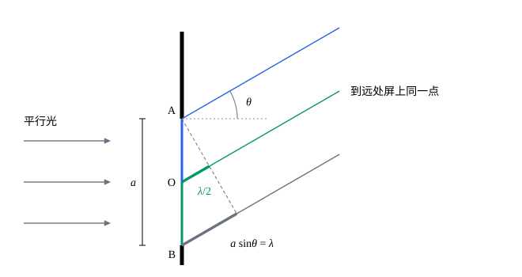

## 这一节要回答的问题

让一束激光穿过一条宽度可调的窄缝，照到几米外的墙上。缝有几毫米宽时，墙上是一条和缝差不多宽的亮带；把缝收窄到零点几毫米，亮带反而变宽，两侧还出现一排暗纹和较暗的亮纹。光为什么会进入几何阴影？暗纹在哪里，光强怎样分布？

## 讲解

### 衍射

::anchor{id="def-diffraction"}
光遇到障碍物，或穿过小孔、窄缝时，偏离直线传播、进入几何阴影的现象，叫作:term[衍射]{id="physics.optics.diffraction"}（diffraction）。

为什么这样定义：几何光学说光沿直线走，影子的边缘清清楚楚；衍射说的正是光对这条规律的偏离，所以拿几何阴影作比较。边界情况：缝比波长宽得多时，光偏离的角度只有$\frac\lambda a$的量级，平时觉察不到，用光线描述就够了（见[反射定律与折射定律](lesson:physics.optics.reflection-refraction)）；缝窄到和波长相当时，光向前方各个方向散开。

要算衍射图样，只用[惠更斯原理](lesson:physics.optics.huygens-principle)的包络（envelope）作图不够：它只告诉我们新的:term[波阵面]{id="physics.optics.wavefront"}（wavefront）在哪里，说不出各处的光有多强。

::anchor{id="def-huygens-fresnel"}
波阵面上每一点都发出:term[次波]{id="physics.optics.secondary-wavelet"}（secondary wavelet），空间某点的光振动等于所有次波传到那里的振动之和，各次波按到达时的相位叠加，这叫作:term[惠更斯-菲涅耳原理]{id="physics.optics.huygens-fresnel-principle"}（Huygens–Fresnel principle）。

为什么这样定义：把次波看成相干的波，叠加时有的地方加强、有的地方抵消，算出来的正是各处的光强，衍射图样由此而来。1818 年，菲涅耳（Augustin-Jean Fresnel）把惠更斯的次波和杨的:term[干涉]{id="physics.optics.interference"}（interference）结合起来，算出的衍射条纹和实验相符，次年获得法国科学院的奖。边界情况：严格计算时，次波的强弱还随方向变化，向前最强、向后为零；本节只看偏离原方向不大的光，这一点可以不计，各次波看成一样强。

衍射和干涉都是相干波的叠加，并没有本质的区别：干涉一般说的是有限几束光的叠加，衍射说的是波阵面上连续分布的无数次波的叠加。

### 夫琅禾费衍射

::anchor{id="def-fraunhofer"}
照到障碍物上的是平行光，并且在离障碍物足够远处观察，到达观察点的各条光线可以看成互相平行，这样的:term[衍射]{id="physics.optics.diffraction"}叫作:term[夫琅禾费衍射]{id="physics.optics.fraunhofer-diffraction"}（Fraunhofer diffraction）。对宽为$a$的缝，足够远是指观察屏离缝的距离$L\gg\frac{a^2}\lambda$。

为什么这样定义：各条光线平行时，从缝上各点到观察点的:term[光程差]{id="physics.optics.optical-path-difference"}（optical path difference）只和该点在缝上的位置成正比，计算最简单，下面的结果都由此得出。条件$L\gg\frac{a^2}\lambda$的来历：从缝中央和缝边缘到屏中央的距离相差约$\frac{a^2}{8L}$，它要比波长小得多，才能把这些光线当作平行。边界情况：$a=0.1\,\mathrm{mm}$、$\lambda=600\,\mathrm{nm}$时$\frac{a^2}\lambda\approx1.7\,\mathrm{cm}$，屏放在$1\,\mathrm m$外就满足；离得不够远时，光程差不再和位置成正比，要用别的办法算（见[菲涅耳衍射与波带片](lesson:physics.optics.fresnel-diffraction)）。实验上也常用透镜把平行光会聚到:term[焦点]{id="physics.optics.focal-point"}（focal point）所在的平面上，相当于把无限远搬到近处（见[薄透镜](lesson:physics.optics.thin-lenses)）。

这类衍射以夫琅禾费（Joseph von Fraunhofer）命名，他在 1821 年前后系统地研究了平行光通过窄缝和:term[光栅]{id="physics.optics.diffraction-grating"}（diffraction grating）的衍射。下面都讨论夫琅禾费衍射，光垂直照到缝上，角度从原来的传播方向量起。

### 暗纹的位置

::anchor{id="thm-single-slit-dark"}
定理（:term[单缝衍射]{id="physics.optics.diffraction"}的暗纹）：宽为$a$的单缝被波长为$\lambda$的平行光垂直照射，在:term[夫琅禾费衍射]{id="physics.optics.fraunhofer-diffraction"}中，偏离原方向$\theta$处满足$a\sin\theta=m\lambda$（$m=\pm1,\pm2,\dots$）时是暗纹。

证明思路：设$a\sin\theta=\lambda$。把缝分成上下两半，上半部分的每一点，和下半部分里向下相距$\frac a2$的点配对，两点到远处同一点的:term[光程差]{id="physics.optics.optical-path-difference"}是$\frac a2\sin\theta=\frac\lambda2$，相位差为$\pi$，:term[次波]{id="physics.optics.secondary-wavelet"}两两抵消，整条缝的光在这个方向上完全抵消（见下面的图）。$a\sin\theta=m\lambda$时，把缝等分成$2|m|$份，相邻的两份同样两两抵消。$m=0$的方向上各次波同相，最亮，是中央亮纹的中心。

中央亮纹夹在$m=\pm1$两条暗纹之间，从中心到第一条暗纹张的角$\theta_1$满足$\sin\theta_1=\frac\lambda a$；角度小时$\theta_1\approx\frac\lambda a$，屏离缝$L$时，中央亮纹宽$\frac{2L\lambda}a$。两侧的亮纹各夹在相邻两条暗纹之间，宽约$\frac{L\lambda}a$，只有中央亮纹的一半。缝越窄，中央亮纹越宽：光被限制在越窄的缝里，出缝后散得越开。

缝宽$a\le\lambda$时，$\frac\lambda a\ge1$，前方没有暗纹，光向前方各个方向散开；$a\gg\lambda$时$\theta_1$很小，光几乎沿原方向前进，回到几何光学。

### 光强分布

::anchor{id="thm-single-slit-intensity"}
定理（:term[单缝衍射]{id="physics.optics.diffraction"}的光强）：条件同上，偏离原方向$\theta$处的光强$I=I_0\Bigl(\frac{\sin\beta}\beta\Bigr)^2$，$\beta=\frac{\pi a\sin\theta}\lambda$，$I_0$是中央亮纹中心的光强。

证明思路：以缝的中点为原点，向上量坐标$x$，把$x$到$x+\dd x$的一小段看作一个:term[次波]{id="physics.optics.secondary-wavelet"}源，振幅正比于$\dd x$。它发出的次波到远处$\theta$方向，:term[光程]{id="physics.optics.optical-path-length"}（optical path length）比从中点出发的少$x\sin\theta$，振动可以写成$\cos(\omega t+kx\sin\theta)\dd x$，$k=\frac{2\pi}\lambda$。各段叠加：$\int_{-a/2}^{a/2}\cos(\omega t+kx\sin\theta)\dd x$等于$\frac{2\sin\frac{ka\sin\theta}2}{k\sin\theta}\cos\omega t$，也就是$a\frac{\sin\beta}\beta\cos\omega t$。光强正比于振幅的平方，$\theta\to0$时$\frac{\sin\beta}\beta\to1$，所以$I=I_0\Bigl(\frac{\sin\beta}\beta\Bigr)^2$。

用[复数表示与旋转矢量](lesson:physics.oscillations-waves.phasors)的办法看更直观：把缝分成许多小段，每段的旋转矢量（phasor）一样长，相邻两段依次转过同一个小角度，首尾相接排成一段圆弧，弧长就是$\theta=0$时的合振幅。$a\sin\theta=\lambda$时，从缝的一端到另一端相位共转过$2\pi$，圆弧正好绕成一整圈，合成为零，是暗纹；$a\sin\theta$约为$1.5\lambda$时绕一圈半，合成等于小圆的直径，是旁边的亮纹。

两侧亮纹的中心近似在$\beta\approx\pm1.43\pi$、$\pm2.46\pi$处，光强只有中央的$4.7\%$、$1.6\%$（第 5 题）：绝大部分光能集中在中央亮纹里。双缝的每条缝也有一定宽度，屏上的双缝条纹实际上还要乘上单缝衍射的因子，条纹的亮暗随之起伏（见[衍射光栅](lesson:physics.optics.diffraction-gratings)）。

## 几何图像

图里的虚线过缝的上沿 A、和光线垂直，从它往后各条光线到远处同一点的路程相同。缝的中点 O 的光比 A 的多走$\frac a2\sin\theta$（绿色粗线），下沿 B 的光多走$a\sin\theta$（灰色粗线）。$a\sin\theta=\lambda$时，绿色粗线正好是半个波长：A 和 O 的光抵消，上半部分（蓝）里每一点都和下半部分（绿）里对应的点抵消。

:::anim{component="function-plot"}
range: { x: [-15, 15], y: [0, 1.1] }
functions:
  - expr: "(sin(pi*a*x/0.6 + 1e-9)/(pi*a*x/0.6 + 1e-9))^2"
    label: |
      光强
  - expr: "10*(sin(pi*a*x/0.6 + 1e-9)/(pi*a*x/0.6 + 1e-9))^2"
    label: |
      光强放大$10$倍
sliders:
  - name: a
    min: 0.05
    max: 0.5
    step: 0.01
    default: 0.1
    label: |
      缝宽$a$（$\mathrm{mm}$）
:::

横轴是屏上离中央的距离$y$（$\mathrm{mm}$），屏离缝$1\,\mathrm m$，光的波长$600\,\mathrm{nm}$；纵轴是光强，以中央最亮处为$1$。第二条曲线把光强放大$10$倍，用来看清两侧较暗的亮纹。缝宽$0.1\,\mathrm{mm}$时，第一条暗纹在$y=\frac{L\lambda}a=6\,\mathrm{mm}$处；滑块把缝收窄，中央亮纹变宽，缝宽减半，宽度加倍。

## 例题

### 例 1　激光穿过窄缝

用氦氖激光（波长$633\,\mathrm{nm}$）垂直照射宽$0.10\,\mathrm{mm}$的单缝，屏离缝$2.0\,\mathrm m$。求第一条暗纹偏离原方向的角度，以及中央亮纹的宽度。

**为什么想到这么做**：$\frac{a^2}\lambda\approx1.6\,\mathrm{cm}$，比$2.0\,\mathrm m$小得多，是:term[夫琅禾费衍射]{id="physics.optics.fraunhofer-diffraction"}；第一条暗纹满足$a\sin\theta_1=\lambda$，中央亮纹夹在两侧第一条暗纹之间。

**推导**：$\sin\theta_1=\frac{633\times10^{-9}}{0.10\times10^{-3}}=6.33\times10^{-3}$，$\theta_1\approx6.33\times10^{-3}\,\mathrm{rad}\approx0.36^\circ$。中央亮纹宽$2L\theta_1\approx2\times2.0\times6.33\times10^{-3}\,\mathrm m$，约$2.53\times10^{-2}\,\mathrm m=25.3\,\mathrm{mm}$，是缝宽的约$250$倍：光确实进入了几何阴影。

### 例 2　针孔相机的孔该多大

针孔相机靠一个小孔成像：孔越大，远处一点的光在底片上落成的光斑越大；孔越小，:term[衍射]{id="physics.optics.diffraction"}又让光斑展开。把小孔近似成宽$a$的缝，孔到底片$L=0.20\,\mathrm m$，光的波长取$550\,\mathrm{nm}$，估计光斑最小时的$a$。

**为什么想到这么做**：远处一点的光是平行光，按几何光学，穿过缝后落成宽约$a$的亮带；衍射让它展开，中央亮纹宽约$\frac{2L\lambda}a$。两种模糊加起来，求最小值。

**推导**：光斑宽约$a+\frac{2L\lambda}a$，对$a$求导，$1-\frac{2L\lambda}{a^2}=0$，得$a=\sqrt{2L\lambda}=\sqrt{2\times0.20\times550\times10^{-9}}\,\mathrm m$，约$4.7\times10^{-4}\,\mathrm m=0.47\,\mathrm{mm}$，这时两种模糊一样大，光斑宽约$0.94\,\mathrm{mm}$。孔比这大，几何的模糊为主；比这小，衍射为主。由$a=\sqrt{2L\lambda}$得$L=\frac{a^2}{2\lambda}$，正在:term[夫琅禾费衍射]{id="physics.optics.fraunhofer-diffraction"}适用的边缘，圆孔的系数也略有不同（见[圆孔衍射与分辨本领](lesson:physics.optics.resolving-power)），所以这只是量级的估计。

## 常见误区

- 「单缝暗纹的条件$a\sin\theta=m\lambda$和双缝亮纹的条件$d\sin\theta=m\lambda$一样，所以这些方向上单缝也是亮的。」形式一样，意思相反：双缝的两束光:term[光程差]{id="physics.optics.optical-path-difference"}是整数个波长时相互加强；单缝两端的光程差是整数个波长时，缝上的:term[次波]{id="physics.optics.secondary-wavelet"}两两抵消，是暗纹。
- 「$m=0$也满足$a\sin\theta=m\lambda$，所以正前方是暗纹。」$m=0$的方向上各次波同相，是中央亮纹最亮的地方；暗纹条件里$m$不取零。
- 「:term[衍射]{id="physics.optics.diffraction"}和:term[干涉]{id="physics.optics.interference"}是两种不同的现象。」都是相干波的叠加：单缝衍射就是缝上无数个次波的干涉。
- 「只有缝窄到和波长差不多时，光才衍射。」缝多宽都会衍射，只是缝宽时偏离的角度$\frac\lambda a$很小，觉察不到；屏放得足够远，宽缝的衍射也能看出来（第 7 题）。
