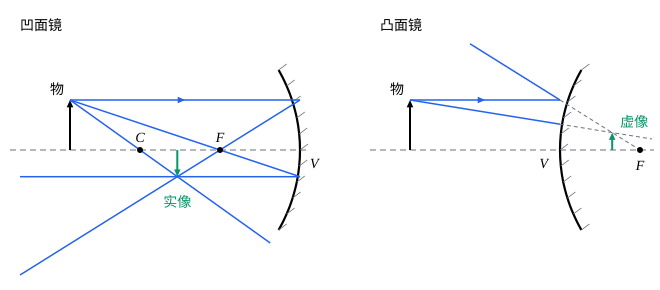

## 这一节要回答的问题

化妆镜为什么能把脸放大？汽车侧面的后视镜为什么看到的范围大，东西却显得小？手电筒怎样把小灯泡的光变成一束平行光？大型天文望远镜为什么用反射镜？

## 讲解

### 凹面镜和凸面镜

把球面的一部分做成镜子，在球面里面反射的是凹面镜（concave mirror），在外面反射的是凸面镜（convex mirror）。光从左边射来，反射后仍回到左边，所以按:term[符号规则]{id="physics.optics.sign-convention"}（sign convention），反射时的出射一侧也是左边：物在镜前时:term[物距]{id="physics.optics.object-distance"}（object distance）为正；像在镜前时:term[像距]{id="physics.optics.image-distance"}（image distance）为正，是:term[实像]{id="physics.optics.real-image"}（real image），在镜后时为负，是:term[虚像]{id="physics.optics.virtual-image"}（virtual image）；凹面镜的球心在镜前，半径$R>0$，凸面镜的$R<0$。

::anchor{id="thm-mirror-focus"}
定理（平行光的会聚点）：在:term[近轴近似]{id="physics.optics.paraxial-approximation"}（paraxial approximation）下，平行于:term[光轴]{id="physics.optics.optical-axis"}（optical axis）射到球面镜上的光，反射后会聚于（或者反向延长线交于）离顶点$\frac R2$的一点$F$，即球面镜的:term[焦距]{id="physics.optics.focal-length"}（focal length）$f=\frac R2$。

证明思路：平行于光轴、高为$h$的光线射到镜面上的$P$点，法线$CP$过球心，入射角$\theta$满足$\sin\theta=\frac hR$。反射光线和光轴成$2\theta$，和光轴交于$F$；三角形$CPF$在$C$、$P$两处的角都是$\theta$，是等腰三角形，$CF=\frac{R}{2\cos\theta}$。所以$F$离顶点$R-\frac{R}{2\cos\theta}$，$\theta$很小时就是$\frac R2$（第 5 题）。

凹面镜的焦距是正的，平行光反射后真正会聚在镜前的:term[焦点]{id="physics.optics.focal-point"}（focal point）上，太阳灶就是这样聚光的；凸面镜的焦距是负的，平行光反射后发散，好像是从镜后的焦点发出的。和透镜不同，镜子只有一个焦点，物方和像方的焦点重合在一处。

### 镜面成像公式

::anchor{id="thm-mirror-equation"}
定理（球面镜的成像公式）：在:term[近轴近似]{id="physics.optics.paraxial-approximation"}下，:term[物距]{id="physics.optics.object-distance"}$s$、:term[像距]{id="physics.optics.image-distance"}$s'$和:term[焦距]{id="physics.optics.focal-length"}满足$\frac1s+\frac1{s'}=\frac1f=\frac2R$，:term[横向放大率]{id="physics.optics.lateral-magnification"}（lateral magnification）$m=-\frac{s'}{s}$。

证明思路：:term[光轴]{id="physics.optics.optical-axis"}上的物点$O$发出的光线和光轴成$\alpha$，射到镜面上高为$h$的$P$点，法线$CP$和光轴成$\beta$，反射光线和光轴成$\gamma$，交光轴于$I$。由:term[反射定律]{id="physics.optics.law-of-reflection"}（law of reflection），入射角和反射角都等于$\theta$，三角形$OPC$和$CPI$的外角给出$\beta=\alpha+\theta$，$\gamma=\beta+\theta$，所以$\alpha+\gamma=2\beta$。近轴时$\alpha\approx\frac hs$，$\beta\approx\frac hR$，$\gamma\approx\frac h{s'}$，消去$h$即得。放大率用射向顶点的光线：它关于光轴对称地反射，$\frac ys=-\frac{y'}{s'}$。

和[球面折射与近轴近似](lesson:physics.optics.paraxial-refraction)里单个折射面的公式比，这里没有:term[折射率]{id="physics.optics.refractive-index"}（refractive index）：反射只改变光的方向，不管镜前是什么介质。

### 作图法

不用计算，也可以用几条特殊的光线画出像的位置。从物体顶端发出的光线里，下面几条的去向最容易确定，任取两条，它们（或它们的反向延长线）的交点就是像的顶端：

- 平行于:term[光轴]{id="physics.optics.optical-axis"}的光线，反射后过:term[焦点]{id="physics.optics.focal-point"}（凸面镜：反向延长线过焦点）；
- 过焦点的光线（凸面镜：射向镜后焦点的光线），反射后平行于光轴；
- 过球心的光线（凸面镜：射向镜后球心的光线），沿原路返回；
- 射到顶点的光线，关于光轴对称地反射。

凹面镜成什么样的像，取决于物离镜子多远：

| 物的位置 | 像的位置 | 像的性质 |
|---|---|---|
| 球心以外（$s>2f$） | 焦点和球心之间 | 倒立、缩小的:term[实像]{id="physics.optics.real-image"} |
| 球心上（$s=2f$） | 球心上 | 倒立、等大的实像 |
| 焦点和球心之间（$f<s<2f$） | 球心以外 | 倒立、放大的实像 |
| 焦点上（$s=f$） | 无穷远 | 射出平行光，不成像 |
| 焦点以内（$s<f$） | 镜后 | 正立、放大的:term[虚像]{id="physics.optics.virtual-image"} |

化妆镜是凹面镜，脸离镜子比:term[焦距]{id="physics.optics.focal-length"}近，看到的是正立、放大的虚像。凸面镜不管物在哪里，都成正立、缩小的虚像，像在镜后、顶点和焦点之间，镜子能照到的范围却比同样大的平面镜宽得多，所以路口的反光镜、汽车侧面的后视镜常用凸面镜（例 2）。

### 抛物面镜

球面镜只把近轴的平行光会聚到:term[焦点]{id="physics.optics.focal-point"}，离:term[光轴]{id="physics.optics.optical-axis"}远的光线会聚得更靠近镜面（第 5 题）。抛物面镜（parabolic mirror）没有这个问题：抛物线绕对称轴转成的曲面，能把平行于轴的光全都精确地反射到焦点上（第 6 题），反过来，放在焦点上的光源发出的光反射后都平行于轴。探照灯、卫星天线、大型天文望远镜的主镜，都做成抛物面或者和它接近的形状；在顶点附近，抛物面和半径为它:term[焦距]{id="physics.optics.focal-length"}两倍的球面几乎重合，所以近轴时两者一样。

反射对各种颜色的光一视同仁，镜子没有透镜那样的:term[色散]{id="physics.optics.dispersion"}（dispersion）。1668 年年末，牛顿为了避开透镜的这个缺点，造出了他的第一架反射望远镜，主镜是一块用铜锡合金磨成的球面镜；球面比抛物面容易磨。

## 几何图像

图是按:term[近轴近似]{id="physics.optics.paraxial-approximation"}画的：反射点画在过顶点的竖线上，镜面的弧线只是示意。左图的:term[物距]{id="physics.optics.object-distance"}是:term[焦距]{id="physics.optics.focal-length"}的$2.9$倍，像在:term[焦点]{id="physics.optics.focal-point"}和球心之间，倒立、约为物的一半。右图的凸面镜，两条反射光线的反向延长线（虚线）交于镜后，成正立、缩小的:term[虚像]{id="physics.optics.virtual-image"}。

:::anim{component="function-plot"}
range: { x: [0, 6], y: [-6, 8] }
functions:
  - expr: "x/(x - 1)"
    label: |
      凹面镜的$\frac{s'}{|f|}$
  - expr: "-x/(x + 1)"
    label: |
      凸面镜的$\frac{s'}{|f|}$
  - expr: "-1/(x - 1)"
    label: |
      凹面镜的放大率$m$
points:
  - x: "2"
    y: "2"
:::

横轴是:term[物距]{id="physics.optics.object-distance"}，纵轴是:term[像距]{id="physics.optics.image-distance"}，都以焦距的大小$|f|$为单位。凹面镜的像距在物到达焦点（$\frac s{|f|}=1$）时趋于无穷，物在焦点以内时像距为负，像到了镜后；图上的点是物在球心上、像也在球心上的情形，这时放大率是$-1$。凸面镜的像距总在$0$和$-|f|$之间：物从远处移近，虚像从焦点向顶点移动，始终在镜后不远处。

## 例题

### 例 1　凹面镜成实像

一面凹面镜的半径是$40\,\mathrm{cm}$，一支蜡烛立在镜前$30\,\mathrm{cm}$处的:term[光轴]{id="physics.optics.optical-axis"}上。求像的位置、性质和放大率。

**为什么想到这么做**：$f=\frac R2=20\,\mathrm{cm}$，物在:term[焦点]{id="physics.optics.focal-point"}和球心之间，用镜面成像公式。

**推导**：$\frac1{s'}=\frac1{20}-\frac1{30}=\frac1{60}$，$s'=60\,\mathrm{cm}$，像在镜前$60\,\mathrm{cm}$处，是:term[实像]{id="physics.optics.real-image"}。$m=-\frac{60}{30}=-2.0$，倒立、放大到$2$倍。用一张纸在镜前$60\,\mathrm{cm}$处就能接到倒立的烛焰。

### 例 2　汽车的后视镜

汽车侧面的后视镜是一面凸面镜，:term[焦距]{id="physics.optics.focal-length"}为$-0.50\,\mathrm m$。后面的一辆车离镜子$10\,\mathrm m$。求像的位置和放大率。

**为什么想到这么做**：凸面镜$f<0$，直接代入成像公式，:term[像距]{id="physics.optics.image-distance"}应该是负的。

**推导**：$\frac1{s'}=\frac{1}{-0.50}-\frac1{10}=-2.1\,\mathrm{m^{-1}}$，$s'\approx-0.48\,\mathrm m$，像在镜后约$0.48\,\mathrm m$处。$m=-\frac{-0.48}{10}\approx0.048$，正立，只有原来的约$\frac1{21}$。像其实离镜子很近，可是它小，看上去就觉得那辆车比实际远，这是看凸面后视镜时要留意的。

## 常见误区

- 「凹面镜总是成倒立的:term[实像]{id="physics.optics.real-image"}。」物在:term[焦点]{id="physics.optics.focal-point"}以内时，凹面镜成正立、放大的:term[虚像]{id="physics.optics.virtual-image"}，化妆镜就是这样用的。
- 「凸面镜里的车显得小，所以它的像在很远的地方。」凸面镜的像在镜后、顶点和焦点之间，离镜子很近；显得远是因为像小。
- 「镜面成像公式和折射面的一样，要用两边的:term[折射率]{id="physics.optics.refractive-index"}。」反射前后光在同一种介质里，公式里没有折射率；镜子浸在水里，:term[焦距]{id="physics.optics.focal-length"}也不变。
- 「球面镜能把所有平行于:term[光轴]{id="physics.optics.optical-axis"}的光都精确地会聚到焦点。」只有近轴的光才行，离光轴远的光会聚得更靠近镜面；抛物面镜才能把平行光都精确地会聚到焦点。
