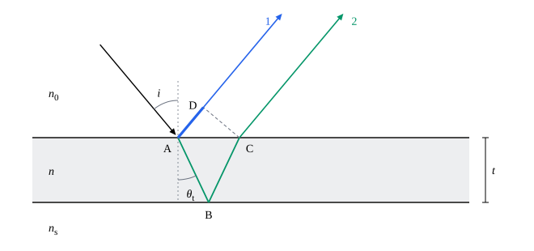

## 这一节要回答的问题

阳光下，肥皂泡和水面上的油膜呈现一圈圈彩色；照相机镜头的表面镀了一层极薄的膜，反光就少了很多。膜只有几百纳米厚，这些颜色和效果从哪里来？膜的厚度和:term[折射率]{id="physics.optics.refractive-index"}（refractive index）怎样决定哪种颜色加强、哪种减弱？

## 讲解

### 反射时的半波损失

光照到两种透明介质的界面上，一部分反射，一部分透射，和[波的反射与透射](lesson:physics.oscillations-waves.reflection-transmission)里波在两根弦的连接处的情形一样。弦上的波从轻弦传到重弦时，反射波倒过来；从重弦传到轻弦时不倒。两根弦的张力相同时，弦越重，波速越小，阻抗（impedance）越大，阻抗和波速成反比。

对光，波速是$\frac cn$，和波速成反比的是:term[折射率]{id="physics.optics.refractive-index"}，折射率大的一侧相当于重的弦。照搬弦的结果，垂直入射时反射光和入射光的振幅之比，即反射系数（reflection coefficient），是$r=\frac{n_1-n_2}{n_1+n_2}$，$n_1$、$n_2$分别是入射一侧和另一侧的折射率；电磁学里由场在界面上满足的条件严格推出了同样的结果（见[界面上的反射与折射：菲涅耳公式](lesson:physics.electromagnetism.fresnel-equations)）。

::anchor{id="def-reflectance"}
反射光的光强和入射光的光强之比叫作:term[反射率]{id="physics.optics.reflectance"}（reflectance）；垂直入射时，它等于反射系数的平方$r^2=\Bigl(\frac{n_1-n_2}{n_1+n_2}\Bigr)^2$。

为什么这样定义：眼睛和仪器感受到的是光强，比较反射得多少，用光强之比最直接；它和入射光的强弱无关，只由两边的折射率和入射角决定。边界情况：空气中的玻璃（$n=1.5$）每个表面反射约$4\%$；两边折射率相同时$r=0$，不反射；不吸收光时，透过的光强占入射光的$1-r^2$。

::anchor{id="def-half-wave-loss"}
光从折射率小的介质射向折射率大的介质、在界面上反射时，反射光的振动和入射光相反，相位突变$\pi$，相当于多走了半个波长，这叫作:term[半波损失]{id="physics.optics.half-wave-loss"}（half-wave loss）；从折射率大的介质射向折射率小的介质反射时，没有半波损失。

为什么这样定义：相位突变$\pi$和多走（或少走）半个波长效果一样，把它记成半个波长，就能和几何路径造成的:term[光程差]{id="physics.optics.optical-path-difference"}（optical path difference）放在一起算，:term[干涉]{id="physics.optics.interference"}（interference）条件写起来最简单。边界情况：垂直入射时，$n_1<n_2$则$r<0$，正是半波损失；$n_1>n_2$则$r>0$，相位不变。斜着入射时，电场在入射面（plane of incidence）内振动的光，反射时的相位变化随入射角改变，这个说法只在接近垂直入射时才可靠（见[界面上的反射与折射：菲涅耳公式](lesson:physics.electromagnetism.fresnel-equations)第 8 题）；下面讲的薄膜，光大多接近垂直入射，可以放心用。

### 薄膜两个表面反射的光

厚为$t$、:term[折射率]{id="physics.optics.refractive-index"}为$n$的薄膜，上面是折射率为$n_0$的介质，下面是折射率为$n_s$的介质，比如空气中的肥皂膜$n_0=n_s=1$，镀在玻璃上的膜$n_s\approx1.5$。光照到膜上，一部分在上表面反射，一部分折射进膜、在下表面反射后再射出来；两束反射光来自同一束入射光，是:term[相干光]{id="physics.optics.coherent-light"}（coherent light）。

::anchor{id="def-thin-film"}
薄膜上下两个表面反射（或透射）的光相互:term[干涉]{id="physics.optics.interference"}，叫作:term[薄膜干涉]{id="physics.optics.thin-film-interference"}（thin-film interference）。

为什么这样定义：两束光从同一束入射光分出来，相位差固定，能够干涉；膜要薄，两束光的:term[光程差]{id="physics.optics.optical-path-difference"}才不大，各种颜色的明暗才不至于混在一起（见下面的常见误区）。边界情况：空气中的玻璃膜，每个表面反射的光振幅约为入射光的$0.2$，两束反射光差不多强；在膜里多反射两次的第三束光，振幅只有它们的约$4\%$，可以不计。表面的:term[反射率]{id="physics.optics.reflectance"}很高时，多次反射的光都要算（见[多光束干涉与法布里-珀罗干涉仪](lesson:physics.optics.fabry-perot)）。

::anchor{id="thm-thin-film"}
定理（薄膜的光程差）：光以入射角$i$照到薄膜上，在膜里的折射角为$\theta_t$，上下两个表面反射的两束光的:term[光程差]{id="physics.optics.optical-path-difference"}是$2nt\cos\theta_t$，再按:term[半波损失]{id="physics.optics.half-wave-loss"}修正：两次反射里恰有一次有半波损失时加$\frac\lambda2$，两次都有或都没有时不加。修正后的光程差$\Delta=m\lambda$时两束光相互加强，$\Delta=\Bigl(m+\frac12\Bigr)\lambda$时相互减弱，$m$是整数。

证明思路：如下面的图，光线在上表面$A$点分成两束：一束直接反射；另一束折射进膜，经下表面$B$反射，从上表面$C$射出，和第一束平行。过$C$作第一束的垂线，垂足为$D$，从$C$、$D$往后两束光走的路程相同，所以光程差是$n(AB+BC)-n_0\cdot AD$。$AB=BC=\frac t{\cos\theta_t}$，$AD=AC\sin i=2t\tan\theta_t\sin i$，由:term[折射定律]{id="physics.optics.law-of-refraction"}（law of refraction）$n_0\sin i=n\sin\theta_t$，$n_0\cdot AD=\frac{2nt\sin^2\theta_t}{\cos\theta_t}$，于是光程差$\frac{2nt}{\cos\theta_t}(1-\sin^2\theta_t)=2nt\cos\theta_t$。两束光各自反射时的半波损失按定义另加。

用白光照射时，在膜厚一定的地方，满足加强条件的颜色反射得多，满足减弱条件的颜色反射得少，反射光就带上了颜色；膜各处厚薄不同，颜色也不同，于是出现一圈圈彩色。斜着看时$\cos\theta_t$变小，光程差变小，同一处的颜色向波长短的一端移动（第 5 题）。

### 增透膜

::anchor{id="def-ar-coating"}
在玻璃表面镀一层透明的膜，膜的:term[折射率]{id="physics.optics.refractive-index"}$n$介于空气和玻璃之间，厚度$t=\frac\lambda{4n}$，使膜上下两个表面反射的光相互抵消，从而减少反射、增加透射，这样的膜叫作:term[增透膜]{id="physics.optics.antireflection-coating"}（antireflection coating）。

为什么这样定义：两次反射都是从折射率小的一侧射向大的一侧，都有:term[半波损失]{id="physics.optics.half-wave-loss"}，互相抵掉；剩下的:term[光程差]{id="physics.optics.optical-path-difference"}$2nt=\frac\lambda2$，两束反射光反相，相互减弱。膜不吸收光时，反射少了，透过的就多了，所以叫增透。边界情况：只有设计的那个波长、垂直入射时抵消得最好，通常按人眼最敏感的绿光（约$550\,\mathrm{nm}$）设计，蓝光和红光反射得多一些，所以镀膜镜头的反光带一点紫色（见下面的动画）。

两束反射光的振幅：空气与膜的界面$r_1=\frac{1-n}{1+n}$，膜与玻璃的界面$r_2=\frac{n-n_s}{n+n_s}$。两束光反相时，反射光的振幅约为$|r_1-r_2|$，要完全抵消需要$r_1=r_2$，即$n=\sqrt{n_s}$；玻璃$n_s=1.52$时理想的折射率是$1.23$。实际常用氟化镁（$n=1.38$）：$r_1\approx-0.160$，$r_2\approx-0.048$，:term[反射率]{id="physics.optics.reflectance"}约$(0.160-0.048)^2\approx1.2\%$，没镀膜时是$\Bigl(\frac{1.52-1}{1.52+1}\Bigr)^2\approx4.3\%$。照相机的镜头有十几个表面（见[界面上的反射与折射：菲涅耳公式](lesson:physics.electromagnetism.fresnel-equations)例 1），每个表面的反光从$4\%$左右降到$1\%$左右，透过的光多了，镜片之间来回反射造成的杂散光也少了。

### 等厚条纹和牛顿环

::anchor{id="def-equal-thickness"}
膜的厚度各处不同、光接近垂直入射时，每条亮纹或暗纹都沿着膜厚相同的地方分布，这样的条纹叫作:term[等厚条纹]{id="physics.optics.equal-thickness-fringes"}（fringes of equal thickness）。

为什么这样定义：垂直入射时$\cos\theta_t=1$，:term[光程差]{id="physics.optics.optical-path-difference"}$2nt$只由当地的膜厚决定，条纹就像地图上的等高线，画出了膜厚的分布。边界情况：相邻两条亮纹处膜厚相差$\frac\lambda{2n}$；膜厚处处相同时，整片一样亮或一样暗，没有条纹。

两块平板玻璃一端接触，另一端夹一根细丝，中间是一层楔形的空气，夹角$\alpha$很小。离接触处$x$的地方空气层厚$t=\alpha x$，相邻两条暗纹处厚度相差$\frac\lambda2$，所以条纹是平行于接触边的等间距直线，间距$\frac\lambda{2\alpha}$。接触处厚度为零，空气层上表面（玻璃射向空气）的反射没有:term[半波损失]{id="physics.optics.half-wave-loss"}，下表面（空气射向玻璃）的有，两束光反相，是暗纹。

::anchor{id="def-newtons-rings"}
把一块球面半径很大的平凸透镜放在平板玻璃上，两者之间的空气层从接触点向外逐渐变厚，用单色光照射，看到以接触点为中心的一圈圈明暗相间的同心圆环，叫作:term[牛顿环]{id="physics.optics.newtons-rings"}（Newton's rings）。

为什么这样定义：这些环是一种:term[等厚条纹]{id="physics.optics.equal-thickness-fringes"}，空气层的厚度只和离接触点的距离有关，所以条纹是同心圆。1665 年，胡克（Robert Hooke）在《显微术》（Micrographia）里描述过薄片和两块玻璃之间的彩色圆环；牛顿把凸透镜压在平板玻璃上，由透镜的曲率算出各处空气层的厚度，系统测量了这些环，写进 1704 年出版的《光学》（Opticks），环因此以他命名。边界情况：从反射光看，接触点处空气层厚度为零，中心是暗斑；从透射光看，明暗正好相反，中心是亮斑。

::anchor{id="thm-newtons-rings"}
定理（牛顿环的半径）：平凸透镜的球面半径为$R$，用波长为$\lambda$的光垂直照射，从反射光看，第$m$个暗环的半径$r_m=\sqrt{mR\lambda}$，$m=0,1,2,\dots$，$m=0$是中心的暗斑。

证明思路：离接触点$r$处空气层的厚度$t$满足$R^2=r^2+(R-t)^2$，$t\ll R$时$t\approx\frac{r^2}{2R}$。空气层上表面的反射没有半波损失，下表面的有，暗纹条件是$2t+\frac\lambda2=\Bigl(m+\frac12\Bigr)\lambda$，即$2t=m\lambda$。代入$t=\frac{r^2}{2R}$得$r_m=\sqrt{mR\lambda}$：环的半径和$\sqrt m$成正比，越往外越密。

牛顿用「光的阵发」解释这些环，没有用波；1802 年前后，杨用光的:term[干涉]{id="physics.optics.interference"}解释了它们，并由牛顿量出的环的数据算出了各种颜色光的波长。

## 几何图像

光线 2 在膜里走了$A\to B\to C$（绿线），光线 1 在膜外多走了$A\to D$（蓝色粗线）。虚线$CD$和光线垂直，从$C$、$D$往后两束光走的路程相同，所以:term[光程差]{id="physics.optics.optical-path-difference"}是$n(AB+BC)-n_0\cdot AD$。入射角越大，$\theta_t$越大，光程差$2nt\cos\theta_t$越小。

:::anim{component="function-plot"}
range: { x: [400, 700], y: [0, 5] }
functions:
  - expr: "100*((1.52-1)/(1.52+1))^2"
    label: |
      没镀膜的玻璃
  - expr: "100*(((1-c)/(1+c))^2 + ((c-1.52)/(c+1.52))^2 + 2*((1-c)/(1+c))*((c-1.52)/(c+1.52))*cos(pi*550/x))"
    label: |
      镀了增透膜的玻璃
sliders:
  - name: c
    min: 1.1
    max: 1.5
    step: 0.01
    default: 1.38
    label: |
      膜的折射率
:::

横轴是波长$\lambda$（$\mathrm{nm}$），纵轴是一个表面的:term[反射率]{id="physics.optics.reflectance"}（$\%$）。第一条曲线是没镀膜的玻璃（$n_s=1.52$），第二条是镀了一层按$550\,\mathrm{nm}$设计厚度（$nt=\frac{550\,\mathrm{nm}}4$）的:term[增透膜]{id="physics.optics.antireflection-coating"}的玻璃，两束反射光按上面的办法叠加。滑块调膜的:term[折射率]{id="physics.optics.refractive-index"}：$1.38$是氟化镁，调到$1.23$时$550\,\mathrm{nm}$处反射为零；在滑块的范围里，两端的蓝光和红光总比中间的绿光反射得多。

## 例题

### 例 1　肥皂膜的颜色

空气中的一片肥皂膜，:term[折射率]{id="physics.optics.refractive-index"}$1.33$，厚$500\,\mathrm{nm}$，阳光垂直照射。反射光里，波长在$400\,\mathrm{nm}$到$700\,\mathrm{nm}$之间的哪种光最强，哪些光最弱？

**为什么想到这么做**：上表面是空气射向肥皂膜，有:term[半波损失]{id="physics.optics.half-wave-loss"}；下表面是肥皂膜射向空气，没有。修正后的:term[光程差]{id="physics.optics.optical-path-difference"}$\Delta=2nt+\frac\lambda2$，加强条件$\Delta=m\lambda$，减弱条件$\Delta=\Bigl(m+\frac12\Bigr)\lambda$。

**推导**：$2nt=2\times1.33\times500\,\mathrm{nm}=1330\,\mathrm{nm}$。加强：$1330\,\mathrm{nm}=\Bigl(m-\frac12\Bigr)\lambda$，$\lambda=\frac{1330\,\mathrm{nm}}{m-1/2}$，$m=1,2,3,4$分别是$2660$、$887$、$532$、$380\,\mathrm{nm}$，范围里只有$532\,\mathrm{nm}$的绿光。减弱：$1330\,\mathrm{nm}=m\lambda$，$m=2,3$分别是$665\,\mathrm{nm}$的红光和$443\,\mathrm{nm}$的蓝光。所以这片膜反射的光偏绿。

### 例 2　用牛顿环量透镜的球面半径

用钠黄光（波长$589.3\,\mathrm{nm}$）照射，从反射光看，量得第$5$个暗环的直径为$4.20\,\mathrm{mm}$，第$15$个暗环的直径为$7.28\,\mathrm{mm}$。求平凸透镜的球面半径。

**为什么想到这么做**：接触处若有一点灰尘，空气层各处都多出同样的厚度$t_0$，暗环满足$\frac{r_m^2}R+2t_0=m\lambda$，单用一个环会有误差；两个环的半径平方相减，$t_0$就消掉了：$r_{m+k}^2-r_m^2=kR\lambda$。

**推导**：$r_5=2.10\,\mathrm{mm}$，$r_{15}=3.64\,\mathrm{mm}$，$r_{15}^2-r_5^2=(13.25-4.41)\,\mathrm{mm}^2=8.84\,\mathrm{mm}^2$。$R=\frac{8.84\times10^{-6}}{10\times589.3\times10^{-9}}\,\mathrm m\approx1.50\,\mathrm m$。

## 常见误区

- 「:term[增透膜]{id="physics.optics.antireflection-coating"}把反射光的能量消灭了。」膜不吸收光时能量守恒：两束反射光相互抵消，少反射的那部分光透了过去，所以叫增透。
- 「膜越厚，颜色越鲜艳。」膜厚到几微米以上时，可见光范围里有许多波长满足加强条件，也有许多满足减弱条件，明暗交错，混成白色，看不出颜色；只有很薄的膜才有鲜艳的颜色。
- 「:term[牛顿环]{id="physics.optics.newtons-rings"}和楔形空气层的条纹一样，都是等间距的。」楔形空气层的厚度随位置均匀增加，条纹等间距；牛顿环的空气层厚度$t\approx\frac{r^2}{2R}$随半径的平方增加，环的半径和$\sqrt m$成正比，越往外越密。
- 「:term[半波损失]{id="physics.optics.half-wave-loss"}是光在反射时真的多走了半个波长的路。」它是反射时振动方向突然反过来造成的相位突变$\pi$，只是在效果上和多走半个波长一样。
