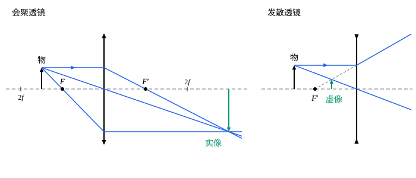

## 这一节要回答的问题

放大镜、眼镜、照相机和投影仪的镜头都是透镜。透镜的:term[焦距]{id="physics.optics.focal-length"}（focal length）由什么决定？物体放在透镜前不同的地方，像在哪里、有多大？眼镜上写的「$-2.50$」是什么意思？

## 讲解

### 薄透镜和磨镜者公式

透镜是两个折射面夹着的一块透明物质，通常两面都是球面，或者一面是平面。光穿过透镜，在两个面上各折射一次，每个面都可以用[球面折射与近轴近似](lesson:physics.optics.paraxial-refraction)里的公式处理，前一个面所成的像就是后一个面的物。

::anchor{id="def-thin-lens"}
透镜的厚度比两个面的半径、:term[物距]{id="physics.optics.object-distance"}（object distance）和:term[像距]{id="physics.optics.image-distance"}（image distance）都小得多时，可以把两个面看作在同一个位置，这样的透镜叫作:term[薄透镜]{id="physics.optics.thin-lens"}（thin lens）；两个面和:term[光轴]{id="physics.optics.optical-axis"}（optical axis）交点处的那一点叫作:term[光心]{id="physics.optics.optical-center"}（optical center）。

为什么这样定义：忽略厚度以后，透镜只用一个位置和一个:term[焦距]{id="physics.optics.focal-length"}来描述，计算和作图都简单得多；眼镜片、放大镜和许多镜头都近似满足。边界情况：玻璃球、厚的镜头组厚度和半径相当，不能当作薄透镜，要逐面计算（见[球面折射与近轴近似](lesson:physics.optics.paraxial-refraction)第 6 题）或者用[光线传输矩阵](lesson:physics.optics.ray-transfer-matrices)。

::anchor{id="thm-lensmaker"}
定理（:term[磨镜者公式]{id="physics.optics.lensmakers-equation"}，lensmaker's equation）：:term[折射率]{id="physics.optics.refractive-index"}（refractive index）为$n$的薄透镜放在空气里，两个面的半径依次为$R_1$、$R_2$（按:term[符号规则]{id="physics.optics.sign-convention"}（sign convention），球心在出射一侧，即右边，时为正），它的焦距$f$满足$\frac1f=(n-1)\Bigl(\frac1{R_1}-\frac1{R_2}\Bigr)$；放在折射率为$n_0$的介质里时，$n-1$换成$\frac{n}{n_0}-1$。

证明思路：第一个面：$\frac1s+\frac{n}{s_1'}=\frac{n-1}{R_1}$。透镜很薄，这个像到第二个面的距离和到第一个面的几乎相同；像在出射一侧时，它对第二个面是:term[虚物]{id="physics.optics.virtual-object"}（virtual object），物距$s_2=-s_1'$。第二个面：$\frac{n}{s_2}+\frac1{s'}=\frac{1-n}{R_2}$，即$-\frac{n}{s_1'}+\frac1{s'}=\frac{1-n}{R_2}$。两式相加，$\frac{n}{s_1'}$消去，得$\frac1s+\frac1{s'}=(n-1)\Bigl(\frac1{R_1}-\frac1{R_2}\Bigr)$，令$s\to\infty$就是焦距（第 5 题）。

这个公式只和透镜的形状、材料有关，透镜两侧都是空气时，两边的焦距相等。中间厚、边缘薄的凸透镜（例如双凸透镜，$R_1>0$，$R_2<0$），$f>0$，把平行光会聚到透镜后的:term[焦点]{id="physics.optics.focal-point"}（focal point）上，是会聚透镜（converging lens）；中间薄、边缘厚的凹透镜，$f<0$，平行光射出后发散，好像来自透镜前的焦点，是发散透镜（diverging lens）。

### 薄透镜成像公式

::anchor{id="thm-thin-lens"}
定理（:term[薄透镜]{id="physics.optics.thin-lens"}成像公式）：在:term[近轴近似]{id="physics.optics.paraxial-approximation"}（paraxial approximation）下，薄透镜放在空气里，:term[物距]{id="physics.optics.object-distance"}$s$、:term[像距]{id="physics.optics.image-distance"}$s'$和:term[焦距]{id="physics.optics.focal-length"}$f$满足$\frac1s+\frac1{s'}=\frac1f$，:term[横向放大率]{id="physics.optics.lateral-magnification"}（lateral magnification）$m=-\frac{s'}{s}$。

证明思路：成像公式在推:term[磨镜者公式]{id="physics.optics.lensmakers-equation"}时已经得到。放大率用过:term[光心]{id="physics.optics.optical-center"}的光线：薄透镜在光心附近相当于一块很薄的平行玻璃板，光线穿过时不偏折、侧移也可以不计，所以物的顶端、光心和像的顶端在一条直线上，$\frac ys=-\frac{y'}{s'}$。

薄透镜的:term[光焦度]{id="physics.optics.optical-power"}（optical power）是$\Phi=\frac1f$，单位是:term[屈光度]{id="physics.optics.diopter"}（diopter，$\mathrm D$，即$\mathrm m^{-1}$）。眼镜上的度数就是光焦度：「$-2.50$」是光焦度$-2.50\,\mathrm D$、焦距$-0.40\,\mathrm m$的发散透镜，用来矫正近视。几个薄透镜贴在一起，光依次穿过时，前一个透镜所成的像是后一个的物，把成像公式依次相加可知，总的光焦度等于各个光焦度之和，$\frac1f=\frac1{f_1}+\frac1{f_2}+\cdots$。

### 作图法

从物体顶端发出的光线里，下面三条的去向最容易确定，任取两条，它们（或它们的反向延长线）的交点就是像的顶端：

- 平行于:term[光轴]{id="physics.optics.optical-axis"}的光线，折射后过:term[像方焦点]{id="physics.optics.focal-point"}$F'$（发散透镜：反向延长线过透镜前的$F'$）；
- 过:term[光心]{id="physics.optics.optical-center"}的光线，方向不变；
- 过物方焦点$F$的光线（发散透镜：射向透镜后的$F$的光线），折射后平行于光轴。

会聚透镜成什么样的像，取决于物离透镜多远：

| 物的位置 | 像的位置 | 像的性质 | 用途 |
|---|---|---|---|
| 两倍:term[焦距]{id="physics.optics.focal-length"}以外（$s>2f$） | 另一侧一倍焦距和两倍焦距之间 | 倒立、缩小的:term[实像]{id="physics.optics.real-image"}（real image） | 照相机 |
| 一倍焦距和两倍焦距之间（$f<s<2f$） | 另一侧两倍焦距以外 | 倒立、放大的实像 | 投影仪 |
| 焦点上（$s=f$） | 无穷远 | 射出平行光 | 探照灯 |
| 一倍焦距以内（$s<f$） | 同一侧 | 正立、放大的:term[虚像]{id="physics.optics.virtual-image"}（virtual image） | 放大镜 |

发散透镜不管物在哪里，都在同一侧成正立、缩小的虚像。由:term[光路可逆]{id="physics.optics.reversibility"}（principle of reversibility），把物放到原来像的位置，像就出现在原来物的位置，所以物和屏的距离固定时，透镜往往有两个位置都能在屏上成清晰的像（第 6 题）。

## 几何图像

左图的:term[物距]{id="physics.optics.object-distance"}是:term[焦距]{id="physics.optics.focal-length"}的$1.5$倍，:term[像距]{id="physics.optics.image-distance"}是焦距的$3$倍，像倒立、放大到$2$倍，这正是投影仪的用法。右图的发散透镜，平行于:term[光轴]{id="physics.optics.optical-axis"}的光折射后发散，它的反向延长线（虚线）过透镜前的:term[焦点]{id="physics.optics.focal-point"}，和过:term[光心]{id="physics.optics.optical-center"}的光线交出正立、缩小的:term[虚像]{id="physics.optics.virtual-image"}（virtual image）。图里的透镜画成一条竖线，两端的箭头表示会聚还是发散；:term[薄透镜]{id="physics.optics.thin-lens"}作图时，折射都画在这条线上。

:::anim{component="function-plot"}
range: { x: [0, 6], y: [-6, 12] }
functions:
  - expr: "x/(x - 1)"
    label: |
      像距$\frac{s'}f$
  - expr: "-1/(x - 1)"
    label: |
      横向放大率$m$
  - expr: "x^2/(x - 1)"
    label: |
      物和像的距离$\frac{s+s'}f$
points:
  - x: "2"
    y: "4"
:::

横轴是物距，以焦距为单位，透镜是会聚透镜。物从远处移近，:term[实像]{id="physics.optics.real-image"}从焦点处向外退，越来越大；物到达焦点时像在无穷远处，物进入焦距以内，像距、放大率都换了符号，成为正立的虚像。物和实像之间的距离$s+s'$在$s=2f$时最小，等于$4f$（图上的点）：屏离物比$4f$近，无论透镜放在哪里，屏上都接不到清晰的像。

## 例题

### 例 1　双凸透镜

一块双凸透镜用:term[折射率]{id="physics.optics.refractive-index"}$1.50$的玻璃做成，两面的半径都是$15\,\mathrm{cm}$。（1）求:term[焦距]{id="physics.optics.focal-length"}。（2）一个物体放在透镜前$25\,\mathrm{cm}$处，求像的位置和放大率。

**为什么想到这么做**：光从左向右射来，第一个面的球心在右边，$R_1=+15\,\mathrm{cm}$；第二个面的球心在左边，$R_2=-15\,\mathrm{cm}$。先用:term[磨镜者公式]{id="physics.optics.lensmakers-equation"}求焦距，再用成像公式。

**推导**：（1）$\frac1f=(1.50-1)\Bigl(\frac1{15}-\frac1{-15}\Bigr)=\frac{1}{15}\,\mathrm{cm^{-1}}$，$f=15\,\mathrm{cm}$。（2）$\frac1{s'}=\frac1{15}-\frac1{25}=\frac{2}{75}$，$s'=37.5\,\mathrm{cm}$，在透镜另一侧，是:term[实像]{id="physics.optics.real-image"}；$m=-\frac{37.5}{25}=-1.5$，倒立、放大到$1.5$倍。

### 例 2　近视眼镜

一个人不戴眼镜时，最远只能看清眼前$50\,\mathrm{cm}$处的东西。要看清远处，眼镜的:term[光焦度]{id="physics.optics.optical-power"}应该是多少？眼镜和眼睛的距离不计。

**为什么想到这么做**：眼镜要把无穷远处的物体成像在$50\,\mathrm{cm}$处，让眼睛去看这个:term[虚像]{id="physics.optics.virtual-image"}；像和物在同一侧，:term[像距]{id="physics.optics.image-distance"}是$-50\,\mathrm{cm}$。

**推导**：$s\to\infty$，$s'=-0.50\,\mathrm m$，$\frac1f=\frac1s+\frac1{s'}=0-\frac{1}{0.50}=-2.0\,\mathrm{m^{-1}}$，光焦度$-2.0\,\mathrm D$，:term[焦距]{id="physics.optics.focal-length"}$-0.50\,\mathrm m$的发散透镜，就是常说的「$200$度」近视眼镜。

## 常见误区

- 「凸透镜一定成:term[实像]{id="physics.optics.real-image"}。」物在一倍:term[焦距]{id="physics.optics.focal-length"}以内时，凸透镜成正立、放大的:term[虚像]{id="physics.optics.virtual-image"}，放大镜就是这样用的。
- 「透镜换一面朝向光，焦距就变了。」把透镜掉过头，$R_1$、$R_2$交换位置并且都变号，$\frac1{R_1}-\frac1{R_2}$不变，:term[薄透镜]{id="physics.optics.thin-lens"}的焦距不变。
- 「挡住透镜的一半，像就少了一半。」物上每一点发出的光都布满整个透镜，挡住一半只是会聚到每个像点的光少了，像变暗，仍然完整。
- 「玻璃凸透镜放到水里，会聚本领不变。」$n-1$要换成$\frac{n}{n_0}-1$，在水里:term[光焦度]{id="physics.optics.optical-power"}只剩空气里的约四分之一（第 5 题）。
