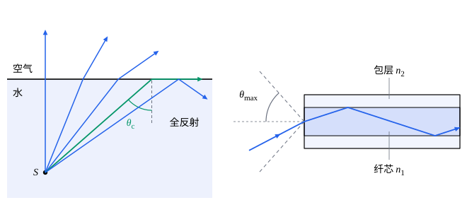

## 这一节要回答的问题

钻石为什么格外闪亮？潜水时从水下往上看，为什么只有头顶一个圆圈里是明亮的天空，圆圈以外的水面却像一面镜子？光纤又细又弯，光怎样沿着它走上几十千米？

## 讲解

### 临界角

光从水、玻璃射向空气时，由:term[折射定律]{id="physics.optics.law-of-refraction"}（law of refraction）$n_1\sin\theta_1=n_2\sin\theta_2$，$n_1>n_2$，折射角比入射角大。入射角增大时，折射角先到达$90^\circ$，折射光线贴着界面射出。

::anchor{id="def-critical-angle"}
光从:term[折射率]{id="physics.optics.refractive-index"}（refractive index）较大的介质射向折射率较小的介质（$n_1>n_2$），折射角等于$90^\circ$时的入射角$\theta_{\mathrm c}$叫作:term[临界角]{id="physics.optics.critical-angle"}（critical angle），$\sin\theta_{\mathrm c}=\frac{n_2}{n_1}$。

为什么这样定义：入射角超过$\theta_{\mathrm c}$时，折射定律要求$\sin\theta_2>1$，没有哪个折射角满足，所以$\theta_{\mathrm c}$是有没有折射光的分界。水和空气之间约为$48.8^\circ$，折射率$1.50$的玻璃和空气之间约为$41.8^\circ$，钻石（$n\approx2.42$）和空气之间只有约$24.4^\circ$。边界情况：光从折射率较小的一侧射来（$n_1\le n_2$）时$\frac{n_2}{n_1}\ge1$，没有临界角，总有折射光。

### 全反射

::anchor{id="def-tir"}
入射角大于:term[临界角]{id="physics.optics.critical-angle"}时，光在界面上全部反射、没有折射光，这种现象叫作:term[全反射]{id="physics.optics.total-internal-reflection"}（total internal reflection）。

为什么这样定义：一般的反射只反射一部分光，而入射角逐渐增大到临界角时，折射光越来越弱，超过临界角就一点不剩，反射光带走入射光的全部能量。英文名里的 internal 是说，光要从:term[折射率]{id="physics.optics.refractive-index"}较大的「里面」射向较小的「外面」才可能发生。边界情况：这时光其实并不完全不进入第二种介质，界面另一侧有一层很薄的场，沿界面传播，不把能量带走，离开界面不到一个波长就衰减得差不多了。把另一块玻璃移到离界面这么近的地方，一部分光就会穿过去（见[界面上的反射与折射：菲涅耳公式](lesson:physics.electromagnetism.fresnel-equations)第 6 题：玻璃里的光以$45^\circ$射到玻璃和空气的界面，真空波长$500\,\mathrm{nm}$时，空气里的场离开界面约$225\,\mathrm{nm}$就衰减到$\frac1e$）。

金属镜面总要吸收一部分光，全反射却不吸收，所以潜望镜、望远镜里常用直角棱镜代替平面镜：光从一个直角边垂直射入，射到斜边上的入射角是$45^\circ$，大于玻璃的临界角，全部反射，方向转过$90^\circ$（例 1）。从水下往上看，由:term[光路可逆]{id="physics.optics.reversibility"}（principle of reversibility），整个天空射到水面上的光进入水里以后，都挤在一个半顶角为临界角的圆锥里，所以头顶有一个明亮的圆圈；圆锥以外，射到水面上的是水下物体发出的光，入射角超过临界角，全部反射，水面像镜子一样映出水下的景物（第 3 题）。

### 光纤

1842 年，瑞士的科拉东（Jean-Daniel Colladon）发表了一个实验：让光从水箱侧面射进流出的水柱，光在水柱的表面上一次次:term[全反射]{id="physics.optics.total-internal-reflection"}，跟着弯曲的水柱一路走，水流落到哪里，哪里就亮。光纤（optical fiber）用的是同一个道理，只是把水柱换成了比头发还细的玻璃丝。

::anchor{id="def-core-cladding"}
光纤中心传光的部分叫作:term[纤芯]{id="physics.optics.fiber-core"}（core），外面包着的一层:term[折射率]{id="physics.optics.refractive-index"}稍小的玻璃叫作:term[包层]{id="physics.optics.cladding"}（cladding）。

为什么这样定义：光在纤芯和包层的界面上全反射，这个界面藏在玻璃里面；裸露的玻璃表面一旦沾上灰尘、水汽或者碰到别的东西，那里就不再满足全反射的条件，光会漏出去，包层把界面保护了起来。边界情况：纤芯和包层的折射率通常只差百分之一左右，:term[临界角]{id="physics.optics.critical-angle"}接近$90^\circ$，所以只有和光纤的轴夹角很小的光才能传下去；纤芯直接接触空气也能全反射，只是怕脏（第 8 题）。

::anchor{id="def-numerical-aperture"}
光从空气射到光纤的端面上，能在纤芯里靠全反射一直传下去的最大入射角$\theta_{\max}$叫作光纤的接收角（acceptance angle），$\sin\theta_{\max}$叫作光纤的:term[数值孔径]{id="physics.optics.numerical-aperture"}（numerical aperture，NA）。

为什么这样定义：只有落在半顶角为$\theta_{\max}$的圆锥里的光才能传下去，数值孔径越大，光纤从光源收集的光越多。边界情况：$\sin\theta_{\max}$不超过$1$，算出的值大于$1$时，说明从空气射进来的光不管角度多大都能传下去。

::anchor{id="thm-numerical-aperture"}
定理（光纤的数值孔径）：纤芯和包层的折射率分别为$n_1$、$n_2$（$n_1>n_2$），端面外是空气时，$\mathrm{NA}=\sin\theta_{\max}=\sqrt{n_1^2-n_2^2}$。

证明思路：光以$\theta$射到端面上，折射角$\theta'$满足$\sin\theta=n_1\sin\theta'$。纤芯里的光线射到纤芯和包层的界面上时，入射角是$90^\circ-\theta'$，它要不小于临界角，即$\cos\theta'\ge\frac{n_2}{n_1}$，也就是$n_1\sin\theta'\le\sqrt{n_1^2-n_2^2}$（第 5 题）。

光纤弯曲时，光线射到界面上的角度会变；只要弯得不太急，入射角仍然大于临界角，光就照样传下去（第 8 题）。不同角度的光线在纤芯里走的路程不同，同时射进去的光，到达另一端的时间有先有后，短的光脉冲会被拉长（第 6 题）。更细致地看，光是波，纤芯里只有某些特定的场的分布能稳定地传下去，每一种这样的分布是一个模（mode），和电磁学里金属管中的模是一回事（见[波导](lesson:physics.electromagnetism.waveguides)）。纤芯细到只有几个波长时，只剩一个模能传播，就是单模光纤（single-mode fiber），没有不同路程带来的时间差；例如康宁公司的 SMF-28 光纤，纤芯直径$8.2\,\mu\mathrm m$，包层直径$125\,\mu\mathrm m$，数值孔径$0.14$。

1966 年，高锟（Charles Kao）和霍克汉姆（George Hockham）指出，当时玻璃里的损耗主要来自杂质，提纯以后可以降到每千米$20$分贝（decibel，dB）以下，足够用来通信。衰减$X\,\mathrm{dB}$是说光的功率降到原来的$10^{-X/10}$，$20\,\mathrm{dB}$就是只剩$1\%$。1970 年，美国康宁公司做出了损耗约$17\,\mathrm{dB/km}$的石英光纤；现在长途通信用的光纤，在$1550\,\mathrm{nm}$的损耗约为$0.2\,\mathrm{dB/km}$，光走$100\,\mathrm{km}$还剩$1\%$。高锟因为这项工作获得了 2009 年的诺贝尔物理学奖。

## 几何图像

左图的点光源在水下，从它发出的光里，竖直向上和斜得不太厉害的几条折射到空气里，越斜折射得越厉害；沿:term[临界角]{id="physics.optics.critical-angle"}射出的那条贴着水面；更斜的发生:term[全反射]{id="physics.optics.total-internal-reflection"}，回到水里。右图的光纤为了看清，:term[纤芯]{id="physics.optics.fiber-core"}和:term[包层]{id="physics.optics.cladding"}的:term[折射率]{id="physics.optics.refractive-index"}差画得夸大了（按$1.50$和$1.30$画），光线和轴的夹角也画得偏大；真实光纤里的光线几乎平行于轴。

:::anim{component="function-plot"}
range: { x: [1.30, 1.70], y: [0, 90] }
functions:
  - expr: "asin(min(1, sqrt(c^2 - x^2)))*180/pi"
    label: |
      接收角$\theta_{\max}$（度）
sliders:
  - name: c
    min: 1.40
    max: 1.70
    step: 0.005
    default: 1.48
    label: |
      纤芯的折射率$n_1$
:::

横轴是包层的折射率$n_2$，纵轴是光纤的接收角。包层的折射率越接近纤芯，接收角越小；$n_2$等于$n_1$时接收角降到零，再大就不能靠全反射导光，曲线在那里断开。纤芯的折射率调大、包层的取得很小时，$\sqrt{n_1^2-n_2^2}$会超过$1$，接收角封顶在$90^\circ$。

## 例题

### 例 1　直角棱镜

用:term[折射率]{id="physics.optics.refractive-index"}$1.50$的玻璃做成等腰直角棱镜，光垂直于一个直角边射入。（1）光射到斜边上会怎样？（2）把棱镜浸在水里（水的折射率取$1.33$），结果有什么不同？

**为什么想到这么做**：光垂直射入时不偏折，射到斜边上的入射角由几何关系得出，和:term[临界角]{id="physics.optics.critical-angle"}比较。

**推导**：（1）光垂直于直角边射入，方向不变，斜边和直角边成$45^\circ$，所以光射到斜边上的入射角是$45^\circ$。玻璃和空气之间的临界角$\arcsin\frac1{1.50}\approx41.8^\circ$，$45^\circ$大于它，发生:term[全反射]{id="physics.optics.total-internal-reflection"}，光转过$90^\circ$，从另一个直角边垂直射出。（2）玻璃和水之间的临界角$\arcsin\frac{1.33}{1.50}\approx62.5^\circ$，$45^\circ$小于它，大部分光折射到水里，棱镜不再像镜子：全反射看的是两边折射率之比，而不只是玻璃本身。

### 例 2　光纤的接收角

一种光纤的:term[纤芯]{id="physics.optics.fiber-core"}:term[折射率]{id="physics.optics.refractive-index"}$1.48$，:term[包层]{id="physics.optics.cladding"}折射率$1.46$。求它的:term[数值孔径]{id="physics.optics.numerical-aperture"}和接收角。

**为什么想到这么做**：直接用$\mathrm{NA}=\sqrt{n_1^2-n_2^2}$，再取反正弦。

**推导**：$\mathrm{NA}=\sqrt{1.48^2-1.46^2}=\sqrt{0.0588}\approx0.242$，$\theta_{\max}=\arcsin0.242\approx14.0^\circ$。光要射在端面前一个半顶角$14^\circ$的圆锥里才能被光纤收下；两种折射率只差约$1.4\%$，数值孔径却有$0.24$，因为它和$n_1^2-n_2^2$开方有关。

## 常见误区

- 「光从空气射向水，入射角足够大时也会:term[全反射]{id="physics.optics.total-internal-reflection"}。」只有光从:term[折射率]{id="physics.optics.refractive-index"}较大的介质射向折射率较小的介质时才可能发生全反射；从空气射向水，总有折射光。
- 「全反射时光一点也不进入第二种介质。」界面另一侧有一层深度和波长相当的场，只是不把能量带走；另一块玻璃靠得足够近时，光能穿过去。
- 「光纤外面要镀银，光才能被管壁反射着传过去。」光纤靠的是:term[纤芯]{id="physics.optics.fiber-core"}和:term[包层]{id="physics.optics.cladding"}界面上的:term[全反射]{id="physics.optics.total-internal-reflection"}，不用金属，全反射也不损失能量；光纤的损耗来自玻璃本身的吸收和散射。
- 「纤芯和包层的折射率差越大越好。」差大了:term[数值孔径]{id="physics.optics.numerical-aperture"}大、收光多，可不同路程的光到达的时间也差得更多，长途通信反而要用纤芯很细、折射率差很小的单模光纤。
