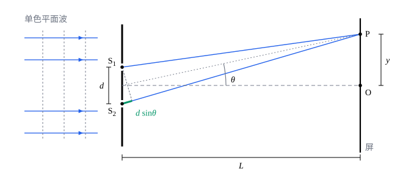

## 这一节要回答的问题

两只手电筒照在同一面墙上，墙上只是更亮了，看不到明暗相间的条纹；让一束光穿过两条靠得很近的细缝，屏上却出现一排整齐的条纹。条纹出现在哪里，间距由什么决定？光的波长只有零点几微米，怎样用尺子量出来？

## 讲解

### 光的叠加和干涉

两列光在空间某处相遇，那里的电场是两者之和。光振动得极快，眼睛和仪器看到的是光强，即电场平方的时间平均；把两列光的电场相加再平方，光强里会多出一个交叉项，它的大小取决于两列光的相位差（phase difference）。

::anchor{id="def-interference"}
两列频率相同、相位差保持不变的光叫作:term[相干光]{id="physics.optics.coherent-light"}（coherent light）；相干光叠加时，有的地方加强、有的地方减弱，叠加后的光强不等于两列光强之和，这种现象叫作:term[干涉]{id="physics.optics.interference"}（interference）。

为什么这样定义：只有相位差固定，交叉项才保持不变，明暗才稳定得能看见。边界情况：两只手电筒各自发光，两列光的相位差每时每刻都在乱变，交叉项平均下来是零，光强就是简单相加，所以墙上没有条纹；同一光源发出的光分成两束再会合，相位差才是确定的（为什么还要满足别的条件，见[相干性](lesson:physics.optics.coherence)）。

::anchor{id="thm-two-beam"}
定理（双光束干涉的光强）：两束相干光单独在某点的光强分别为$I_1$、$I_2$，相位差为$\delta$，叠加后的光强$I=I_1+I_2+2\sqrt{I_1I_2}\cos\delta$。

证明思路：某点的电场是$E=A_1\cos\omega t+A_2\cos(\omega t+\delta)$，光强正比于$E^2$的时间平均。$\cos^2\omega t$的平均是$\frac12$，$\cos\omega t\cos(\omega t+\delta)=\frac12[\cos\delta+\cos(2\omega t+\delta)]$的平均是$\frac12\cos\delta$，所以$\overline{E^2}=\frac{A_1^2}2+\frac{A_2^2}2+A_1A_2\cos\delta$。三项分别对应$I_1$、$I_2$和$2\sqrt{I_1I_2}\cos\delta$。

两束光一样强时，$I=2I_0(1+\cos\delta)=4I_0\cos^2\frac\delta2$：相位差是$2\pi$的整数倍处最亮，是单独一束的$4$倍；相位差是$\pi$的奇数倍处全暗。能量并没有凭空增减，只是重新分配：在一个明暗周期里平均，光强仍是$2I_0$。

### 光程差

::anchor{id="def-opd"}
从同一点出发的两束光走不同的路径到达某点，两条路径的:term[光程]{id="physics.optics.optical-path-length"}（optical path length）之差叫作:term[光程差]{id="physics.optics.optical-path-difference"}（optical path difference），记作$\Delta$；它造成的相位差是$\delta=\frac{2\pi\Delta}{\lambda}$，$\lambda$是光在真空中的波长。

为什么这样定义：光在:term[折射率]{id="physics.optics.refractive-index"}（refractive index）为$n$的介质里，波长缩短为$\frac\lambda n$，走过几何路程$s$，相位变化$\frac{2\pi s}{\lambda/n}=\frac{2\pi(ns)}{\lambda}$，正好用光程算；所以无论两束光经过什么介质，比较光程就能得到相位差。边界情况：光在某些界面上反射时，相位还会突然变化$\pi$，这时光程差要另加半个波长（见[薄膜干涉](lesson:physics.optics.thin-film-interference)）。

::anchor{id="def-order"}
由此，光程差是波长的整数倍，$\Delta=m\lambda$时，两束光相互加强，是亮纹；光程差是半波长的奇数倍，$\Delta=\Bigl(m+\frac12\Bigr)\lambda$时，相互抵消，是暗纹。整数$m$叫作这条亮纹（或暗纹）的:term[级次]{id="physics.optics.interference-order"}（order）。

为什么这样定义：$m$数的是光程差里有几个整波长，给条纹按光程差排了号：$m=0$是光程差为零的那条亮纹，往外依次是第$\pm1$、$\pm2$……级，不管是什么装置，同一级的条纹光程差都相同。边界情况：$m$可正可负，正负表示光程差的正负，也就是条纹在光程差为零那条的哪一侧；暗纹也用$m$编号，只是它的光程差多了半个波长。

### 杨氏双缝干涉

一束单色光先穿过一条细缝，再照到两条靠得很近的平行细缝$S_1$、$S_2$上。由:term[惠更斯原理]{id="physics.optics.huygens-principle"}（Huygens' principle），两条缝各自成为新的波源，它们来自同一个:term[波阵面]{id="physics.optics.wavefront"}（wavefront），相位差固定，是:term[相干光]{id="physics.optics.coherent-light"}。

::anchor{id="thm-young"}
定理（:term[杨氏双缝干涉]{id="physics.optics.young-double-slit"}，Young's double-slit interference）：双缝间距为$d$，屏到双缝的距离为$L\gg d$，单色光在真空中的波长为$\lambda$，缝外是空气。屏上偏离中央角度$\theta$处，两束光的:term[光程差]{id="physics.optics.optical-path-difference"}$\Delta\approx d\sin\theta$；角度很小时，离中央$y$处$\Delta\approx\frac{dy}{L}$，亮纹在$y_m=\frac{mL\lambda}d$，暗纹在$\Bigl(m+\frac12\Bigr)\frac{L\lambda}d$，相邻亮纹的间距$\Delta y=\frac{L\lambda}d$。两条缝发出的光一样强时，$I=4I_0\cos^2\frac{\pi dy}{\lambda L}$。

证明思路：屏离得远，从两条缝到屏上同一点的两条光线几乎平行，都和中轴成$\theta$。从$S_1$向$S_2P$作垂线，两条路径的差就是$S_2$到垂足的一段，等于$d\sin\theta$（见下面的图）。角度小时$\sin\theta\approx\tan\theta=\frac yL$，代入亮纹、暗纹的条件和光强公式，$\delta=\frac{2\pi}{\lambda}\cdot\frac{dy}{L}$。

条纹间距$\frac{L\lambda}d$把微小的波长放大了$\frac Ld$倍：$d$是零点几毫米、$L$是一两米时，可见光的条纹间距有几毫米，用尺子就能量。19 世纪初（1801 年、1803 年），杨（Thomas Young）在英国皇家学会的讲座里用光的:term[干涉]{id="physics.optics.interference"}说明光是波，并由干涉条纹算出了不同颜色光的波长。1961 年，约恩松（Claus Jönsson）让电子束穿过双缝，也得到了这样的条纹（见[物质波](lesson:physics.quantum-mechanics.matter-waves)）。

## 几何图像

图里的角度和缝间距都画得夸大了，实际上$d$只有$L$的千分之一左右，两条光线几乎平行。绿色的一小段是$S_2P$比$S_1P$多走的路，约为$d\sin\theta$。

:::anim{component="function-plot"}
range: { x: [-10, 10], y: [0, 1.15] }
functions:
  - expr: "cos(1000*pi*d*x/450)^2"
    label: |
      蓝光，$\lambda=450\,\mathrm{nm}$
  - expr: "cos(1000*pi*d*x/650)^2"
    label: |
      红光，$\lambda=650\,\mathrm{nm}$
sliders:
  - name: d
    min: 0.1
    max: 0.5
    step: 0.01
    default: 0.2
    label: |
      双缝间距$d$（$\mathrm{mm}$）
:::

横轴是屏上离中央的距离$y$（$\mathrm{mm}$），屏到双缝$1\,\mathrm m$；纵轴是光强，以最亮处为$1$。两条曲线分别是蓝光和红光单独照射时的条纹。红光波长长，条纹间距大；中央$y=0$处两种颜色都最亮，往外很快就错开。滑块调缝间距：$d$越大，条纹越密；用白光照射时，各种颜色的条纹叠在一起，只有中央附近几条看得清（第 8 题）。

## 例题

### 例 1　量条纹间距

用氦氖激光（波长$632.8\,\mathrm{nm}$）照射间距$0.20\,\mathrm{mm}$的双缝，屏离双缝$1.5\,\mathrm m$。求相邻亮纹的间距，以及中央亮纹两侧第 3 条亮纹之间的距离。

**为什么想到这么做**：条纹间距$\Delta y=\frac{L\lambda}d$；第$m$条亮纹离中央$m\Delta y$。

**推导**：$\Delta y=\frac{1.5\times632.8\times10^{-9}}{0.20\times10^{-3}}\,\mathrm m$，约$4.75\times10^{-3}\,\mathrm m=4.75\,\mathrm{mm}$。两侧第 3 条亮纹分别在$\pm3\Delta y$，相距$6\Delta y\approx28.5\,\mathrm{mm}$。

### 例 2　用条纹的移动量薄片的厚度

用波长$550\,\mathrm{nm}$的光做双缝实验，在一条缝后面贴上一片:term[折射率]{id="physics.optics.refractive-index"}$1.58$的薄云母片，屏上的条纹整体移动了$7$条。求云母片的厚度。

**为什么想到这么做**：云母片让这一路的:term[光程]{id="physics.optics.optical-path-length"}多了$(n-1)t$，中央亮纹（:term[光程差]{id="physics.optics.optical-path-difference"}为零的地方）就移到了原来光程差为$(n-1)t$的位置，每移一条，光程差变一个波长。

**推导**：$(n-1)t=7\lambda$，$t=\frac{7\times550\,\mathrm{nm}}{1.58-1}\approx6.64\times10^3\,\mathrm{nm}=6.64\,\mu\mathrm m$。条纹向贴了云母片的那条缝一侧移动：那一边的几何路程要短一些，才能和另一路的光程相等。

## 常见误区

- 「两只手电筒照不出条纹，说明光不是波。」它们发出的光不相干，相位差乱变，交叉项平均为零；同一光源分出的两束光才能:term[干涉]{id="physics.optics.interference"}。
- 「暗纹处的光能量消失了。」能量只是重新分配：暗纹少的那部分，亮纹多出来，一个周期里平均的光强仍是两束光之和。
- 「条纹间距和缝的宽度有关。」间距只由$L$、$\lambda$、$d$决定；缝宽影响的是条纹整体的亮暗分布（见[单缝衍射](lesson:physics.optics.single-slit-diffraction)）。
- 「:term[光程差]{id="physics.optics.optical-path-difference"}就是两条路径的几何长度之差。」有介质时要用:term[光程]{id="physics.optics.optical-path-length"}：例 2 里两路的几何长度几乎相同，光程差却有$7$个波长。
