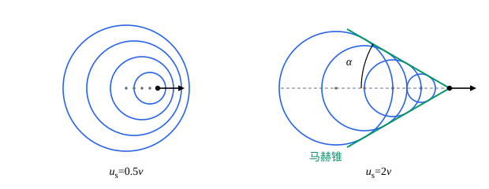

## 这一节要回答的问题

救护车鸣着笛从身边开过，笛声由高变低，车上的人听到的音调却始终不变。波源在动、观察者在动，听到的音调各变多少？飞机飞得比声音还快时，又会发生什么？

## 讲解

### 多普勒效应

::anchor{id="def-doppler"}
波源或观察者相对介质运动时，观察者接收到的:term[频率]{id="physics.oscillations-waves.frequency"}（frequency）和波源发出的频率不同，这种现象叫作:term[多普勒效应]{id="physics.oscillations-waves.doppler-effect"}（Doppler effect）；接收频率相对发出频率的变化叫作:term[频移]{id="physics.oscillations-waves.frequency-shift"}（frequency shift），接收频率比发出的低叫作:term[红移]{id="physics.oscillations-waves.redshift"}（redshift），比发出的高叫作:term[蓝移]{id="physics.oscillations-waves.blueshift"}（blueshift）。

为什么这样定义：接收到的频率是观察者每秒数到的波峰个数，波源和观察者之间的距离在变，路上的波峰就在变多或变少，每秒数到的个数也就和每秒发出的个数不同。红移、蓝移的名字来自光谱，红光在可见光里频率最低；声波也照样用这两个词。边界情况：波源和观察者都相对介质静止时，不论相距多远，接收频率都等于发出频率。

::anchor{id="thm-doppler"}
定理：介质里的:term[波速]{id="physics.oscillations-waves.wave-speed"}（wave speed）是$v$，波源发出频率为$f_0$的波，速度都相对介质。（1）观察者静止，波源以速率$u_{\mathrm s}<v$运动，它的速度和它到观察者的连线成$\theta$角，观察者离得足够远时，接收频率$f=\frac{f_0}{1-(u_{\mathrm s}/v)\cos\theta}$；（2）波源静止，观察者以速率$u_{\mathrm o}$运动，他的速度和他到波源的连线成$\theta'$角，$f=f_0\bigl(1+\frac{u_{\mathrm o}}v\cos\theta'\bigr)$。

证明思路：（1）波源每隔$\frac1{f_0}$发出一个波峰，这段时间里朝观察者走近$\frac{u_{\mathrm s}\cos\theta}{f_0}$（离得远，连线的方向几乎不变），后一个波峰少走这段路，两个波峰到达的时间间隔是$\frac1{f_0}\bigl(1-\frac{u_{\mathrm s}}v\cos\theta\bigr)$，取倒数即得；$\theta=0$时，前方相邻波峰的间距即:term[波长]{id="physics.oscillations-waves.wavelength"}（wavelength）被压缩成$\frac{v-u_{\mathrm s}}{f_0}$。（2）波源静止，波长仍是$\lambda_0=\frac v{f_0}$；由[参考系与相对运动](lesson:physics.newtonian-mechanics.relative-motion#thm-galilean)，波峰沿连线相对观察者的速度是$v+u_{\mathrm o}\cos\theta'$，他每秒遇到$\frac{v+u_{\mathrm o}\cos\theta'}{\lambda_0}$个波峰。

两种情形并不对称：波源运动时波长变了，观察者运动时波长没变。迎面运动（$\theta=0$）时两式分别是$\frac{f_0}{1-u_{\mathrm s}/v}$和$f_0\bigl(1+\frac{u_{\mathrm o}}v\bigr)$，速率小时都约等于$f_0\bigl(1+\frac uv\bigr)$，速率大了才分得开。光没有介质，[相对论多普勒效应](lesson:physics.special-relativity.relativistic-doppler)里的公式只含相对速度。

### 激波和马赫锥

::anchor{id="def-mach-cone"}
波源以大于:term[波速]{id="physics.oscillations-waves.wave-speed"}的速率$u_{\mathrm s}$运动时，它在各个时刻发出的波向四周扩展成一个个球面，这些球面的包络（envelope）是以波源为顶点、向后张开的圆锥面，叫作:term[马赫锥]{id="physics.oscillations-waves.mach-cone"}（Mach cone），$M=\frac{u_{\mathrm s}}v$叫作马赫数（Mach number）；锥面上各个波的扰动叠在一起，形成很强的压强突变，叫作激波（shock wave）。

为什么这样定义：波源比波跑得快，所有的波都落在锥面以内，锥面前方没有任何扰动；超音速飞机飞过头顶时，要等锥面扫到才听到声音，那一下的巨响叫音爆。边界情况：$u_{\mathrm s}$趋于$v$时，各个波都堆在波源正前方，$\frac{f_0}{1-u_{\mathrm s}/v}$也趋于无穷，这就是飞机接近声速时要冲破的「声障」。

::anchor{id="thm-mach-angle"}
定理：马赫锥的半顶角$\alpha$满足$\sin\alpha=\frac v{u_{\mathrm s}}=\frac1M$。

证明思路：波源$t$秒前在$P$点发出的波，此刻是以$P$为球心、半径为$vt$的球面，波源此刻在$Q$，$PQ=u_{\mathrm s}t$。从$Q$作这个球面的切线，切点到$P$的距离是$vt$，切线和$QP$的夹角满足$\sin\alpha=\frac{vt}{u_{\mathrm s}t}$，和$t$无关，所以各个时刻发出的球面都和同一个圆锥相切。

## 几何图像

两幅图都是某一时刻的截面：大的圆点是波源，箭头表示它向右运动，只表示方向，长短不按比例；蓝色的圆是先后发出的波峰此刻的位置，小圆点是发出时波源所在处。左图右边的波峰挤在一起，那里收到的:term[频率]{id="physics.oscillations-waves.frequency"}高，左边疏开，频率低。右图波源的速率是:term[波速]{id="physics.oscillations-waves.wave-speed"}的 2 倍，圆都包在绿色的:term[马赫锥]{id="physics.oscillations-waves.mach-cone"}里，锥面以外还听不到声音。

## 例题

### 例 1　驶过身边的救护车

救护车的警笛:term[频率]{id="physics.oscillations-waves.frequency"}是$700\,\mathrm{Hz}$，车以$25\,\mathrm{m/s}$驶近、再驶离站在路边的行人，声速取$340\,\mathrm{m/s}$。行人听到的频率各是多少？

**为什么想到这么做**：观察者静止、波源运动，车正对着行人驶来时$\theta=0$，驶离时$\theta=\pi$，代入定理的（1）。

**推导**：驶近时$f=\frac{700}{1-25/340}\,\mathrm{Hz}=\frac{700\times340}{315}\,\mathrm{Hz}\approx756\,\mathrm{Hz}$，驶离时$f=\frac{700}{1+25/340}\,\mathrm{Hz}=\frac{700\times340}{365}\,\mathrm{Hz}\approx652\,\mathrm{Hz}$。车开过身边时音调降了约$100\,\mathrm{Hz}$。

### 例 2　超音速飞机的音爆

飞机以马赫数$2$在离地$9.0\,\mathrm{km}$的高空水平飞行，声速取$300\,\mathrm{m/s}$，并当作不随高度变化。飞机从一个人的头顶飞过以后，再过多久他听到音爆？

**为什么想到这么做**：音爆在:term[马赫锥]{id="physics.oscillations-waves.mach-cone"}的锥面扫到人的时刻听到；锥面跟着飞机走，先求半顶角，再算锥面扫到地面上这一点时飞机飞到了哪里。

**推导**：$\sin\alpha=\frac12$，$\alpha=30^\circ$。锥面经过这个人时，他到飞机的连线和飞行方向成$30^\circ$，飞机已在他头顶前方$\frac{9.0\,\mathrm{km}}{\tan30^\circ}\approx15.6\,\mathrm{km}$处。飞机的速度是$600\,\mathrm{m/s}$，所以过了$\frac{15.6\times10^3}{600}\,\mathrm s\approx26\,\mathrm s$才听到。

## 常见误区

- 「波源以$u$靠近静止的观察者，和观察者以$u$靠近静止的波源，听到的:term[频率]{id="physics.oscillations-waves.frequency"}一样。」前者是$\frac{f_0}{1-u/v}$，后者是$f_0\bigl(1+\frac uv\bigr)$，速率越大差得越多；有介质时，谁相对介质在动是分得出来的。
- 「救护车经过身边的一瞬间，频率从高跳到低。」$\theta$从$0$连续变到$\pi$，频率也连续变化；人离车道越近，$\theta$在车经过时变得越快，音调降得越突然。
- 「超音速飞机只在冲破声障的那一刻发出音爆。」:term[马赫锥]{id="physics.oscillations-waves.mach-cone"}一直跟着超音速飞行的飞机，锥面扫过哪里，哪里就听到音爆。
