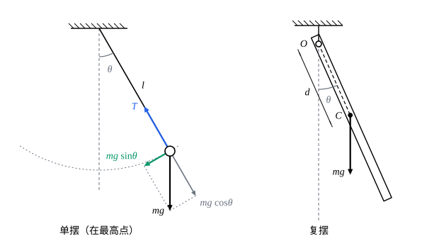

## 这一节要回答的问题

挂钟的摆为什么能计时？摆长加倍，:term[周期]{id="physics.oscillations-waves.period"}（period）变成几倍？一根直杆、一个圆环挂在钉子上摆，周期怎么算？摆得幅度大了，「周期和:term[振幅]{id="physics.oscillations-waves.amplitude"}（amplitude）无关」还成立吗？

## 讲解

### 单摆

::anchor{id="def-simple-pendulum"}
一根不能伸长、质量不计的细线，上端固定，下端挂一个可以看成质点的小球，小球在竖直平面里摆动，这样的装置叫作:term[单摆]{id="physics.oscillations-waves.simple-pendulum"}（simple pendulum）。线长$l$叫作摆长，线和竖直方向的夹角$\theta$叫作摆角。

为什么这样定义：真实的摆，摆球有大小、线有质量，还受空气的阻碍；把这些都略去，摆的运动就只由$l$和$g$决定。边界情况：摆球的大小和摆长比起来不能忽略，或者摆是一根杆时，要当作下面的:term[复摆]{id="physics.oscillations-waves.compound-pendulum"}（compound pendulum）处理。

::anchor{id="thm-simple-pendulum"}
定理：单摆的摆角满足$\ddot\theta=-\frac gl\sin\theta$；摆角很小时$\ddot\theta\approx-\frac gl\theta$，单摆近似做:term[简谐运动]{id="physics.oscillations-waves.simple-harmonic-motion"}（simple harmonic motion），:term[周期]{id="physics.oscillations-waves.period"}$T_0=2\pi\sqrt{\frac lg}$，和摆球的质量、和不大的:term[振幅]{id="physics.oscillations-waves.amplitude"}都无关。

证明思路：对悬点用转动定律（law of rotation，见[转动定律](lesson:physics.newtonian-mechanics.rotation-law#thm-rotation-law)），转动惯量（moment of inertia）$I=ml^2$。线的拉力过悬点，没有力矩（torque）；重力的力矩是$-mgl\sin\theta$，负号表示它总使摆角的大小减小。所以$ml^2\ddot\theta=-mgl\sin\theta$。摆角很小时（用弧度）$\sin\theta=\theta+o(\theta)$，略去高阶小量，就是[简谐运动](lesson:physics.oscillations-waves.simple-harmonic-motion#thm-shm-solution)的方程，$\omega_0=\sqrt{g/l}$。

质量约掉了：重力和惯性都和$m$成正比。摆长加倍，周期变为原来的$\sqrt2$倍。

### 复摆

::anchor{id="def-compound-pendulum"}
绕水平的固定转轴摆动的刚体（rigid body）叫作:term[复摆]{id="physics.oscillations-waves.compound-pendulum"}（compound pendulum），也叫物理摆（physical pendulum）。记刚体的质量为$m$、对转轴的转动惯量为$I$，转轴到质心（center of mass）的距离为$d$。

为什么这样定义：真实的摆都是有大小的物体，:term[单摆]{id="physics.oscillations-waves.simple-pendulum"}只是$I=ml^2$、$d=l$的特例。边界情况：转轴过质心（$d=0$）时，重力对转轴没有力矩，刚体停在什么方向都行，不会摆动。

::anchor{id="thm-compound-pendulum"}
定理：复摆的摆角很小时近似做:term[简谐运动]{id="physics.oscillations-waves.simple-harmonic-motion"}，:term[周期]{id="physics.oscillations-waves.period"}$T=2\pi\sqrt{\frac I{mgd}}=2\pi\sqrt{\frac{I_{\mathrm C}+md^2}{mgd}}$，$I_{\mathrm C}$是对过质心、平行于转轴的轴的转动惯量；它和摆长为$\frac I{md}$的单摆周期相同。

证明思路：重力作用在质心，对转轴的力矩是$-mgd\sin\theta$，$\theta$是转轴到质心的连线和竖直方向的夹角。由转动定律$I\ddot\theta=-mgd\sin\theta\approx-mgd\,\theta$，$\omega_0=\sqrt{\frac{mgd}I}$；再由[转动动能与平行轴定理](lesson:physics.newtonian-mechanics.rotational-energy#thm-parallel-axis)里的平行轴定理（parallel axis theorem），$I=I_{\mathrm C}+md^2$。$\frac I{md}=d+\frac{I_{\mathrm C}}{md}$比$d$长：复摆比摆长为$d$的单摆摆得慢。

### 大振幅时的周期

::anchor{id="thm-large-amplitude"}
定理：:term[振幅]{id="physics.oscillations-waves.amplitude"}为$\theta_0$（$0<\theta_0<\pi$）的:term[单摆]{id="physics.oscillations-waves.simple-pendulum"}，:term[周期]{id="physics.oscillations-waves.period"}$T=4\sqrt{\frac l{2g}}\int_0^{\theta_0}\frac{\dd\theta}{\sqrt{\cos\theta-\cos\theta_0}}$，这个反常积分（improper integral）收敛；$\theta_0$不大时，$T\approx T_0\Bigl(1+\frac{\theta_0^2}{16}\Bigr)$。

证明思路：转动动能（rotational kinetic energy）加重力势能（gravitational potential energy）守恒，$\frac12ml^2\dot\theta^2-mgl\cos\theta=-mgl\cos\theta_0$，所以摆从$0$摆到$\theta_0$时$\dot\theta=\sqrt{\frac{2g}l}\sqrt{\cos\theta-\cos\theta_0}$。这一段是四分之一周期，$\frac T4=\int_0^{\theta_0}\frac{\dd\theta}{\dot\theta}$。$\theta\to\theta_0$时被积函数无界，可$\cos\theta-\cos\theta_0$约为$\sin\theta_0\,(\theta_0-\theta)$，被积函数和$(\theta_0-\theta)^{-1/2}$同阶，由[无界函数的反常积分](lesson:math.calculus.improper-unbounded#thm-power-unbounded)里幂函数的结论和比较判别法（comparison test），积分收敛。把被积函数按$\theta$、$\theta_0$展开到二次项再积分，就得到$\frac1{16}$（第 5 题）。

振幅越大，周期越长（例 2），所以摆钟要保持小而稳定的振幅才走得准。

## 几何图像

左图在:term[单摆]{id="physics.oscillations-waves.simple-pendulum"}摆到最高点、速度为零的时刻：线的拉力正好和重力沿线的分力抵消，剩下的切向分力$mg\sin\theta$把小球拉回平衡位置，它就是这里的:term[回复力]{id="physics.oscillations-waves.restoring-force"}（restoring force）。右图的:term[复摆]{id="physics.oscillations-waves.compound-pendulum"}，重力对转轴$O$的力臂（moment arm）是$d\sin\theta$。

## 例题

### 例 1　挂在钉子上的圆环

质量为$M$、半径为$R=0.25\,\mathrm m$的均匀细圆环挂在钉子上，钉子穿过环上一点，环在竖直平面里小幅摆动，$g$取$9.8\,\mathrm{m/s^2}$。求:term[周期]{id="physics.oscillations-waves.period"}。

**为什么想到这么做**：圆环是:term[复摆]{id="physics.oscillations-waves.compound-pendulum"}，转轴（钉子）到质心（圆心）的距离$d=R$；对钉子的转动惯量用平行轴定理求。

**推导**：细圆环对过圆心、垂直于环面的轴，$I_{\mathrm C}=MR^2$，所以$I=MR^2+MR^2=2MR^2$。$T=2\pi\sqrt{\frac{2MR^2}{MgR}}=2\pi\sqrt{\frac{2R}g}=2\pi\sqrt{\frac{0.50}{9.8}}\approx1.42\,\mathrm s$：和摆长等于直径的:term[单摆]{id="physics.oscillations-waves.simple-pendulum"}一样，和质量无关。

### 例 2　摆角大了，周期变长多少

摆长$1.00\,\mathrm m$的:term[单摆]{id="physics.oscillations-waves.simple-pendulum"}，$g$取$9.80\,\mathrm{m/s^2}$，:term[振幅]{id="physics.oscillations-waves.amplitude"}分别是$30^\circ$和$90^\circ$时，:term[周期]{id="physics.oscillations-waves.period"}各是多少？

**为什么想到这么做**：先算小角度的$T_0$，再用$T\approx T_0\bigl(1+\frac{\theta_0^2}{16}\bigr)$估计，并和反常积分的数值比较。

**推导**：$T_0=2\pi\sqrt{\frac{1.00}{9.80}}\approx2.007\,\mathrm s$。$30^\circ$即$\theta_0\approx0.524$，$T\approx2.007\times(1+0.0171)\approx2.041\,\mathrm s$，数值积分得$2.042\,\mathrm s$。$90^\circ$时估计$2.317\,\mathrm s$，数值积分得$2.369\,\mathrm s$：估计式只适合中等的振幅。

## 常见误区

- 「摆球越重，摆得越慢。」:term[单摆]{id="physics.oscillations-waves.simple-pendulum"}的:term[周期]{id="physics.oscillations-waves.period"}$2\pi\sqrt{l/g}$和摆球的质量无关，重力和惯性都和质量成正比。
- 「:term[复摆]{id="physics.oscillations-waves.compound-pendulum"}就像摆长为$d$的单摆。」等效的摆长是$\frac I{md}=d+\frac{I_{\mathrm C}}{md}$，总比$d$长，复摆摆得更慢。
- 「单摆的周期和:term[振幅]{id="physics.oscillations-waves.amplitude"}完全无关。」这只在摆角很小时近似成立；振幅越大周期越长，$90^\circ$时长了约$18\%$。
