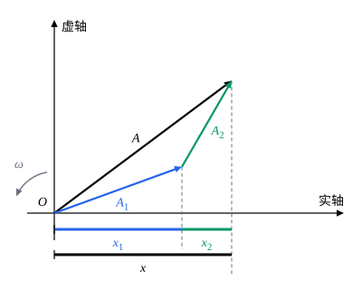

## 这一节要回答的问题

两个:term[频率]{id="physics.oscillations-waves.frequency"}（frequency）相同的:term[简谐运动]{id="physics.oscillations-waves.simple-harmonic-motion"}（simple harmonic motion）加在一起，还是简谐运动吗？合起来的:term[振幅]{id="physics.oscillations-waves.amplitude"}（amplitude）和:term[初相]{id="physics.oscillations-waves.initial-phase"}（initial phase）是多少？用三角公式硬算很繁，把余弦看成一个转动着的复数的实部，求导、相加都变成简单的复数运算。

## 讲解

### 复振幅

由欧拉公式（Euler's formula）$e^{i\theta}=\cos\theta+i\sin\theta$（见[欧拉公式与复指数](lesson:math.complex-analysis.complex-exponential#thm-euler)），$A\cos(\omega t+\varphi)$是复数$Ae^{i(\omega t+\varphi)}=Ae^{i\varphi}e^{i\omega t}$的实部。

::anchor{id="def-complex-amplitude"}
:term[简谐运动]{id="physics.oscillations-waves.simple-harmonic-motion"}$x=A\cos(\omega t+\varphi)$的:term[复振幅]{id="physics.oscillations-waves.complex-amplitude"}（complex amplitude）是复数$\tilde x=Ae^{i\varphi}$，它的模是:term[振幅]{id="physics.oscillations-waves.amplitude"}，辐角（argument）是:term[初相]{id="physics.oscillations-waves.initial-phase"}，$x=\Re\bigl(\tilde xe^{i\omega t}\bigr)$。

为什么这样定义：$e^{i\omega t}$是所有:term[角频率]{id="physics.oscillations-waves.angular-frequency"}（angular frequency）为$\omega$的振动共有的因子，一个振动的全部信息（振幅和初相）就装进了一个复数。好处是求导、相加都只是复数的乘法和加法（下面的定理）。边界情况：复振幅只在给定的角频率下有意义，不同:term[频率]{id="physics.oscillations-waves.frequency"}的振动不能只把复振幅相加；$\tilde x$乘$e^{-i\delta}$，初相减小$\delta$，表示振动落后$\delta$，乘$-1$则是反相。

本领域约定用$e^{i\omega t}$；有的书用$e^{-i\omega t}$，那时落后要乘$e^{i\delta}$。共轭复数写成$z^*$，复分析里写$\bar z$。

::anchor{id="thm-phasor-derivative"}
定理：$x=\Re\bigl(\tilde xe^{i\omega t}\bigr)$时，$\dot x=\Re\bigl(i\omega\tilde xe^{i\omega t}\bigr)$，$\ddot x=\Re\bigl(-\omega^2\tilde xe^{i\omega t}\bigr)$：求一次导数，复振幅就乘一次$i\omega$。几个同频率振动的实系数线性组合（linear combination），复振幅就是对应的线性组合。

证明思路：$\bigl(e^{i\omega t}\bigr)'=i\omega e^{i\omega t}$（见[欧拉公式与复指数](lesson:math.complex-analysis.complex-exponential#thm-exp-derivative)），而取实部和求导、和实系数的加减都可以交换次序：$\Re z_1+\Re z_2=\Re(z_1+z_2)$，$c\Re z=\Re(cz)$（$c$是实数）。复数相乘是模相乘、辐角相加（见[复数与复平面](lesson:math.complex-analysis.complex-numbers#thm-multiplication)），$i=e^{i\pi/2}$，所以乘$i\omega$就是伸长$\omega$倍、再把辐角加$\frac\pi2$：速度比位移超前$\frac\pi2$，加速度和位移反相。

例如$\ddot x=-\omega_0^2x$里代入$x=\Re\bigl(\tilde xe^{i\omega t}\bigr)$，得$(\omega_0^2-\omega^2)\tilde x=0$：含导数的方程变成了代数方程，$\tilde x\ne0$就要$\omega=\omega_0$。

### 旋转矢量

::anchor{id="def-phasor"}
在复平面上，从原点指向$\tilde xe^{i\omega t}$的矢量叫作这个振动的:term[旋转矢量]{id="physics.oscillations-waves.phasor"}（phasor）：它长$A$，以角速度（angular velocity）$\omega$逆时针转动，$t=0$时和实轴成$\varphi$角，它在实轴上的投影就是$x$。

为什么这样定义：它的终点就是[简谐运动](lesson:physics.oscillations-waves.simple-harmonic-motion#def-reference-circle)里:term[参考圆]{id="physics.oscillations-waves.reference-circle"}（reference circle）上转动的那个点，只是放进了复平面，于是复数的运算有了图像：乘$i\omega$是转$90^\circ$再伸长$\omega$倍，:term[复振幅]{id="physics.oscillations-waves.complex-amplitude"}相加就是按平行四边形法则把矢量相加（见[复数与复平面](lesson:math.complex-analysis.complex-numbers#def-complex-plane)）。边界情况：同:term[频率]{id="physics.oscillations-waves.frequency"}的几个振动，旋转矢量以同一个角速度一起转，相对位置不变，所以常常只画$t=0$时的样子，也就是复振幅本身。

::anchor{id="thm-phasor-sum"}
定理：同频率的两个:term[简谐运动]{id="physics.oscillations-waves.simple-harmonic-motion"}$x_1=A_1\cos(\omega t+\varphi_1)$、$x_2=A_2\cos(\omega t+\varphi_2)$之和仍是同频率的简谐运动（或恒为零），复振幅$\tilde x=A_1e^{i\varphi_1}+A_2e^{i\varphi_2}$，:term[振幅]{id="physics.oscillations-waves.amplitude"}$A=|\tilde x|$满足$A^2=A_1^2+A_2^2+2A_1A_2\cos(\varphi_2-\varphi_1)$。

证明思路：由上一个定理，$x_1+x_2=\Re\bigl((\tilde x_1+\tilde x_2)e^{i\omega t}\bigr)$。$A^2=\tilde x\tilde x^*=\bigl(A_1e^{i\varphi_1}+A_2e^{i\varphi_2}\bigr)\bigl(A_1e^{-i\varphi_1}+A_2e^{-i\varphi_2}\bigr)=A_1^2+A_2^2+A_1A_2\bigl(e^{i(\varphi_2-\varphi_1)}+e^{-i(\varphi_2-\varphi_1)}\bigr)$，括号里是$2\cos(\varphi_2-\varphi_1)$。在图上，这就是两个旋转矢量首尾相接组成的三角形的余弦定理。

两个振动同相（$\varphi_2-\varphi_1=0$）时$A=A_1+A_2$最大；反相（相差$\pi$）时$A=|A_1-A_2|$最小，两个振幅相等时完全抵消。

## 几何图像

图中三个矢量一起以角速度$\omega$逆时针转，形状不变。实轴下方，第一个矢量的投影$x_1$（蓝）和第二个矢量的投影$x_2$（绿）接起来，正好是合成矢量的投影$x$：两个余弦相加，就是首尾相接的两个矢量的投影相加。

## 例题

### 例 1　初相相差 120° 的两个振动

$x_1=2\cos\omega t$，$x_2=2\cos\bigl(\omega t+\frac{2\pi}3\bigr)$（单位$\mathrm{cm}$），求$x_1+x_2$。

**为什么想到这么做**：两个振动同:term[频率]{id="physics.oscillations-waves.frequency"}，把:term[复振幅]{id="physics.oscillations-waves.complex-amplitude"}相加，再读出模和辐角。

**推导**：$\tilde x=2+2e^{i2\pi/3}=2+\bigl(-1+\sqrt3\,i\bigr)=1+\sqrt3\,i$，模是$2$，辐角是$\frac\pi3$，所以$x_1+x_2=2\cos\bigl(\omega t+\frac\pi3\bigr)\,\mathrm{cm}$。两个:term[旋转矢量]{id="physics.oscillations-waves.phasor"}和合成矢量组成等边三角形：:term[振幅]{id="physics.oscillations-waves.amplitude"}相等、相差$120^\circ$时，合振动的振幅不变，:term[初相]{id="physics.oscillations-waves.initial-phase"}取在两者正中间。

### 例 2　N 个等长、依次转过同一角度的旋转矢量

$N$个同:term[频率]{id="physics.oscillations-waves.frequency"}的振动，:term[振幅]{id="physics.oscillations-waves.amplitude"}都是$a$，:term[初相]{id="physics.oscillations-waves.initial-phase"}依次是$0,\delta,2\delta,\dots,(N-1)\delta$。求合振动的振幅。

**为什么想到这么做**：:term[复振幅]{id="physics.oscillations-waves.complex-amplitude"}是等比数列$a,ae^{i\delta},\dots,ae^{i(N-1)\delta}$，先求和；在图上，$N$个等长的:term[旋转矢量]{id="physics.oscillations-waves.phasor"}首尾相接，每个比前一个多转$\delta$，排成正多边形的一段。

**推导**：$\delta$不是$2\pi$的整数倍时，$\tilde x=a\frac{e^{iN\delta}-1}{e^{i\delta}-1}$。由$e^{i\alpha}-1=e^{i\alpha/2}\bigl(e^{i\alpha/2}-e^{-i\alpha/2}\bigr)=2ie^{i\alpha/2}\sin\frac\alpha2$，得$|\tilde x|=a\Bigl|\frac{\sin(N\delta/2)}{\sin(\delta/2)}\Bigr|$。$\delta\to0$时趋于$Na$，全部同相；$N\delta=2\pi$时为零，多边形首尾闭合。光学里讲:term[单缝衍射]{id="physics.optics.diffraction"}（single-slit diffraction）时，用的就是这种首尾相接的旋转矢量。

## 常见误区

- 「振动本身是复数。」位移是实数，复数只是记账的办法，最后要取实部。加减、求导、乘实数这些线性运算可以先在复数里做再取实部；两个振动的乘积（如能量里的$x^2$）不能这样算，$\Re z_1\cdot\Re z_2\ne\Re(z_1z_2)$。
- 「两个振动相加，:term[振幅]{id="physics.oscillations-waves.amplitude"}就是两个振幅相加。」只有同相时才是；一般$A^2=A_1^2+A_2^2+2A_1A_2\cos(\varphi_2-\varphi_1)$，反相时振幅是两者之差。
- 「位移最大时速度也最大。」速度的:term[复振幅]{id="physics.oscillations-waves.complex-amplitude"}是$i\omega\tilde x$，比位移超前$\frac\pi2$：位移最大时速度为零，经过平衡位置时速度最大。
