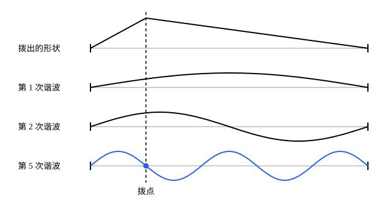

## 这一节要回答的问题

同一根吉他弦，拨在正中间，声音柔和；拨在靠近琴桥（bridge）的地方，声音清脆明亮，音调（pitch，也叫音高）却一点没变。弦还是那根弦，拨的位置改变了什么？

## 讲解

### 各次谐波的振幅

弦两端固定在$x=0$、$x=\ell$，在$x=d$处拨起$h$，成了三角形，从静止放开。[弦振动与简正模](lesson:math.pde.string-modes)把两端固定的弦的运动写成:term[简正模]{id="physics.oscillations-waves.normal-mode"}（normal mode）的叠加，那里的$L$、$c$、$u$就是这里的$\ell$、$v$、$y$。开始时各点静止，含$\sin\omega_nt$的项系数$B_n=0$（[驻波](lesson:physics.oscillations-waves.standing-waves#thm-string-modes)里的$B$是另一个量），只剩

$$
y(x,t)=\sum_{n=1}^\infty A_n\sin\frac{n\pi x}\ell\cos\omega_nt,\qquad\omega_n=\frac{n\pi v}\ell .
$$

第$n$项是:term[第$n$次谐波]{id="physics.oscillations-waves.harmonic"}（harmonic），它的:term[振幅]{id="physics.oscillations-waves.amplitude"}（amplitude）指:term[波腹]{id="physics.oscillations-waves.antinode"}（antinode）处的$\lvert A_n\rvert$。

::anchor{id="thm-plucked-amplitudes"}
定理：理想的弦（均匀，不计硬度和阻尼）两端固定在$x=0$、$x=\ell$，在$x=d$处拨成高$h$的三角形（$0<d<\ell$，$h$远小于$d$和$\ell-d$），从静止放开，则它的运动是各次谐波$A_n\sin\frac{n\pi x}\ell\cos\frac{n\pi vt}\ell$之和，$A_n=\frac{2h\ell^2}{n^2\pi^2d(\ell-d)}\sin\frac{n\pi d}\ell$，$v$是:term[波速]{id="physics.oscillations-waves.wave-speed"}（wave speed）。

证明思路：照[弦振动与简正模](lesson:math.pde.string-modes#thm-string-series)，$A_n=\frac2\ell\int_0^\ell y(x,0)\sin\frac{n\pi x}\ell\dd x$，$y(x,0)$在折角左边是$\frac{hx}d$、右边是$\frac{h(\ell-x)}{\ell-d}$；两边分开做分部积分（integration by parts），折角处的边界项相消，就得$A_n$。三角形奇延拓（odd extension）、按周期$2\ell$延开后连续、分段光滑（piecewise smooth），$t=0$时级数一致收敛（uniform convergence）到它（[傅里叶级数的收敛](lesson:math.analysis.fourier-convergence#thm-fourier-uniform)，周期换成$2\ell$同理）；$\lvert A_n\rvert$不超过常数乘$\frac1{n^2}$，别的时刻也一致收敛。折角处没有二阶导数（second derivative），级数给出的只是放宽了意思的解（[一维波动方程与达朗贝尔公式](lesson:math.pde.wave-dalembert)第 7 题）。

$A_n$里的$\frac1{n^2}$从哪里来：形状没有跳跃，只有一个折角；函数越光滑，系数衰减得越快（[傅里叶级数](lesson:math.analysis.fourier-series)第 5 题）。放开以后，弦上并不是一个:term[驻波]{id="physics.oscillations-waves.standing-wave"}（standing wave）：折角分成两个，各以$v$向两边跑开，碰到固定端倒过来弹回；各次谐波的:term[角频率]{id="physics.oscillations-waves.angular-frequency"}（angular frequency）不同，形状一直在变。

### 音色

笛子和小提琴奏同样高、同样响的一个长音，耳朵照样分得出来。

::anchor{id="def-timbre"}
音调、响度（loudness）、长短、方位都相同的两个声音，听起来仍有的差别叫作:term[音色]{id="physics.oscillations-waves.timbre"}（timbre）；持续的周期性声音里，它主要由各次:term[谐波]{id="physics.oscillations-waves.harmonic"}:term[振幅]{id="physics.oscillations-waves.amplitude"}的相对大小决定。

为什么这样定义：上面两个声音的:term[周期]{id="physics.oscillations-waves.period"}（period）相同，按傅里叶级数（Fourier series）拆开，各次谐波的相对大小却不同。各次谐波的:term[初相]{id="physics.oscillations-waves.initial-phase"}（initial phase）也影响波形，却几乎听不出来，所以只提振幅。边界情况：起音（attack）、衰减的快慢也影响音色；拨下去的一瞬间:term[频率]{id="physics.oscillations-waves.frequency"}（frequency）散得很开（[傅里叶变换](lesson:math.pde.fourier-transform)第 7 题），还谈不上哪几次谐波。

下面都是同一根弦、同一个琴身，只改拨点：弦的第$n$次谐波变成声音的比例不随拨点变，只要比较$\lvert A_n\rvert$。

### 拨点怎样改变音色

各次:term[谐波]{id="physics.oscillations-waves.harmonic"}的:term[频率]{id="physics.oscillations-waves.frequency"}$f_n=nf_1$由弦本身定（[驻波](lesson:physics.oscillations-waves.standing-waves#def-harmonics)），拨在哪里只决定每个:term[简正模]{id="physics.oscillations-waves.normal-mode"}占多少。$A_1$总不为零，弦运动的最小:term[周期]{id="physics.oscillations-waves.period"}总是$\frac1{f_1}=\frac{2\ell}v$，正是折角跑一个来回的时间（[弦的波动方程](lesson:physics.oscillations-waves.wave-equation)例 1、[驻波](lesson:physics.oscillations-waves.standing-waves)例 1 的吉他弦约$10.3\,\mathrm{ms}$）。所以拨点影响:term[音色]{id="physics.oscillations-waves.timbre"}，不影响音调。

拨点是第$n$次谐波的:term[波节]{id="physics.oscillations-waves.node"}（node）时，$\sin\frac{n\pi d}\ell=0$，第$n$、$2n$、$3n$……次谐波都没有。这和[驻波](lesson:physics.oscillations-waves.standing-waves)例 2 的轻触正好相反：碰住一点，留下的是在那里有波节的谐波；拨一点，去掉的正是它们。

拨在中点，弦的形状关于中点对称，反对称的偶数次谐波都没有（[一维链与连续极限](lesson:physics.oscillations-waves.beaded-string)第 6 题用过同样的道理），奇数次的按$\frac1{n^2}$降，声音柔。拨得很靠边，形状几乎是端点处的一个跳跃：只要$\frac{n\pi d}\ell$还很小，$\sin\frac{n\pi d}\ell\approx\frac{n\pi d}\ell$，$A_n\approx\frac{2h\ell}{n\pi(\ell-d)}$只按$\frac1n$降，高次谐波相对大得多，声音亮。用拨片（pick）比用指肚拨亮：指肚把折角磨圆了，高次谐波更小（第 6 题）。

真实的弦有硬度，弯曲时自己也反抗，高次振动方式的频率略高于$nf_1$，不叫谐波，弦上的波有:term[色散]{id="physics.oscillations-waves.dispersion"}（dispersion）。阻尼让高次的衰减得更快（[弦振动与简正模](lesson:math.pde.string-modes)第 8 题（3）），拨得太重，还会生出新的频率（见[非线性振动](lesson:physics.oscillations-waves.nonlinear-oscillators)第 6 题）。

## 几何图像

:::anim{component="function-plot"}
range: { x: [0, 21], y: [-0.05, 1] }
sequences:
  - expr: "abs(2/(n^2*pi^2*d*(1 - d))*sin(n*pi*d))"
    n: [1, 20]
    label: |
      $\lvert A_n\rvert$（以$h$为单位）
sliders:
  - name: d
    min: 0.05
    max: 0.5
    step: 0.05
    default: 0.5
    label: |
      拨点$\frac d\ell$
:::

横轴是:term[谐波]{id="physics.oscillations-waves.harmonic"}的次数$n$，纵轴（图上写作 y）是$\lvert A_n\rvert$。把拨点从中点往端点拖：中点处偶数次的圆点都落在横轴上；总的看，越靠近端点，后面的圆点相对第一个越高。

弦在$\frac\ell5$处拨成三角形，下面是第 1、2、5 次谐波的形状（高低不按比例）。竖虚线是拨点：第 5 次在那里是:term[波节]{id="physics.oscillations-waves.node"}，不出现。

## 例题

### 例 1　拨在正中间

弦在中点拨起$h$，从静止放开。哪些:term[谐波]{id="physics.oscillations-waves.harmonic"}没有？第 3 次谐波的:term[振幅]{id="physics.oscillations-waves.amplitude"}是第 1 次的几分之一？

**为什么想到这么做**：$d=\frac\ell2$代进定理，看$\sin\frac{n\pi}2$什么时候是零，再比较系数。

**推导**：$A_n=\frac{8h}{n^2\pi^2}\sin\frac{n\pi}2$，$n$为偶数时是零，只有奇数次。$\frac{\lvert A_3\rvert}{\lvert A_1\rvert}=\frac19$，第 5 次只有$\frac1{25}$：以第 1 次谐波为主，声音柔。

### 例 2　拨在$\frac\ell5$处

改在离一端$\frac\ell5$处拨起$h$。哪些:term[谐波]{id="physics.oscillations-waves.harmonic"}没有？第 2、3 次谐波的:term[振幅]{id="physics.oscillations-waves.amplitude"}各是第 1 次的多少倍？

**为什么想到这么做**：拨点是哪几次谐波的:term[波节]{id="physics.oscillations-waves.node"}，哪几次就没有；比值只和$\frac1{n^2}\sin\frac{n\pi}5$有关。

**推导**：$\sin\frac{n\pi}5=0$要$n$是 5 的倍数，第 5、10、15……次没有。比值是

$$
\frac{\lvert A_2\rvert}{\lvert A_1\rvert}=\frac14\cdot\frac{\sin(2\pi/5)}{\sin(\pi/5)}=\frac12\cos\frac\pi5\approx0.40,\qquad\frac{\lvert A_3\rvert}{\lvert A_1\rvert}=\frac19\cdot\frac{\sin(3\pi/5)}{\sin(\pi/5)}\approx0.18.
$$

和拨中点比，第 2 次从无到有，第 3 次从$0.11$升到$0.18$，声音亮得多。

## 常见误区

- 「拨中点放开，弦一直是三角形，只是高低在变。」折角分成两个跑开，中间是一段平的，弦成了梯形。
- 「声音亮，就是音调高。」音调由:term[基频]{id="physics.oscillations-waves.fundamental-frequency"}（fundamental frequency）定，亮是:term[高次谐波]{id="physics.oscillations-waves.harmonic"}相对大。
