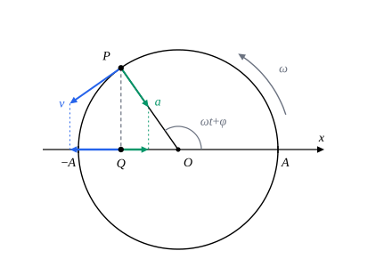

## 这一节要回答的问题

弹簧上的小球、小角度摆动的钟摆、敲过的音叉，都在某个位置两边来回运动。为什么它们的位置随时间常常按余弦变化？来回一次要多久，和偏离得多远有没有关系？知道开始时的位置和速度，就能算出以后的运动吗？

## 讲解

### 回复力

光滑水平面上，劲度系数（spring constant）为$k$的弹簧一端固定，另一端连着质量为$m$的物块。以弹簧原长时物块的位置为原点，由胡克定律（Hooke's law），物块受力$F=-kx$：偏到哪一边，力就指向另一边，物块于是来回运动。

::anchor{id="def-restoring-force"}
质点沿直线运动，离开平衡位置（合力为零的位置）时受到的、指向平衡位置的合力叫作:term[回复力]{id="physics.oscillations-waves.restoring-force"}（restoring force）。以平衡位置为原点，回复力和位移成正比、写成$F=-kx$（$k$是正的常量）时，说回复力是线性的。

为什么这样定义：回复力是按作用起的名，弹力、重力的分力或几个力的合力都可以充当。线性回复力最常见：$F(x)$在$0$处可导、$F(0)=0$时，由泰勒公式（Taylor's formula），$F(x)=F'(0)x+o(x)$（见[泰勒公式](lesson:math.calculus.taylor-polynomial#thm-peano)），$F'(0)<0$时平衡位置附近近似是$k=-F'(0)$的线性回复力。边界情况：$F=-cx^3$（$c>0$）也是回复力，可$F'(0)=0$，偏离再小也不近似是线性的。

用点表示对时间求导：$\dot x=\dv xt$，$\ddot x=\frac{\dd^2x}{\dd t^2}$。只受线性回复力时，由牛顿第二定律$m\ddot x=-kx$，即

$$
\ddot x=-\omega_0^2x,\qquad \omega_0=\sqrt{\frac km}.
$$

### 简谐运动

::anchor{id="def-shm"}
质点的位移随时间按$x=A\cos(\omega t+\varphi)$变化（$A>0$，$\omega>0$），这样的运动叫作:term[简谐运动]{id="physics.oscillations-waves.simple-harmonic-motion"}（simple harmonic motion），也叫简谐振动。$A$叫作:term[振幅]{id="physics.oscillations-waves.amplitude"}（amplitude），$\omega$叫作:term[角频率]{id="physics.oscillations-waves.angular-frequency"}（angular frequency），$\omega t+\varphi$叫作:term[相位]{id="physics.oscillations-waves.phase"}（phase），$t=0$时的相位$\varphi$叫作:term[初相]{id="physics.oscillations-waves.initial-phase"}（initial phase）。运动每隔$T=\frac{2\pi}\omega$重复一次，$T$叫作:term[周期]{id="physics.oscillations-waves.period"}（period）；单位时间里重复的次数$f=\frac1T=\frac\omega{2\pi}$叫作:term[频率]{id="physics.oscillations-waves.frequency"}（frequency），单位是赫兹（Hz）。

为什么这样定义：余弦是最简单的周期函数，写成正弦也一样，$A\sin(\omega t+\varphi)=A\cos\bigl(\omega t+\varphi-\frac\pi2\bigr)$，只是初相差$\frac\pi2$。要求$A>0$、$\omega>0$，振幅和初相才由运动唯一确定，否则$-A$和$\varphi+\pi$给出同一个运动；相位说的是振到了一个周期里的哪一步。边界情况：振幅为$0$是静止在平衡位置，不算简谐运动；初相差$2\pi$的整数倍是同一个运动，通常取在$(-\pi,\pi]$里。

::anchor{id="thm-shm-solution"}
定理：只受:term[线性回复力]{id="physics.oscillations-waves.restoring-force"}的质点，要么静止在平衡位置，要么做角频率为$\omega_0=\sqrt{k/m}$的简谐运动；周期$T=2\pi\sqrt{m/k}$只由质量和劲度系数决定，和振幅无关。

证明思路：求两次导数可以验算，$x=A\cos(\omega_0t+\varphi)$满足$\ddot x=-\omega_0^2x$。设$x(t)$是任意一个解，用下面的定理取$A$、$\varphi$，让$y=A\cos(\omega_0t+\varphi)$在$t=0$时的位移、速度和$x$相同（两者都为零时取$y\equiv0$），差$u=x-y$也满足方程，且$u(0)=\dot u(0)=0$。$\frac12m\dot u^2+\frac12ku^2$的导数是$\dot u(m\ddot u+ku)=0$，这正是[势能与机械能守恒](lesson:physics.newtonian-mechanics.potential-energy#thm-mechanical-energy)里的机械能守恒（conservation of mechanical energy）；它一直等于开始时的$0$，所以$u\equiv0$。振幅变为原来的 2 倍时，路程是原来的 2 倍，对应时刻的速度也是原来的 2 倍，周期因此不变。

### 由初位置和初速度定振幅和初相

::anchor{id="thm-initial-conditions"}
定理：$t=0$时位移为$x_0$、速度为$v_0$（两者不都为零）的:term[简谐运动]{id="physics.oscillations-waves.simple-harmonic-motion"}，:term[振幅]{id="physics.oscillations-waves.amplitude"}是$A=\sqrt{x_0^2+(v_0/\omega_0)^2}$，:term[初相]{id="physics.oscillations-waves.initial-phase"}$\varphi$由$\cos\varphi=\frac{x_0}A$、$\sin\varphi=-\frac{v_0}{\omega_0A}$确定；$x_0>0$时$\varphi=\arctan\Bigl(-\frac{v_0}{\omega_0x_0}\Bigr)$。

证明思路：在$x=A\cos(\omega_0t+\varphi)$和$\dot x=-A\omega_0\sin(\omega_0t+\varphi)$里令$t=0$，得$x_0=A\cos\varphi$、$\frac{v_0}{\omega_0}=-A\sin\varphi$，平方相加得$A$，再由$\cos\varphi$、$\sin\varphi$定出$(-\pi,\pi]$里的$\varphi$。反正切函数（arctangent）的值在$\bigl(-\frac\pi2,\frac\pi2\bigr)$里（见[隐函数与反函数的求导](lesson:math.calculus.implicit-differentiation#def-inverse-trig)），对应$\cos\varphi>0$即$x_0>0$；$x_0<0$时要再加上或减去$\pi$，$x_0=0$时$\varphi=\pm\frac\pi2$，正负号和$v_0$相反。

### 参考圆

::anchor{id="def-reference-circle"}
一个点在半径为$A$的圆上以角速度（angular velocity）$\omega$沿逆时针方向匀速转动，$t=0$时它和圆心的连线与$x$轴正方向的夹角是$\varphi$；它在$x$轴上的投影的位置是$x=A\cos(\omega t+\varphi)$，正好做:term[简谐运动]{id="physics.oscillations-waves.simple-harmonic-motion"}。这个圆叫作这个简谐运动的:term[参考圆]{id="physics.oscillations-waves.reference-circle"}（reference circle）。

为什么这样定义：转动的点和圆心的连线与$x$轴的夹角就是:term[相位]{id="physics.oscillations-waves.phase"}$\omega t+\varphi$，:term[角频率]{id="physics.oscillations-waves.angular-frequency"}就是转动的角速度，相位成了看得见的角。投影点的加速度是向心加速度（centripetal acceleration）的$x$分量，向心加速度指向圆心、大小$A\omega^2$，分量是$-\omega^2x$（见[圆周运动](lesson:physics.newtonian-mechanics.circular-motion#thm-centripetal)）：投影点和只受:term[线性回复力]{id="physics.oscillations-waves.restoring-force"}的质点满足同一个方程，那一节第 8 题的猜测由此成立。边界情况：点要是顺时针转，投影是$A\cos(\omega t-\varphi)$，:term[初相]{id="physics.oscillations-waves.initial-phase"}差一个负号，所以本领域一律取逆时针。

## 几何图像

图中$P$的速度$v$（蓝）沿切线、加速度$a$（绿）指向圆心，它们的水平分量就是投影$Q$的速度和加速度。此刻$Q$在平衡位置左边、往左走，加速度却指向平衡位置，所以越走越慢，到$x=-A$就折回来。

## 例题

### 例 1　由初位置和初速度写出运动

质量$0.50\,\mathrm{kg}$的物块连在劲度系数$50\,\mathrm{N/m}$的弹簧上，在光滑水平面上振动。$t=0$时它在平衡位置右边$0.10\,\mathrm m$处，以$1.0\,\mathrm{m/s}$的速度向左运动。写出$x(t)$，并求它第一次经过平衡位置的时刻。

**为什么想到这么做**：只受:term[线性回复力]{id="physics.oscillations-waves.restoring-force"}，运动是$x=A\cos(\omega_0t+\varphi)$，:term[振幅]{id="physics.oscillations-waves.amplitude"}和:term[初相]{id="physics.oscillations-waves.initial-phase"}由初位置和初速度定。取向右为正，$x_0=0.10\,\mathrm m$，$v_0=-1.0\,\mathrm{m/s}$。

**推导**：$\omega_0=\sqrt{\frac{50}{0.50}}=10\,\mathrm{rad/s}$，$\frac{v_0}{\omega_0}=-0.10\,\mathrm m$，$A=\sqrt{0.10^2+0.10^2}\approx0.141\,\mathrm m$。$\cos\varphi=\frac{0.10}{0.141}=\frac{\sqrt2}2$，$\sin\varphi=-\frac{v_0}{\omega_0A}=\frac{\sqrt2}2$，所以$\varphi=\frac\pi4$，$x=0.141\cos\bigl(10t+\frac\pi4\bigr)\,\mathrm m$。在:term[参考圆]{id="physics.oscillations-waves.reference-circle"}上，点从$45^\circ$出发逆时针转，转到$90^\circ$时投影第一次到达原点，用时$\frac{\pi/4}{10}\approx0.0785\,\mathrm s$。

## 常见误区

- 「:term[振幅]{id="physics.oscillations-waves.amplitude"}越大，振动得越慢。」只受:term[线性回复力]{id="physics.oscillations-waves.restoring-force"}时，:term[周期]{id="physics.oscillations-waves.period"}$2\pi\sqrt{m/k}$和振幅无关。周期随振幅变化，说明回复力不是线性的，第 7 题的$F=-cx^3$就是这样。
- 「:term[初相]{id="physics.oscillations-waves.initial-phase"}由开始时的位置决定。」初位置只定出$\cos\varphi$，还要看初速度的方向：同样从$x_0=\frac A2$出发，向$x$轴正方向运动时$\varphi=-\frac\pi3$，向负方向运动时$\varphi=\frac\pi3$。
