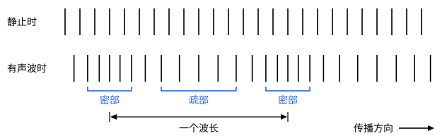

## 这一节要回答的问题

拍一下手，几米外的人立刻听见。空气没有张力，各层之间也没有绳子连着，是什么把挤压一层层传过去的？声音在水里比在空气里快，又是为什么？

## 讲解

### 体积模量

堵住注射器的口推活塞，空气被压缩、压强（pressure）变大，松手后活塞弹回；装满水时几乎推不动。

::anchor{id="def-bulk-modulus"}
一定量的流体（fluid）沿某种过程被压缩或膨胀时，压强$p$随体积$V$变化，$K=-V\dv pV$叫作这种过程的:term[体积模量]{id="physics.oscillations-waves.bulk-modulus"}（bulk modulus）；过程中温度不变的叫作等温体积模量（isothermal bulk modulus），和外界没有热量交换的叫作绝热体积模量（adiabatic bulk modulus）。

为什么这样定义：体积减小一个小的比例，压强约增加这个比例的$K$倍，负号让$K$为正。它像弹簧的劲度系数（spring constant），却和取多大一块流体无关，说的是流体本身多「硬」。这里的$K$不是动能，也不是:term[耦合振子]{id="physics.oscillations-waves.coupled-oscillators"}（coupled oscillators）的矩阵。

边界情况：水的$K$约为$2.2\times10^9\,\mathrm{Pa}$，加一个大气压（atmospheric pressure）体积只缩小约十万分之五，所以常把液体当作不能压缩；水的两种体积模量只差约 1%，气体的差得多，声音里取哪一个见[气体中的声速](lesson:physics.oscillations-waves.gas-sound-speed)。

### 声波的波动方程

设想一柱沿水平的$x$轴放着的流体，截面积为$S$，静止时压强为$p_0$（不是液面上的压强）、密度为$\rho_0$。静止时在$x$处的一层，$t$时刻沿$x$轴移动了$\xi(x,t)$，压强是$p(x,t)$，同一截面上各处相同；各层沿传播方向振动，这是:term[纵波]{id="physics.oscillations-waves.longitudinal-wave"}（longitudinal wave）。把流体看成连续的，要求:term[波长]{id="physics.oscillations-waves.wavelength"}（wavelength）远大于分子间距和:term[平均自由程]{id="physics.thermal-physics.mean-free-path"}（mean free path，空气里约$70\,\mathrm{nm}$）。

为什么会想到:term[波动方程]{id="physics.oscillations-waves.wave-equation"}（wave equation）：把这柱流体切成厚$a$的薄层，每层像:term[一维链]{id="physics.oscillations-waves.beaded-string"}（beaded string）里质量为$\rho_0Sa$的小球；一层被压薄$\Delta a$，压强约升高$\frac{K\Delta a}a$，像劲度系数为$\frac{KS}a$的弹簧。照那里的[连续极限](lesson:physics.oscillations-waves.beaded-string#thm-continuum-limit)（continuum limit），「张力除以间距」换成$\frac{KS}a$、线密度（linear density）换成$\rho_0S$，得到下面的方程。

::anchor{id="thm-sound-equation"}
定理：连续、不计黏性（viscosity）的流体静止时，$p_0$、$\rho_0$沿水平的$x$轴处处相同；沿$x$轴传播的一维扰动:term[振幅]{id="physics.oscillations-waves.amplitude"}（amplitude）很小（$|\xi_x|\ll1$，$|p-p_0|\ll p_0$）时，$p-p_0=-K\xi_x$，$\rho_0\xi_{tt}=K\xi_{xx}$，$p-p_0$也满足同一个方程；$K$是各层所经历的那种过程的:term[体积模量]{id="physics.oscillations-waves.bulk-modulus"}。

证明思路：静止时在$x$到$x+\Delta x$之间的一薄层，质量$\rho_0S\Delta x$不变，此刻厚度约为$(1+\xi_x)\Delta x$，体积的相对变化是$\xi_x$；由[泰勒公式](lesson:math.calculus.taylor-polynomial)（Taylor's formula）在静止时的体积$V$处取一阶近似，$p-p_0\approx\dv pV\cdot V\xi_x=-K\xi_x$。两侧流体推它的力是$p(x,t)S$和$p(x+\Delta x,t)S$，静止时平衡（见[静止流体中的压强](lesson:physics.newtonian-mechanics.fluid-statics)）；由牛顿第二定律（Newton's second law），$\rho_0S\Delta x\,\xi_{tt}=\bigl(p(x,t)-p(x+\Delta x,t)\bigr)S$，除以$S\Delta x$再令$\Delta x\to0$，得$\rho_0\xi_{tt}=-p_x=K\xi_{xx}$。对$x$求偏导数（partial derivative）再乘$-K$，就得$p-p_0$的方程。

$p-p_0=-K\xi_x$说明，推回各层的是压缩、膨胀造成的压强差。不计黏性的流体对接触面只能垂直地推，两层横着错开时没有力拉回，所以其中的声音只能是纵波，固体里还能传:term[横波]{id="physics.oscillations-waves.transverse-wave"}（transverse wave）。振幅很大时，波形越传越陡，最后出现压强的突变（见[非线性一阶方程与激波](lesson:math.pde.burgers-shocks)）；三维情形见[平面波与球面波](lesson:physics.oscillations-waves.waves-in-3d)。

### 声速

::anchor{id="def-sound-wave"}
声音在气体、液体、固体里以机械波（mechanical wave）的形式传播，这种波叫作:term[声波]{id="physics.oscillations-waves.sound-wave"}（sound wave）；流体里的声波就是上面这种压缩和膨胀。声波相对静止的介质传播的速度叫作:term[声速]{id="physics.oscillations-waves.speed-of-sound"}（speed of sound），也叫音速。

为什么这样定义：耳朵听到声音，是空气压强的起伏推动了鼓膜（eardrum）。声速取相对介质的，因为有风时，相对地面的速度还要加上风速（见[参考系与相对运动](lesson:physics.newtonian-mechanics.relative-motion#thm-galilean)）。边界情况：真空里没有介质，就没有声波；人耳听不到的超声波（ultrasound）、次声波（infrasound）也是声波。

::anchor{id="thm-sound-speed"}
定理：在声波的:term[波动方程]{id="physics.oscillations-waves.wave-equation"}那条定理的条件下，声速$v=\sqrt{K/\rho_0}$；不计热传导（heat conduction）时，$K$取:term[绝热体积模量]{id="physics.oscillations-waves.bulk-modulus"}（见[气体中的声速](lesson:physics.oscillations-waves.gas-sound-speed)）。

证明思路：把$\rho_0\xi_{tt}=K\xi_{xx}$写成$\xi_{tt}=\frac K{\rho_0}\xi_{xx}$，和波动方程$y_{tt}=v^2y_{xx}$对照，$v^2=\frac K{\rho_0}$；由[弦的波动方程](lesson:physics.oscillations-waves.wave-equation#thm-traveling-wave)，$\xi=f(x-vt)$是以$v$向右平移的:term[行波]{id="physics.oscillations-waves.traveling-wave"}（traveling wave）。

弦上的:term[波速]{id="physics.oscillations-waves.wave-speed"}（wave speed）是张力除以线密度再开方，这里同样是「硬度」除以惯性再开方。

### 压强和位移

设:term[声波]{id="physics.oscillations-waves.sound-wave"}是:term[简谐波]{id="physics.oscillations-waves.harmonic-wave"}（harmonic wave），照[简谐波](lesson:physics.oscillations-waves.harmonic-waves#thm-complex-wave)写成$\xi=\Re\bigl(\tilde Ae^{i(\omega t-kx)}\bigr)$，$\tilde A=Ae^{i\varphi}$。对$x$求导是乘$-ik$，所以$p-p_0=\Re\bigl(iKk\tilde Ae^{i(\omega t-kx)}\bigr)$：压强变化的:term[复振幅]{id="physics.oscillations-waves.complex-amplitude"}（complex amplitude）是$iKk\tilde A$，模$KkA=\rho_0v\omega A$，辐角（argument）比$\tilde A$的大$\frac\pi2$，压强的变化比位移超前四分之一个:term[周期]{id="physics.oscillations-waves.period"}（period）。所以位移为零的那一层压缩或膨胀得最厉害。

## 几何图像

竖线代表一层层空气。:term[声波]{id="physics.oscillations-waves.sound-wave"}经过时，挤紧处叫作密部（compression），压强高于$p_0$；疏开处叫作疏部（rarefaction），压强低于$p_0$。

:::anim{component="function-plot"}
range: { x: [0, 12.6], y: [-1.5, 1.5] }
functions:
  - expr: "cos(s - x)"
    label: |
      位移$\xi$（以$A$为单位）
  - expr: "-sin(s - x)"
    label: |
      压强的变化$p-p_0$（以$KkA$为单位）
points:
  - { x: "s + pi/2", y: "1" }
sliders:
  - name: s
    min: 0
    max: 6.28
    step: 0.01
    default: 0
    label: |
      $\omega t$
:::

横轴是$kx$（图上写作 x），拖动$\omega t$两条线一起右移。圆点跟着压强最高处，那里位移为零。

:::anim{component="oscillator"}
masses: [1, 1, 1, 1, 1, 1, 1, 1]
springs: [c, c, c, c, c, c, c, c, c]
initial: [1, 0, 0, 0, 0, 0, 0, 0]
dt: 0.01
sliders:
  - name: c
    min: 0.5
    max: 4
    step: 0.1
    default: 1
    label: |
      弹簧的劲度系数（相当于$\frac{KS}a$）
:::

物块相当于一层层空气，弹簧相当于层间的空气。最左边的物块往右挪一点再放开，挤紧处一个接一个往右传，劲度系数越大传得越快。曲线图的纵轴是位移$\xi$，图上写作 x。

## 例题

### 例 1　空气的体积模量

$20\,^\circ\mathrm C$的空气密度约为$1.20\,\mathrm{kg/m^3}$，实测:term[声速]{id="physics.oscillations-waves.speed-of-sound"}约为$343\,\mathrm{m/s}$。求它的:term[体积模量]{id="physics.oscillations-waves.bulk-modulus"}，并和[静止流体中的压强](lesson:physics.newtonian-mechanics.fluid-statics)第 5 题「空气的密度和压强成正比」的模型比较。

**为什么想到这么做**：声速的定理反过来就是$K=\rho_0v^2$；一定量空气的体积和密度成反比，$K=-V\dv pV=\rho\dv p\rho$，正好用上那个模型。

**推导**：$K=1.20\times343^2\,\mathrm{Pa}\approx1.41\times10^5\,\mathrm{Pa}$，约是大气压的 1.4 倍。$\rho\propto p$时$\dv p\rho=\frac p\rho$，$K=p\approx1.01\times10^5\,\mathrm{Pa}$，实测值多出约四成，原因见[气体中的声速](lesson:physics.oscillations-waves.gas-sound-speed)。

### 例 2　水里的声速

水的:term[体积模量]{id="physics.oscillations-waves.bulk-modulus"}约为$2.2\times10^9\,\mathrm{Pa}$，密度约为$998\,\mathrm{kg/m^3}$。求水中的:term[声速]{id="physics.oscillations-waves.speed-of-sound"}；水的密度比空气大得多，声音为什么反而更快？

**为什么想到这么做**：代入声速的定理，再和例 1 比。

**推导**：$v=\sqrt{\frac{2.2\times10^9}{998}}\,\mathrm{m/s}\approx1.48\times10^3\,\mathrm{m/s}$，和[简谐波](lesson:physics.oscillations-waves.harmonic-waves)第 7 题的$1480\,\mathrm{m/s}$对得上。水的密度约是空气的 830 倍，体积模量却约是空气的$1.6\times10^4$倍，声速约是空气里的 4.3 倍。

## 常见误区

- 「声音传过来，是空气从声源那里流到了耳边。」:term[振幅]{id="physics.oscillations-waves.amplitude"}很小时，每层空气只在原位附近振动：向右传播的:term[行波]{id="physics.oscillations-waves.traveling-wave"}里$\xi_t=-v\xi_x$，层的速度只是:term[声速]{id="physics.oscillations-waves.speed-of-sound"}的$|\xi_x|$倍；传过来的是压缩和膨胀。
