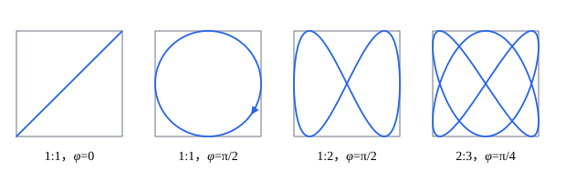

## 这一节要回答的问题

两个音叉的音调几乎一样，同时敲响时，声音为什么一阵强一阵弱？强弱变化的快慢由什么决定？把两个振动分别加在示波器的水平方向和竖直方向，屏幕上的亮点会画出什么图形？

## 讲解

### 同方向、频率相近的振动：拍

两个同方向的振动$x_1=A\cos\omega_1t$、$x_2=A\cos\omega_2t$，用和差化积，

$$
x_1+x_2=2A\cos\frac{(\omega_1-\omega_2)t}2\cos\frac{(\omega_1+\omega_2)t}2.
$$

$\omega_1$、$\omega_2$很接近时，第二个余弦变得快，第一个变得慢：合振动以:term[角频率]{id="physics.oscillations-waves.angular-frequency"}（angular frequency）$\frac{\omega_1+\omega_2}2$快速振动，「:term[振幅]{id="physics.oscillations-waves.amplitude"}（amplitude）」$2A\Bigl|\cos\frac{(\omega_1-\omega_2)t}2\Bigr|$慢慢地时大时小。

::anchor{id="def-beats"}
两个同方向、:term[频率]{id="physics.oscillations-waves.frequency"}（frequency）相近的振动叠加，合振动的振幅周期性地时大时小，这种现象叫作:term[拍]{id="physics.oscillations-waves.beats"}（beats）；单位时间里振幅变大、变小的次数$|f_1-f_2|$叫作:term[拍频]{id="physics.oscillations-waves.beat-frequency"}（beat frequency）。

为什么这样定义：$\cos\frac{(\omega_1-\omega_2)t}2$的频率是$\frac{|f_1-f_2|}2$，可它的绝对值每过半个:term[周期]{id="physics.oscillations-waves.period"}（period）就重复一次，响度在它的一个周期里大两次，所以耳朵听到的强弱变化频率是$|f_1-f_2|$。边界情况：$f_1=f_2$时振幅不随时间变，没有拍；$|f_1-f_2|$大到每秒十几次以上时，耳朵就跟不上强弱的变化，听到的是两个音或一种粗糙的声音。

::anchor{id="thm-beats"}
定理：$x_1=A_1\cos(\omega_1t+\varphi_1)$和$x_2=A_2\cos(\omega_2t+\varphi_2)$叠加，两个:term[旋转矢量]{id="physics.oscillations-waves.phasor"}（phasor）的合成矢量的长度$A(t)$满足$A(t)^2=A_1^2+A_2^2+2A_1A_2\cos\bigl((\omega_2-\omega_1)t+\varphi_2-\varphi_1\bigr)$，在$A_1+A_2$和$|A_1-A_2|$之间以频率$|f_1-f_2|$变化。

证明思路：两个旋转矢量转得快慢略有不同，它们之间的夹角是$(\omega_2-\omega_1)t+\varphi_2-\varphi_1$，随时间均匀增大。由[复数表示与旋转矢量](lesson:physics.oscillations-waves.phasors#thm-phasor-sum)里两个矢量合成的余弦定理即得；夹角每增加$2\pi$，合成矢量的长度就重复一次。两个矢量方向一致时最长，相反时最短，振幅不等时最弱也不为零。

### 互相垂直的振动

一个点同时在$x$方向做$x=A\cos\omega_1t$、在$y$方向做$y=B\cos(\omega_2t+\varphi)$，它在平面上画出的轨迹由这两个参数方程（parametric equations）给出（见[参数曲线](lesson:math.calculus.parametric-curves#def-parametric-equations)）。

::anchor{id="thm-perpendicular"}
定理：$\omega_1=\omega_2=\omega$时，轨迹满足$\frac{x^2}{A^2}+\frac{y^2}{B^2}-\frac{2xy}{AB}\cos\varphi=\sin^2\varphi$：$\varphi=0$或$\pi$时是一条过原点的线段，其他情形是一个椭圆，$0<\varphi<\pi$时点沿顺时针方向走，$-\pi<\varphi<0$时沿逆时针方向走。

证明思路：$\frac yB=\frac xA\cos\varphi-\sin\omega t\,\sin\varphi$，把$\frac yB-\frac xA\cos\varphi=-\sin\omega t\sin\varphi$和$\frac xA\sin\varphi=\cos\omega t\sin\varphi$两边平方相加，消去$t$即得。转向：$t=0$时点在最右边$x=A$，$\dot y=-B\omega\sin\varphi$，$0<\varphi<\pi$时为负，点在最右边往下走，是顺时针。

::anchor{id="def-lissajous"}
$x=A\cos\omega_1t$、$y=B\cos(\omega_2t+\varphi)$画出的轨迹叫作:term[李萨如图形]{id="physics.oscillations-waves.lissajous-figure"}（Lissajous figure）。

为什么这样定义：图形的样子由:term[频率]{id="physics.oscillations-waves.frequency"}比$\frac{\omega_1}{\omega_2}$和$\varphi$决定，一眼就能读出两个振动的频率比。比是有理数$\frac pq$（最简分数）时，点经过时间$\frac{2\pi q}{\omega_2}$回到出发点、速度也一样，图形是闭合曲线；比是无理数时永远不闭合，慢慢画满整个$2A\times2B$的矩形。边界情况：频率相等时就是上面的椭圆或线段。

读频率比的办法：一个:term[周期]{id="physics.oscillations-waves.period"}里，点碰到右边$x=A$的次数等于$x$振动的次数，碰到上边$y=B$的次数等于$y$振动的次数，所以$f_x:f_y$等于图形和竖直边的切点数与和水平边的切点数之比（$\varphi$取一般的值，切点不在角上时）。

## 几何图像

:::anim{component="function-plot"}
range: { x: [0, 3], y: [-2.3, 2.3] }
functions:
  - expr: "cos(2*pi*10*x) + cos(2*pi*(10 + d)*x)"
    label: |
      两个振动之和
  - expr: "2*abs(cos(pi*d*x))"
    label: |
      合振动的振幅
sliders:
  - name: d
    min: 0.2
    max: 3
    step: 0.1
    default: 1
    label: |
      频率差$f_2-f_1$（Hz）
:::

横轴是时间（秒，图上写作$x$），两个:term[振幅]{id="physics.oscillations-waves.amplitude"}相等的振动，:term[频率]{id="physics.oscillations-waves.frequency"}是$10\,\mathrm{Hz}$和$10\,\mathrm{Hz}+(f_2-f_1)$。橙线是合振动的振幅：拖动频率差，每秒变大变小的次数正好是频率差，频率差越小，:term[拍]{id="physics.oscillations-waves.beats"}越慢。

四幅图都画在$2A\times2B$（这里$A=B$）的方框里。第二幅转向的判断见上面的定理；后两幅数一数切点：$1:2$的图和竖直边相切 1 次、和水平边相切 2 次，$2:3$的图分别是 2 次和 3 次。

## 例题

### 例 1　两个音叉

:term[频率]{id="physics.oscillations-waves.frequency"}$440\,\mathrm{Hz}$的音叉和另一个音叉同时敲响，听到每秒 3 次强弱变化。给第二个音叉的叉臂粘上一小块橡皮泥（它的频率随之略降），强弱变化变慢了。第二个音叉原来的频率是多少？

**为什么想到这么做**：:term[拍频]{id="physics.oscillations-waves.beat-frequency"}只告诉我们$|f_1-f_2|$，不知道谁高谁低；看频率往一个方向变时拍频变大还是变小，就能定下来。

**推导**：$|f_2-440|=3\,\mathrm{Hz}$，$f_2$是$443\,\mathrm{Hz}$或$437\,\mathrm{Hz}$。粘了橡皮泥$f_2$降低，:term[拍]{id="physics.oscillations-waves.beats"}变慢说明$|f_2-440|$变小，$f_2$在向$440$靠近，所以原来$f_2=443\,\mathrm{Hz}$；如果原来是$437\,\mathrm{Hz}$，降低后拍会变快。

### 例 2　频率比 1:2 的图形

$x=A\cos\omega t$，$y=A\cos\bigl(2\omega t+\frac\pi2\bigr)$。轨迹是什么形状？

**为什么想到这么做**：$y=-A\sin2\omega t=-2A\sin\omega t\cos\omega t$，用$x$表示$\cos\omega t$，消去$t$。

**推导**：$\cos\omega t=\frac xA$，$\sin\omega t=\pm\sqrt{1-\frac{x^2}{A^2}}$，所以$y^2=4x^2\bigl(1-\frac{x^2}{A^2}\bigr)$。曲线过原点两次，左右各一个圈，像横放的 8 字；$y$在$x=\pm\frac A{\sqrt2}$处达到$\pm A$，和上边、下边各相切两次，和左边、右边各相切一次，切点数之比$1:2$正是$f_x:f_y$。

## 常见误区

- 「:term[拍频]{id="physics.oscillations-waves.beat-frequency"}是两个:term[频率]{id="physics.oscillations-waves.frequency"}之差的一半。」$\cos\frac{(\omega_1-\omega_2)t}2$的频率是一半，可响度在它的一个:term[周期]{id="physics.oscillations-waves.period"}里大两次，听到的强弱变化频率是$|f_1-f_2|$。
- 「出现:term[拍]{id="physics.oscillations-waves.beats"}时，合振动的频率是$|f_1-f_2|$。」合振动以平均频率$\frac{f_1+f_2}2$振动，$|f_1-f_2|$只是:term[振幅]{id="physics.oscillations-waves.amplitude"}强弱变化的频率。
- 「两个互相垂直、频率相同的振动合成的轨迹是圆。」只有$A=B$、$\varphi=\pm\frac\pi2$时才是圆；一般是椭圆，$\varphi=0$、$\pi$时退化成线段。
