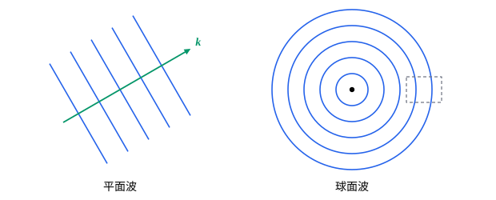

## 这一节要回答的问题

弦上的波只沿一条线跑，声音和光却向四面八方传开。三维的波怎样说清它往哪个方向传？点波源发出的波越传越弱，为什么正好和距离成反比地变弱？

## 讲解

### 波阵面

:term[波动方程]{id="physics.oscillations-waves.wave-equation"}（wave equation）推广到三维，是$\psi_{tt}=v^2\nabla^2\psi$，$\psi(\vb r,t)$是空间各点的扰动，例如声波里空气压强的变化，$\nabla^2$是拉普拉斯算子（Laplacian）。均匀、各向同性的介质里的声波满足这样的方程，电磁波也是（见[真空中的电磁波](lesson:physics.electromagnetism.em-waves)）。

::anchor{id="def-wavefront"}
同一时刻振动的:term[相位]{id="physics.oscillations-waves.phase"}（phase）相同的各点连成的面，叫作:term[波阵面]{id="physics.oscillations-waves.wavefront"}（wavefront）；波阵面是一族平行平面的波叫作:term[平面波]{id="physics.oscillations-waves.plane-wave"}（plane wave），是一族同心球面的叫作:term[球面波]{id="physics.oscillations-waves.spherical-wave"}（spherical wave）。

为什么这样定义：波阵面记下了波此刻传到了哪里，它往哪里移，波就往哪里传。平面波只沿一个方向传播，$\psi$只随沿这个方向的坐标和时间变化；点波源在各向同性的介质里向各个方向同样地传播，波阵面是以它为中心的球面。边界情况：离点波源很远时，只看一小块地方，球面几乎是平的，球面波可以当平面波算。

### 平面简谐波

::anchor{id="def-wave-vector"}
沿单位矢量$\hat{\vb n}$方向传播、随时间作简谐变化的:term[平面波]{id="physics.oscillations-waves.plane-wave"}写成$\psi=A\cos(\omega t-\vb k\cdot\vb r+\varphi)$，$\vb k=k\hat{\vb n}$叫作它的:term[波矢]{id="physics.oscillations-waves.wave-vector"}（wave vector），$k$是:term[波数]{id="physics.oscillations-waves.wave-number"}（wave number）。

为什么这样定义：$\vb k\cdot\vb r=k\,\hat{\vb n}\cdot\vb r$，:term[相位]{id="physics.oscillations-waves.phase"}只和$\vb r$沿$\hat{\vb n}$的分量有关，垂直于$\hat{\vb n}$的每个平面上相位都相同，这些平面就是:term[波阵面]{id="physics.oscillations-waves.wavefront"}。一个矢量同时说清了传播方向和:term[波长]{id="physics.oscillations-waves.wavelength"}（wavelength）$\lambda=\frac{2\pi}{\lvert\vb k\rvert}$；$\hat{\vb n}$取$x$轴方向时，就是[简谐波](lesson:physics.oscillations-waves.harmonic-waves#def-harmonic-wave)里的$A\cos(\omega t-kx+\varphi)$。边界情况：电磁学写$\cos(\vb k\cdot\vb r-\omega t)$，和这里只差:term[初相]{id="physics.oscillations-waves.initial-phase"}（initial phase）的符号。

::anchor{id="thm-plane-wave"}
定理：$\psi=A\cos(\omega t-\vb k\cdot\vb r+\varphi)$满足三维的:term[波动方程]{id="physics.oscillations-waves.wave-equation"}，当且仅当$\lvert\vb k\rvert=\frac\omega v$；这时波阵面以速度$v$沿$\vb k$的方向前进。

证明思路：记$\theta=\omega t-\vb k\cdot\vb r+\varphi$，$\nabla\theta=-\vb k$，$\nabla\cos\theta=\vb k\sin\theta$，再取散度（divergence）得$\nabla^2\cos\theta=-\lvert\vb k\rvert^2\cos\theta$；对$t$求两次导数是乘$-\omega^2$，所以方程成立当且仅当$\omega^2=v^2\lvert\vb k\rvert^2$。相位等于某个常数的平面满足$\hat{\vb n}\cdot\vb r=\frac{\omega t+\text{常数}}k$，沿$\hat{\vb n}$以$\frac\omega k=v$移动。

### 球面波

::anchor{id="thm-spherical-wave"}
定理：对任何二阶可导的函数$f$，$\psi=\frac{f(r-vt)}r$（$r>0$，$r$是到原点的距离）满足三维的:term[波动方程]{id="physics.oscillations-waves.wave-equation"}；它是从原点向外传播的:term[球面波]{id="physics.oscillations-waves.spherical-wave"}，形状不变，:term[振幅]{id="physics.oscillations-waves.amplitude"}（amplitude）和$r$成反比。

证明思路：$\psi$只和$r$有关时，$\nabla\psi=\psi'\frac{\vb r}r$（撇号表示对$r$求导），再用散度的乘积法则（product rule）和$\nabla\cdot\vb r=3$，得$\nabla^2\psi=\psi''+\frac2r\psi'$（同[向量微分恒等式与拉普拉斯算子](lesson:math.vector-calculus.vector-identities)第 8 题），它等于$\frac1r\frac{\partial^2(r\psi)}{\partial r^2}$。于是方程化成$\frac{\partial^2(r\psi)}{\partial t^2}=v^2\frac{\partial^2(r\psi)}{\partial r^2}$：$r\psi$满足一维的波动方程，由[弦的波动方程](lesson:physics.oscillations-waves.wave-equation#thm-traveling-wave)，$r\psi=f(r-vt)$是它的解。

振幅为什么偏偏按$\frac1r$衰减，从能量看最清楚。线性的波整体放大$c$倍仍是解，各处的位移、速度、形变都变为$c$倍；单位时间穿过单位面积的能量，即:term[能流]{id="physics.oscillations-waves.energy-flux"}（energy flux），是那里的作用力做功的功率（power），力和形变成正比，速度也变为$c$倍，所以能流和振幅的平方成正比。点波源每秒发出的能量一定，穿过半径为$r$的球面的总功率处处相同，球面积是$4\pi r^2$，能流就和$\frac1{r^2}$成正比，振幅和$\frac1r$成正比，和上面的定理一致。

离点波源很远时，在一个比$r$小得多的范围里，$\frac1r$几乎不变，球面几乎是平的，球面波近似是沿径向传播的:term[平面波]{id="physics.oscillations-waves.plane-wave"}。

## 几何图像

两幅图都是某一时刻的截面，蓝线是:term[相位]{id="physics.oscillations-waves.phase"}相同的:term[波阵面]{id="physics.oscillations-waves.wavefront"}，相邻两条相距一个:term[波长]{id="physics.oscillations-waves.wavelength"}。左图的:term[平面波]{id="physics.oscillations-waves.plane-wave"}，绿色的:term[波矢]{id="physics.oscillations-waves.wave-vector"}垂直于波阵面，波阵面沿它的方向前进。右图的:term[球面波]{id="physics.oscillations-waves.spherical-wave"}从中间的圆点向外扩展，离点波源远一些的地方（虚线框），两条圆弧已经很接近平行的直线。

## 例题

### 例 1　写出斜着传播的平面波

:term[频率]{id="physics.oscillations-waves.frequency"}（frequency）为$680\,\mathrm{Hz}$的声波在空气里沿$xy$平面内、和$x$轴、$y$轴都成$45^\circ$的方向传播，声速取$340\,\mathrm{m/s}$，:term[振幅]{id="physics.oscillations-waves.amplitude"}为$A$。写出这列:term[平面波]{id="physics.oscillations-waves.plane-wave"}，并求同一时刻原点和点$(0.25\,\mathrm m,0,0)$的相位差。

**为什么想到这么做**：$\lvert\vb k\rvert=\frac\omega v$，方向沿$\frac1{\sqrt2}(1,1,0)$；两点的相位差是$\vb k\cdot\Delta\vb r$。

**推导**：$\lambda=\frac{340}{680}\,\mathrm m=0.50\,\mathrm m$，$\lvert\vb k\rvert=\frac{2\pi}\lambda=4\pi\,\mathrm{rad/m}$，$\vb k=2\sqrt2\pi(1,1,0)\,\mathrm{rad/m}$，$\psi=A\cos\bigl(1360\pi t-2\sqrt2\pi(x+y)\bigr)$。相位差$\vb k\cdot\Delta\vb r=2\sqrt2\pi\times0.25\approx2.22$：沿$x$轴走$0.25\,\mathrm m$，只相当于沿传播方向走了$\frac{0.25}{\sqrt2}\,\mathrm m$。

### 例 2　点声源的远近

点声源向四周均匀地发声。离它$2.0\,\mathrm m$处和$10\,\mathrm m$处，声波的:term[振幅]{id="physics.oscillations-waves.amplitude"}之比和:term[能流]{id="physics.oscillations-waves.energy-flux"}之比各是多少？

**为什么想到这么做**：:term[球面波]{id="physics.oscillations-waves.spherical-wave"}的振幅和$r$成反比，能流和振幅的平方成正比。

**推导**：振幅之比$\frac{10}{2.0}=5$，能流之比$25$：离开 5 倍远，振幅变为五分之一，每平方米接收到的功率变为二十五分之一。

## 常见误区

- 「:term[球面波]{id="physics.oscillations-waves.spherical-wave"}的:term[振幅]{id="physics.oscillations-waves.amplitude"}和距离的平方成反比。」和距离的平方成反比的是:term[能流]{id="physics.oscillations-waves.energy-flux"}，振幅只和距离成反比。
- 「:term[波矢]{id="physics.oscillations-waves.wave-vector"}的方向就是介质里各点振动的方向。」波矢指的是传播方向；:term[横波]{id="physics.oscillations-waves.transverse-wave"}（transverse wave）里振动方向和波矢垂直，:term[纵波]{id="physics.oscillations-waves.longitudinal-wave"}（longitudinal wave）里和波矢平行。
- 「离点波源很远，球面波就变成了:term[平面波]{id="physics.oscillations-waves.plane-wave"}，振幅不再减小。」只在一小块范围里近似是平面波；从远处再走远，振幅照样按$\frac1r$减小，只是在这一小块里变得很少。
