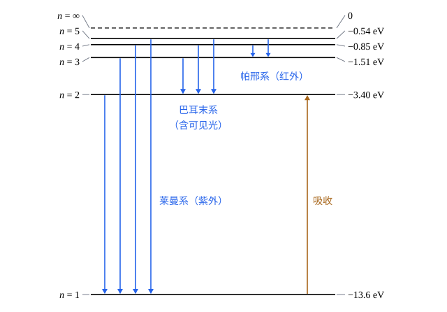

## 这一节要回答的问题

氢原子的谱线（spectral line）满足:term[里德伯公式]{id="physics.quantum-mechanics.rydberg-formula"}（Rydberg formula），可按经典电磁学，绕核的电子不到一纳秒就会落到原子核（nucleus）上。玻尔（Niels Bohr）怎样用三条假设让原子稳定，又算出了:term[里德伯常量]{id="physics.quantum-mechanics.rydberg-constant"}（Rydberg constant）？

## 讲解

### 玻尔的三条假设

::anchor{id="def-bohr-model"}
1913 年，玻尔在:term[原子的核式结构模型]{id="physics.quantum-mechanics.nuclear-model"}（nuclear model of the atom）上加了下面三条假设，其余照用牛顿力学和库仑定律（Coulomb's law），这叫作:term[玻尔模型]{id="physics.quantum-mechanics.bohr-model"}（Bohr model）。

为什么这样定义：只改非改不可的地方，其余照用经典力学，才算得出轨道和能量。边界情况：电子仍被看成沿轨道运动的质点。

::anchor{id="def-stationary-state"}
假设一：电子只能在一些特定的圆轨道上绕核运动，这时原子的能量确定，不辐射电磁波（electromagnetic wave）；这样的状态叫作:term[定态]{id="physics.quantum-mechanics.stationary-state"}（stationary state）。

为什么这样定义：按经典电磁学，绕核的电子会辐射（见[拉莫尔公式](lesson:physics.electromagnetism.larmor-formula)），玻尔干脆假定定态不辐射，原子才稳定。边界情况：定态里电子仍在运动，「定」的是能量。

::anchor{id="def-quantization-condition"}
假设二：电子绕核的角动量（angular momentum）只能取$L=n\hbar$，$n=1,2,3,\dots$，这叫作:term[玻尔量子化条件]{id="physics.quantum-mechanics.bohr-quantization-condition"}（Bohr quantization condition），其中$\hbar=\frac h{2\pi}\approx1.055\times10^{-34}\,\mathrm{J\cdot s}$叫作:term[约化普朗克常量]{id="physics.quantum-mechanics.reduced-planck-constant"}（reduced Planck constant）。

为什么这样定义：$\hbar$和角动量的单位相同，这样选才对得上:term[里德伯公式]{id="physics.quantum-mechanics.rydberg-formula"}（下面）。边界情况：$n$不能取 0，$L=0$时电子沿直线穿过原子核，没有圆轨道。

::anchor{id="def-transition"}
假设三：原子从一个定态变到另一个定态，叫作:term[跃迁]{id="physics.quantum-mechanics.transition"}（transition）。把$L=n\hbar$的定态的能量记作$E_n$，从$E_{n_2}$跃迁到较低的$E_{n_1}$时放出一个:term[光子]{id="physics.quantum-mechanics.photon"}（photon），反过来吸收一个，光子的频率满足$h\nu=E_{n_2}-E_{n_1}$，这叫作频率条件（frequency condition）。

为什么这样定义：这就是能量守恒，也是[氢原子光谱](lesson:physics.quantum-mechanics.hydrogen-spectrum)里光子能量为两项之差的原因，[激光](lesson:physics.optics.lasers)用的也是它。边界情况：光子的频率一般不等于电子绕核转动的频率，经典理论却以为两者相等（第 5 题）。

### 能级

::anchor{id="thm-bohr-levels"}
定理：原子核不动，电子在库仑力作用下绕核做圆周运动，并满足:term[玻尔量子化条件]{id="physics.quantum-mechanics.bohr-quantization-condition"}时，第$n$个:term[定态]{id="physics.quantum-mechanics.stationary-state"}的轨道半径$r_n=n^2a_0$，$a_0=\frac{4\pi\varepsilon_0\hbar^2}{m_{\mathrm e}e^2}$，能量$E_n=-\frac{m_{\mathrm e}e^4}{2(4\pi\varepsilon_0)^2\hbar^2n^2}$，约为$-\frac{13.6\,\mathrm{eV}}{n^2}$，$m_{\mathrm e}$是电子的质量（[电势](lesson:physics.electromagnetism.electric-potential)例 2 写作$m_e$）。

证明思路：在[有心力与有效势](lesson:physics.newtonian-mechanics.central-forces#thm-orbit-types)的定理里，把$k$取$\frac{e^2}{4\pi\varepsilon_0}$、$m$取$m_{\mathrm e}$、$L$取$n\hbar$：圆轨道的半径$\frac{L^2}{mk}$就是$r_n$，有效势（effective potential）的最小值$-\frac{mk^2}{2L^2}$就是$E_n$，也可写成$-\frac{e^2}{8\pi\varepsilon_0r_n}$，同[拉莫尔公式](lesson:physics.electromagnetism.larmor-formula)例 2。

::anchor{id="def-bohr-radius"}
$a_0\approx5.29\times10^{-11}\,\mathrm m$叫作:term[玻尔半径]{id="physics.quantum-mechanics.bohr-radius"}（Bohr radius），它是$n=1$的轨道半径。

为什么这样定义：它定下了原子大小的尺度。边界情况：这是原子核不动时的值，计入原子核的运动，电子和质子的距离还要乘$1+\frac{m_{\mathrm e}}{m_{\mathrm p}}$（见下面），$m_{\mathrm p}$是质子的质量。

::anchor{id="def-energy-level"}
定态的能量$E_1,E_2,E_3,\dots$叫作原子的:term[能级]{id="physics.quantum-mechanics.energy-level"}（energy level），给定态编号的$n$叫作:term[量子数]{id="physics.quantum-mechanics.quantum-number"}（quantum number）；$n=1$的定态能量最低，叫作:term[基态]{id="physics.quantum-mechanics.ground-state"}（ground state），其余的叫作:term[激发态]{id="physics.quantum-mechanics.excited-state"}（excited state）。

为什么这样定义：能量只取这些分立的值，画成一组横线最直观（几何图像）。边界情况：能级都是负的，因为取电子在无穷远处静止时为零，负号表示束缚。

由$m_{\mathrm e}v_nr_n=n\hbar$，电子的速率$v_n=\frac{v_1}n$，$v_1\approx2.19\times10^6\,\mathrm{m/s}$，约为光速的$\frac1{137}$，不考虑相对论是合理的。

::anchor{id="def-ionization-energy"}
把电子从基态移到无穷远处至少要给的能量，叫作氢原子的电离能（ionization energy），按定理是$-E_1\approx13.606\,\mathrm{eV}$。

为什么这样定义：它能直接测量，计入原子核的运动（见下面）算出$13.598\,\mathrm{eV}$，和实测相符；[质能关系](lesson:physics.special-relativity.mass-energy)那一节说的氢原子的$13.6\,\mathrm{eV}$，就是这个实测的约$13.598\,\mathrm{eV}$。边界情况：给的能量更多时，多出的部分成为电子离开后的动能。

### 里德伯常量的由来

由频率条件和$E_n$，

$$
\frac1\lambda=\frac{E_{n_2}-E_{n_1}}{hc}=R_\infty\Bigl(\frac1{n_1^2}-\frac1{n_2^2}\Bigr),\qquad R_\infty=\frac{m_{\mathrm e}e^4}{8\varepsilon_0^2h^3c}.
$$

这正是:term[里德伯公式]{id="physics.quantum-mechanics.rydberg-formula"}，$R_\infty\approx1.097\,373\times10^7\,\mathrm{m^{-1}}$全由基本常量算出，下标$\infty$表示原子核不动，好像质量无穷大。可它比实测的:term[里德伯常量]{id="physics.quantum-mechanics.rydberg-constant"}$R_{\mathrm H}$大$0.054\%$，远超测量误差。

原因是原子核也在动。由[二体问题与约化质量](lesson:physics.newtonian-mechanics.two-body-problem)，电子和质子的相对运动就像约化质量（reduced mass）为$\mu=\frac{m_{\mathrm e}m_{\mathrm p}}{m_{\mathrm e}+m_{\mathrm p}}$的质点绕不动的力心转，质心系（center-of-mass frame）里的总角动量是$\mu\vb r\times\vb v$，:term[玻尔量子化条件]{id="physics.quantum-mechanics.bohr-quantization-condition"}管的应当是它。所以各式的$m_{\mathrm e}$都换成$\mu$（不是线密度），$R_{\mathrm H}=\frac{R_\infty}{1+m_{\mathrm e}/m_{\mathrm p}}$，对上了实测（例 1）。

### 玻尔模型的局限

:term[玻尔模型]{id="physics.quantum-mechanics.bohr-model"}算不出谱线的强弱，对氦这样有两个以上电子的原子也算不对。计入相对论效应和原子内部的强磁场（见[毕奥-萨伐尔定律](lesson:physics.electromagnetism.biot-savart)例 2），谱线还分成靠得很近的几条（精细结构，fine structure，见[氢原子的精细结构](lesson:physics.quantum-mechanics.fine-structure)），更细的还有超精细结构（hyperfine structure）。「轨道」只是一幅图像，:term[定态]{id="physics.quantum-mechanics.stationary-state"}为什么不辐射，到[氢原子的能级](lesson:physics.quantum-mechanics.hydrogen-energy-levels)以后才有解释。

## 几何图像

:term[能级]{id="physics.quantum-mechanics.energy-level"}按比例画，越往上越密，都挤向$E=0$。向下的箭头是发射，箭头越长，:term[光子]{id="physics.quantum-mechanics.photon"}的能量越大，所以:term[莱曼系]{id="physics.quantum-mechanics.spectral-series"}（Lyman series）在紫外、帕邢系（Paschen series）在红外。向上的箭头是吸收：要把原子送到另一个:term[定态]{id="physics.quantum-mechanics.stationary-state"}，光子的能量必须正好是两个能级之差。[激光](lesson:physics.optics.lasers)的能级图把:term[基态]{id="physics.quantum-mechanics.ground-state"}记作$E_0$，只看相对高低。

## 例题

### 例 1　$\mathrm H_\alpha$的波长和约化质量

按原子核不动的:term[玻尔模型]{id="physics.quantum-mechanics.bohr-model"}，求氢原子从$n=3$:term[跃迁]{id="physics.quantum-mechanics.transition"}到$n=2$时放出的:term[光子]{id="physics.quantum-mechanics.photon"}在真空中的波长。计入原子核的运动呢？

**为什么想到这么做**：由频率条件，$\frac1\lambda=R_\infty\bigl(\frac14-\frac19\bigr)=\frac5{36}R_\infty$。$R_\infty$和电子的质量成正比，计入原子核的运动，就是把$m_{\mathrm e}$换成$\mu$，也就是把$R_\infty$换成$R_{\mathrm H}$。

**推导**：$\lambda=\frac{36}{5R_\infty}=\frac{36}{5\times1.097\,373\times10^7}\,\mathrm m\approx656.11\,\mathrm{nm}$。换成$R_{\mathrm H}$，波长乘上$1+\frac{m_{\mathrm e}}{m_{\mathrm p}}\approx1.000\,545$，得$656.47\,\mathrm{nm}$；换到空气中是$656.29\,\mathrm{nm}$，实测空气中是$656.28\,\mathrm{nm}$，第五位的差来自精细结构等修正。

## 常见误区

- 「:term[跃迁]{id="physics.quantum-mechanics.transition"}时，电子从一条轨道一点点挪到另一条，一路连续地发光。」:term[玻尔模型]{id="physics.quantum-mechanics.bohr-model"}只管跃迁前后的两个:term[定态]{id="physics.quantum-mechanics.stationary-state"}，放出一个频率确定的:term[光子]{id="physics.quantum-mechanics.photon"}，不描述中间怎样过渡。
- 「$E_n$是负的，所以电子的动能是负的。」由$E_n=-\frac{e^2}{8\pi\varepsilon_0r_n}$，动能是$-E_n>0$，势能是$2E_n$，两者之和才是$E_n$。
